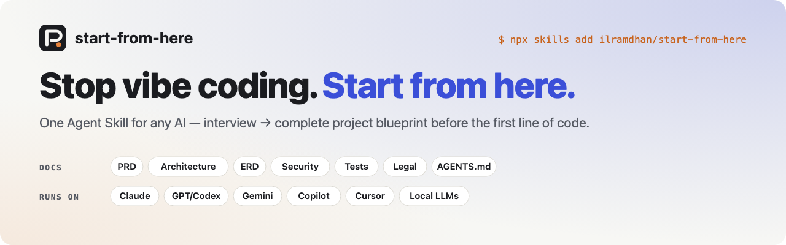
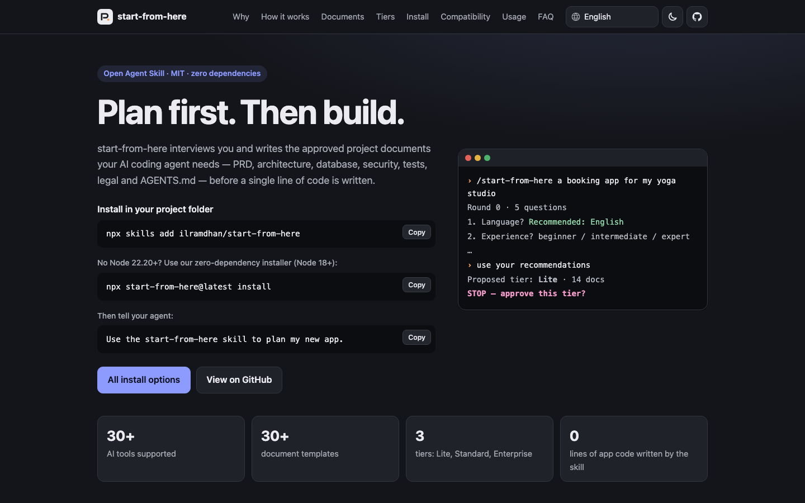
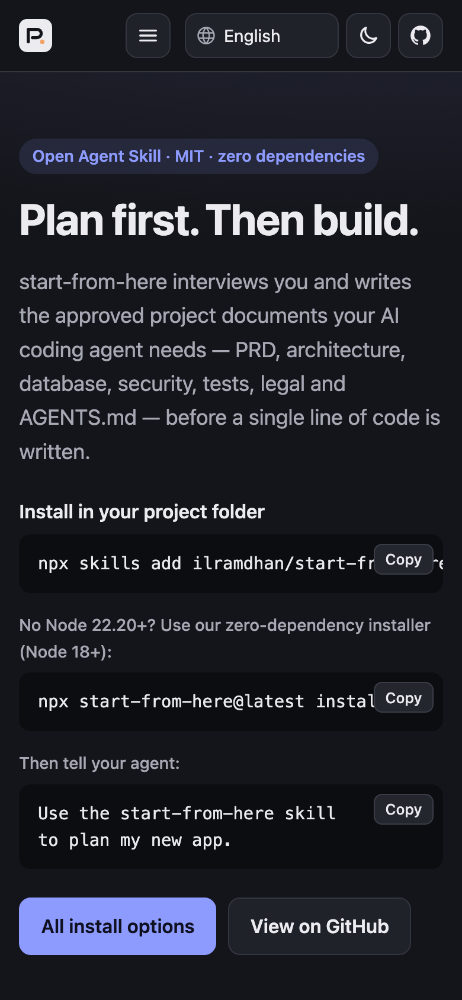
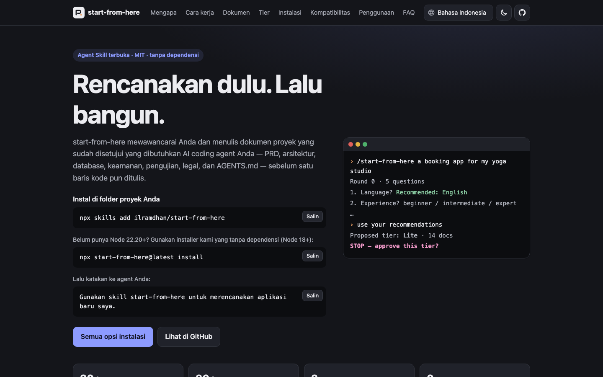
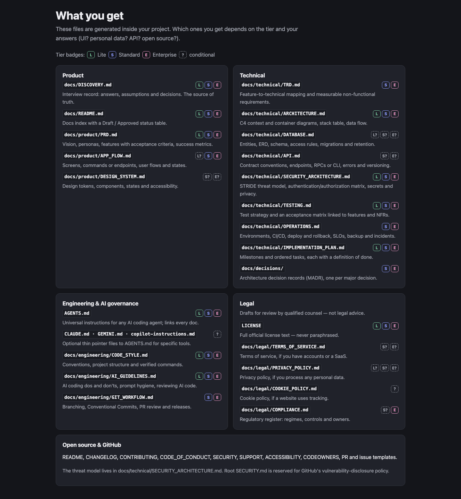

<p align="center">
  <a href="https://ilramdhan.github.io/start-from-here/">
    <picture>
      <source media="(prefers-color-scheme: dark)" srcset=".github/assets/banner-dark.svg">
      <source media="(prefers-color-scheme: light)" srcset=".github/assets/banner.svg">
      
    </picture>
  </a>
</p>

# start-from-here

<p align="center">

[](https://github.com/ilramdhan/start-from-here/actions/workflows/ci.yml)
[](https://www.npmjs.com/package/start-from-here)
[](https://www.npmjs.com/package/start-from-here#provenance)
[](LICENSE)
[](https://scorecard.dev/viewer/?uri=github.com/ilramdhan/start-from-here)
[](https://ilramdhan.github.io/start-from-here/)
[](https://agentskills.io/specification)

</p>

**Plan first, then build. One Agent Skill that interviews you and writes the approved docs your AI coding agent needs before it writes any code.**

> [!NOTE]
> **Testing status:** start-from-here follows the open Agent Skills standard and is designed to be model-agnostic, but it has been benchmarked only on a set of representative models (see [docs/TESTING-REPORT.md](docs/TESTING-REPORT.md)). Output quality depends on the model, its context window, and its tool access. Results on untested models or platforms may differ — please review every generated document, and [report issues](https://github.com/ilramdhan/start-from-here/issues/new/choose).

**Website and illustrated guide (6 languages): <https://ilramdhan.github.io/start-from-here/>**

```bash
npx skills add ilramdhan/start-from-here        # or: npx start-from-here@latest install
```

Then tell your agent: **"Use the start-from-here skill to plan my new app."**

## Screenshots

The [live site](https://ilramdhan.github.io/start-from-here/) is an illustrated guide in 6 languages, with light and dark themes.

<table>
  <tr>
    <td width="72%" valign="top"></td>
    <td width="28%" valign="top"></td>
  </tr>
  <tr>
    <td align="center"><sub>Desktop: install in one command, then tell your agent to plan.</sub></td>
    <td align="center"><sub>Mobile</sub></td>
  </tr>
  <tr>
    <td colspan="2"></td>
  </tr>
  <tr>
    <td colspan="2" align="center"><sub>Every page is translated — here in Bahasa Indonesia (<a href="https://ilramdhan.github.io/start-from-here/?lang=id">?lang=id</a>).</sub></td>
  </tr>
  <tr>
    <td colspan="2"></td>
  </tr>
  <tr>
    <td colspan="2" align="center"><sub>The document map: what gets generated in your project, by tier.</sub></td>
  </tr>
</table>

---

## Why

"Vibe coding" means asking an AI to build an app straight from a one-line idea. It feels fast, but the agent has to guess the scope, the users, the data model, the permissions, the security rules, and the conventions. Each guess becomes code, and wrong guesses get expensive to undo.

`start-from-here` puts the thinking first:

- **It interviews you** in short rounds. Every question comes with a labeled recommended default, so a beginner can answer "use your recommendation" and an expert can skip ahead.
- **It recommends, you decide.** If you haven't picked a stack, it shows 2–3 options with trade-offs and marks one as recommended. Nothing is final until you approve it.
- **It writes a consistent set of documents.** Everything uses shared IDs (`F-01`, `NFR-01`, `ADR-0001`…) and gets cross-checked before handoff.
- **It never writes application code** and never makes things up. Unknowns become `[TBD: …]`, proposals become `> **PROPOSAL:**`, and guesses become `> **ASSUMPTION:**`. It never claims your project "is compliant".
- **It hands off cleanly** with a readiness checklist and a *first implementation prompt* that works with any coding agent.

It is model-agnostic. It follows the [Agent Skills open standard](https://agentskills.io/specification) and also ships as a single pasteable prompt for chat-only tools.

## What you get

These files are generated inside **your** project. Which ones you get depends on the tier and your answers (UI? personal data? API? open source?). Tier codes: **L**ite / **S**tandard / **E**nterprise.

**Product**
```
docs/
├── DISCOVERY.md                 # interview record: answers, assumptions, decisions (source of truth)   L S E
├── README.md                    # docs index + Draft/Approved status table                              L S E
└── product/
    ├── PRD.md                   # vision, personas P-xx, features F-xx + acceptance criteria, metrics   L S E
    ├── APP_FLOW.md              # screens / commands / endpoints, flows, states                         S E (L if UI)
    └── DESIGN_SYSTEM.md         # tokens, components, states, accessibility                             S E if UI
```

**Technical**
```
docs/technical/
├── TRD.md                       # feature → technical mapping, NFR-xx with numbers                      S E
├── ARCHITECTURE.md              # C4 context/container (Mermaid), stack table, data flow                L S E
├── DATABASE.md                  # entities, ERD, schema, access rules, migrations, retention            L S E if data
├── API.md                       # contract conventions, endpoints/RPCs/CLI, errors, versioning          S E if API
├── SECURITY_ARCHITECTURE.md     # STRIDE threat model, authN/Z matrix, secrets, privacy                 S E (L short)
├── TESTING.md                   # strategy + acceptance matrix linked to F-xx / NFR-xx                  L S E
├── OPERATIONS.md                # environments, CI/CD, deploy/rollback, SLOs, backup/DR, incidents      S E
└── IMPLEMENTATION_PLAN.md       # milestones, ordered tasks with definition of done                     L S E
docs/decisions/                  # ADR index + 0001 + one MADR record per major decision                 S E (required E)
```

**Engineering & AI governance**
```
AGENTS.md                        # universal AI-agent instructions; links every doc                      L S E
CLAUDE.md / GEMINI.md / .github/copilot-instructions.md    # optional thin pointers to AGENTS.md
docs/engineering/
├── CODE_STYLE.md                # conventions, structure, verified commands                             L S E
├── AI_GUIDELINES.md             # AI coding dos & don'ts, prompt hygiene, reviewing AI code             L S E
└── GIT_WORKFLOW.md              # branching, Conventional Commits, PR review, releases                  S E
```

**Legal** (drafts for review by qualified counsel, not legal advice)
```
LICENSE                          # full official license text, never paraphrased                         L S E
docs/legal/
├── TERMS_OF_SERVICE.md          # if accounts / SaaS                                                    S E
├── PRIVACY_POLICY.md            # if any personal data                                                  S E (L if personal data)
├── COOKIE_POLICY.md             # if web + tracking                                                     optional
└── COMPLIANCE.md                # regulatory register: regimes, controls, owners                        E (S if regulated)
```

**Open-source / GitHub**
```
README.md · CHANGELOG.md · CONTRIBUTING.md · CODE_OF_CONDUCT.md · SECURITY.md · SUPPORT.md · ACCESSIBILITY.md
.github/CODEOWNERS · PULL_REQUEST_TEMPLATE.md · ISSUE_TEMPLATE/{bug_report.yml, feature_request.yml, config.yml}
```

> The threat model lives in `docs/technical/SECURITY_ARCHITECTURE.md`. Root `SECURITY.md` is reserved for GitHub's vulnerability-disclosure policy.

Full catalog with inputs and done-criteria: [`skills/start-from-here/references/document-catalog.md`](skills/start-from-here/references/document-catalog.md).

## How it works

```mermaid
flowchart LR
    P0[0 · Orient<br/>new / existing / resume] --> P1[1 · Calibrate<br/>language, experience, tier]
    P1 -->|STOP: approve tier| P2[2 · Discover<br/>rounds of 5–7 questions]
    P2 --> P3[3 · Recommend<br/>2–3 stack options]
    P3 -->|STOP: pick option| P4[4 · Confirm brief<br/>docs/DISCOVERY.md]
    P4 -->|STOP: approve brief| P5[5 · Generate<br/>docs in dependency order]
    P5 -->|STOP: approve each batch| P6[6 · Audit<br/>cross-doc consistency]
    P6 --> P7[7 · Handoff<br/>checklist + first prompt]
    P7 --> X([You build with any agent])
```



- **Gates.** The skill stops at every gate and waits for your answer.
- **Resumable.** Progress is saved to `docs/.start-from-here/STATE.md` after every step. In any tool, with any model, say `resume`.
- **Brownfield-aware.** In an existing repo it inspects manifests, CI, and docs first. It proposes section-level merges and never overwrites files.
- **Works without a filesystem.** In chat-only tools, each doc arrives as a `### path` heading plus a fenced block, 2–3 per message.

### Small context window? Use session mode

Local LLMs (8–32k), small/flash models, and chat UIs that truncate history can't hold the whole skill plus every upstream doc, so docs come out shallow or the session dies. Say `session mode` (the skill also proposes it automatically): the work is split into work packages — interview, product, architecture, data/API, security/testing, ops/plan, engineering, legal/repo, audit — one per fresh session, connected by `docs/.start-from-here/HANDOVER.md` (decisions, ID registry, open TBDs, next-session prompt). Each session loads only what it needs. See [Small context windows & session mode](docs/USAGE.md#small-context-windows--session-mode).

Quick commands: `start`, `resume`, `status`, `use your recommendations`, `skip to generation`, `audit docs`, `update <doc>`, `add <doc>`, `explain <term>`, `change tier <…>`, `session mode`, `next session`, `handoff`. See the [User manual](docs/USAGE.md).

## Tiers

| Tier | For | Interview | Review |
|---|---|---|---|
| **Lite** | Solo, indie, prototype, hackathon, internal tool | ≈ 3 rounds, 15–25 questions | 3 grouped batches |
| **Standard** | Startup MVP, OSS project, small-team product | ≈ 5 rounds, 35–60 questions | 6 batches |
| **Enterprise** | Regulated data, multiple teams, SLAs, multi-tenant, audits | ≈ 7+ rounds, 60+ questions | One doc per review |

The skill proposes a tier from what it learns and you confirm it. Any regulated-data signal (health, payments, children, finance) leads it to propose Enterprise unless you object. You can turn individual docs on or off.

## Install


| # | Channel | Command | Needs | Guide |
|---|---|---|---|---|
| 1 | Vercel `skills` CLI | `npx skills add ilramdhan/start-from-here` (`-g` global, `-a <agent>`) | Node ≥ 22.20 | [guides](docs/guides/README.md) |
| 2 | Our zero-dep installer | `npx start-from-here@latest install` | Node ≥ 18 | [CLI reference](docs/guides/README.md#our-cli-reference) |
| 3 | GitHub CLI | `gh skill install ilramdhan/start-from-here start-from-here` | gh ≥ 2.90 | [github-copilot.md](docs/guides/github-copilot.md) |
| 4 | Claude Code plugin | `/plugin marketplace add ilramdhan/start-from-here` then `/plugin install start-from-here@start-from-here` | Claude Code | [claude-code.md](docs/guides/claude-code.md) |
| 5 | Codex plugin | `codex plugin marketplace add ilramdhan/start-from-here` | Codex | [codex.md](docs/guides/codex.md) |
| 6 | Gemini CLI extension | `gemini extensions install https://github.com/ilramdhan/start-from-here` | Gemini CLI | [gemini-cli.md](docs/guides/gemini-cli.md) |
| 7 | Zip upload | Upload `dist/start-from-here.zip` | claude.ai, ChatGPT Skills (beta), Skills APIs, Open WebUI | [claude-apps.md](docs/guides/claude-apps.md) · [chatgpt.md](docs/guides/chatgpt.md) |
| 8 | Paste a prompt | `dist/start-from-here.prompt.md` (+ `dist/knowledge/`) | Any chat LLM, Custom GPT, Gem, local model | [local-and-other-llms.md](docs/guides/local-and-other-llms.md) · [gemini-app-gems.md](docs/guides/gemini-app-gems.md) |

The `dist/` files are attached to every GitHub release. You can rebuild them with `npx start-from-here@latest bundle --out dist`.

Our installer at a glance:

```bash
npx start-from-here@latest install                    # .agents/skills + .claude/skills in this project
npx start-from-here@latest install -a cursor,cline -y # specific agents
npx start-from-here@latest install --global --all     # every skill-capable agent, in your home dir
npx start-from-here@latest list-agents                # supported ids and paths (unverified ones marked)
npx start-from-here@latest doctor                     # where it's installed, versions, validity
npx start-from-here@latest uninstall --dry-run
```

It copies files by default, never overwrites without `--force`, and supports `--dry-run`.

## Supported platforms

| Support level | Platforms |
|---|---|
| **Native skill** | Claude Code, claude.ai / Claude Desktop, Claude API & Agent SDK, OpenAI Codex, ChatGPT Skills (beta), OpenAI API & Agents SDK, Gemini CLI, Google Antigravity, GitHub Copilot (CLI, cloud agent, VS Code, Visual Studio, JetBrains), Cursor, Windsurf / Devin Desktop, Cline, Roo Code, Kilo Code, JetBrains Junie, Kiro, OpenCode, Goose, Amp, Augment, Qwen Code, Mistral Vibe, Zed, Trae*, Continue*, OpenHands*, Factory Droid* |
| **Plugin / extension** | Claude Code, Codex, Gemini CLI |
| **Rules-file fallback** | Aider, Amazon Q Developer, JetBrains AI Assistant*, Jules (via `AGENTS.md`) |
| **Prompt-only** | Custom GPTs and Projects, Gemini Gems, Le Chat, Perplexity, DeepSeek, Grok, Qwen, Ollama, LM Studio, Open WebUI (also supports native skill import) |

\* Paths are known only from third-party sources and are marked `UNVERIFIED` in `list-agents`.

Full matrix, invocation syntax per tool, and a "which method should I use?" decision tree: **[docs/guides/README.md](docs/guides/README.md)**.

## Quick start

```text
You:   /start-from-here a booking app for my yoga studio

Agent: Phase 0 — new project, I can write files here.
       Round 0 (5 questions):
       1. Language for our chat and for the docs?        Recommended: English / English
       2. Your experience? beginner / intermediate / expert
       3. Who books? Only your students, or the public too?
       4. Payments online, or at the studio?              Recommended: at the studio for v1
       5. Rough size: just you, or a team?
       Unsure? Say "use your recommendations".

You:   beginner, public, at the studio for now, just me. use your recommendations for the rest.

Agent: Proposed tier: Lite (solo, no regulated data). Doc set:
       DISCOVERY, PRD, APP_FLOW, ARCHITECTURE, DATABASE, SECURITY_ARCHITECTURE (short),
       TESTING, CODE_STYLE, AI_GUIDELINES, IMPLEMENTATION_PLAN, PRIVACY_POLICY,
       AGENTS.md, README, LICENSE.
       STOP — approve this tier and list, or change it.
...
Agent: Phase 7 — Handoff. Readiness: ✅ 11 · ⚠️ 2 (open questions Q-03, Q-05) · ❌ 0
       Here is your first implementation prompt. Paste it into any coding agent.
```

## The first implementation prompt

The skill stops at handoff and gives you a prompt you can paste into **any** coding agent. That agent doesn't need this skill, because it reads `AGENTS.md` and the docs it links:

```text
Read AGENTS.md and every document it links. Summarize the approved MVP, architecture,
data and permission rules, coding conventions, and acceptance criteria. List blocking
contradictions or [TBD] items. Then propose a plan for Milestone 1, Task 1 from
docs/technical/IMPLEMENTATION_PLAN.md, with files to create and how each acceptance
criterion will be verified. Do not write code until I approve the plan.
```

Work through `IMPLEMENTATION_PLAN.md` one task at a time. When a decision changes, come back and say `update <doc>`, and the skill updates every downstream doc. Run `npx start-from-here@latest check .` at any time to find missing files, leftover placeholders, and broken links.

## Repository layout

```
start-from-here/
├── skills/start-from-here/        # THE SKILL (Agent Skills standard)
│   ├── SKILL.md                   # orchestrator (< 500 lines, self-sufficient)
│   ├── references/                # loaded on demand: workflow, question bank, stack, tiers, catalog, audit, legal…
│   ├── assets/templates/          # tech-agnostic templates mirroring the output layout
│   └── scripts/check-docs.mjs     # optional zero-dep doc checker
├── bin/cli.mjs                    # zero-dependency installer CLI (npx start-from-here)
├── lib/                           # CLI internals: agents registry, install, bundle, validate, zip
├── scripts/                       # validate-skill.mjs, build-bundle.mjs, run-tests.mjs
├── test/                          # node:test suites
├── adapters/                      # chat bootloader for non-filesystem platforms
├── dist/                          # built zip, single-file prompt, knowledge files, SHA256SUMS
├── docs/USAGE.md                  # user manual
├── docs/guides/                   # one guide per platform + compatibility matrix
├── site/                          # GitHub Pages site (vanilla HTML/CSS/JS, i18n/<lang>.json)
├── .claude-plugin/ .codex-plugin/ # plugin manifests
├── gemini-extension.json, GEMINI-EXTENSION.md, commands/   # Gemini CLI extension
└── AGENTS.md                      # instructions for AI agents developing this repo
```

## Development

Requires Node ≥ 18 and has no runtime dependencies.

```bash
npm run validate   # spec checks: frontmatter keys, name, description ≤ 200 chars, SKILL.md < 500 lines, referenced paths exist
npm run build      # rebuild dist/: zip, prompt.md, knowledge/, gpt/gem instructions, SHA256SUMS
npm test           # node:test suites for the CLI and the bundle
node bin/cli.mjs install --dir /tmp/demo --dry-run   # try the installer locally
```

`prepublishOnly` runs all three. Releases are automated with release-please: Conventional Commits → release PR → merge → npm publish (trusted publishing with provenance) plus GitHub Release assets. See [CONTRIBUTING.md › Releasing](CONTRIBUTING.md#releasing).

## Roadmap

- More localized question banks and templates (the skill already converses in any language).
- Optional domain packs (e.g. mobile store compliance, data/ML governance, game design docs).
- Verify the paths for agents still marked `UNVERIFIED` (Trae, Continue, OpenHands, Factory Droid, JetBrains AI Assistant).
- A sample generated docs set for each tier, kept as fixtures for regression tests.
- Listing on skill directories and marketplaces as they mature.

Have an idea? [Open an issue](https://github.com/ilramdhan/start-from-here/issues/new/choose).

## Contributing

Contributions are welcome: better questions, better templates, new platform support, and bug fixes. Read [CONTRIBUTING.md](CONTRIBUTING.md) and follow the [Code of Conduct](CODE_OF_CONDUCT.md). AI agents working on this repo should read [AGENTS.md](AGENTS.md).

## Security

Report vulnerabilities privately through GitHub's private vulnerability reporting. Don't open a public issue. See [SECURITY.md](SECURITY.md).

## License

[MIT](LICENSE) © 2026 ilramdhan

## Acknowledgments

- The document structure grew out of the author's own reference drafts for pre-development docs: early PRD, architecture, database, design-system, security, testing, and code-style documents, along with notes on the "six documents before vibe coding" idea. This skill generalizes them into a tiered, tech-agnostic, model-agnostic workflow.
- [Agent Skills specification](https://agentskills.io/specification) and the [AGENTS.md](https://agents.md) convention.
- [Keep a Changelog](https://keepachangelog.com/en/1.1.0/), [Semantic Versioning](https://semver.org/), [Conventional Commits](https://www.conventionalcommits.org/), [MADR](https://adr.github.io/madr/), [C4 model](https://c4model.com/), [Contributor Covenant](https://www.contributor-covenant.org/), and [Mermaid](https://mermaid.js.org/).
