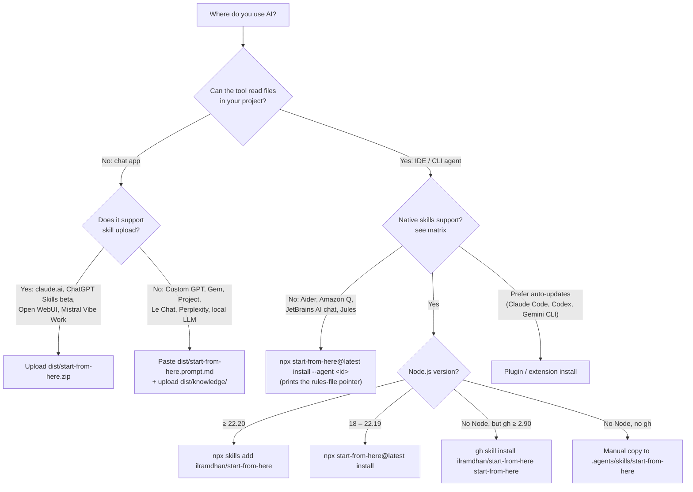

# Platform guides — start-from-here

`start-from-here` is an [Agent Skill](https://agentskills.io/specification). It interviews you, then writes approved pre-development docs (PRD, TRD, architecture, database, security, testing, AI rules, legal, GitHub files) **before any code is written**. These guides show how to install and run it on each AI tool.

For what the skill does once it is running (phases, tiers, quick commands, output files), read the [User manual](../USAGE.md).


## Universal 60-second quick start

1. Open a terminal **in your project folder** (an empty folder is fine).
2. Install the skill for every agent detected on your machine:

   ```bash
   npx skills add ilramdhan/start-from-here
   ```

   No Node 22.20+? Use our zero-dependency installer (Node 18+):

   ```bash
   npx start-from-here@latest install
   ```

3. Open your AI coding agent in that folder and type:

   ```text
   Use the start-from-here skill to plan my new app.
   ```

   (Or the native shortcut: `/start-from-here` in Claude Code, Copilot, Cursor, Junie…; `$start-from-here` in Codex.)
4. Answer the questions. Say `use your recommendations` whenever you're unsure.

No terminal or filesystem (ChatGPT, Gemini app, Le Chat, a local model)? Paste `dist/start-from-here.prompt.md` into the chat or a custom assistant. See [local-and-other-llms.md](local-and-other-llms.md).

## Compatibility matrix

Support levels:
- **Native skill**: the tool reads `SKILL.md` folders and loads the skill on demand.
- **Plugin**: also installable as a plugin or extension package.
- **Rules-file fallback**: no native skills. You point a rules or instructions file at `SKILL.md`.
- **Prompt-only**: no filesystem. You paste the flattened prompt or upload knowledge files.

| Platform | Support level | Best install method | Invocation | Guide |
|---|---|---|---|---|
| Claude Code | Native skill + Plugin | `/plugin marketplace add ilramdhan/start-from-here` or `npx skills add … -a claude-code` | `/start-from-here` | [claude-code.md](claude-code.md) |
| Claude.ai / Desktop / mobile | Native skill (upload) | Upload `dist/start-from-here.zip` in Customize › Skills | "Use the start-from-here skill…" | [claude-apps.md](claude-apps.md) |
| Claude API / Agent SDK | Native skill | `POST /v1/skills` (API) · `.claude/skills/` (SDK) | `container.skills` / SDK `skills` option | [claude-api-and-agent-sdk.md](claude-api-and-agent-sdk.md) |
| OpenAI Codex (CLI / IDE / desktop) | Native skill + Plugin | `npx skills add … -a codex` | `$start-from-here` | [codex.md](codex.md) |
| ChatGPT | Native skill (beta, business plans) / Prompt-only | Skills upload, or Custom GPT / Project | `@start-from-here` or automatic | [chatgpt.md](chatgpt.md) |
| OpenAI API / Agents SDK | Native skill | `POST /v1/skills` / `Skills(from_=…)` | shell tool environment | [openai-api-and-agents-sdk.md](openai-api-and-agents-sdk.md) |
| Gemini CLI | Native skill + Extension | `gemini extensions install https://github.com/ilramdhan/start-from-here` | "Use the start-from-here skill…" (consent prompt) | [gemini-cli.md](gemini-cli.md) |
| Google Antigravity | Native skill | `npx skills add … -a antigravity` | "Use the start-from-here skill…" | [antigravity.md](antigravity.md) |
| Gemini app (Gems) | Prompt-only | New Gem + knowledge files | Open the Gem, say "start" | [gemini-app-gems.md](gemini-app-gems.md) |
| Jules | Rules-file fallback (AGENTS.md) | Commit skill + root `AGENTS.md` pointer | Task prompt referencing the skill | [jules.md](jules.md) |
| GitHub Copilot (CLI, cloud agent, VS Code, VS, JetBrains) | Native skill | `gh skill install ilramdhan/start-from-here start-from-here` | `/start-from-here` | [github-copilot.md](github-copilot.md) |
| Cursor | Native skill | `npx skills add … -a cursor` | `/start-from-here` in Agent chat | [cursor.md](cursor.md) |
| Windsurf / Devin Desktop | Native skill | `npx skills add … -a windsurf` | `@start-from-here` | [windsurf.md](windsurf.md) |
| Cline / Roo Code / Kilo Code | Native skill | `npx start-from-here@latest install --agent cline` (or `roo`, `kilo`) | "Use the start-from-here skill…" | [cline-roo-kilo.md](cline-roo-kilo.md) |
| JetBrains Junie | Native skill | `npx skills add … -a junie` | `/start-from-here` or `$start-from-here` | [jetbrains-junie.md](jetbrains-junie.md) |
| JetBrains AI Assistant (chat) | Rules-file fallback | `.aiassistant/rules/` pointer | Mention the rule / "start" | [jetbrains-junie.md](jetbrains-junie.md#jetbrains-ai-assistant-chat) |
| Kiro (IDE / CLI) | Native skill | `npx skills add … -a kiro-cli` | "Use the start-from-here skill…" | [kiro-and-amazon-q.md](kiro-and-amazon-q.md) |
| Amazon Q Developer (IDE) | Rules-file fallback | `.amazonq/rules/` pointer | "start-from-here: start" | [kiro-and-amazon-q.md](kiro-and-amazon-q.md#amazon-q-developer-ide) |
| OpenCode, Goose, Amp, Augment, Qwen Code, Trae, Mistral Vibe | Native skill | `npx skills add … -a <agent>` | `/start-from-here` or natural language | [opencode-goose-amp-others.md](opencode-goose-amp-others.md) |
| Aider | Rules-file fallback | `aider --read …/SKILL.md` | "start" | [aider.md](aider.md) |
| Zed | Native skill | `npx skills add … -a zed` | `/start-from-here` or `@` | [zed.md](zed.md) |
| Continue | Native skill (⚠️ partial / unverified) | `npx skills add … -a continue` | natural language | [continue.md](continue.md) |
| Ollama, LM Studio, Open WebUI, Le Chat, DeepSeek, Grok, Perplexity, Qwen, Llama | Prompt-only (Open WebUI: native skill import) | Paste `dist/start-from-here.prompt.md` | "start" | [local-and-other-llms.md](local-and-other-llms.md) |

> **Small context window?** Local LLMs (8–32k), small/flash models, and chat apps that truncate history work best in **session mode**: say `session mode` and the skill splits the work into short work packages across fresh sessions, connected by `docs/.start-from-here/HANDOVER.md`. See [Small context windows & session mode](../USAGE.md#small-context-windows--session-mode).

## Which method should I use?



## Install methods at a glance

| # | Method | Command | Needs |
|---|---|---|---|
| 1 | Vercel `skills` CLI | `npx skills add ilramdhan/start-from-here` (`-g` global, `-a <agent>`) | Node ≥ 22.20 |
| 2 | Our installer | `npx start-from-here@latest install [--agent <ids>\|--all] [--global]` | Node ≥ 18 |
| 3 | GitHub CLI | `gh skill install ilramdhan/start-from-here start-from-here` | gh ≥ 2.90.0 |
| 4 | Claude Code plugin | `/plugin marketplace add ilramdhan/start-from-here` → `/plugin install start-from-here@start-from-here` | Claude Code |
| 5 | Codex plugin | `codex plugin marketplace add ilramdhan/start-from-here` | Codex |
| 6 | Gemini CLI | `gemini extensions install https://github.com/ilramdhan/start-from-here` | Gemini CLI |
| 7 | Zip upload | `dist/start-from-here.zip` | claude.ai, ChatGPT Skills, Skills APIs, Open WebUI |
| 8 | Paste prompt | `dist/start-from-here.prompt.md` (+ `dist/knowledge/`) | any chat LLM |

The `dist/` files are attached to each GitHub release and can be rebuilt locally with `npx start-from-here@latest bundle --out dist`.

### Our CLI reference

```bash
npx start-from-here@latest install [--agent <id,...>|--all] [--global] [--copy|--symlink] [--dir <project>] [--force] [--dry-run] [--yes]
npx start-from-here@latest uninstall [--agent <id,...>|--all] [--global]
npx start-from-here@latest list-agents      # ids + project/global paths (unverified paths are marked)
npx start-from-here@latest doctor           # where it is installed, versions, frontmatter check
npx start-from-here@latest bundle --out dist  # zip + prompt.md + knowledge/
npx start-from-here@latest check [dir]      # check generated docs (missing files, leftover markers, broken links, ID cross-references)
```

Agent ids: `universal`, `claude-code`, `codex`, `gemini-cli`, `antigravity`, `copilot`, `cursor`, `windsurf`, `cline`, `kiro`, `trae`, `opencode`, `goose`, `amp`, `roo`, `kilo`, `junie`, `augment`, `qwen-code`, `zed`, `continue`. Rules-file fallback ids: `aider`, `amazon-q`, `jetbrains-ai-assistant` (these print instructions; with `--yes` they write a pointer rules file).

Defaults: copy mode, never overwrites without `--force`. With no `--agent`, the installer detects agents and installs to `.agents/skills/start-from-here` (universal) plus `.claude/skills/start-from-here`.

> **Tip:** `.agents/skills/start-from-here/` is the most portable path. Copilot, Cursor, Windsurf/Devin, Roo, Kilo, Zed, Junie, OpenCode, Goose, Amp, Augment, Qwen Code, Mistral Vibe, Codex, Gemini CLI and Antigravity all read it. Claude Code, Cline, Kiro and Trae need their own folders.

## All guides

- Anthropic: [Claude Code](claude-code.md) · [Claude apps](claude-apps.md) · [Claude API & Agent SDK](claude-api-and-agent-sdk.md)
- OpenAI: [Codex](codex.md) · [ChatGPT](chatgpt.md) · [OpenAI API & Agents SDK](openai-api-and-agents-sdk.md)
- Google: [Gemini CLI](gemini-cli.md) · [Antigravity](antigravity.md) · [Gemini app & Gems](gemini-app-gems.md) · [Jules](jules.md)
- IDEs & agents: [GitHub Copilot](github-copilot.md) · [Cursor](cursor.md) · [Windsurf](windsurf.md) · [Cline, Roo, Kilo](cline-roo-kilo.md) · [JetBrains Junie](jetbrains-junie.md) · [Kiro & Amazon Q](kiro-and-amazon-q.md) · [OpenCode, Goose, Amp & others](opencode-goose-amp-others.md) · [Aider](aider.md) · [Zed](zed.md) · [Continue](continue.md)
- Chat & local: [Local and other LLMs](local-and-other-llms.md)

## Sources

- Agent Skills specification: https://agentskills.io/specification
- Vercel skills CLI: https://github.com/vercel-labs/skills (docs/agents.md, docs/commands.md)
- GitHub CLI `gh skill`: https://cli.github.com/manual/gh_skill_install · https://github.blog/changelog/2026-04-16-manage-agent-skills-with-github-cli/
- Claude Code plugins: https://code.claude.com/docs/en/plugins/install
- Codex plugins: https://developers.openai.com/plugins/build/plugins
- Gemini CLI extensions: https://geminicli.com/docs/extensions/reference/
- Per-platform sources are listed at the bottom of each guide.
