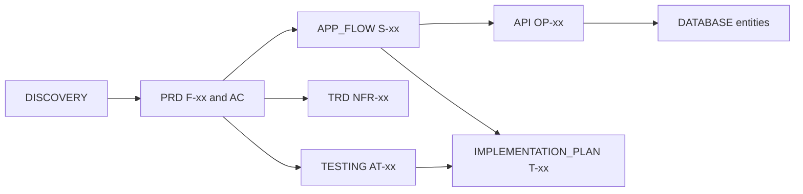

# {{project_name}} — Documentation

> **Status:** Draft · **Owner:** {{docs_owner}} · **Last updated:** {{last_updated}} · **Tier:** {{tier}} · **Related:** [AGENTS.md](../AGENTS.md) · [README.md](../README.md) · [DISCOVERY.md](DISCOVERY.md)

<!-- guidance: This is the docs index. Generate it LAST so it reflects every document that actually exists.
Only list documents that were generated for this tier (see the tier matrix). For documents deliberately
skipped, keep the row and set Status to "N/A" with a one-line reason, so readers know it was a decision,
not an omission. Every link MUST be relative and MUST resolve to an existing file. -->

<!-- guidance: Tier notes —
Lite: keep "How to read", the status table (only generated docs + N/A rows), and "Open questions". Drop "Change process" detail to one sentence.
Standard: everything below.
Enterprise: add an "Approvers" column to the status table, link the compliance register, and require a dated approval for every Approved doc. -->

## Purpose

This folder is the approved, pre-development source of truth for **{{project_name}}**: {{one_sentence_description}}.
Humans and AI coding agents read these documents before writing code. Where a document and the code disagree,
treat it as a defect and resolve it explicitly (update the doc or fix the code) rather than silently picking one.

## How to read these docs

| If you are… | Start with | Then read |
| --- | --- | --- |
| New contributor | [PRD](product/PRD.md) | [ARCHITECTURE](technical/ARCHITECTURE.md), [CODE_STYLE](engineering/CODE_STYLE.md) |
| AI coding agent | [AGENTS.md](../AGENTS.md) | [IMPLEMENTATION_PLAN](technical/IMPLEMENTATION_PLAN.md), the docs linked from the task |
| Designer | [APP_FLOW](product/APP_FLOW.md) | [DESIGN_SYSTEM](product/DESIGN_SYSTEM.md) |
| Reviewer / security | [SECURITY_ARCHITECTURE](technical/SECURITY_ARCHITECTURE.md) | [DATABASE](technical/DATABASE.md), [API](technical/API.md) |
| Operator / SRE | [OPERATIONS](technical/OPERATIONS.md) | [ARCHITECTURE](technical/ARCHITECTURE.md) |

Dependency order (upstream documents win on conflict until the conflict is resolved):
`DISCOVERY → PRD → APP_FLOW → DESIGN_SYSTEM → TRD → ARCHITECTURE → ADRs → DATABASE → API → SECURITY_ARCHITECTURE → TESTING → OPERATIONS → engineering/* → IMPLEMENTATION_PLAN → legal/*`

## Document status

<!-- guidance: Status values: Draft | In review | Approved | N/A. "Approved" requires a named approver and a date.
Never mark a document Approved on the user's behalf. Remove rows for documents not in the output layout. -->

| Area | Document | Purpose | Status | Owner | Last updated |
| --- | --- | --- | --- | --- | --- |
| Discovery | [DISCOVERY.md](DISCOVERY.md) | Interview record, decisions, open questions | {{status}} | {{owner}} | {{date}} |
| Product | [PRD.md](product/PRD.md) | What we build and why; features F-xx | {{status}} | {{owner}} | {{date}} |
| Product | [APP_FLOW.md](product/APP_FLOW.md) | Screens / commands / endpoints and flows | {{status}} | {{owner}} | {{date}} |
| Product | [DESIGN_SYSTEM.md](product/DESIGN_SYSTEM.md) | Tokens, components, accessibility | {{status}} | {{owner}} | {{date}} |
| Technical | [TRD.md](technical/TRD.md) | Technical requirements, NFR-xx, integrations | {{status}} | {{owner}} | {{date}} |
| Technical | [ARCHITECTURE.md](technical/ARCHITECTURE.md) | Structure, stack, boundaries, data flow | {{status}} | {{owner}} | {{date}} |
| Technical | [DATABASE.md](technical/DATABASE.md) | Data model, access rules, migrations, retention | {{status}} | {{owner}} | {{date}} |
| Technical | [API.md](technical/API.md) | Interface contract and conventions | {{status}} | {{owner}} | {{date}} |
| Technical | [SECURITY_ARCHITECTURE.md](technical/SECURITY_ARCHITECTURE.md) | Threat model, authN/Z, privacy engineering | {{status}} | {{owner}} | {{date}} |
| Technical | [TESTING.md](technical/TESTING.md) | Test strategy, acceptance matrix, release gates | {{status}} | {{owner}} | {{date}} |
| Technical | [OPERATIONS.md](technical/OPERATIONS.md) | Environments, CI/CD, SLOs, incidents | {{status}} | {{owner}} | {{date}} |
| Technical | [IMPLEMENTATION_PLAN.md](technical/IMPLEMENTATION_PLAN.md) | Milestones and ordered tasks | {{status}} | {{owner}} | {{date}} |
| Engineering | [CODE_STYLE.md](engineering/CODE_STYLE.md) | Conventions and verified commands | {{status}} | {{owner}} | {{date}} |
| Engineering | [AI_GUIDELINES.md](engineering/AI_GUIDELINES.md) | Rules for AI-assisted development | {{status}} | {{owner}} | {{date}} |
| Engineering | [GIT_WORKFLOW.md](engineering/GIT_WORKFLOW.md) | Branching, commits, reviews, releases | {{status}} | {{owner}} | {{date}} |
| Decisions | [decisions/](decisions/README.md) | Architecture Decision Records (ADR-xxxx) | {{status}} | {{owner}} | {{date}} |
| Legal | [legal/](legal/) | Terms, privacy, cookies, compliance register; B2B contract skeletons (MSA, DPA, BAA) if triggered | {{status}} | {{owner}} | {{date}} |

Repository-level policies live at the root: [README](../README.md), [CONTRIBUTING](../CONTRIBUTING.md),
[SECURITY](../SECURITY.md) (vulnerability disclosure), [CHANGELOG](../CHANGELOG.md), [LICENSE](../LICENSE).
<!-- guidance: Remove root links for files that were not generated. -->

## Conventions used in these docs

- **IDs:** personas `P-01`, user stories `US-01`, features `F-01`, non-functional requirements `NFR-01`, risks `R-01`, open questions `Q-01`, decisions `ADR-0001`. Reference by ID; never renumber an ID once published (mark it *Withdrawn* instead).
- **Markers:** `[TBD: question — owner]` = unknown; `> **PROPOSAL:**` = awaiting approval; `> **ASSUMPTION:**` = believed true, not confirmed.
- **Test status:** `Not run` is never the same as `Passed`.
- **Diagrams:** Mermaid code blocks, rendered natively by GitHub and most Markdown viewers.
- **No secrets:** documents name secrets and environment variables; they never contain values.

## Open questions (roll-up)

<!-- guidance: Summarize blocking questions only; the full log lives in DISCOVERY.md. Write "None" if there are none. -->

| ID | Question | Blocks | Owner | Needed by |
| --- | --- | --- | --- | --- |
| Q-{{nn}} | {{question}} | {{doc_or_milestone}} | {{owner}} | {{date_or_milestone}} |

## Change process

1. Propose the change (issue or PR) and name the affected IDs (e.g. `F-03`, `NFR-02`).
2. Update every affected document in the same change; check downstream docs in dependency order.
3. Record significant technical decisions as a new ADR in [decisions/](decisions/README.md); never edit an accepted ADR's decision — supersede it.
4. Re-set changed docs to **In review** until re-approved; update this table and the date.

## Traceability at a glance

<!-- guidance: Standard+ (Lite: optional). Counts are taken from the generated docs during the Phase 6 audit; write "pending" before the audit. Never estimate a count. -->

| Item | Defined in | Count | Fully traced? |
| --- | --- | --- | --- |
| Features (Must / Should / Could) | [PRD §7](product/PRD.md#7-features) | {{n_must}} / {{n_should}} / {{n_could}} | {{yes_or_gaps_listed}} |
| Acceptance criteria | PRD §7.2 | {{n}} | {{every_AC_has_a_test}} |
| Screens / commands | [APP_FLOW](product/APP_FLOW.md) | {{n}} | {{every_S_has_F}} |
| Tests (AT / SEC / PERF / A11Y) | [TESTING](technical/TESTING.md) | {{n}} | {{every_Must_AC_covered}} |
| Tasks | [IMPLEMENTATION_PLAN](technical/IMPLEMENTATION_PLAN.md) | {{n}} | {{every_Must_F_has_task}} |

## Delivery phases

<!-- guidance: One line per phase from IMPLEMENTATION_PLAN §2; keep names identical. Lite: list only the phases kept. -->

| Phase | Goal | Status |
| --- | --- | --- |
| M0 Foundations | Repo, tooling, CI, environments | Not started |
| M1 Data & auth | Schema, identity, permissions | Not started |
| M2 First vertical slice | One Must journey end to end | Not started |
| M3 Core features | All Must features | Not started |
| M4 Secondary features | Should features | Not started |
| M5 Hardening | Security, accessibility, performance, observability | Not started |
| M6 Release / launch | Production release with rollback | Not started |
| M7 Post-launch | KPIs, stabilization, next backlog | Not started |

## Definition of done

- [ ] Every generated document is listed with a working relative link; skipped documents show `N/A` with a reason.
- [ ] Status, owner, and date are filled for each row; nothing is marked Approved without the user's approval.
- [ ] Blocking open questions are rolled up with owners.
- [ ] No `{{placeholders}}` or guidance comments remain.

### Completeness self-check
<!-- guidance: Tick every box before presenting. Fix, or write "N/A — reason" next to the box. -->
- [ ] Every doc in the tier matrix appears exactly once; generated ones link to existing files.
- [ ] Statuses equal each doc's status header; dates are real.
- [ ] Traceability counts come from the docs (or say `pending`), not estimates.
- [ ] Delivery phases match IMPLEMENTATION_PLAN §2 names.
- [ ] No link points to a file that does not exist.
