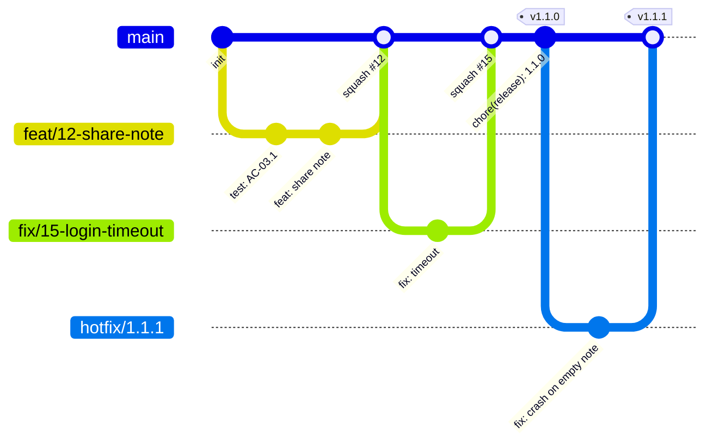
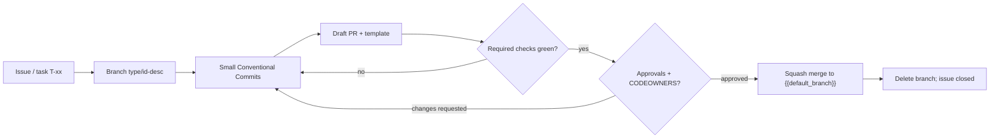
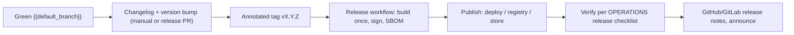

# Git Workflow — {{project_name}}

> **Status:** Draft · **Owner:** {{owner}} · **Last updated:** {{yyyy_mm_dd}} · **Tier:** {{tier}} · **Related:** [CONTRIBUTING](../../CONTRIBUTING.md), [CODE_STYLE](CODE_STYLE.md), [AI_GUIDELINES](AI_GUIDELINES.md), [OPERATIONS](../technical/OPERATIONS.md), [CHANGELOG](../../CHANGELOG.md)

<!-- guidance: Purpose: how code moves from idea to release. Choose ONE branching model with the user (recommend trunk-based for most
teams). Every rule here must be enforceable in the hosting platform (GitHub/GitLab/Bitbucket/Gitea) — name the setting. Do not claim
branch protection or signing is enabled unless confirmed; write "To configure" otherwise.
Tier notes — Lite (solo): trunk-based, Conventional Commits, tags + CHANGELOG; skip CODEOWNERS, required reviews, merge queue.
Standard: all sections. Enterprise: signed commits required, ≥2 reviewers for protected paths, merge queue, release approvals,
audit trail of releases, separation of duties (author ≠ approver ≠ deployer where required by COMPLIANCE.md). -->

<!-- guidance: Inputs you MUST read: DISCOVERY (TEA-03/04/07, OPS-01/07, OSS-05/06), OPERATIONS §3 pipeline, TESTING §8 gates,
CODE_STYLE §12/§13, AI_GUIDELINES §13, CONTRIBUTING and PR template drafts. Coverage rules (MANDATORY):
- §1 has a gitGraph of the chosen model (+ ASCII fallback). §5 lists every blocking gate from TESTING §8 with the same names.
- §10 states one release approach (manual or a named automation) and the exact tag format; §12 hotfix flow fits the chosen model.
- Every protection in §7 is "Configured on <date>" or "To configure" — never assumed. Self-review: references/governance-guide.md §9. -->

## 1. Branching model

| Model | How it works | Best for | Trade-offs |
|---|---|---|---|
| **Trunk-based (recommended)** | Short-lived branches (≤ 2 days) off `main`, merged via PR; feature flags hide unfinished work; release from tags | Most teams with CI; continuous delivery; SaaS | Needs good tests and feature flags |
| GitHub Flow | Branch → PR → merge to `main` → deploy | Small teams, web apps | Similar to trunk-based, less emphasis on branch lifetime |
| Release branches | Trunk-based + `release/x.y` branches for stabilization and backports | Libraries, mobile apps, on-prem with multiple supported versions | Backport overhead |
| Git Flow | `develop` + `feature/*` + `release/*` + `hotfix/*` | Scheduled, infrequent releases | Long-lived branches, merge conflicts; generally discouraged for CD |

**Chosen model:** {{branching_model}} — rationale: {{branching_rationale}} <!-- record as an ADR if Standard/Enterprise -->

### 1.1 Branching diagram
<!-- guidance: Draw the CHOSEN model. Example: trunk-based with short-lived branches, a tagged release, and a hotfix. -->


ASCII fallback:

```text
main  o----------o(squash #12)----o(squash #15)----o v1.1.0 ----------o v1.1.1
       \        /                 \              /         \          /
 feat/12 o--o--o           fix/15  o------------o    hotfix  o--------o
```

- Default branch: `{{default_branch}}`
- Branch naming: `{{branch_naming_pattern}}` <!-- e.g. type/short-description or type/ISSUE-123-short-description: feat/123-login-rate-limit, fix/payment-timeout, docs/adr-0004 -->

## 2. Commit messages — Conventional Commits 1.0.0

Format ([spec](https://www.conventionalcommits.org/en/v1.0.0/)):

```text
<type>[optional scope][!]: <description>

[optional body]

[optional footer(s)]
```

| Type | Use for | SemVer effect |
|---|---|---|
| `feat` | New user-facing capability | MINOR |
| `fix` | Bug fix | PATCH |
| `docs` | Documentation only | none |
| `refactor` | Code change without behavior change | none |
| `perf` | Performance improvement | PATCH |
| `test` | Tests only | none |
| `build` / `ci` | Build system, dependencies, CI config | none |
| `chore` | Maintenance not touching src/tests | none |
| `revert` | Reverts a previous commit | depends |

- Breaking changes: `!` after type/scope **and/or** a `BREAKING CHANGE: <explanation>` footer → MAJOR.
- Description: imperative mood, lower case, no trailing period, ≤ 72 chars. Scopes: {{allowed_scopes}}.
- Footers: `Refs: #123`, `Closes #123`, `Signed-off-by:` (if DCO), AI disclosure trailer per [AI_GUIDELINES §13](AI_GUIDELINES.md#13-disclosure-and-attribution).
- Enforcement: {{commit_lint_tool}} <!-- e.g. commitlint, cocogitto, conform, or "PR title check only" or "Not configured" -->

Examples: `feat(auth): add passkey sign-in` · `fix(api)!: return 404 for missing tenant` · `docs: add ADR-0003 for queue choice`

Full example with body and footers:

```text
feat(sharing): let owners share a note by email

Owners can invite a registered user; recipients see the note under
"Shared with me". Non-owners get a permission error (AC-03.2).

Refs: F-03, T-07
Closes #42
Assisted-by: {{ai_tool_name}}
```

| DO | DON'T |
|---|---|
| One logical change per commit; message explains why | `wip`, `fix stuff`, `update`, mixed unrelated changes |
| Reference IDs/issues in footers | Put secrets, customer names, or exploit details in messages |
| Mark breaking changes with `!` and a `BREAKING CHANGE:` footer | Hide breaking changes in a `fix:` or `chore:` |

## 3. Pull requests

- One logical change per PR; target ≤ {{max_pr_lines}} changed lines (excluding generated files and lockfiles). Split larger work behind flags.
- PR title follows Conventional Commits (it becomes the squash commit).
- Fill in the [PR template](../../.github/PULL_REQUEST_TEMPLATE.md): summary, linked issue/`F-xx`, test evidence, risk, AI disclosure.
- Draft PRs for early feedback; mark ready only when checks pass.
- Reviews: at least {{required_approvals}} approval(s); CODEOWNERS approval for owned paths; author may not approve their own PR.
- Review SLA: first response within {{review_sla}}. Reviewers use the [CODE_STYLE checklist](CODE_STYLE.md#12-review-checklist).
- Resolve all conversations before merge; re-request review after significant changes (stale approvals dismissed).

### 3.1 Change flow (commit → PR → merge)


ASCII fallback: `issue → branch → commits → draft PR → checks green? (no → fix) → review approved? (no → fix) → squash merge → delete branch`.

### 3.2 PR size guide
| Size (changed lines, excl. generated) | Expectation |
|---|---|
| ≤ 200 | Ideal; review within SLA |
| 200–{{max_pr_lines}} | Acceptable with clear description and commits |
| > {{max_pr_lines}} | Split (stacked PRs or flags) unless approved by {{owner}} |

## 4. CODEOWNERS

[`.github/CODEOWNERS`](../../.github/CODEOWNERS) maps paths to required reviewers. Combine with branch protection "Require review from Code Owners". Keep owners as teams (`@org/team`) rather than individuals where possible, and protect the CODEOWNERS file itself.

## 5. Required checks

| Check | Command / workflow | Required? |
|---|---|---|
| Build | `{{build_command}}` | {{yes_no}} |
| Tests | `{{test_command}}` | {{yes_no}} |
| Lint + format check | `{{lint_command}}` | {{yes_no}} |
| Type check | `{{typecheck_command}}` | {{yes_no}} |
| Security scan (SAST / dependency / secret scanning) | {{security_scan_tool}} | {{yes_no}} |
| Commit/PR title lint | {{commit_lint_tool}} | {{yes_no}} |

<!-- guidance: Only list workflows that exist or are planned in OPERATIONS.md; mark planned ones "To configure". -->

## 6. Merge strategy

- **Recommended:** squash merge (one Conventional Commit per PR on `{{default_branch}}`; linear history). Alternatives: rebase merge (keeps granular commits; requires clean commits) or merge commit (preserves branch history; noisier).
- Chosen: {{merge_strategy}}. Disable the other merge methods in repository settings.
- Delete branches after merge. Use a merge queue if CI is slow or main breaks from concurrent merges: {{merge_queue}}.

## 7. Protected branches

Configure on `{{default_branch}}` (and `release/*` if used) via branch protection rules or rulesets:

- [ ] Require pull request before merging; required approvals: {{required_approvals}}; require Code Owner review
- [ ] Dismiss stale approvals on new commits
- [ ] Require status checks (§5) to pass and branch to be up to date
- [ ] Require conversation resolution
- [ ] Require linear history (if squash/rebase)
- [ ] Require signed commits (§8) — {{yes_no}}
- [ ] Block force pushes and deletions
- [ ] Restrict who can push / bypass: {{bypass_actors}}

Status: {{protection_status}} <!-- "Configured on YYYY-MM-DD" or "To configure" — never claim it is enabled if unverified -->

## 8. Signed commits

- Policy: {{signing_policy}} <!-- required / encouraged / not required -->
- Supported: GPG, SSH (`git config gpg.format ssh`), or S/MIME/gitsign (Sigstore). Register signing keys with the hosting platform so commits show as verified.
- Developer Certificate of Origin (DCO) sign-off (`git commit -s`): {{dco_policy}}.

## 9. Versioning — Semantic Versioning 2.0.0

`MAJOR.MINOR.PATCH` ([semver.org](https://semver.org/)): MAJOR = incompatible API change, MINOR = backward-compatible feature, PATCH = backward-compatible fix. Pre-releases: `1.2.0-rc.1`. Before `1.0.0`, the public API is unstable and MINOR may break.

- What counts as the public API: {{public_api_definition}} <!-- e.g. HTTP API v1, CLI flags, exported package symbols, config file format -->
- For apps without a public API, SemVer still communicates release impact; CalVer (`YYYY.MM.N`) is an alternative — record the choice in an ADR.

## 10. Releases and tagging

1. Ensure `{{default_branch}}` is green.
2. Move `Unreleased` entries in [CHANGELOG.md](../../CHANGELOG.md) under the new version and date.
3. Bump version in {{version_files}}.
4. Create an annotated (signed if required) tag: `git tag -s v{{version}} -m "v{{version}}"` (tags are `vMAJOR.MINOR.PATCH`).
5. Push tag → release workflow builds, publishes, and creates release notes: {{release_workflow}}.
6. Verify deployment/publication per [OPERATIONS](../technical/OPERATIONS.md).

Automation option: {{release_automation}} <!-- e.g. release-please, semantic-release, changesets, goreleaser, cargo-release, or "manual" -->

### 10.1 Release flow


ASCII fallback: `green main → changelog + bump → tag vX.Y.Z → build/sign/SBOM → publish → verify → release notes`.

### 10.2 Release automation options
| Tool | How it works | Best for | Notes |
|---|---|---|---|
| Manual | Human edits CHANGELOG, bumps version, tags | Small projects, infrequent releases | Use the §10 steps as a checklist |
| release-please | Bot opens/updates a "release PR" from Conventional Commits; merging it tags and creates the release | Teams wanting a human gate before each release; monorepos | Requires Conventional Commits; CHANGELOG generated from commits |
| semantic-release | Fully automated: analyzes commits on merge, computes version, tags, publishes, writes notes | Libraries/packages with continuous release | No human gate; strict commit discipline needed |
| changesets | Contributors add a changeset file per PR; a release PR aggregates them | JS/TS monorepos | Human-written change notes |
| goreleaser / cargo-release / platform tools | Language-specific build + publish on tag | Go binaries, Rust crates | Combine with any versioning approach above |

Chosen: {{release_automation}} — record in an ADR (Standard/Enterprise). Generated changelogs are edited for human readability before release.

## 11. Changelog

Maintain [CHANGELOG.md](../../CHANGELOG.md) per [Keep a Changelog 1.1.0](https://keepachangelog.com/en/1.1.0/): sections Added, Changed, Deprecated, Removed, Fixed, Security; newest first; `Unreleased` at top. Changelogs are for humans — write user-facing impact, not commit dumps.

## 12. Hotfixes

1. Branch `hotfix/<short-description>` from the released tag (or `{{default_branch}}` in trunk-based if it is releasable).
2. Minimal fix + regression test; expedited review by {{hotfix_approvers}} (still at least one reviewer).
3. Release as a PATCH version; cherry-pick/merge back to `{{default_branch}}` and supported `release/*` branches.
4. Record in CHANGELOG; open a post-incident follow-up if user-impacting ([OPERATIONS](../technical/OPERATIONS.md)).

## 13. Things never to do

- Force-push or rewrite history on shared/protected branches.
- Commit secrets, credentials, `.env` files, large binaries, or build artifacts (use `.gitignore` / Git LFS).
- Merge with failing required checks or bypass protection without a recorded reason.

## Definition of done (this document)

- [ ] Branching model, merge strategy, and versioning chosen (ADR recorded for Standard/Enterprise).
- [ ] Required checks match real CI workflows (or marked "To configure").
- [ ] Protection/signing status stated truthfully.
- [ ] Consistent with CONTRIBUTING.md, the PR template, CODEOWNERS, and AGENTS.md.
- [ ] No `{{placeholders}}` or guidance comments remain.

### Completeness self-check
- [ ] §1 shows the chosen model as a gitGraph with an ASCII fallback, plus default branch and branch naming pattern with examples.
- [ ] §2 has the type table, a full commit example, and the enforcement tool (or "Not configured").
- [ ] §3 states PR size limit, approvals, review SLA, and links the PR template and CODE_STYLE checklist.
- [ ] §5 required checks match TESTING §8 and OPERATIONS §3 by name.
- [ ] §7 protection items each marked Configured (date) or To configure; signing and DCO policies stated.
- [ ] §10 names the release approach and tag format; §12 hotfix flow fits the branching model.
