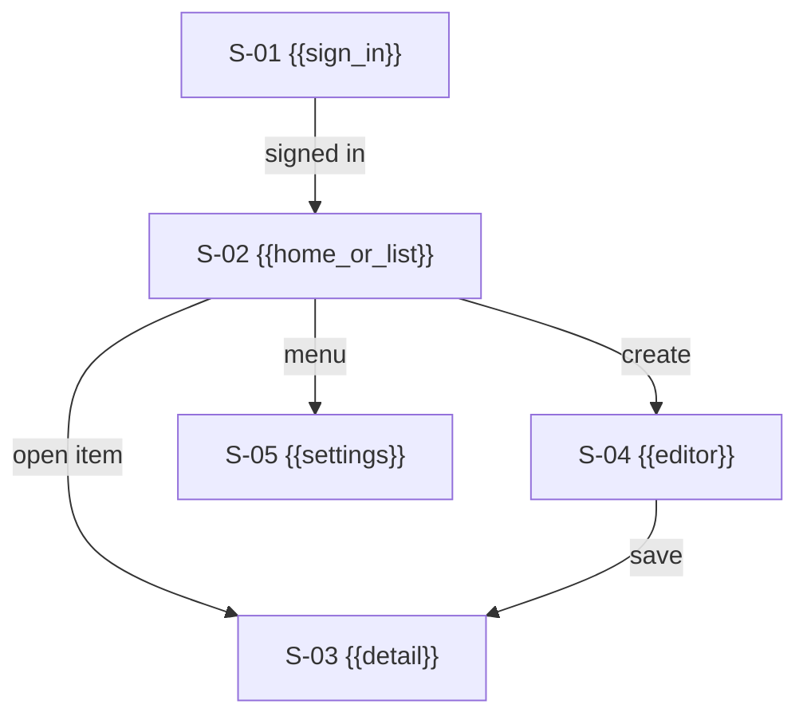
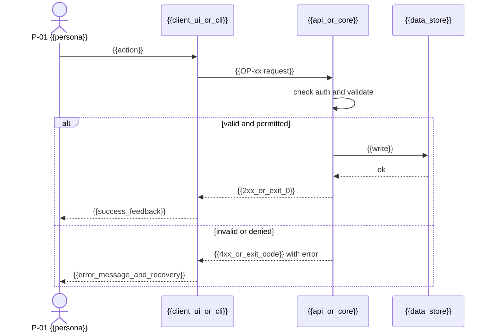

# App Flow — {{product_name}}

> **Status:** Draft · **Owner:** {{flow_owner}} · **Last updated:** {{last_updated}} · **Tier:** {{tier}} · **Related:** [PRD](PRD.md) · [DESIGN_SYSTEM](DESIGN_SYSTEM.md) · [API](../technical/API.md) · [TESTING](../technical/TESTING.md)

<!-- guidance: This document describes how a user (or calling program) moves through the product and what
happens on EVERY action, including failure. It works for any interface type — pick the vocabulary that fits:
- UI app (web/mobile/desktop/game): "screens", taps/clicks, navigation.
- CLI: "commands", flags, prompts, exit codes, stdout/stderr.
- API / SDK / library: "endpoints"/"methods", request sequences, status codes, errors.
Keep the section headings; adapt column names. Every flow MUST trace to a PRD journey (J-xx) or feature (F-xx).
BEFORE WRITING: read references/product-guide.md §4 (journeys), §11 (state machines), §12 (APP_FLOW depth), §15 (Mermaid safety).
Write the whole document in one pass. Every table cell is filled or says "N/A — reason". -->

<!-- guidance: Tier notes —
Lite: §1 entry points, §2 inventory, one Mermaid diagram of the primary journey + ASCII fallback, §4 action table for Must features only, §6 states (short), §11 state matrix for Must screens.
Standard: all sections. Minimums: every interactive F-xx has ≥ 1 S-xx; navigation map; primary journey + ≥ 2 alternate/failure flows diagrammed; ≥ 1 sequence diagram; state matrix for every S-xx.
Enterprise: add role-specific flows (one per role), audit-relevant actions flagged, deep-link/URL contract, and a state-machine diagram for complex entities (e.g. order, approval). -->

## 1. Interface type and entry points

- **Interface type(s):** {{e.g. responsive web app + iOS app / CLI / REST API + TypeScript SDK}}
- **Entry points:**

| Entry point | Example | Lands on | Auth required? |
| --- | --- | --- | --- |
| {{e.g. marketing link, app icon, deep link, `tool --help`, first API call, package import}} | {{example}} | {{screen_command_endpoint}} | {{yes_no}} |

## 2. Inventory

<!-- guidance: One row per screen / command / endpoint group. "Required data" = what must be loaded or provided to render/execute.
Minimum: every interactive F-xx appears in ≥ 1 row; every row lists ≥ 1 F-xx (a row without a feature is scope creep).
Include system screens: sign-in, error/not-found, settings, and (if roles exist) admin. CLI: include `--help`, `--version`, config/init.
OP-xx are filled when API.md exists; until then write "pending". -->

| ID | Name | Type | Purpose | Required data / input | Roles | Features | Operations |
| --- | --- | --- | --- | --- | --- | --- | --- |
| S-01 | {{e.g. Sign in / `tool login` / POST /v1/sessions}} | {{screen_command_endpoint}} | {{purpose}} | {{data}} | {{roles}} | F-01 | {{OP-xx_or_pending}} |

### 2.1 Navigation map
<!-- guidance: Standard+. All S-xx, ≤ 15 nodes per diagram (split by area). Node IDs without hyphens (S01), readable ID in the label.
CLI: draw the command tree. API: draw the resource hierarchy. Label edges with the action. -->



## 3. Flows

### 3.1 Primary journey — {{J-01 name}}

<!-- guidance: Replace the sample diagram. Use flowchart for navigation, sequenceDiagram for API/CLI call sequences.
The primary journey MUST show failure branches (validation, permission, network/dependency) and their recovery edges. -->

```mermaid
flowchart LR
    A[{{entry_point}}] --> B{Authenticated?}
    B -- No --> C[{{sign_in_or_setup}}]
    C --> D[{{main_view_or_command}}]
    B -- Yes --> D
    D -->|{{primary_action}}| E[{{processing}}]
    E -->|success| F[{{success_state}}]
    E -->|error| G[{{error_state_with_recovery}}]
    G -->|retry| D
```

ASCII fallback (required for the primary journey):

```text
[{{entry}}] --(auth?)--no--> [{{sign_in}}] --ok--> [{{main}}]
                 '--yes------------------------> [{{main}}] --{{action}}--> ({{process}})
                                                                   |--ok-----> [{{success}}]
                                                                   |--invalid-> [inline errors, input kept] --> [{{main}}]
                                                                   '--fail----> [{{error + retry}}] --> [{{main}}]
```

### 3.2 Alternate journeys
<!-- guidance: Minimum: for every Must feature, ≥ 1 alternate and ≥ 1 failure path (from PRD §6.1). Diagram the 2 most important ones (Standard+). -->
| Journey | Type | From | Path | Ends at | Features |
| --- | --- | --- | --- | --- | --- |
| {{cancel / edit / undo / skip / back / --dry-run / retry}} | {{alternate_failure}} | {{S-xx}} | {{steps}} | {{S-xx_or_state}} | {{F-xx}} |

### 3.3 Key operation sequence
<!-- guidance: Standard+. One sequenceDiagram for the most important write operation (the first vertical slice). Show auth check, validation, persistence, external call, and the error return. -->



## 4. Action specifications

<!-- guidance: One row per user/caller action in Must and Should features. Every column is required; "n/a" must be justified.
Write error messages verbatim (DESIGN_SYSTEM §6 voice). Minimum: ≥ 1 row per Must AC that involves a user action.
Examples: UI — "Tap Save"; CLI — "`tool sync --all`"; API — "POST /v1/orders". -->

| Action | Where | Trigger | Validation | Loading / progress | Success | Error (message + recovery) | Next | AC |
| --- | --- | --- | --- | --- | --- | --- | --- | --- |
| {{action}} | S-01 | {{click_command_request}} | {{rules}} | {{spinner_progress_bar_202_Accepted}} | {{toast_exit_0_201_Created}} | {{inline_error_exit_code_problem_json}} | {{S-xx}} | {{AC-xx.y}} |

## 5. Navigation and invocation rules

<!-- guidance: UI: tabs, stack/back behavior, modals, deep links/URLs, browser refresh, unsaved-changes guard.
CLI: subcommand tree, global flags, interactive vs non-interactive (CI) mode, `--json` output, exit-code table.
API: resource hierarchy, links/pagination cursors, redirects. -->

- {{rule}}
- **Deep links / URLs / command paths:** {{pattern_examples}}
- **Exit codes (CLI) / status codes (API):** {{table_or_link_to_API.md}}

## 6. System states

| State | When it occurs | What the user/caller sees | Available actions |
| --- | --- | --- | --- |
| Empty | {{no data yet}} | {{helpful empty state with primary action}} | {{actions}} |
| Loading | {{fetch_in_progress}} | {{skeleton_spinner_progress}} | {{cancel?}} |
| Partial / degraded | {{a dependency is down}} | {{message}} | {{actions}} |
| Error | {{unexpected failure}} | {{message without internals + reference id}} | {{retry_report}} |
| Permission denied | {{insufficient role}} | {{message; no data leaked}} | {{request access}} |
| Offline / no network | {{connectivity lost}} | {{cached view / queued actions / clear error}} | {{retry}} |
| Rate limited | {{too many requests}} | {{retry-after guidance}} | {{wait}} |
| Session expired | {{token expiry}} | {{re-auth prompt; preserve input}} | {{sign in}} |
| Not found | {{deleted_or_unknown_id}} | {{message + way back}} | {{go to list}} |
| Conflict | {{concurrent edit / duplicate}} | {{what changed; choices}} | {{reload_overwrite_merge}} |

## 7. First-use and onboarding

<!-- guidance: UI: sign-up, verification, permissions prompts (camera, notifications) asked in context, sample data, tour.
CLI: install, `init`, config file location, auth, first successful command. API/SDK: get key, quick-start call, sandbox. -->

1. {{step}}
2. {{step}}
- **Time to first value target:** {{e.g. "first task created < 2 min", "first successful API call < 5 min"}}

## 8. Notifications and async outcomes
| Event | Channel | Recipient | Content | Opt-out |
| --- | --- | --- | --- | --- |
| {{event}} | {{email_push_webhook_stdout}} | {{who}} | {{summary}} | {{yes_no}} |

## 9. Open questions
| ID | Question | Owner |
| --- | --- | --- |
| Q-{{nn}} | {{question}} | {{owner}} |

## 10. Traceability (flow slice)
<!-- guidance: One row per F-xx with user interaction. Mirrors PRD §18 for F → J → S → OP. Every Must F has ≥ 1 J and ≥ 1 S. -->
| Feature | Journeys | Screens / commands | Actions (§4) | Operations | Tests |
| --- | --- | --- | --- | --- | --- |
| F-01 | J-01 | S-02, S-03 | {{action_names}} | {{OP-xx_or_pending}} | {{AT-xx_or_pending}} |

## 11. Per-screen state matrix
<!-- guidance: Required (Lite: Must screens; Standard+: every S-xx; Enterprise: + role variants). Each cell says what is shown, or "N/A — reason".
CLI columns become: no results · progress · output · usage error (exit 2) · runtime error (exit 1) · auth error · non-TTY · interrupted (Ctrl-C).
API columns become: empty list · 202 pending · 2xx · 400/422 · 5xx · 401/403 · 429 · 404/409. -->
| S-xx | Empty | Loading | Populated | Validation error | Server error | Permission denied | Offline | Session expired |
| --- | --- | --- | --- | --- | --- | --- | --- | --- |
| S-01 | {{e.g. "No items yet" + Create}} | {{skeleton}} | {{content}} | {{inline_errors_or_N/A}} | {{banner + Retry + ref ID}} | {{message_or_redirect}} | {{cached + badge_or_error}} | {{re-auth, keep input}} |

## 12. Entity lifecycle in the UI
<!-- guidance: For entities with a PRD §7.4 state diagram: which screen shows each state and which actions each state allows.
Write "N/A — no stateful entities" if none. Do not redraw the PRD diagram; reference it. -->
| Entity | State | Shown on | Visual indicator | Allowed actions | Blocked actions (message) |
| --- | --- | --- | --- | --- | --- |
| {{entity}} | {{state}} | {{S-xx}} | {{badge_text}} | {{actions}} | {{action — "message"}} |

## 13. Flow dos and don'ts

| Do | Don't |
| --- | --- |
| Keep user input when an error occurs. | Clear a form or lose a draft on failure. |
| Say what happened and how to recover, in plain words. | Show stack traces, raw codes, or internal IDs only. |
| Ask for device permissions in context, at the moment of use. | Ask for every permission on first launch. |
| Make every destructive action confirmable or undoable. | Delete on a single unconfirmed click/command. |
| Support non-interactive use for CLIs (`--yes`, `--json`, exit codes). | Require a TTY prompt in CI. |
| Hide or disable actions the role cannot perform, and still enforce on the server. | Rely on hidden buttons as the only permission check. |

## Definition of done
- [ ] Every PRD journey and Must feature maps to at least one flow and inventory item.
- [ ] Every action has trigger, validation, loading, success, error, and next state defined.
- [ ] Empty, permission-denied, offline/degraded, and session-expired states are covered (or justified n/a).
- [ ] Mermaid diagrams render and match the tables.
- [ ] Onboarding / first-use path is defined with a time-to-first-value target.

### Completeness self-check
<!-- guidance: Tick every box before presenting. Fix, or write "N/A — reason" next to the box. -->
- [ ] Every interactive F-xx has ≥ 1 S-xx; every S-xx lists ≥ 1 F-xx (§2, §10).
- [ ] Navigation map (Standard+), primary journey with failure branches, and ASCII fallback are present.
- [ ] ≥ 1 sequence diagram for the key write operation (Standard+).
- [ ] Every Must feature has ≥ 1 alternate and ≥ 1 failure path in §3.2.
- [ ] §4 has a row for every Must/Should action, with verbatim error text and an AC link.
- [ ] §11 state matrix has no empty cell.
- [ ] Exit codes (CLI) or status codes (API) are listed or linked.
- [ ] Mermaid node IDs have no hyphens; no node named `end`; ≤ 15 nodes per diagram.
- [ ] No `{{placeholders}}`, guidance comments, or invented operations; unknown OP-xx say `pending`.
