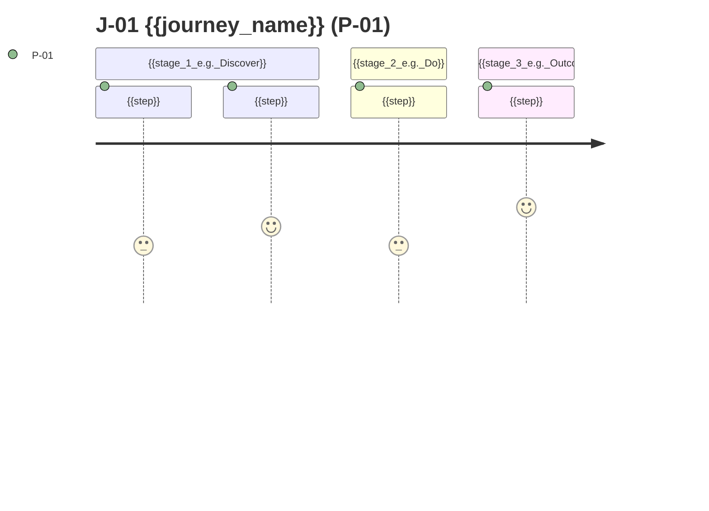

# Product Requirements Document — {{product_name}}

> **Status:** Draft · **Owner:** {{product_owner}} · **Last updated:** {{last_updated}} · **Tier:** {{tier}} · **Related:** [DISCOVERY](../DISCOVERY.md) · [APP_FLOW](APP_FLOW.md) · [TRD](../technical/TRD.md) · [TESTING](../technical/TESTING.md) · [IMPLEMENTATION_PLAN](../technical/IMPLEMENTATION_PLAN.md)

<!-- guidance: The PRD defines WHAT and WHY, never HOW (no stack, no schema). Every statement must trace to
DISCOVERY.md; anything not confirmed is [TBD: …], > **ASSUMPTION:** or > **PROPOSAL:**. Never invent market size,
competitor facts, metrics baselines, or user research. IDs (P-xx, US-xx, F-xx, R-xx, Q-xx) are permanent once
published: withdraw, never renumber. Every Must feature MUST have at least one Given/When/Then criterion with an
observable result and at least one failure/edge criterion.
BEFORE WRITING: read references/product-guide.md (procedure §0, minimum counts §1, edge-case catalog §5.4,
worked example §16). Write the WHOLE document in one pass; never stop mid-section to save space. If a section
does not apply, keep the heading and write one line "N/A — reason". -->

<!-- guidance: Tier notes —
Lite: keep §1–2, §4 (1–2 personas), §7 (features with acceptance), §8 NFR summary (3–5 lines), §9 metrics (1–3), §10 scope, §15 open questions, §18 traceability (Must only). Merge journeys into features; skip JTBD, release plan detail, glossary. Minimums: ≥ 2 AC per Must feature (1 happy + 1 negative).
Standard: all sections; release plan by milestone. Minimums: ≥ 2 personas, ≥ 3 journeys, ≥ 3 AC per Must feature (≥ 1 negative, ≥ 1 edge), North Star + ≥ 2 input KPIs + ≥ 1 guardrail, state diagram for every entity with ≥ 3 statuses.
Enterprise: add stakeholder/RACI table, regulatory requirements per feature, traceability to business objectives (OKRs), formal approval with dates, and change log (§20). Minimums: one persona per role, ≥ 4 AC per Must feature incl. a permission case, HEART or AARRR mapping. -->

## 1. Overview

| Item | Value |
| --- | --- |
| Product | {{product_name}} |
| One-liner | {{one_sentence_what_and_for_whom}} |
| Product type | {{e.g. web SaaS · iOS/Android app · CLI tool · public REST API · open-source library}} |
| Release in scope | {{e.g. MVP / v1.0}} |
| Decision maker | {{name_role}} |
| Primary persona | {{P-01}} |
| North Star metric | {{KPI-01}} |

### 1.1 Vision
{{vision_statement}} <!-- guidance: 1–2 sentences, the world after this product exists (VIS-07). -->

### 1.2 Problem
- **Who:** {{affected_users}}
- **Pain today:** {{problem}}
- **Current workaround:** {{what_they_do_today_and_why_it_falls_short}}
- **Evidence:** {{source_of_evidence_or_[TBD: evidence — owner]}}
- **Why now:** {{why_now_or_[TBD]}}

### 1.3 Value proposition
For {{target_user}} who {{need}}, **{{product_name}}** is a {{category}} that {{key_benefit}}. Unlike {{alternative}}, it {{differentiator}}.

## 2. Goals and non-goals

<!-- guidance: Minimum: 2–5 goals, each linked to a KPI-xx; ≥ 2 non-goals. A goal is an outcome ("members share notes weekly"), not a feature ("build sharing"). -->

| ID | Goal (outcome) | Measured by (see §9) | Priority |
| --- | --- | --- | --- |
| G-01 | {{goal}} | {{KPI-xx}} | {{primary_secondary}} |

**Non-goals:** {{things_we_deliberately_do_not_try_to_achieve}}

## 3. Stakeholders
<!-- guidance: Standard/Enterprise. Lite: delete. -->
| Stakeholder | Interest | Role (R/A/C/I) |
| --- | --- | --- |
| {{name_or_group}} | {{interest}} | {{raci}} |

## 4. Personas

<!-- guidance: Minimum: Lite ≥ 1 (≥ 2 if a second role exists); Standard ≥ 2; Enterprise one per distinct role.
A persona is role + context + goal (product-guide §2) — never invented demographics or quotes. Include non-human
actors when they call the product (CI job, integrating service). Mark exactly one persona as primary. -->

| ID | Persona | Role (permissions) | Context (where, device, frequency) | Goals | Frustrations | Skill level | Accessibility / environment needs |
| --- | --- | --- | --- | --- | --- | --- | --- |
| P-01 | {{e.g. "Solo maintainer", "Clinic receptionist", "Platform engineer integrating our API"}} (primary) | {{role}} | {{context}} | {{goals}} | {{pains}} | {{beginner_expert}} | {{e.g. screen reader, low bandwidth, terminal-only}} |
| P-02 | {{secondary_persona_e.g._admin}} | {{role}} | {{context}} | {{goals}} | {{pains}} | {{level}} | {{needs}} |

## 5. Jobs to be done
<!-- guidance: Format: When {{situation}}, I want to {{motivation}}, so I can {{expected outcome}}. Standard+: ≥ 1 per persona; each JTBD maps to ≥ 1 feature or is explicitly out of scope. -->
| ID | Persona | Job statement | Served by |
| --- | --- | --- | --- |
| JTBD-01 | P-01 | When {{situation}}, I want to {{motivation}}, so I can {{outcome}}. | {{F-xx}} |

## 6. User journeys and stories

### 6.1 Journeys
<!-- guidance: One per key outcome. Minimum: Lite ≥ 1, Standard ≥ 3 (primary, onboarding, one more), Enterprise ≥ 3 + one per role.
Every Must feature appears in ≥ 1 journey. Each journey lists happy, alternate and failure/recovery paths. Detailed step flows live in APP_FLOW.md. -->
| Journey | Actor | Trigger | Preconditions | Steps (happy path) | Alternate paths | Failure → recovery | Success outcome | Features |
| --- | --- | --- | --- | --- | --- | --- | --- | --- |
| J-01 {{name}} | P-01 | {{trigger}} | {{preconditions}} | {{1. … 2. … 3. …}} | {{cancel_edit_skip}} | {{e.g. invalid input → inline error, input kept; offline → queued}} | {{outcome}} | {{F-01, F-02}} |

#### 6.1.1 Primary journey map
<!-- guidance: Replace the sample. Scores 1–5 are design estimates — label PROPOSAL unless from research. Keep ≤ 10 steps. -->



ASCII fallback:

```text
{{trigger}} -> {{step_1}} -> {{step_2}} -> {{step_3}} -> {{success_outcome}}
                    '--{{failure}}--> {{recovery}} --> back to {{step}}
```

### 6.2 User stories
<!-- guidance: Minimum: ≥ 1 story per Must feature (Standard: per Must/Should; Enterprise: per feature per persona that uses it). Every US links exactly one F-xx. -->
| ID | Story | Persona | Feature | Priority |
| --- | --- | --- | --- | --- |
| US-01 | As a {{user}}, I want {{action}}, so that {{benefit}}. | P-01 | F-01 | Must |

## 7. Features

<!-- guidance: MoSCoW priority: Must (release fails without it) / Should / Could / Won't (this release).
Decompose epic → F-xx → US-xx → AC-xx.y (product-guide §5). A feature is the smallest unit a user would recognize;
more than ~8 AC means split it. Must features should be ≤ ~60% of effort; if more, raise an R-xx.
Examples of good acceptance criteria across app types:
- Web: Given a signed-in member, when they submit an empty title, then the form shows "Title is required" and nothing is saved.
- Mobile: Given no network, when the user taps Save, then the item shows "Not synced" and is kept after app restart.
- CLI: Given no config file, when the user runs `tool init`, then a config file is created and the command exits 0.
- API: Given an expired token, when the client calls GET /v1/items, then the response is 401 with a problem+json body.
- Library: Given invalid input, when `parse()` is called, then it raises/returns a typed error without partial output. -->

### 7.1 Feature summary
| ID | Feature | Epic | User benefit | Priority | RICE (optional) | Stories | Release |
| --- | --- | --- | --- | --- | --- | --- | --- |
| F-01 | {{feature_name}} | {{epic_or_—}} | {{benefit}} | Must | {{score_or_—}} | US-01 | {{MVP}} |

<!-- guidance: RICE (Standard/Enterprise when > 8 features): Reach × Impact × Confidence ÷ Effort. Inputs the user did not provide are PROPOSAL; RICE informs, never overrides, the user's MoSCoW. -->

### 7.2 Feature specifications

<!-- guidance: One block per Must and Should feature (Could: description + 1 AC is enough). Every field is required;
write "none" or "N/A — reason" rather than deleting a field. Minimum AC: Lite ≥ 2 (1 happy + 1 negative);
Standard ≥ 3 (≥ 1 negative, ≥ 1 edge); Enterprise ≥ 4 (+ ≥ 1 permission). Types: happy, negative, edge, permission, nfr.
AC must be observable: exact message text, status/exit code, visible record, number with unit. -->

#### F-01 — {{feature_name}}
- **Priority / release:** {{Must}} · {{MVP}}
- **Description:** {{behavior_inputs_outputs}}
- **Actors & permissions:** {{who_can_do_what_and_who_cannot}}
- **Trigger & preconditions:** {{what_starts_it}} · {{what_must_be_true}}
- **Inputs & validation:**

  | Field / argument | Type | Required | Rules (limits, format) | Error message |
  | --- | --- | --- | --- | --- |
  | {{field}} | {{type}} | {{yes_no}} | {{e.g. 1–200 chars}} | {{"Title is required"}} |

- **Business rules:** Rule 1 — {{rule}}. Rule 2 — {{rule}}.
- **Data touched:** {{entity_names_no_schema}}
- **States:** {{empty · loading · success · error · denied · offline — as applicable}}
- **Acceptance criteria:**
  - **AC-01.1 (happy)** Given {{starting_state}}, when {{action}}, then {{observable_result}}.
  - **AC-01.2 (negative)** Given {{invalid_or_unauthorized_state}}, when {{action}}, then {{safe_error_and_recovery}} and {{what_does_not_happen}}.
  - **AC-01.3 (edge)** Given {{boundary_condition}}, when {{action}}, then {{result}}.
  - **AC-01.4 (permission)** Given {{role_without_rights}}, when {{action}}, then {{denied_result_no_data_leak}}.
- **Out of scope for this feature:** {{exclusions}}
- **Related:** {{US-xx}} · {{J-xx}} · {{NFR-xx}} · {{R-xx}} · {{Q-xx}}

### 7.3 Edge-case coverage
<!-- guidance: One row per Must feature (Enterprise: Must + Should). For each category cite the AC that covers it, or write
"N/A — reason". An empty cell is a defect. Categories from product-guide §5.4. Lite: Empty, Invalid, Unauthorized only. -->
| Feature | Empty | Invalid input | Unauthenticated | Unauthorized | Not found | Conflict / duplicate | Limits | Offline / timeout | Dependency failure | Destructive / undo |
| --- | --- | --- | --- | --- | --- | --- | --- | --- | --- | --- |
| F-01 | {{AC-01.x_or_N/A}} | {{AC}} | {{AC}} | {{AC}} | {{AC}} | {{AC}} | {{AC}} | {{AC}} | {{AC}} | {{AC}} |

### 7.4 Entity lifecycles
<!-- guidance: Required for every entity with ≥ 3 statuses or role-restricted transitions (Enterprise: every entity with a status).
Label transitions "action [guard] / role". Add a negative AC for each forbidden transition. Write "N/A — no stateful entities" if none.
Mermaid: state names without spaces; do not use "end" as a name. -->

```mermaid
stateDiagram-v2
    [*] --> {{State1}}: {{create}} / {{role}}
    {{State1}} --> {{State2}}: {{submit}} [{{guard}}] / {{role}}
    {{State2}} --> {{State3}}: {{approve}} / {{role}}
    {{State2}} --> {{State1}}: {{reject}} / {{role}}
    {{State3}} --> [*]
```

| Entity | From | To | Trigger | Who | Guard | Side effects (notify, audit) |
| --- | --- | --- | --- | --- | --- | --- |
| {{entity}} | {{state}} | {{state}} | {{action}} | {{role}} | {{condition}} | {{effects}} |

## 8. Non-functional requirements (summary)
<!-- guidance: Plain-language expectations only; measurable NFR-xx targets live in TRD.md (Lite: ARCHITECTURE.md §14.2 — repoint the links). Link each line.
Walk every category in product-guide §7: each row gets the user's answer, a PROPOSAL default, or "N/A — reason". -->
| Area | Expectation | Source | Detailed in |
| --- | --- | --- | --- |
| Performance | {{e.g. "search feels instant on mid-range phones"}} | {{NFR-Q01}} | [NFR-01](../technical/TRD.md#3-non-functional-requirements) |
| Capacity | {{expected users / data volume}} | {{USR-03, NFR-Q03}} | NFR-xx |
| Availability | {{expectation}} | {{NFR-Q02}} | NFR-xx |
| Recovery (RPO/RTO) | {{expectation_or_N/A}} | {{NFR-Q05}} | NFR-xx |
| Security & privacy | {{expectation}} | {{IDN, PRV}} | NFR-xx |
| Accessibility | {{e.g. WCAG 2.2 AA for all UI}} | {{ACC-01}} | NFR-xx |
| Compatibility | {{browsers_os_devices_runtimes}} | {{NFR-Q07}} | NFR-xx |
| Offline / network | {{expectation_or_N/A}} | {{NFR-Q04}} | NFR-xx |
| Localization | {{languages_regions}} | {{I18N-01}} | NFR-xx |

## 9. Success metrics
<!-- guidance: Standard+: one North Star, 2–4 input metrics, ≥ 1 guardrail (product-guide §8). Lite: 1–3 metrics.
Every row has a definition (numerator/denominator, period), data source and method. Never invent baselines.
If tracking requires analytics, note the privacy implication and link SECURITY_ARCHITECTURE.md. If no tracking is wanted, use manual methods (survey, interviews) and say so. -->
| ID | Type | Metric (KPI) | Definition & data source | Measurement method | Baseline | Target | Timeframe | Owner |
| --- | --- | --- | --- | --- | --- | --- | --- | --- |
| KPI-01 | North Star | {{e.g. weekly active teams, CLI installs, API calls by external clients}} | {{definition}} | {{event_query_survey}} | {{baseline_or_[TBD]}} | {{target}} | {{when}} | {{owner}} |
| KPI-02 | Input | {{e.g. activation: % completing J-01 within 24 h}} | {{definition}} | {{method}} | {{[TBD]}} | {{target}} | {{when}} | {{owner}} |
| KPI-03 | Guardrail | {{e.g. error rate, p95 latency, support tickets per 100 users}} | {{definition}} | {{method}} | {{[TBD]}} | {{must_not_exceed}} | {{when}} | {{owner}} |

### 9.1 Metric tree
<!-- guidance: Standard+. Enterprise: also map each KPI to HEART (Happiness, Engagement, Adoption, Retention, Task success) or AARRR (Acquisition, Activation, Retention, Referral, Revenue) in a column or list. -->

```mermaid
flowchart LR
    ns[["KPI-01 North Star: {{metric}}"]]
    i1[KPI-02 {{input_metric}}] -->|drives| ns
    i2[KPI-0x {{input_metric}}] -->|drives| ns
    g1[/KPI-03 Guardrail: {{metric}}/] -.->|must not worsen| ns
```

## 10. Scope

<!-- guidance: Minimum: Lite ≥ 2 out-of-scope items; Standard/Enterprise ≥ 3 with reasons. Scope-creep guard (product-guide §9):
ideas not in DISCOVERY go here as PROPOSAL for later, never into §7. -->

| In scope (this release) | Out of scope (later / never) — reason |
| --- | --- |
| {{F-01 …}} | {{deferred_item — reason}} |

## 11. Release plan
| Release | Target | Features | Exit criteria |
| --- | --- | --- | --- |
| {{MVP}} | {{date_or_[TBD]}} | {{F-01, F-02}} | {{e.g. all Must AC pass; release criteria in TESTING.md}} |

<!-- guidance: Build sequencing (phases M0–M7, tasks) lives in IMPLEMENTATION_PLAN.md; keep this section at release level. -->

## 12. Risks
<!-- guidance: Minimum: Standard ≥ 3 risks covering product (adoption), delivery (time/skills), and dependency/compliance where relevant. Use TIM-04/TIM-06 answers. -->
| ID | Risk | Likelihood | Impact | Mitigation | Owner |
| --- | --- | --- | --- | --- | --- |
| R-01 | {{risk}} | {{L/M/H}} | {{L/M/H}} | {{mitigation}} | {{owner}} |

## 13. Assumptions and dependencies
- > **ASSUMPTION:** (A-{{nn}}) {{assumption}} — validate by {{method}}.
- **Dependencies:** {{external_teams_vendors_app_store_review_legal_review}}

## 14. Constraints
{{budget_deadline_platform_regulatory_brand_constraints}}

## 15. Open questions
| ID | Question | Owner | Needed by |
| --- | --- | --- | --- |
| Q-{{nn}} | {{question}} | {{owner}} | {{milestone}} |

## 16. Glossary
<!-- guidance: Every domain term used in feature specs (entity names, statuses, roles). DESIGN_SYSTEM and API reuse these words exactly. -->
| Term | Meaning |
| --- | --- |
| {{term}} | {{definition}} |

## 17. Approval
| Name | Role | Decision | Date |
| --- | --- | --- | --- |
| {{name}} | {{role}} | {{Approved / Changes requested}} | {{date}} |

## 18. Traceability
<!-- guidance: One row per F-xx (Lite: Must only). Chain: F → US → AC → J → S (APP_FLOW) → OP (API) → entity (DATABASE) → tests (TESTING) → tasks (IMPLEMENTATION_PLAN).
Columns for docs generated later are written "pending" now and MUST be filled in the Phase 6 audit; docs not in the tier → "N/A".
A Must feature with any empty cell after the audit is a defect. -->
| Feature | Priority | Stories | Acceptance | Journeys | Screens / commands | Operations | Entities | Tests | Tasks |
| --- | --- | --- | --- | --- | --- | --- | --- | --- | --- |
| F-01 | Must | US-01 | AC-01.1–AC-01.{{n}} | J-01 | {{S-xx_or_pending}} | {{OP-xx_or_pending}} | {{entity_or_pending}} | {{AT-xx_or_pending}} | {{T-xx_or_pending}} |

## 19. Product dos and don'ts
<!-- guidance: Keep these rules; add project-specific ones from DISCOVERY (e.g. "Don't require sign-up to view a shared note"). -->

| Do | Don't |
| --- | --- |
| Write outcomes and observable behavior. | Prescribe technology, schema, or UI widgets here. |
| Keep every feature traceable to a DISCOVERY answer. | Add features nobody asked for ("while we're at it"). |
| State limits and error messages exactly. | Use vague words: fast, easy, intuitive, seamless, properly. |
| Mark unknowns `[TBD: question — owner]` and log Q-xx. | Invent baselines, research, competitors, or dates. |
| Give every Must feature negative and edge criteria. | Ship a feature spec with only the happy path. |
| Change scope via the change log and change-propagation rule. | Silently edit an Approved PRD. |

## 20. Change log
<!-- guidance: Standard: optional; Enterprise: required. Record scope/priority changes after approval. -->
| Date | Change | IDs affected | Approved by |
| --- | --- | --- | --- |
| {{date}} | {{change}} | {{F-xx, AC-xx.y}} | {{name}} |

## Definition of done
- [ ] Problem, users, and goals trace to DISCOVERY.md; nothing invented.
- [ ] Every F-xx has a priority, linked US-xx, and testable Given/When/Then criteria including an error case.
- [ ] Scope in/out is explicit; Won't items are listed.
- [ ] Metrics have definitions and data sources (baselines may be `[TBD]`).
- [ ] NFR summary links to TRD NFR-xx; open questions have owners.
- [ ] Approved by the named decision maker.

### Completeness self-check
<!-- guidance: Tick every box before presenting the PRD for review. An unticked box means: fix it, or write "N/A — reason" next to it. Keep the ticked list in the output so reviewers see what was checked. -->
- [ ] Persona count meets the tier minimum; each has role, context, goals, frustrations; one is marked primary.
- [ ] Journeys meet the tier minimum; every Must feature appears in one with happy, alternate, and failure/recovery paths.
- [ ] Every Must/Should feature has a full §7.2 block (description, permissions, inputs & validation, rules, data, states, AC, out of scope).
- [ ] AC counts meet the tier minimum (≥ 1 negative per Must; ≥ 1 edge for Standard+; ≥ 1 permission for Enterprise); every AC is observable.
- [ ] §7.3 edge-case row exists for every Must feature with no empty cell.
- [ ] §7.4 state diagram + transition table for every entity with ≥ 3 statuses (or N/A stated).
- [ ] §8 covers every NFR category (answer, PROPOSAL, or N/A).
- [ ] §9 has North Star + inputs + guardrail (Standard+), each with method and owner; no invented baselines.
- [ ] §10 lists the minimum out-of-scope items with reasons; no feature lacks a priority.
- [ ] §18 has one row per feature; unknown downstream links say `pending`.
- [ ] Mermaid diagrams use safe IDs (no hyphens in node IDs, no `end`), ≤ 15 nodes; an ASCII fallback exists for J-01.
- [ ] No `{{placeholders}}`, no guidance comments, no secrets; every TBD has a Q-xx.
