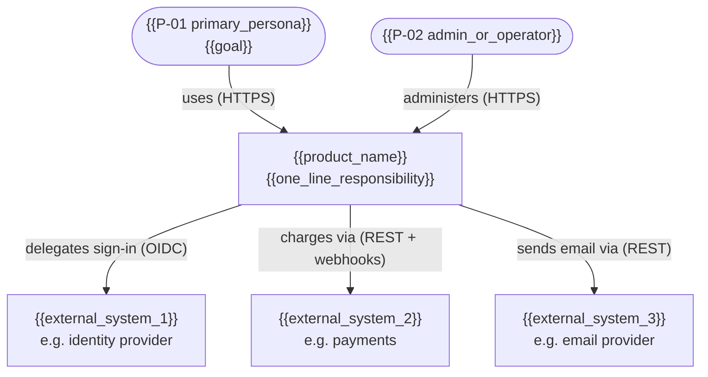
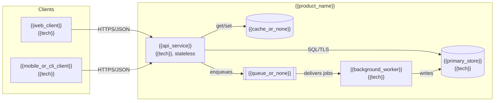
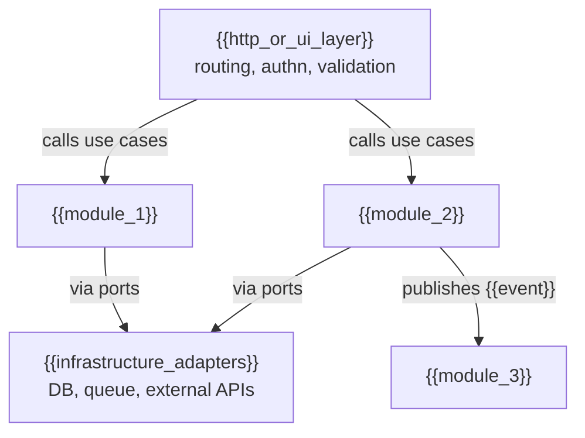
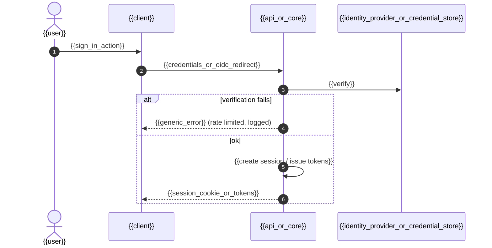
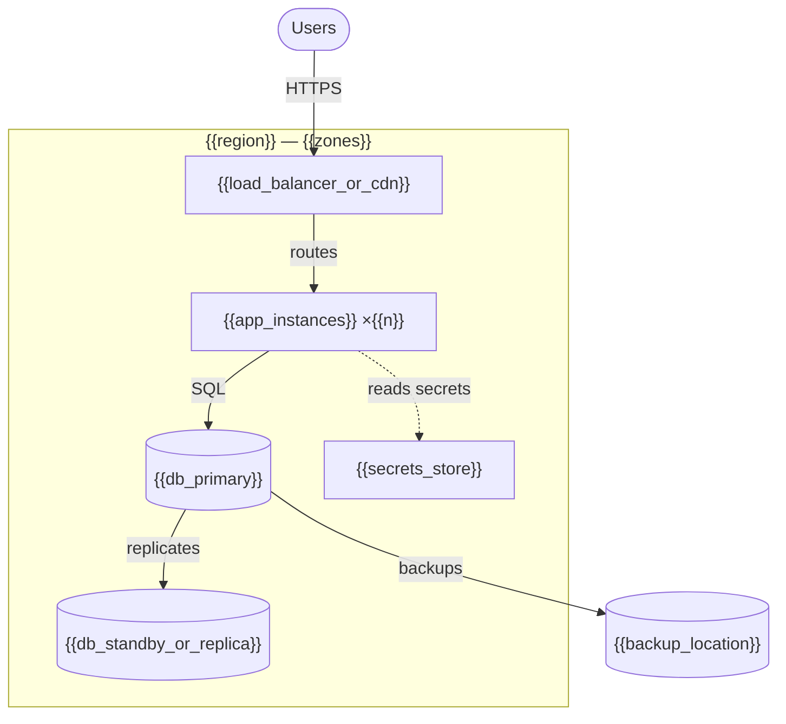
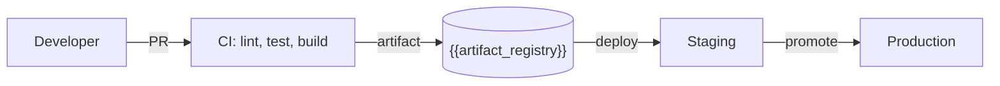

# Architecture — {{product_name}}

> **Status:** Draft · **Owner:** {{architect_owner}} · **Last updated:** {{last_updated}} · **Tier:** {{tier}} · **Related:** [TRD](TRD.md) · [Decisions](../decisions/README.md) · [DATABASE](DATABASE.md) · [API](API.md) · [SECURITY_ARCHITECTURE](SECURITY_ARCHITECTURE.md) · [OPERATIONS](OPERATIONS.md)

<!-- guidance: BEFORE writing, read references/architecture-guide.md (style selection, required views, Mermaid examples
at the expected depth, cross-cutting checklist, NFR→tactic table, failure-mode analysis, self-review).
Describe the approved shape of the system, not an aspirational one. Prefer the simplest architecture that meets the
NFRs and the TRD §9 capacity estimate (a modular monolith or single binary is a valid, often best, answer). Every
stack choice states the reason and the rejected alternative; significant ones get an ADR in ../decisions/. If the stack
is undecided, present options as > **PROPOSAL:** and stop for approval. Diagrams use Mermaid (≤ 15 nodes, labeled
edges); diagrams and tables MUST agree. If the user's tools do not render Mermaid, add an ASCII version in a `text`
block under each diagram (guide §4).
For a library/SDK: "containers" become modules/packages and "deployment" becomes distribution (registry, versions).
For a CLI: containers = binary + local config/cache + credential store + remote services it calls.
For a client-only / local-first app (e.g. mobile app with on-device storage, no backend): drop the API/worker/queue nodes,
the admin actor and server boundary; the container view is "app + on-device store (+ OS services / app store / optional
sync service)"; "enforced server/core side" in the DoD becomes "enforced in the app's core layer". Replace sample
diagrams; never keep nodes that do not exist. Keep ALL H2 headings; a section that does not apply keeps its heading and
one line `N/A — reason`. -->

<!-- guidance: Tier notes —
Lite: §1 (short), §2, §3.1 context diagram only, §4 stack table, §5 boundaries, §6 one sequence diagram (J-01 incl. failure path), §7 interfaces (if any), §8 key concerns, §9 project structure, §12 key decisions (table only), §13 unknowns, plus §14 (Lite merged sections) because TRD, API, OPERATIONS and ADRs are skipped in Lite. Other sections: one line or `N/A — reason`.
Standard: all sections; §3.3 for the core container; a sequence diagram per Must journey + auth flow; ADRs for stack, data store, auth, hosting, style.
Enterprise: add C4 component diagrams for every critical container, quality-attribute scenarios per NFR, multi-region/tenancy view, architecture review sign-off, and fitness functions enforced in CI. -->

## 1. Purpose and drivers
<!-- guidance: Minimum content — 1–3 sentence purpose; the 3–6 quality attributes that drive the design, each linked
to NFR-xx; hard constraints; capacity headline from TRD §9 (e.g. "~30 peak RPS, ~20 GB/yr"). -->
- **System purpose:** {{summary_from_PRD}}
- **Key drivers (quality attributes):** {{e.g. NFR-01 latency, NFR-02 availability, NFR-05 privacy}}
- **Capacity headline:** {{peak RPS / users / data growth from TRD §9, or "on-device only"}}
- **Constraints:** {{from TRD §4}}
- **Assumptions:** {{A-xx list_or_none}}

## 2. Architectural style
<!-- guidance: Minimum content — chosen style, the drivers it satisfies (team size, deploy cadence, traffic shape,
consistency, offline, residency, budget), ≥ 2 alternatives rejected with reasons, and the "what would force a redesign"
answer. Default to modular monolith for backend products unless a driver says otherwise (guide §1). -->
- **Chosen style:** {{e.g. modular monolith · serverless functions · client-only/local-first app · CLI with plugin system · event-driven services · library with layered core}}
- **Rationale:** {{why_it_fits_drivers_team_size_and_scale}}
- **Alternatives rejected:** {{option — reason}} → [ADR-{{nnnn}}](../decisions/{{nnnn}}-{{slug}}.md)
- **Redesign trigger:** {{e.g. > 5 independent teams, or a module needing separate scaling → extract along module boundaries}}

## 3. System views (C4)

### 3.1 Context
<!-- guidance: Minimum content — the product as ONE box; every persona type (P-xx) and every external system from
TRD §5 (identity, email, payments, storage, analytics, AI APIs, app stores…); every edge labeled with verb + protocol. -->


### 3.2 Containers
<!-- guidance: A "container" is a separately deployable/runnable unit (web app, mobile app, API, worker, database,
cache, queue, CLI binary, on-device store). Minimum content — every container + data store, protocol on each edge,
and one table row per node (same count). Lite: optional. -->


| Container | Responsibility | Technology | Owner | Scales by | Stateful? |
| --- | --- | --- | --- | --- | --- |
| {{name}} | {{responsibility}} | {{tech}} | {{team}} | {{horizontal / vertical / n/a}} | {{yes/no}} |

### 3.3 Components
<!-- guidance: Standard: the core container (API / app core) broken into modules (one per bounded context, e.g.
identity, workspaces, core domain, billing, notifications, audit) plus HTTP/UI layer and infrastructure adapters, with
dependency arrows pointing inward. Enterprise: every critical container. Lite: `N/A — Lite tier`. -->


| Component | Owns (entities / F-xx) | Depends on | Exposes |
| --- | --- | --- | --- |
| {{module}} | {{entities, F-xx}} | {{modules}} | {{interfaces/events}} |

## 4. Stack decisions
| Layer | Choice | Version policy | Reason | Alternative considered | ADR |
| --- | --- | --- | --- | --- | --- |
| Language / runtime | {{choice}} | {{e.g. current LTS — verify at setup}} | {{reason}} | {{alternative}} | ADR-{{nnnn}} |
| Client / UI | {{choice_or_n_a}} | | | | |
| Backend / API | {{choice_or_n_a}} | | | | |
| Data store | {{choice}} | | | | |
| Cache / queue | {{choice_or_none}} | | | | |
| AuthN / identity | {{choice}} | | | | |
| Hosting / distribution | {{e.g. cloud provider, app stores, package registry}} | | | | |
| CI/CD | {{choice}} | | | | |
| Observability | {{choice}} | | | | |

## 5. Boundaries and responsibilities
- **Client owns:** {{presentation, local state, input hints — never authorization}}
- **Server / core owns:** {{validation, authorization, business rules, persistence}}
- **External services own:** {{capability}} — failure behavior in [TRD §5](TRD.md#5-external-integrations)
- **Out of scope:** {{systems_we_do_not_build}}
- **Module rules:** {{e.g. domain has no dependency on framework/IO; dependencies point inward; no module reads another module's tables; cross-module calls via interfaces or in-process events}}
- **Enforcement:** {{e.g. architecture test / lint rule in CI, or [TBD]}}

## 6. Request and data flow
<!-- guidance: Minimum content — (a) the coverage table listing EVERY Must journey J-xx with its diagram; (b) one
sequenceDiagram per Must journey (Lite: J-01 only) showing client → entry → authn/authz/validation → data store →
response, with `alt` branches for denied/invalid and at least one dependency failure (timeout/outage/conflict);
(c) the authentication flow (sign-in, token/session issue, refresh/expiry); (d) async paths (outbox/queue/worker) where
a journey triggers side effects. Participants must be containers/components from §3. Examples at the expected depth:
architecture-guide §3.4–3.5. -->

| Journey | Diagram | Containers involved | Failure paths shown |
| --- | --- | --- | --- |
| J-01 {{name}} | §6.1 | {{containers}} | {{denied, invalid, provider timeout}} |
| Authentication | §6.2 | {{containers}} | {{bad credentials, expired session}} |

### 6.1 J-01 — {{journey_name}}
```mermaid
sequenceDiagram
    autonumber
    actor U as {{P-01 user}}
    participant C as {{client}}
    participant A as {{api_or_core}}
    participant D as {{data_store}}
    participant Q as {{queue_or_worker}}
    U->>C: {{action}}
    C->>A: {{request}} (auth token, Idempotency-Key if unsafe)
    A->>A: authenticate, resolve tenant, validate
    A->>D: authorize ({{role/ownership check}})
    alt denied
        A-->>C: 403 {{error_model}}
        C-->>U: {{permission_message}} (nothing changed)
    else invalid input
        A-->>C: 422 {{field_errors}}
        C-->>U: {{inline_errors}}
    else allowed and valid
        A->>D: BEGIN; {{write}}; insert outbox event; COMMIT
        A-->>C: {{success_response}}
        C-->>U: {{success_state}}
        Q->>Q: {{side_effect}} (timeout, retry with backoff)
        opt {{dependency}} unavailable after retries
            Q->>D: mark failed, move to DLQ, alert
        end
    end
```

### 6.2 Authentication flow


## 7. Interfaces
| Interface | Type | Producer → Consumer | Contract location | Notes |
| --- | --- | --- | --- | --- |
| {{public API}} | {{REST / GraphQL / gRPC / CLI / SDK}} | {{api → clients}} | [API.md](API.md) | |
| {{events / jobs}} | {{queue topic / webhook / cron}} | {{producer → consumer}} | {{path}} | {{retry, idempotency key, DLQ}} |

## 8. Cross-cutting concerns
<!-- guidance: Minimum content — every row decided or `N/A — reason` (full checklist: architecture-guide §5). -->
| Concern | Approach |
| --- | --- |
| Authentication / authorization | {{summary}} → [SECURITY_ARCHITECTURE](SECURITY_ARCHITECTURE.md) |
| Tenancy | {{model + enforcement}} → [DATABASE §7](DATABASE.md#7-multi-tenancy-and-isolation) |
| Input validation | {{schema at boundary + DB constraints}} |
| Configuration | {{12-factor env vars / config files; precedence order; validated at startup}} |
| Secrets | {{store; names only; rotation}} |
| Error handling | {{error model, user-facing vs internal, correlation IDs}} → [API](API.md) |
| Logging & tracing | {{structured logs, trace propagation (e.g. W3C Trace Context), redaction}} |
| Metrics & alerting | {{RED per endpoint, SLO burn alerts}} → [OPERATIONS](OPERATIONS.md) |
| Caching | {{what, where, key incl. tenant, TTL, invalidation}} |
| Async work | {{queue/scheduler, retries + jitter, idempotent handlers, DLQ}} |
| Idempotency & concurrency | {{Idempotency-Key, optimistic locking}} |
| Rate limiting & abuse | {{limits per user/IP/key; 429 + Retry-After}} |
| File handling | {{direct-to-storage signed URLs, limits, scanning / N/A}} |
| Internationalization | {{where strings live, locale negotiation}} |
| Time & IDs | {{UTC storage, ID format e.g. UUIDv7 / ULID / integer}} |
| Feature flags | {{approach_or_none}} |
| Offline / sync | {{strategy + conflict policy / N/A}} |
| AI / LLM components | {{provider, data sent, logging policy, cost limits, fallback / N/A}} |

## 9. Project structure
<!-- guidance: Real directories if the repo exists; otherwise a PROPOSAL consistent with the stack's conventions and
the §3.3 modules (one directory per module). Must equal CODE_STYLE directory map. -->
```text
{{repo_root}}/
├── {{dir}}/   # {{responsibility}}
└── {{dir}}/   # {{responsibility}}
```

## 10. Scalability and resilience
<!-- guidance: Minimum content — scaling strategy tied to TRD §9 numbers (what scales, at which trigger); resilience
rules for every outbound call; SPOF list; failure-mode table with one row per external integration, primary data
store, queue, and identity provider (architecture-guide §9). -->
- **Scaling strategy:** {{stateless services behind LB / read replicas / partitioning / n/a}} — next step at {{trigger}}
- **Failure handling:** {{timeouts, retries with jittered backoff (idempotent ops only), circuit breakers, idempotency, graceful degradation}}
- **Single points of failure:** {{list_and_mitigation}}

### 10.1 Failure modes
| Component / dependency | Failure | Detection | User impact | Mitigation / degradation | Recovery |
| --- | --- | --- | --- | --- | --- |
| {{dependency}} | {{down / slow / bad data}} | {{alert}} | {{impact}} | {{fallback}} | {{runbook RB-xx}} |

## 11. Deployment view
<!-- guidance: Minimum content — runtime topology (environments, region/zones, LB/CDN, compute, data stores with
replication, secrets store, telemetry sink, backups location) plus the delivery pipeline. Mobile/desktop: build →
signing → store tracks → staged rollout. Library/CLI: build → registry/release channels. -->



Environments, rollout, and rollback: [OPERATIONS](OPERATIONS.md).

## 12. Decisions, risks, and technical debt
| ADR | Title | Status |
| --- | --- | --- |
| [ADR-0001](../decisions/0001-record-architecture-decisions.md) | Record architecture decisions | Accepted |
| ADR-{{nnnn}} | {{title}} | {{Proposed / Accepted}} |

| ID | Risk / debt | Impact | Mitigation | Owner |
| --- | --- | --- | --- | --- |
| R-{{nn}} | {{item}} | {{impact}} | {{mitigation}} | {{owner}} |

## 13. Unknowns
| ID | Question | Blocks | Owner |
| --- | --- | --- | --- |
| Q-{{nn}} | {{question}} | {{component_or_milestone}} | {{owner}} |

## 14. Lite merged sections
<!-- guidance: Lite only. In Standard/Enterprise keep the heading and write `N/A — covered by TRD, API, OPERATIONS and ADRs.` Keep each subsection short. -->
### 14.1 Requirements mapping
| Feature | Component(s) | Notes |
| --- | --- | --- |
| F-01 | {{component}} | {{note}} |

### 14.2 NFRs
| ID | Category | Requirement (number + unit) | Measured by |
| --- | --- | --- | --- |
| NFR-01 | {{category}} | {{requirement}} | {{method}} |

### 14.3 Constraints and integrations
- **Constraints:** {{budget_platform_deadline}}
- **Integrations:** {{provider — purpose — failure behavior, or "None"}}

### 14.4 Deploy & run
<!-- guidance: Hosted: environments, deploy, rollback, backups, error tracking. Mobile/desktop: build signing, store test tracks
(TestFlight / Play internal testing), staged rollout, no instant rollback (ship a fix forward), on-device data migrations
must be backward-safe, crash reporting (privacy impact!), OS backup/export of local data. CLI/library: release + publishing.
Always include the one-line "Incident & secret rotation" item below: SECURITY_ARCHITECTURE §7.3 and §13 point here in Lite. -->
- {{item}}
- **Incident & secret rotation:** {{who is paged/contacted, first actions (disable feature / revoke + rotate secret / roll back), where secrets are rotated, how users are told}}

## 15. Quality attribute tactics
<!-- guidance: Minimum content — one row per NFR-xx from TRD §3 (Lite: §14.2), with concrete tactics from
architecture-guide §6, the component that implements them, and the verifying test ID. Lite: rows for Must NFRs only. -->
| NFR | Target | Tactics | Implemented in | Verified by |
| --- | --- | --- | --- | --- |
| NFR-01 | {{e.g. p95 ≤ 300 ms at 80 RPS}} | {{indexes per DATABASE §9, keyset pagination, CDN for assets, async side effects}} | {{components}} | {{PERF-01}} |
| NFR-02 | {{e.g. 99.9%}} | {{2 zones, health checks, managed DB failover, rolling deploys}} | {{components}} | {{SLO-01, DR-01}} |

## Completeness self-check
<!-- guidance: Tick every box before presenting this doc (full list: architecture-guide §10). Fix gaps instead of
reporting them; anything not fixable becomes [TBD] + Q-xx. Keep this checklist in the output, ticked. -->
- [ ] Every persona type and every TRD §5 external system appears in the context diagram.
- [ ] Container diagram nodes = container table rows = deployment view nodes (Lite: N/A).
- [ ] Every Must J-xx is in the §6 coverage table with a sequence diagram; auth flow and ≥ 1 dependency-failure path are drawn.
- [ ] Every F-xx maps to a component (TRD §2 or §14.1); every component owns at least one F-xx or is infrastructure.
- [ ] Every NFR-xx has tactics, an implementing component, and a test in §15.
- [ ] Style choice has drivers, ≥ 2 rejected alternatives, and an ADR (or PROPOSAL).
- [ ] No technology appears that is not decided or marked PROPOSAL; versions say "verify at setup" unless verified.
- [ ] Every outbound call has a timeout and failure behavior; side effects use outbox/queue, not dual writes.
- [ ] Every cross-cutting concern in §8 is decided or `N/A — reason`.
- [ ] SPOFs listed with mitigation; failure-mode table covers every integration and data store.
- [ ] Data stores match DATABASE §1; interfaces match API; project structure matches §3.3 modules.
- [ ] Diagrams ≤ 15 nodes with labeled edges; ASCII fallback added if the user's tools need it.
- [ ] No `{{placeholders}}` or guidance comments remain.

## Definition of done
- [ ] Style and every stack choice have a reason and rejected alternative; significant ones link an ADR.
- [ ] Context and container diagrams match the container table and TRD integrations.
- [ ] Boundaries state that authorization and validation are enforced server/core side.
- [ ] Every Must journey's sequence includes the failure path; the auth flow is drawn.
- [ ] Cross-cutting concerns and project structure are defined or marked [TBD] with owners.
- [ ] Completeness self-check is fully ticked.
