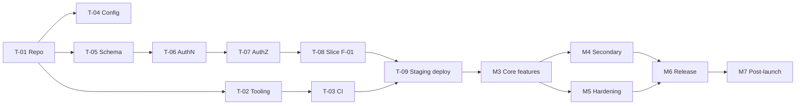
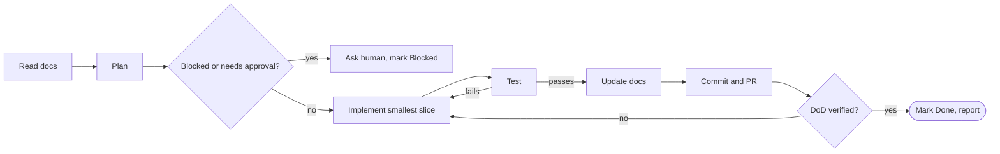

# Implementation Plan — {{product_name}}

> **Status:** Draft · **Owner:** {{delivery_owner}} · **Last updated:** {{last_updated}} · **Tier:** {{tier}} · **Related:** [PRD](../product/PRD.md) · [ARCHITECTURE](ARCHITECTURE.md) · [TESTING](TESTING.md) · [AGENTS.md](../../AGENTS.md)

<!-- guidance: An ordered build sequence a human or AI coding agent can execute task by task. Derive tasks ONLY from
approved docs; every task links the F-xx / NFR-xx / threat (TH-xx) it serves and states inputs, output, and a verifiable
definition of done (DoD). Order by dependency, and deliver a thin end-to-end vertical slice early instead of
building layer by layer. Size tasks so each fits one reviewable PR (S ≈ ≤ ½ day, M ≈ 1–2 days, L = split it).
Do not invent dates; use [TBD] or relative sequencing. Blocking Q-xx must be resolved before the dependent task.
BEFORE WRITING: read references/product-guide.md §14 (plan rules) and §15 (Mermaid safety), then PRD §7/§18, APP_FLOW,
ARCHITECTURE, DATABASE, API, SECURITY_ARCHITECTURE (TH-xx), TESTING (AT/SEC/PERF/A11Y IDs), OPERATIONS, CODE_STYLE.
Write the whole plan in one pass: all phases (§9), all tasks (§3), all diagrams (§2.1, §2.2, §5). Never stop part-way. -->

<!-- guidance: Tier notes —
Lite: §1, milestones M0, M1+M2 merged, M3, M6 (drop M4/M5/M7 or fold into M3/M6 with a reason), tasks for Must features only, §4 vertical slice, §5 graph, §6 "before moving on" rule, §10 agent protocol, §11 dos & don'ts. Gantt optional; ASCII workflow required.
Standard: all sections; tasks sized S/M; checkpoints with demo per milestone. Minimums: ≥ 2 tasks per Must feature (build + verify/harden), every NFR-xx with a test has a task, Gantt + dependency flowchart + ASCII workflow.
Enterprise: add owners/teams per task, cross-team dependencies, change-management and security sign-off checkpoints, compliance evidence tasks, and a RAID log (§12: risks, assumptions, issues, dependencies). -->

## 1. Approach
- **Build strategy:** {{e.g. walking skeleton → vertical slice → feature increments → hardening → release}}
- **Sequencing principle:** dependencies first, riskiest assumptions earliest, one working increment per milestone.
- **Executors:** {{solo dev / team names / AI agent supervised by {{name}}}}
- **Blocking questions to resolve first:** {{Q-xx list_or_none}}
- **Critical path:** {{e.g. T-01 → T-05 → T-06 → T-07 → T-08 → T-12 → T-20}}
- **Plan baseline:** relative to plan approval date (Day 0) — {{date_of_approval_or_[TBD]}}

## 2. Milestones
<!-- guidance: Adapt names to the app type (e.g. for a library M3 = public API; for a mobile app M6 includes store submission and test tracks).
The sample rows assume a hosted service with accounts: rename/delete M1 "data & auth", staging deploys, auth/tenant tasks and
SEC rows when there are no accounts or no server (e.g. M1 = local data layer; "deploys to staging" = "builds a test-track build";
CLI = "installs from a pre-release package"; library = "published as a pre-release version").
A dropped phase keeps its row with "N/A — reason" so IDs stay stable. Full entry/exit criteria live in §9. -->
| ID | Milestone | Goal | Exit criteria | Target |
| --- | --- | --- | --- | --- |
| M0 | Foundations / repo setup | Repo, tooling, CI, environments ready | Empty app builds, lints, tests, and deploys to staging (or packages) via CI | {{TBD}} |
| M1 | Data & auth | Schema, migrations, identity, permissions | Auth + isolation tests (SEC-xx) pass | |
| M2 | First vertical slice | One Must journey end to end | AT for {{F-01}} Passed in staging | |
| M3 | Core features | Remaining Must features | All Must AT Passed | |
| M4 | Secondary features | Should features | Agreed Should AT Passed | |
| M5 | Hardening | Security, accessibility, performance, observability, error handling | NFR tests meet targets; scans clean | |
| M6 | Release / launch | Release, monitoring, rollback ready | Release criteria in TESTING §10 met | |
| M7 | Post-launch | Stabilize, measure KPIs, triage feedback | KPI baselines captured; no open Sev-1/2; backlog for next release agreed | |

### 2.1 Timeline (Gantt)
<!-- guidance: Standard+ (Lite optional). Durations are estimates — label the block PROPOSAL. Use a placeholder start date (plan approval)
and relative durations; never invent a launch date. Task IDs in Gantt are alphanumeric (m0, t08). One section per milestone. -->

> **PROPOSAL:** Durations below are estimates for sequencing, not commitments. Re-baseline after M2.

```mermaid
gantt
    title {{product_name}} — delivery phases (relative to plan approval)
    dateFormat YYYY-MM-DD
    axisFormat Week %W
    section M0 Foundations
    Repo, tooling, CI, envs        :m0, {{plan_start_yyyy_mm_dd}}, 5d
    section M1 Data and auth
    Schema and migrations          :m1a, after m0, 3d
    Authentication and authorization :m1b, after m1a, 4d
    section M2 Vertical slice
    {{F-01}} end to end            :m2, after m1b, 5d
    section M3 Core features
    Remaining Must features        :m3, after m2, 15d
    section M4 Secondary
    Should features                :m4, after m3, 10d
    section M5 Hardening
    Security, a11y, perf, observability :m5, after m3, 10d
    section M6 Release
    Release candidate and launch   :milestone, m6, after m5, 0d
    section M7 Post-launch
    Stabilize and measure          :m7, after m6, 14d
```

### 2.2 Delivery workflow (ASCII)
<!-- guidance: Required in every tier. Keep it in sync with §9 gates. -->

```text
 M0 Foundations ──gate──► M1 Data & auth ──gate──► M2 Vertical slice ──gate──► M3 Core (Must)
   repo, CI, envs           schema, authN/Z          F-01 UI→API→DB→test          all Must F
                                                                                     │
                                                         ┌───────────gate────────────┤
                                                         ▼                           ▼
                                               M4 Secondary (Should)       M5 Hardening (sec, a11y, perf, obs)
                                                         └───────────┬───────────────┘
                                                                     ▼ gate (release criteria)
                                                          M6 Release / launch ──► M7 Post-launch
                                                                                   (KPIs, bugs, next backlog)

 Each task loop:  read docs → plan → implement smallest slice → test → update docs → commit/PR → review → Done
```

## 3. Task list
<!-- guidance: Status: To do | In progress | Blocked (Q-xx) | Done. "Done" requires the DoD to be verified, not just code written.
Minimums: every Must F-xx → ≥ 1 build task (Standard+: ≥ 2 incl. a test/hardening task); every NFR-xx with a test → a task (usually M5);
every TH-xx with mitigation "Planned" → a task; M0 contains setup only. Size S or M only (L = split).
Owner: Human | Agent | Human + Agent. Decisions, credentials, production deploys, store submissions, legal → Human.
"Acceptance" lists the AC-xx.y / AT-xx / SEC-xx / PERF-xx / A11Y-xx that prove the task. "Links" = F-xx / NFR-xx / TH-xx served,
or "infra" for setup tasks. Group rows by milestone; keep IDs stable (append, never renumber). -->
| ID | Milestone | Task | Inputs | Output | Definition of done | Acceptance | Depends on | Links | Size | Owner | Status |
| --- | --- | --- | --- | --- | --- | --- | --- | --- | --- | --- | --- |
| T-01 | M0 | Initialize repository with approved stack and structure | ARCHITECTURE §4, §9 | Skeleton project | Builds locally with verified command; structure matches §9 | Build command exits 0 | — | infra | S | Human + Agent | To do |
| T-02 | M0 | Configure format, lint, type check, test runner | CODE_STYLE | Tooling config | Commands recorded in AGENTS.md and TESTING §9 | Each command runs on the empty project | T-01 | NFR-10 | S | Agent | To do |
| T-03 | M0 | CI pipeline with quality gates and secret scanning | TESTING §8, OPERATIONS §3 | CI workflow | PR runs gates; failing check blocks merge | Deliberately failing PR is blocked | T-02 | SEC-03 | M | Agent | To do |
| T-04 | M0 | Environments and config (names only) | OPERATIONS §1–2 | `.env.example`, staging target | App starts with example config; no secrets committed | Secret scan clean | T-01 | infra | S | Human | To do |
| T-05 | M1 | Initial schema and migrations for {{entities}} | DATABASE §5 | Migration files | Migrate up/down on clean DB; seeds synthetic | Migration test passes | T-01 | F-01 | M | Agent | To do |
| T-06 | M1 | Authentication | SECURITY_ARCHITECTURE §4 | Sign-in/session flow | AT + SEC-01 pass | AT-{{nn}}, SEC-01 | T-05 | F-{{nn}}, TH-01 | M | Agent | To do |
| T-07 | M1 | Authorization & tenant isolation | SECURITY §5–6, DATABASE §8 | Policy layer | SEC-01, SEC-02 pass | SEC-01, SEC-02 | T-06 | TH-02 | M | Agent | To do |
| T-08 | M2 | {{F-01 vertical slice: UI/command → API → data}} | PRD F-01, APP_FLOW, API OP-01 | Working feature | AT-01, AT-02 pass in staging; all states (empty/loading/error) implemented | AC-01.1–AC-01.{{n}} via AT-01, AT-02 | T-07 | F-01 | M | Agent | To do |
| T-09 | M2 | Deploy slice to staging with logging and correlation ID | OPERATIONS §3–5 | Staging release | Slice reachable in staging; one request traced in logs | Smoke test on staging | T-08, T-03 | infra, NFR-{{nn}} | S | Human + Agent | To do |
| T-{{nn}} | M3 | {{F-xx build: UI → API → data for one feature}} | PRD F-xx, APP_FLOW S-xx, API OP-xx, DATABASE | Working feature | All AC for F-xx pass; §11 states implemented | AC-xx.1–AC-xx.n via AT-xx | {{T-xx}} | F-xx | M | Agent | To do |
| T-{{nn}} | M3 | {{F-xx edge and failure cases (conflict, limits, offline)}} | PRD §7.3 | Tests + handling | Negative/edge AC pass | AC-xx.{{n}} | {{T-xx}} | F-xx | S | Agent | To do |
| T-{{nn}} | M4 | {{Should feature F-xx}} | PRD F-xx | Working feature | AC pass | AT-xx | {{T-xx}} | F-xx | M | Agent | To do |
| T-{{nn}} | M5 | Accessibility pass on all S-xx | DESIGN_SYSTEM §7, TESTING | Fixes + report | A11Y-xx pass; manual screen-reader pass recorded | A11Y-xx | M3 done | NFR-{{a11y}} | M | Human + Agent | To do |
| T-{{nn}} | M5 | Performance test against NFR targets | TRD NFR-xx, TESTING §4 | PERF results | p95 within target or R-xx raised | PERF-xx | M3 done | NFR-{{perf}} | M | Agent | To do |
| T-{{nn}} | M5 | Security review: threat mitigations, dependency audit, secret scan | SECURITY_ARCHITECTURE | Review notes, fixes | All TH-xx Planned → Done or accepted risk | SEC-xx | M3 done | TH-xx | M | Human + Agent | To do |
| T-{{nn}} | M5 | Observability: dashboards, alerts for SLO-xx | OPERATIONS §5 | Dashboards/alerts | Alert fires in staging test | SLO-xx | T-09 | NFR-{{avail}} | S | Agent | To do |
| T-{{nn}} | M6 | Release checklist, rollback rehearsal, production deploy | TESTING §10, OPERATIONS §4 | Release | Release criteria met; rollback rehearsed once | Release criteria | M5 done | infra | S | Human | To do |
| T-{{nn}} | M7 | KPI instrumentation check and first KPI report | PRD §9 | KPI report | KPI-xx values captured with method | KPI-01..KPI-xx | T-{{release}} | KPI-xx | S | Human + Agent | To do |
| T-{{nn}} | {{M}} | {{task}} | {{inputs}} | {{output}} | {{verifiable_DoD}} | {{AC/AT IDs}} | {{T-xx}} | {{F-xx / NFR-xx / TH-xx}} | {{S/M}} | {{Human/Agent}} | To do |

### 3.1 Feature coverage
<!-- guidance: One row per F-xx. Every Must F has ≥ 1 task; Should F has a task or "Out of plan — reason". Mirrors PRD §18 "Tasks". -->
| Feature | Priority | Milestone | Tasks | Acceptance tests |
| --- | --- | --- | --- | --- |
| F-01 | Must | M2 | T-08, T-09 | AT-01, AT-02 |

## 4. First vertical slice
- **Journey:** {{J-01}} covering {{F-01}}
- **Path:** {{screen/command}} → {{API/function}} → {{data store}} → {{response/state}}
- **Includes:** real auth, validation, persistence, error state, a log line with correlation ID, and deployment to staging (or a published pre-release package).
- **Why first:** proves the architecture end to end and de-risks {{R-xx}}.
- **Not included:** {{polish, secondary states, admin — deferred to M3/M4}}

```text
[{{S-xx screen/command}}] → [{{OP-xx}}] → [{{service/module}}] → [({{entity}})] → response → [{{S-xx success state}}]
       │ AT-01 happy        │ SEC-01 auth     │ validation         │ migration       │ AT-02 error state
```

## 5. Dependency graph
<!-- guidance: Show every task in M0–M2 and milestone-level nodes after that (≤ 15 nodes per diagram; add one diagram per milestone if needed).
Node IDs without hyphens (T01), readable ID in the label. Must be acyclic. Highlight the critical path in §1. -->


## 6. Checkpoints and "before moving on" rule
At the end of **every task**:
1. Run the verified commands (format, lint, type check, tests) and record what ran; anything not run stays "Not run".
2. Verify the task's DoD and linked acceptance criteria by observation (run the app, command, or request).
3. Review the diff for scope creep, secrets, and unrelated changes.
4. Update affected docs (and ADRs) in the same change; record unresolved issues as Q-xx or R-xx.

At the end of **every milestone**: demo the increment, update [TESTING §11](TESTING.md#11-results-log), re-check open questions, and get approval from {{approver}} before starting the next milestone.

### 6.1 Phase gates — do not start the next phase until…
<!-- guidance: Keep every gate; adapt wording to the app type. A gate is passed only by observation, never by assumption. -->
| Gate | Do not start… | …until all of these are true |
| --- | --- | --- |
| G0 | M1 | CI is green on the default branch; verified commands are in AGENTS.md; no secrets in repo; blocking Q-xx for M1 answered. |
| G1 | M2 | Migrations run up and down on a clean store; authentication and authorization tests (SEC-xx) pass; roles match SECURITY_ARCHITECTURE. |
| G2 | M3 | The slice works in staging (or a pre-release build) end to end; AT for F-01 Passed; logging with correlation ID observed; architecture issues found are ADR'd. |
| G3 | M4 / M5 | Every Must AT Passed; every Must screen implements its state matrix (APP_FLOW §11); no open Sev-1/2 defects. |
| G4 | M6 | NFR tests meet targets or have accepted R-xx; security review done; accessibility pass recorded; dashboards and alerts live; rollback rehearsed; release criteria (TESTING §10) met; human approval recorded. |
| G5 | M7 close | KPI baselines captured; incidents reviewed; next-release backlog prioritized in PRD. |

## 7. Risks to the plan
| ID | Risk | Affects | Mitigation | Owner |
| --- | --- | --- | --- | --- |
| R-{{nn}} | {{e.g. third-party API access approval delay}} | {{T-xx}} | {{mock first; request access in M0}} | {{owner}} |

## 8. Out of plan
{{items deferred to later releases, linked to PRD §10}}

## 9. Phase playbook
<!-- guidance: One H3 per phase M0–M7 with every field filled. Dropped phase: keep the H3 and write "N/A — reason" (e.g. "M1 N/A — no accounts, local file storage only; data layer built in M2").
Verification commands come from CODE_STYLE/TESTING; until verified write "Not configured". -->

### 9.1 M0 — Foundations / repo setup
- **Entry criteria:** PRD, ARCHITECTURE, CODE_STYLE approved; stack ADRs accepted; repo host chosen.
- **Deliverables:** repository skeleton, formatter/linter/type checker/test runner, CI with gates and secret scanning, environment config names, AGENTS.md commands verified.
- **Exit criteria / DoD:** empty app builds, lints, tests, and deploys (or packages) via CI; failing PR is blocked.
- **Verification:** `{{build_command_or_Not configured}}` · `{{lint_command_or_Not configured}}` · `{{test_command_or_Not configured}}`
- **Risks:** {{e.g. toolchain unfamiliar to the team — R-xx}}
- **Not in this phase:** feature code, schema, UI screens.

### 9.2 M1 — Data & auth
- **Entry criteria:** G0 passed; DATABASE and SECURITY_ARCHITECTURE approved.
- **Deliverables:** schema + migrations for entities used by M2, synthetic seed data, authentication, authorization/tenant isolation policy layer.
- **Exit criteria / DoD:** migrations up/down on a clean store; SEC-xx for auth and isolation pass; no PII in logs.
- **Verification:** `{{migration_command_or_Not configured}}` · `{{test_command_or_Not configured}}`
- **Risks:** {{e.g. auth provider limits — R-xx}}

### 9.3 M2 — First vertical slice
- **Entry criteria:** G1 passed; F-01 AC approved; API OP-xx for F-01 defined.
- **Deliverables:** F-01 through every layer, all its states, deployed to staging (or pre-release), with logs.
- **Exit criteria / DoD:** AT for F-01 Passed in staging; demo given; plan re-baselined.
- **Verification:** `{{e2e_command_or_Not configured}}` + manual walkthrough of J-01.
- **Risks:** architecture gaps discovered late — mitigated by doing this slice first.

### 9.4 M3 — Core features (Must)
- **Entry criteria:** G2 passed.
- **Deliverables:** every remaining Must F-xx, one vertical slice per feature, including §7.3 edge cases.
- **Exit criteria / DoD:** every Must AT Passed; every Must screen matches APP_FLOW §11.
- **Verification:** full test suite; E2E for J-xx.
- **Risks:** scope creep — any new idea goes to PRD §10 as PROPOSAL, not into M3.

### 9.5 M4 — Secondary features (Should)
- **Entry criteria:** G3 passed; Should features re-confirmed with the decision maker.
- **Deliverables:** agreed Should features; Could features only if explicitly approved.
- **Exit criteria / DoD:** agreed Should AT Passed; unfinished Should items moved to "Out of plan" with approval.
- **Verification:** full test suite.
- **Risks:** time pressure — Should items are the first to cut.

### 9.6 M5 — Hardening (security, accessibility, performance, observability)
- **Entry criteria:** G3 passed (can run in parallel with M4).
- **Deliverables:** threat mitigations complete, dependency audit, accessibility fixes, performance results vs NFR-xx, dashboards and alerts for SLO-xx, error-handling review, backup/restore test (if data).
- **Exit criteria / DoD:** SEC-xx, PERF-xx, A11Y-xx results recorded; deviations have R-xx with an owner.
- **Code security review:** {{run a code-level security review of the implemented system against SECURITY_ARCHITECTURE (e.g. an open-source audit skill or external reviewer); confirmed findings become TH-xx/R-xx updates and SEC-xx tests}}.
- **Verification:** `{{security_scan_or_Not configured}}` · `{{perf_test_or_Not configured}}` · `{{a11y_check_or_Not configured}}` + manual screen-reader pass.
- **Risks:** late performance findings — mitigated by PERF smoke tests from M2.

### 9.7 M6 — Release / launch
- **Entry criteria:** G4 passed.
- **Deliverables:** release notes and CHANGELOG, production deploy (or package/store release), rollback rehearsal, support channel live, legal docs published if applicable.
- **Exit criteria / DoD:** release criteria in TESTING §10 met; production smoke test passed; human release approval recorded.
- **Verification:** `{{release_command_or_Not configured}}` + smoke test checklist.
- **Risks:** store review / approval delays — submit early with a buffer.

### 9.8 M7 — Post-launch
- **Entry criteria:** release live.
- **Deliverables:** KPI report (PRD §9), incident and bug triage, feedback log, next-release backlog, doc updates for anything learned.
- **Exit criteria / DoD:** KPI baselines captured with method; no open Sev-1/2; backlog prioritized (MoSCoW) in the PRD.
- **Verification:** KPI queries/dashboards; incident log.
- **Risks:** no data to measure KPIs — verify instrumentation in M5.

## 10. AI-agent execution protocol
<!-- guidance: Keep this protocol verbatim (translate if needed). AGENTS.md links here. -->

For **every task**, an AI coding agent MUST:

1. **Read** — the task row, linked F-xx (PRD §7.2) and AC, APP_FLOW S-xx and state matrix, API OP-xx, DATABASE entities, relevant ADRs, CODE_STYLE, AGENTS.md.
2. **Plan** — post a short plan: files to change, tests to add, AC covered, open questions. Stop and ask if a blocking Q-xx or an approval boundary (AGENTS.md) applies.
3. **Implement the smallest slice** — only this task; no unrelated refactors, no new dependencies without approval.
4. **Test** — write/extend tests for every linked AC (happy, negative, edge); run the verified commands; record what ran and results; anything not run is `Not run`.
5. **Update docs** — change any doc the task affected (API, DATABASE, APP_FLOW, TESTING results, CHANGELOG); new decisions → ADR.
6. **Commit / PR** — Conventional Commit referencing T-xx and F-xx; PR description lists AC covered, commands run, and limitations.
7. **Report and stop** — set status to Done only after DoD is verified; otherwise `In progress` or `Blocked (Q-xx)`. Do not start the next task without instruction if the plan requires review.



Task prompt template (copy per task):

```text
Task {{T-xx}} ({{milestone}}): {{task}}
Implements: {{F-xx}} — acceptance {{AC-xx.y list}}, tests {{AT-xx list}}
Read first: PRD §7.2 {{F-xx}}, APP_FLOW {{S-xx}}, API {{OP-xx}}, DATABASE {{entity}}, AGENTS.md
Constraints: only this task; no new dependencies; no schema change unless listed; ask on any Q-xx.
Done when: {{DoD}}; verified commands run and reported.
```

## 11. Execution dos and don'ts

| Do | Don't |
| --- | --- |
| Finish one task (DoD verified) before starting the next. | Keep several half-done tasks open. |
| Build vertical slices (UI → API → data → test) per feature. | Build all backend first, then all UI. |
| Write tests for negative and edge AC, not only the happy path. | Mark a task Done because the code compiles. |
| Record commands actually run and their results. | Claim tests passed without running them. |
| Respect phase gates (§6.1). | Start M3 features before the slice works end to end. |
| Update docs and ADRs in the same PR as the change. | Leave docs to "later". |
| Raise scope ideas as PROPOSAL in PRD §10. | Add unplanned features mid-milestone. |
| Ask a human for credentials, deploys, schema on shared data, legal text. | Let an agent deploy, rotate secrets, or migrate production. |
| Split any task that grows beyond M. | Merge PRs larger than the agreed size. |
| Re-baseline the plan after M2 with real velocity. | Keep estimates that the slice proved wrong. |

## 12. Progress tracking and RAID
<!-- guidance: Standard: progress table only. Enterprise: full RAID log (Risks link §7; Assumptions A-xx; Issues; Dependencies on other teams/vendors). -->

| Milestone | Tasks done / total | Gate status | Demo date | Approved by |
| --- | --- | --- | --- | --- |
| M0 | 0 / {{n}} | Not started | — | — |

| Type | ID | Description | Owner | Status |
| --- | --- | --- | --- | --- |
| {{Assumption_Issue_Dependency}} | {{A-xx_or_I-xx_or_DEP-xx}} | {{description}} | {{owner}} | {{status}} |

## Definition of done
- [ ] Every Must feature and blocking NFR is covered by at least one task.
- [ ] Each task has inputs, output, verifiable DoD, dependencies, links, and size; no task is "L".
- [ ] A first vertical slice is defined and scheduled right after foundations.
- [ ] Dependency order is consistent with the graph; blocking Q-xx precede dependent tasks.
- [ ] The "before moving on" rule and milestone approvals are stated.

### Completeness self-check
<!-- guidance: Tick every box before presenting. Fix, or write "N/A — reason" next to the box. -->
- [ ] Phases M0–M7 all present in §2 and §9 (dropped/merged ones say why); each §9 phase has entry, deliverables, exit/DoD, verification, risks.
- [ ] §2.1 Gantt (Standard+), §2.2 ASCII workflow, and §5 dependency flowchart are present and agree with §3.
- [ ] Every Must F-xx appears in §3.1 with ≥ 1 task (Standard+: ≥ 2) and acceptance IDs.
- [ ] Every NFR-xx with a test and every TH-xx marked Planned has a task.
- [ ] Every task has size S/M, depends-on, owner (Human/Agent), acceptance, DoD, links; no task is L; no cycles.
- [ ] M0 contains setup tasks only; human-only actions (credentials, deploys, legal, store) are owned by Human.
- [ ] §6.1 gates, §10 agent protocol, and §11 dos & don'ts are present.
- [ ] Commands are verified or `Not configured`; no invented calendar dates (durations marked PROPOSAL).
- [ ] No `{{placeholders}}` or guidance comments remain.
