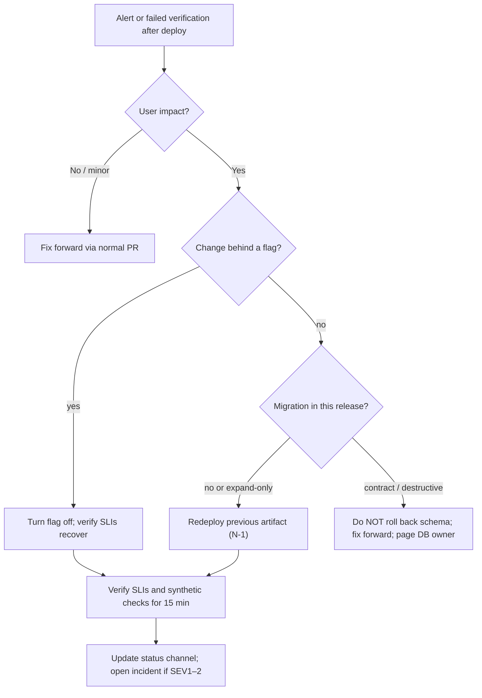
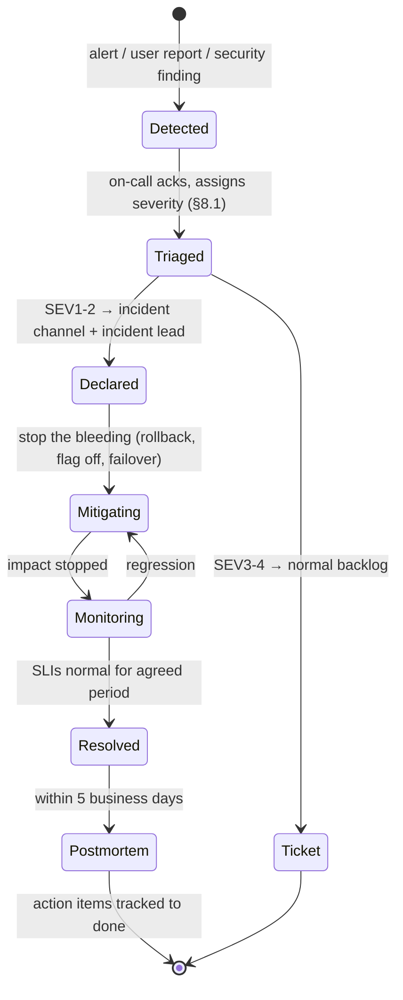

# Operations — {{product_name}}

> **Status:** Draft · **Owner:** {{ops_owner}} · **Last updated:** {{last_updated}} · **Tier:** {{tier}} · **Related:** [ARCHITECTURE](ARCHITECTURE.md) · [TRD](TRD.md) · [SECURITY_ARCHITECTURE](SECURITY_ARCHITECTURE.md) · [TESTING](TESTING.md) · [GIT_WORKFLOW](../engineering/GIT_WORKFLOW.md)

<!-- guidance: How the system is built, shipped, run, observed, and recovered. Adapt to the delivery model:
- Hosted service (web/API/SaaS): full document.
- Mobile/desktop app: environments, CI/CD, store release tracks (TestFlight / Play internal testing), staged rollout, crash reporting, backend ops if any.
- CLI / library: CI, release & publishing (registries, signing, provenance), versioning, support window; SLO/on-call sections usually N/A.
Never invent hostnames, account IDs, costs, or commands; never include secret values.
Procedures: references/governance-guide.md §5 "Deriving SLOs from NFRs" and §7 "CI/CD reference pipeline". -->

<!-- guidance: Inputs you MUST read before writing: TRD (NFR-xx availability/latency/RPO/RTO, capacity), ARCHITECTURE (containers,
hosting, deployment view), SECURITY_ARCHITECTURE (§7 secrets, §12 logging, §13 playbooks), TESTING (§8 gates, DR-xx), DATABASE
(migrations, backups), GIT_WORKFLOW (release flow), DISCOVERY (OPS-*, OBS-*, budget). Coverage rules (MANDATORY):
- Every NFR-xx about availability/latency/durability → an SLO-xx row (or a stated reason it is not an SLO).
- Every SLO-xx → ≥1 alert row (burn-rate) with a runbook RB-xx.
- Every paging alert → a runbook RB-xx in §15. Every data store → a §9 backup row with RPO/RTO and a DR-xx drill in TESTING.
- Every config variable the app reads → a §2 row (secret values never). Every container → a deploy strategy and rollback method. -->

<!-- guidance: Tier notes —
Lite: §1 environments, §2 config (names), §3 CI/CD summary, §4 deploy + rollback, §6 basic logging/error tracking, §9 backups (if data). Mark SLO/on-call/FinOps N/A.
Standard: all sections; at least one SLO for the primary journey; runbooks for deploy, rollback, restore; release checklist §16.
Enterprise: multi-region/DR tiers, formal change management, error-budget policy with release freeze, 24×7 on-call rotation, capacity reviews, chargeback/FinOps tagging, audit evidence retention, game days. -->

## 1. Environments
<!-- guidance: Minimum content: every environment that exists or is planned; isolation (separate accounts/projects) and data rules per env. Production data never flows to lower environments un-anonymized. -->
| Environment | Purpose | URL / target | Data | Deploys from | Access |
| --- | --- | --- | --- | --- | --- |
| Local | Development | {{localhost / emulator / local binary}} | Synthetic | Working tree | Developer |
| Preview | Per-PR review | {{optional}} | Synthetic | PR branch | Team |
| Staging | Pre-release verification | {{target}} | Synthetic / anonymized | `{{default_branch}}` | {{roles}} |
| Production | Live users | {{target}} | Real | Release tag | {{roles}} |

### 1.1 Environment parity matrix
| Aspect | Local | Preview | Staging | Production |
| --- | --- | --- | --- | --- |
| Runtime / versions | {{same pinned versions}} | same | same | same |
| Data store | {{container}} | {{ephemeral}} | {{managed, small}} | {{managed, HA}} |
| Third-party integrations | {{mocks / sandbox}} | sandbox | sandbox | live |
| Feature flags | {{all on}} | {{per PR}} | {{prod-like}} | {{controlled}} |
| Cloud account / project | — | {{non-prod}} | {{non-prod}} | {{prod (separate)}} |
| Observability | console | {{basic}} | full | full + alerting |

## 2. Configuration and secrets
| Variable | Purpose | Secret? | Required in | Default |
| --- | --- | --- | --- | --- |
| `{{APP_ENV}}` | {{environment name}} | No | All | {{development}} |
| `{{DATABASE_URL}}` | {{connection}} | Yes | {{staging, prod}} | — |
- Source: {{env vars / config files / secret manager}}; `.env.example` lists names only. Secret storage & rotation: [SECURITY_ARCHITECTURE §7](SECURITY_ARCHITECTURE.md#7-secrets-management).
- Config is validated at startup; the app fails fast with a clear message naming the missing variable (never printing values).

## 3. CI/CD pipeline
<!-- guidance: Minimum content: every stage from commit to production with its gate; artifact type and registry; who/what approves production.
Promote the SAME artifact (built once) through environments — never rebuild per environment. -->
```mermaid
flowchart LR
    pr[Pull request] --> checks[Lint · types · tests · scans]
    checks --> review[Code review]
    review --> merge[Merge to {{default_branch}}]
    merge --> build[Build + sign artifact + SBOM]
    build --> stg[Deploy staging]
    stg --> verify[Smoke / E2E]
    verify --> approve{Release approval}
    approve --> prod[Deploy production]
```
- **Platform:** {{CI_system_or_[TBD]}} · **Artifacts:** {{container image / binary / package / app bundle}} stored in {{registry}}
- **Gates:** see [TESTING §8](TESTING.md#8-ci-quality-gates)
- **Release versioning:** SemVer tags; notes from [CHANGELOG](../../CHANGELOG.md).

ASCII fallback:

```text
PR -> checks (lint/types/tests/scans) -> review -> merge main -> build once + sign + SBOM
   -> deploy staging -> smoke/E2E -> [release approval] -> deploy prod (strategy §4) -> verify -> done
                                                         \-> fail -> rollback (RB-01)
```

### 3.1 Pipeline stages
| # | Stage | Trigger | Gate / exit criteria | Blocks? | Typical duration target |
| --- | --- | --- | --- | --- | --- |
| 1 | Static checks | PR push | format, lint, types, SAST, secret scan clean | Yes | {{< 3 min}} |
| 2 | Tests | PR push | unit + integration + contract green; coverage gate | Yes | {{< 10 min}} |
| 3 | Supply chain | PR push | SCA, license policy, dependency review | Yes (critical) | |
| 4 | Build | merge to `{{default_branch}}` | reproducible build; SBOM; signature; provenance | Yes | |
| 5 | Deploy staging | build success | migrations applied (expand); health checks green | Yes | |
| 6 | Verify staging | deploy success | E2E smoke, DAST baseline (nightly), perf (pre-release) | Yes | |
| 7 | Approve | manual / automatic | {{release approver role}}; change ticket (Enterprise) | Yes | |
| 8 | Deploy production | approval | strategy §4; automated analysis of SLIs during rollout | Auto-rollback on breach | |
| 9 | Post-deploy | deploy success | synthetic checks green for {{15 min}}; release notes published | — | |

## 4. Deployment strategy and rollback
- **Strategy:** {{rolling / blue-green / canary {{n}}% → 100% / app-store phased release / registry publish}}
- **Database changes:** expand/contract, see [DATABASE §10](DATABASE.md#10-migrations).
- **Feature flags:** {{tool_or_none}} — decouple deploy from release.
- **Rollback:** {{redeploy previous artifact / flip flag / halt phased rollout / deprecate + publish patch (registries rarely allow unpublish)}}; target time ≤ {{minutes}}.
- **Who may deploy to production:** {{roles}}; AI agents never deploy without explicit authorization.

### 4.1 Strategy options
| Strategy | How | Best for | Rollback | Cost / complexity |
| --- | --- | --- | --- | --- |
| Rolling | Replace instances gradually | Stateless services, small teams | Redeploy previous version | Low |
| Blue-green | Two full environments; switch traffic | Fast, clean rollback | Switch traffic back | 2× capacity during deploy |
| Canary | {{1% → 10% → 50% → 100%}} with SLI analysis | High traffic, risky changes | Route 0% to canary | Needs metrics + traffic splitting |
| Feature flag | Deploy dark, enable per cohort | Product changes, experiments | Turn flag off | Flag hygiene needed |
| Phased store release | {{e.g. 1% → 100% over 7 days}} | Mobile apps | Halt rollout; ship fix (no true rollback) | Store review time |
| Registry publish | Tag → publish | Libraries, CLIs | Deprecate/yank + patch release | Consumers may pin bad version |

### 4.2 Rollback runbook (RB-01)
<!-- guidance: Write real steps once the platform is chosen; until then keep this decision tree and mark commands Not configured. -->


ASCII fallback:

```text
alert after deploy -> impact? no -> fix forward
                    -> yes -> flagged? yes -> flag off -> verify
                              no -> migration? none/expand -> redeploy N-1 -> verify
                                              contract   -> fix forward + page DB owner
verify (SLIs, synthetics 15 min) -> communicate -> incident if SEV1-2
```

| Step | Action | Command / location | Owner |
| --- | --- | --- | --- |
| 1 | Freeze further deploys | {{pipeline lock / Not configured}} | {{on-call}} |
| 2 | Identify last good version | {{release list / registry tags}} | |
| 3 | Roll back or disable flag | {{Not configured}} | |
| 4 | Verify recovery | {{dashboard link / synthetic checks}} | |
| 5 | Communicate and record | {{status page / channel}}; incident doc | |

## 5. Infrastructure as code
- Tool: {{e.g. Terraform/OpenTofu, Pulumi, CloudFormation, Bicep, Kubernetes manifests, platform config file}} or N/A (fully managed / no infra).
- Location: `{{path}}` · Changes via PR with plan output reviewed · State stored in {{location}}.
- Drift detection: {{scheduled plan / platform feature}} · Manual console changes: {{forbidden except break-glass, recorded}}.

## 6. Observability
<!-- guidance: Minimum content: logs, metrics, traces, errors, and uptime each have a tool (or N/A), what is captured, and retention.
Golden signals (latency, traffic, errors, saturation) are captured for every user-facing container. -->
| Signal | Tool | What is captured | Retention |
| --- | --- | --- | --- |
| Logs | {{tool}} | Structured (JSON), correlation/trace ID, no PII/secrets | {{period}} |
| Metrics | {{tool}} | RED (rate, errors, duration) per endpoint; USE for resources; business KPIs | {{period}} |
| Traces | {{tool, e.g. OpenTelemetry-compatible}} | Request path across services | {{period}} |
| Errors / crashes | {{tool}} | Client + server exceptions, mobile crashes | {{period}} |
| Uptime | {{tool}} | Synthetic checks of primary journey | — |

### 6.1 Golden signals per component
| Component | Latency | Traffic | Errors | Saturation | Dashboard |
| --- | --- | --- | --- | --- | --- |
| {{API service}} | {{p50/p95/p99 per route}} | {{req/s}} | {{5xx rate, timeouts}} | {{CPU, memory, connection pool}} | {{link or [TBD]}} |
| {{worker}} | {{job duration}} | {{jobs/min}} | {{failed jobs, DLQ size}} | {{queue depth, age of oldest}} | |
| {{database}} | {{query p95}} | {{QPS}} | {{errors, deadlocks}} | {{connections, storage, replication lag}} | |
| {{web/mobile client}} | {{Core Web Vitals / app start}} | {{sessions}} | {{JS errors / crash-free rate}} | — | |

### 6.2 Logging standard
- Fields on every line: `timestamp` (UTC, ISO 8601), `level`, `service`, `env`, `version`, `trace_id`, `request_id`, `message`, {{`tenant_id` if allowed}}.
- Levels: `error` needs attention; `warn` recoverable; `info` state changes; `debug` off in production.
- Redaction per [SECURITY_ARCHITECTURE §12](SECURITY_ARCHITECTURE.md#12-logging-audit-and-redaction), applied in the logger, not by convention.
- Sampling: {{100% errors; x% traces}} · Cost guard: {{daily ingest cap}}.

## 7. SLIs, SLOs, and error budget
<!-- guidance: Derive each SLO from an NFR-xx (see references/governance-guide.md §5). SLI = good events / valid events measured where users feel it.
Target ≤ NFR target; never promise more than the dependencies' SLAs allow. Error budget = 1 − target over the window
(99.5% over 28 days ≈ 3 h 22 min of "bad" minutes). -->
| SLO ID | User journey | SLI (good events / valid events) | Target | Window | NFR |
| --- | --- | --- | --- | --- | --- |
| SLO-01 | {{J-01}} | {{requests completed < 300 ms with non-5xx / all requests}} | {{99.5%}} | 28 days | NFR-01, NFR-02 |
- **Error budget policy:** when budget is exhausted, {{prioritize reliability work; freeze non-critical releases}}.

| Budget remaining | Action |
| --- | --- |
| > 50% | Normal release cadence |
| 25–50% | Extra review for risky changes; reliability items prioritized |
| 0–25% | Only fixes and reliability work; {{owner}} approves releases |
| Exhausted | Release freeze (except security fixes) until budget recovers; postmortem required |

## 8. Alerting and on-call
<!-- guidance: Minimum content: one burn-rate alert per SLO (fast + slow window), plus alerts for saturation/backups/certificates/security events.
Every row has a severity, a destination, and an RB-xx. Page only for user-impacting symptoms; everything else is a ticket. -->
| Alert | Condition | Severity | Notifies | Runbook |
| --- | --- | --- | --- | --- |
| {{SLO burn rate high}} | {{fast-burn multiwindow}} | {{page}} | {{rotation}} | RB-{{nn}} |
- Alerts must be actionable and symptom-based; every paging alert has a runbook.
- On-call: {{rotation / business hours only / best effort (OSS)}}.

| Alert (example rows) | Condition | Severity | Notifies | Runbook |
| --- | --- | --- | --- | --- |
| SLO-01 fast burn | {{burn rate ≥ 14.4 over 1 h AND 5 min}} | SEV2 page | {{primary on-call}} | RB-{{nn}} |
| SLO-01 slow burn | {{burn rate ≥ 6 over 6 h AND 30 min}} | Ticket | {{team channel}} | RB-{{nn}} |
| Backup job failed | {{no successful backup in 26 h}} | SEV3 ticket | {{DB owner}} | RB-02 |
| Certificate expiry | {{< 14 days}} | Ticket | {{owner}} | RB-{{nn}} |
| Auth failure spike | {{sign-in failures > x/min}} | SEV2 page | {{security owner}} | RB-{{nn}} |
| Queue backlog | {{oldest message age > n min}} | {{SEV3}} | | RB-{{nn}} |

### 8.1 Severity levels
| Severity | Definition | Response target | Who is engaged | Update cadence |
| --- | --- | --- | --- | --- |
| SEV1 | Full outage, data loss, or confirmed breach | {{ack ≤ 15 min, 24×7}} | On-call + incident lead + {{exec / security / counsel}} | {{every 30 min}} |
| SEV2 | Major degradation, SLO fast burn, key feature down | {{ack ≤ 30 min}} | On-call + incident lead | {{every 60 min}} |
| SEV3 | Minor impact, workaround exists | {{next business day}} | Owning team | {{daily}} |
| SEV4 | No user impact | {{backlog}} | Owning team | — |

### 8.2 On-call
- Rotation: {{weekly primary + secondary / business hours / best effort (OSS)}} · Tool: {{paging tool or [TBD]}}
- Hand-off: {{weekly, with open issues and recent changes}} · Escalation: primary → secondary → {{engineering lead}} after {{15 min}} without ack.
- Health: {{max pages per shift target; compensation/time-off policy [TBD: owner]}}.

## 9. Backup and disaster recovery
<!-- guidance: Minimum content: one row per data store and per stateful asset (object storage, search index, secrets, IaC state).
RPO/RTO copied from NFR-xx. Every row has a DR-xx drill in TESTING §14. "Last restore test" stays "Not run" until a real drill. -->
| Data / system | Backup method | Frequency | RPO | RTO | Last restore test |
| --- | --- | --- | --- | --- | --- |
| {{primary DB}} | {{snapshot / PITR}} | {{daily}} | {{NFR-09}} | {{NFR-09}} | Not run |
- DR scenario: {{region/provider outage plan or "accept downtime — documented risk R-xx"}} <!-- guidance: with data-residency rules, the DR region must be in the same jurisdiction (e.g. EU→EU). -->

### 9.1 Backup policy
- **3-2-1 principle:** {{≥3 copies, 2 media/services, 1 off-site or separate account}}; backups are encrypted and access-restricted.
- **Immutability:** {{object lock / separate account}} protects against ransomware and operator error.
- **Retention:** {{daily × 7, weekly × 4, monthly × 12}} — aligned with deletion obligations in SECURITY_ARCHITECTURE §11.
- **Restore drill:** {{quarterly}} restore to an isolated environment, timed against RTO, recorded as DR-01 in [TESTING](TESTING.md).

### 9.2 DR tiers
| Tier | Approach | Typical RPO / RTO | Cost | Chosen? |
| --- | --- | --- | --- | --- |
| Backup & restore | Restore from backups in same/another region | hours / hours–day | Low | {{}} |
| Pilot light | Replicated data, minimal standby compute | minutes / tens of minutes | Medium | {{}} |
| Warm standby | Scaled-down full stack running | seconds–minutes / minutes | High | {{}} |
| Active-active | Multi-region serving | ~0 / ~0 | Highest | {{}} |

## 10. Capacity and scaling
- Expected load: {{from TRD §1}} · Scaling triggers: {{CPU / queue depth / latency}} · Limits & quotas to watch: {{provider limits}}.
- Headroom target: {{run at ≤ 60% of capacity at expected peak}} · Load-test evidence: PERF-xx in TESTING.

## 11. Cost management (FinOps)
- Budget: {{monthly_budget_or_[TBD]}} · Billing alerts at {{50/80/100%}} · Resources tagged by {{env, service, owner}}.
- Biggest cost drivers: {{list}} · Review cadence: {{monthly}}.

| Cost driver | Unit metric | Estimate | Guardrail |
| --- | --- | --- | --- |
| {{compute}} | {{per 1k requests}} | {{[TBD]}} | {{autoscaling max}} |
| {{AI model calls (if any)}} | {{per active user / month}} | {{[TBD]}} | {{per-user token cap}} |
| {{log ingest}} | {{GB/day}} | {{[TBD]}} | {{sampling, retention}} |

## 12. Dependencies and vendor status
| Vendor | Status page | Support contact owner | Impact if down |
| --- | --- | --- | --- |
| {{vendor}} | {{url}} | {{owner}} | {{impact}} |

## 13. Maintenance
- Dependency and OS/runtime patching: {{cadence}} · Certificate/domain renewal owner: {{owner}} · Support window for old versions (apps/libraries): {{policy}}
- Maintenance windows: {{none — zero-downtime required / weekly window}} · Customer notice: {{n days}} for planned downtime.

## 14. Incident management
- **Severity levels:** SEV1 (outage / data breach) · SEV2 (major degradation) · SEV3 (minor).
- **Process:** detect → declare → assign incident lead → mitigate → communicate ({{status page / channel}}) → resolve → postmortem.
- **Postmortems:** blameless, within {{5 business days}} for SEV1–2, with tracked action items.
- **Security incidents & breach notification:** follow [SECURITY_ARCHITECTURE §13](SECURITY_ARCHITECTURE.md#13-incident-response).

### 14.1 Incident lifecycle


ASCII fallback:

```text
detect -> triage (severity) -> SEV1-2: declare -> mitigate -> monitor -> resolve -> postmortem -> actions tracked
                            -> SEV3-4: ticket
```

### 14.2 Roles
| Role | Responsibility |
| --- | --- |
| Incident lead | Coordinates, decides, keeps timeline; does not debug |
| Operations / subject expert | Investigates and mitigates |
| Communications | Status page, customer and internal updates on cadence |
| Scribe | Timeline of actions and decisions (feeds postmortem) |

### 14.3 Postmortem template (minimum fields)
Summary · impact (users, duration, SLO budget consumed) · timeline (UTC) · root cause and contributing factors · what went well / poorly · action items (owner, due date, ticket) · links (alerts, dashboards, PRs).

## 15. Runbooks index
<!-- guidance: Minimum content: RB-01 deploy & rollback, RB-02 restore, RB-03 secret rotation, plus one per paging alert in §8 and per security playbook in SECURITY_ARCHITECTURE §13.1. -->
| ID | Runbook | Location | Last exercised |
| --- | --- | --- | --- |
| RB-01 | Deploy & rollback | {{path}} | Not run |
| RB-02 | Restore from backup | {{path}} | Not run |
| RB-03 | Rotate a compromised secret | {{path}} | Not run |

Runbook format: trigger/symptom · impact · diagnosis steps (dashboards, queries) · mitigation steps (exact commands once verified) · verification · escalation · last exercised date.

## 16. Release checklist
<!-- guidance: Copy into each release PR/issue. Standard and Enterprise. Lite: keep the first four lines. -->
- [ ] All blocking gates green on the release commit ([TESTING §8](TESTING.md#8-ci-quality-gates)); release criteria in TESTING §10 met.
- [ ] CHANGELOG `Unreleased` moved under the new version; version bumped per [GIT_WORKFLOW](../engineering/GIT_WORKFLOW.md).
- [ ] Migrations reviewed (expand/contract); backup taken or PITR confirmed before applying.
- [ ] Rollback path confirmed (previous artifact available, flags identified).
- [ ] Feature flags for new features default off in production (if used).
- [ ] Dashboards and alerts exist for new endpoints/jobs; runbooks updated.
- [ ] Security: SCA/SAST clean or exceptions approved; SBOM and signatures generated.
- [ ] Communication: release notes, status page / customer notice if needed; support briefed.
- [ ] Post-deploy verification done (synthetic checks, SLIs) and recorded.

## Definition of done
- [ ] Environments, config variable names, and secret storage are defined (no values).
- [ ] Pipeline stages, gates, deploy strategy, and rollback method are agreed.
- [ ] Observability covers logs, metrics, traces/errors with redaction; at least one SLO (or N/A with reason).
- [ ] Backups have RPO/RTO and a restore test plan; incident process and runbooks index exist.
- [ ] Nothing claims to be tested or exercised that was not.

### Completeness self-check
- [ ] Every availability/latency/durability NFR-xx maps to an SLO-xx with the same or stricter number (or a reason).
- [ ] Every SLO-xx has a fast-burn and slow-burn alert; every paging alert has an RB-xx in §15.
- [ ] Every data store in ARCHITECTURE/DATABASE has a §9 row with RPO/RTO and a DR-xx drill in TESTING.
- [ ] Every container has golden signals in §6.1 and a deployment strategy + rollback path in §4.
- [ ] Pipeline stages match TESTING §8 and GIT_WORKFLOW §5; the artifact is built once and promoted.
- [ ] Every config variable is in §2 with secret flag; no values, hostnames, or account IDs invented.
- [ ] All "Last restore test" / "Last exercised" cells are `Not run` unless a real drill happened.
- [ ] Mermaid diagrams have ASCII fallbacks; no `{{placeholders}}` or guidance comments remain.
