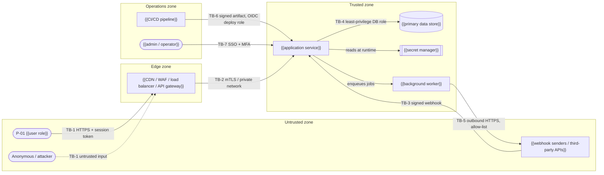
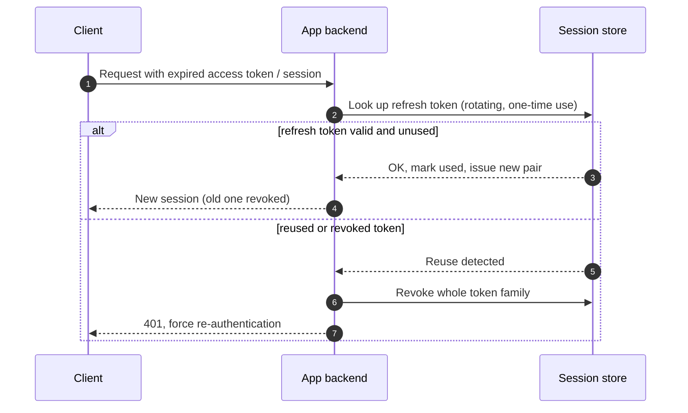
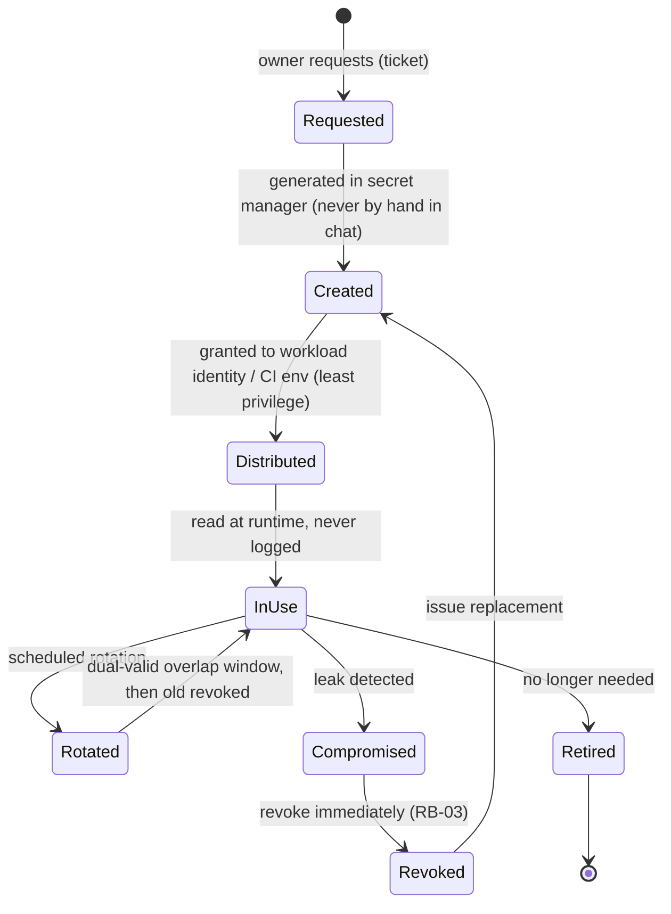
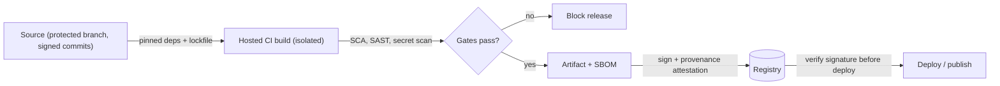

# Security Architecture — {{product_name}}

> **Status:** Draft · **Owner:** {{security_owner}} · **Last updated:** {{last_updated}} · **Tier:** {{tier}} · **Related:** [ARCHITECTURE](ARCHITECTURE.md) · [DATABASE](DATABASE.md) · [API](API.md) · [TESTING](TESTING.md) · [OPERATIONS](OPERATIONS.md)

> **Note:** This is the engineering threat model and control design. The vulnerability **disclosure policy** (how to report a vulnerability) lives in the root [SECURITY.md](../../SECURITY.md). This document does not by itself establish regulatory compliance.

<!-- guidance: Ground every threat and control in the actual architecture, data, and integrations. Do not claim a
control exists unless it is decided; mark planned controls as PROPOSAL and status "Planned". NEVER write secret values — names only
(e.g. `PAYMENT_API_KEY`). Use OWASP references for structure (Top 10 for web apps, API Security Top 10 for APIs,
Top 10 for LLM Applications for AI features, MASVS for mobile, ASVS levels for verification depth). For a local CLI or library,
focus on input handling, supply chain, file/system access, and credential storage; many web-specific sections become N/A.
For a client-only / local-first mobile or desktop app: replace the sample diagram and seed threats (no gateway, tenants, IDOR);
focus on on-device storage and OS backups (MASVS-STORAGE), third-party SDKs that send data (analytics/crash), app-store
and signing-key account security (MFA), supply chain, and logging of user-entered content. Auth/role sections become
"N/A — no accounts" with one line. Remove links to SECURITY.md/OPERATIONS/API if those docs are not generated.
Procedure (step by step): references/governance-guide.md §3 "Threat modeling procedure" and §4 "Authorization matrix". -->

<!-- guidance: Inputs you MUST read before writing: ARCHITECTURE (containers, integrations), DATABASE (entities, PII flags,
classification, access rules), API (OP-xx list with roles), PRD (roles/personas P-xx, Must features), DISCOVERY (IDN-*, PRV-*,
CMP-*, AIM-* answers), legal/COMPLIANCE (if generated). Every table below has a "Minimum content" rule. A section that does not apply
keeps its heading and one line `N/A — reason`. Example rows marked "Example" are illustrations; replace them with real rows. -->

<!-- guidance: Tier notes —
Lite: §1 assets, §2 boundaries (diagram + table), §3 threat table (top 5–8 threats, still ≥1 per STRIDE letter across the system), §4 authN, §5 role matrix, §7 secrets, §8 input handling, §12 redaction list, §14 residual risks, §15 a 3-row testing plan. Keep it to ~2 pages; skip §9.1 ASVS checklist (state target level only).
Standard: all sections; full STRIDE per trust boundary; ASVS Level 1 checklist as a typical baseline; OWASP Top 10 mapping (+ API Top 10 if API, + LLM Top 10 if AI).
Enterprise: ASVS Level 2 (Level 3 for high-assurance), formal DFD per trust boundary, abuse cases (§3.2), pen-test plan, key management (KMS/HSM, rotation), SBOM + signed artifacts + provenance mandatory, DPIA link, control owners and evidence locations for audit (link legal/COMPLIANCE.md CR-xx). -->

## 1. Assets
<!-- guidance: Minimum content: one row for (a) every data class in DATABASE §2 that holds Confidential/Restricted data,
(b) credentials and session tokens, (c) secrets and signing keys, (d) admin/privileged interfaces, (e) source code and CI/CD pipeline,
(f) availability of the primary journey. CIA = which property matters most (Confidentiality, Integrity, Availability). -->
| Asset | Classification | CIA priority | Why it matters (impact if compromised) | Stored / processed in | Owner |
| --- | --- | --- | --- | --- | --- |
| {{e.g. user accounts & credentials}} | {{Restricted}} | {{C, I}} | {{account takeover, data exposure}} | {{auth provider, users table}} | {{owner}} |
| {{e.g. customer content}} | {{Confidential}} | {{C}} | {{privacy breach, contractual liability}} | {{db, object storage}} | |
| {{e.g. signing keys, CI tokens}} | {{Restricted}} | {{I}} | {{malicious release to all users}} | {{secret manager, CI}} | |
| {{e.g. primary journey J-01}} | {{—}} | {{A}} | {{revenue / trust loss}} | {{all containers}} | |

### 1.1 Data classification and handling
<!-- guidance: Reuse the classes from DATABASE §2 verbatim. One row per class actually used. -->
| Class | Examples in this product | Encryption | May appear in logs? | May be sent to AI tools? | Retention |
| --- | --- | --- | --- | --- | --- |
| Public | {{marketing pages, public docs}} | In transit | Yes | Yes | — |
| Internal | {{feature flags, non-sensitive config}} | In transit | Yes | {{per AI_GUIDELINES §2}} | {{period}} |
| Confidential | {{customer content, emails}} | In transit + at rest | Masked only | {{No unless DPA}} | {{period}} |
| Restricted | {{credentials, tokens, payment, health, government IDs}} | In transit + at rest (+ field-level if required) | Never | Never | {{period}} |

## 2. Trust boundaries
<!-- guidance: Minimum content: a data-flow diagram (DFD) with every external actor, every container from ARCHITECTURE,
every data store, and every third-party integration; each crossing numbered TB-1…TB-n; plus the boundary table below with one row per TB-x.
A trust boundary exists wherever data crosses between different privilege levels, owners, networks, or processes
(internet → edge, edge → app, app → data store, app → third party, third party → app (webhooks), CI → production, admin → app, AI model ↔ app).
Keep ≤ 15 nodes per diagram; split by zone if larger. Enterprise: one DFD per boundary. -->


ASCII fallback (keep in sync with the diagram; use when Mermaid cannot render):

```text
 UNTRUSTED                 | EDGE        | TRUSTED                          | OPS
 [P-01 user]--TB-1 HTTPS-->| [gateway]   |                                  |
 [attacker]--TB-1-------->|   |--TB-2-->| [app] --TB-4--> (db)             |
 [3rd party]--TB-3 signed------------->|   |  \--> [[secrets]]            |
                           |             |   \--> [worker]--TB-5--> 3rd pty |
                           |             |  <--TB-6 signed artifact-------- | [CI]
                           |             |  <--TB-7 SSO+MFA--------------- | [admin]
```

| TB | From → To | Data classes crossing | Protocol | Authentication | Authorization | Key controls |
| --- | --- | --- | --- | --- | --- | --- |
| TB-1 | {{Client → edge}} | {{Confidential, credentials}} | {{HTTPS (TLS 1.2+)}} | {{session cookie / bearer token}} | {{per §5}} | {{WAF, rate limits, input validation}} |
| TB-2 | {{Edge → app}} | | | | | |
| TB-3 | {{Third party → app (webhook)}} | | | {{HMAC signature + timestamp}} | {{fixed sender}} | {{replay window, idempotency key}} |
| TB-4 | {{App → data store}} | | | {{DB credentials from secret manager}} | {{least-privilege role, RLS}} | {{parameterized queries}} |

## 3. Threat model (STRIDE)
<!-- guidance: Coverage rule (MANDATORY): for EVERY trust boundary TB-x, consider all six STRIDE categories
(Spoofing, Tampering, Repudiation, Information disclosure, Denial of service, Elevation of privilege).
Each pair (TB-x, category) gets ≥1 TH-xx row OR one row stating `N/A — reason` (e.g. "TB-4 Repudiation: N/A — no human actor at this boundary; covered by TB-7").
Each threat names attacker, action, and asset ("An anonymous attacker replays a captured webhook to credit an account twice").
Each row has ≥1 control, a status (Planned / Implemented / Accepted risk), a test ID (SEC-xx in TESTING) or "N/A — reason",
and an R-xx if the residual risk is not Low. Rate likelihood and impact with §3.1. Sort rows by TB, then STRIDE order.
Lite: 5–8 highest-risk threats total, but every STRIDE letter appears at least once across the system. -->
| ID | TB | Component | STRIDE | Threat (attacker → action → asset) | L | I | Risk | Control(s) | Status | Test | Risk ID |
| --- | --- | --- | --- | --- | --- | --- | --- | --- | --- | --- | --- |
| TH-01 | TB-1 | {{sign-in}} | S | {{Attacker uses leaked credentials (credential stuffing) to take over accounts}} | {{M}} | {{H}} | {{High}} | {{rate limiting per IP+account, MFA, breached-password check, generic errors}} | {{Planned}} | {{SEC-01}} | {{R-xx}} |
| TH-02 | TB-1 | {{API}} | T | {{Authenticated user modifies another user's record by changing the ID (IDOR / BOLA)}} | | | | {{server-side ownership check on every access; opaque IDs}} | | | |
| TH-03 | TB-1 | {{app}} | R | {{User denies performing a destructive action}} | | | | {{append-only audit log with actor, time, request ID}} | | | |
| TH-04 | TB-1 | {{API responses}} | I | {{Over-fetching exposes fields the caller may not see}} | | | | {{response allow-lists / DTOs per role}} | | | |
| TH-05 | TB-1 | {{search endpoint}} | D | {{Bot floods an expensive endpoint}} | | | | {{rate limits, pagination caps, timeouts, cost limits}} | | | |
| TH-06 | TB-1 | {{profile update}} | E | {{User escalates role via mass assignment of `role` field}} | | | | {{allow-listed writable fields, role changes only via admin OP}} | | | |
| TH-07 | TB-3 | {{webhook handler}} | S | {{Attacker forges a webhook from the payment provider}} | | | | {{HMAC signature verification, timestamp tolerance}} | | | |
| TH-08 | TB-3 | {{webhook handler}} | T | {{Replayed webhook double-applies an event}} | | | | {{idempotency key store, replay window}} | | | |
| TH-09 | TB-4 | {{db}} | I | {{Cross-tenant read through a query missing the tenant filter}} | | | | {{tenant-scoped repository layer + RLS; isolation tests}} | | | |
| TH-10 | TB-6 | {{CI/CD}} | T | {{Compromised dependency or CI action injects code into the release}} | | | | {{pinned deps and action SHAs, SBOM, signed artifacts, provenance}} | | | |
| TH-nn | TB-4 | {{db}} | R | N/A — {{reason}} | — | — | — | — | — | — | — |

### 3.1 Risk rating
| Likelihood ↓ / Impact → | Low | Medium | High |
| --- | --- | --- | --- |
| **High** | Medium | High | Critical |
| **Medium** | Low | Medium | High |
| **Low** | Low | Low | Medium |

- Likelihood: H = exploitable by an anonymous attacker with public tools; M = needs an account or insider knowledge; L = needs privileged access or an unlikely chain.
- Impact: H = Restricted data exposed, money moved, or service down for all; M = one tenant/user affected or partial outage; L = minor, recoverable.
- Critical and High risks MUST have a control before release or an accepted-risk entry in §14 signed by {{risk_owner}}.

### 3.2 Abuse cases (Standard optional, Enterprise required)
<!-- guidance: One abuse case per Must feature that moves money, data, or permissions. Format: "As a <malicious actor>, I want to <misuse>, so that <gain>." Link to TH-xx and a SEC-xx test. -->
| ID | Feature | Abuse case | Linked threat | Test |
| --- | --- | --- | --- | --- |
| AB-01 | {{F-03}} | {{As a free user, I want to call the export API repeatedly to scrape all shared notes}} | {{TH-05}} | {{SEC-07}} |

### 3.3 AI / LLM-specific threats (if the product uses AI)
<!-- guidance: Required when DISCOVERY AIM-* says the product calls a model, uses RAG, or lets a model call tools. Otherwise `N/A — no AI features`. Map each to OWASP Top 10 for LLM Applications (§9.4). -->
| ID | Threat | Example | Control(s) | Test |
| --- | --- | --- | --- | --- |
| TH-{{nn}} | Direct / indirect prompt injection | {{uploaded document tells the model to email all notes to an attacker}} | {{treat retrieved content as data; tool allow-list; human approval for side effects}} | {{SEC-xx}} |
| TH-{{nn}} | Sensitive information disclosure | {{model reveals another tenant's data from shared context}} | {{per-tenant retrieval filters; no secrets in prompts; output filters}} | |
| TH-{{nn}} | Improper output handling | {{model output rendered as HTML executes script}} | {{encode output; never pass model output to shell/SQL/eval}} | |
| TH-{{nn}} | Excessive agency | {{agent deletes data via an over-scoped tool}} | {{least-privilege tool scopes; confirmation for destructive actions}} | |
| TH-{{nn}} | Unbounded consumption | {{long prompts drive cost spikes}} | {{token and rate limits per user; budget alerts}} | |

## 4. Authentication
<!-- guidance: Minimum content: every bullet answered (or N/A — reason); ≥1 sequence diagram for the primary sign-in flow
and one for session refresh/revocation (if sessions exist); service-to-service auth for every internal call crossing a TB. -->
- **Identity source:** {{e.g. built-in accounts / OIDC provider / enterprise SSO (SAML/OIDC) / OS keychain for CLI / none}}
- **Credentials:** {{passwords hashed with a modern adaptive algorithm (e.g. Argon2id, bcrypt, scrypt) / passkeys (WebAuthn) / magic links}}
- **MFA:** {{required for admins; optional for users}}
- **Sessions/tokens:** {{lifetime, refresh, rotation, revocation on password change/logout, secure cookie flags}}
- **Account recovery:** {{flow and abuse protections}}
- **Service-to-service:** {{workload identity / mTLS / scoped API keys}}

### 4.1 Authentication flows
<!-- guidance: Draw the real flow for the chosen identity source. Example below: OIDC authorization code + PKCE with a server-side session.
For API keys: issue → hash at rest → present → verify → rotate. For a CLI: device authorization flow + OS keychain storage. -->
```mermaid
sequenceDiagram
    autonumber
    actor U as P-01 User
    participant C as Client (browser / app)
    participant A as App backend
    participant I as Identity provider
    U->>C: Click "Sign in"
    C->>A: GET /auth/login
    A->>A: Create state + nonce + PKCE verifier (stored server-side)
    A-->>C: 302 redirect to IdP (code_challenge, state)
    C->>I: Authorization request
    I->>U: Authenticate (password / passkey + MFA)
    I-->>C: 302 back with code + state
    C->>A: GET /auth/callback?code&state
    A->>A: Verify state; exchange code + verifier
    A->>I: Token request (back channel)
    I-->>A: ID token + access token
    A->>A: Validate signature, issuer, audience, nonce, expiry
    A-->>C: Set session cookie (HttpOnly, Secure, SameSite)
```



ASCII fallback:

```text
User -> Client -> App:/auth/login -> (state, nonce, PKCE) -> redirect -> IdP
IdP: authenticate + MFA -> redirect(code,state) -> App:/auth/callback
App: verify state -> exchange code+verifier -> validate ID token -> set secure session cookie
Refresh: rotating refresh token; reuse => revoke family => 401 re-auth
```

### 4.2 Authentication control checklist
| Control | Decision | Status |
| --- | --- | --- |
| Generic error messages (no account enumeration on sign-in, sign-up, reset) | {{yes}} | {{Planned}} |
| Rate limiting / progressive delay on sign-in, reset, MFA | {{limits}} | |
| Password policy (length ≥ {{n}}, breached-password check, no composition rules — NIST SP 800-63B style) | {{policy or N/A}} | |
| MFA enrolment and recovery codes; step-up auth for sensitive actions | {{which actions}} | |
| Session idle timeout / absolute timeout | {{values}} | |
| Revoke sessions on password change, role change, account disable | {{yes}} | |
| Cookie flags `HttpOnly`, `Secure`, `SameSite={{Lax/Strict}}`; CSRF protection for cookie auth | {{yes}} | |
| Token validation: signature, issuer, audience, expiry, algorithm allow-list | {{yes}} | |

## 5. Authorization
<!-- guidance: Deny by default. Enforced server/core side on every request; the client only hides UI.
Minimum content (coverage rules):
- Every role/persona from PRD appears as a column (plus Anonymous if anything is public, plus service accounts if any).
- Every resource (entity) from DATABASE appears as a row group; every action the API exposes on it (create/read/update/delete/list/export/share/admin) is a row.
- Every OP-xx in API maps to exactly one permission row (record it in the "Operations" column).
- Cells use: ✓ allowed · ✗ denied · `own` only own records · `org` only within own tenant · `cond` see §5.2 rule ID.
- Every ✗ that a real user could attempt becomes a permission-denial test in TESTING §3 (SEC-xx).
Model: RBAC (roles), ABAC (attributes like owner, tenant, plan, status), or ReBAC (relationships like "shared with"). Most products are RBAC + ownership/tenant conditions. -->
**Model:** {{RBAC + ownership/tenant conditions / ABAC / ReBAC}} · **Policy location:** {{e.g. policy module in service layer / policy engine (OPA, Cedar, Casbin) / DB row-level security}} · **Default:** deny.

### 5.1 Roles
| Role | Who (persona) | How granted | Scope | Can be self-assigned? |
| --- | --- | --- | --- | --- |
| {{Anonymous}} | {{visitor}} | — | Public resources | — |
| {{Member}} | {{P-01}} | {{sign-up / invite}} | {{own tenant}} | {{No}} |
| {{Admin}} | {{P-02}} | {{granted by Owner}} | {{own tenant}} | No |
| {{Owner / Super-admin}} | {{P-03}} | {{tenant creator / ops}} | {{tenant / platform}} | No |

### Permission matrix
| Resource | Action | {{Anonymous}} | {{Member}} | {{Admin}} | {{Owner / Super-admin}} | Operations (OP-xx) | Enforced at |
| --- | --- | --- | --- | --- | --- | --- | --- |
| {{item}} | create | ✗ | org | org | org | {{OP-01}} | {{service + DB policy}} |
| {{item}} | read | ✗ | own / cond C-1 | org | org | {{OP-02}} | |
| {{item}} | update | ✗ | own | org | org | {{OP-03}} | |
| {{item}} | delete | ✗ | own | org | org | {{OP-04}} | |
| {{item}} | export | ✗ | ✗ | org | org | {{OP-05}} | |
| {{member}} | change role | ✗ | ✗ | cond C-2 | org | {{OP-10}} | |
| {{billing}} | manage | ✗ | ✗ | ✗ | org | {{OP-20}} | |

### 5.2 Attribute and relationship conditions
| ID | Condition | Example |
| --- | --- | --- |
| C-1 | {{Member may read an item if owner OR the item is shared with them}} | {{share table lookup}} |
| C-2 | {{Admin may change roles except their own and except to Owner}} | {{prevents self-escalation}} |

### 5.3 Enforcement rules
- Authorization runs after authentication and before any data access, in {{single policy layer}} — never scattered `if` checks in handlers.
- Tenant/owner IDs come from the verified token/session, never from request bodies or query strings.
- Return {{404 / 403}} for denied object access consistently (choose one to avoid existence leaks).
- Privileged actions (role change, export, delete tenant) require {{re-authentication / MFA step-up}} and write an audit event (§12).

## 6. Tenant and data isolation
<!-- guidance: Minimum content: isolation model, where the tenant ID comes from, every enforcement layer, and the tests that prove it. N/A — reason if single-tenant. -->
- **Model:** {{shared schema + tenant_id column / schema per tenant / database per tenant}} (see DATABASE §7)
- **Tenant source:** {{verified token claim only}} · **Enforcement layers:** {{repository filter + row-level security + cache key prefix + object-storage path prefix}}
- **Cross-tenant paths to guard:** {{search indexes, caches, background jobs, exports, analytics, AI retrieval}}
- **Tests:** isolation rows in [TESTING](TESTING.md) (`SEC-02` and others)

## 7. Secrets management
<!-- guidance: Minimum content: one row per secret the system uses (DB credentials, API keys for every third party, signing keys,
encryption keys, webhook secrets, OAuth client secrets, CI deploy credentials). Names only. Prefer short-lived credentials
(workload identity, OIDC federation from CI) over long-lived keys. -->
| Secret name | Used by | Stored in | Injected via | Rotation | Owner |
| --- | --- | --- | --- | --- | --- |
| `{{SECRET_NAME}}` | {{component}} | {{e.g. cloud secret manager / CI encrypted secrets / OS keychain}} | {{env var at runtime / mounted file / SDK fetch}} | {{cadence / on compromise}} | {{owner}} |
- Never in source, docs, logs, client bundles, mobile binaries, or container images. Secret scanning runs in CI and pre-commit.
- Public client config (e.g. publishable keys) is listed explicitly as public.

### 7.1 Secrets lifecycle


ASCII fallback: `request → create (secret manager) → distribute (least privilege) → use (never log) → rotate (overlap, revoke old) → retire`; on leak: `revoke now → replace → audit access → postmortem`.

### 7.2 Encryption and key management
| Key / purpose | Algorithm (decided) | Managed by | Rotation | Access |
| --- | --- | --- | --- | --- |
| {{data at rest — database}} | {{provider default AES-256}} | {{cloud KMS}} | {{yearly, automatic}} | {{service role only}} |
| {{field-level encryption for Restricted fields}} | {{envelope encryption}} | {{KMS}} | | |
| {{artifact / release signing}} | {{e.g. Sigstore keyless / GPG}} | {{CI identity / maintainer}} | | |

### 7.3 Leak response
1. Revoke/rotate the secret first (RB-03 in [OPERATIONS](OPERATIONS.md#15-runbooks-index)); removing it from git history is not enough.
2. Review access logs for use of the secret between leak time and revocation.
3. Record as a security incident per §13.

## 8. Input and output handling
<!-- guidance: Minimum content: one bullet (or N/A) per input channel the product has: HTTP bodies/params, headers, file uploads,
webhooks, message queues, CLI args/env/files, deep links, AI model output, imported files (CSV/JSON/XML). -->
- Validate all input at the trust boundary with schemas (type, length, format, allow-lists); reject unknown fields.
- Parameterized queries only; context-aware output encoding; Content Security Policy for web.
- File uploads: {{allowed types by content sniffing, size ≤ {{n}} MB, stored outside web root, malware scan if needed}}.
- SSRF: outbound requests to user-supplied URLs use an allow-list and block internal ranges.
- CLI/library: no shell interpolation of user input; safe path handling; safe deserialization.
- LLM features (if any): treat model output and retrieved content as untrusted; guard tool calls; see OWASP Top 10 for LLM Applications.

### 8.1 Web security headers (if web UI)
| Header | Value (decided) |
| --- | --- |
| `Content-Security-Policy` | {{default-src 'self'; script-src with nonces; frame-ancestors 'none'}} |
| `Strict-Transport-Security` | {{max-age=31536000; includeSubDomains}} |
| `X-Content-Type-Options` | `nosniff` |
| `Referrer-Policy` | {{strict-origin-when-cross-origin}} |
| CORS | {{explicit origin allow-list; no wildcard with credentials}} |

## 9. Standards mapping
<!-- guidance: Coverage rule: every row of every applicable list below is present with "How addressed" (section / TH-xx / control)
or `N/A — reason`. Never write "compliant"; say "addressed by". Rows below follow OWASP Top 10:2025 (https://owasp.org/Top10/2025/); if you must map against 2021,
re-label rows from the official 2021 list. -->
| Reference | Item | How addressed | Status |
| --- | --- | --- | --- |
| OWASP Top 10:2025 (web) | A01 Broken Access Control (incl. SSRF) | §5, TH-02, §8 SSRF rule | {{Planned}} |
| OWASP Top 10:2025 | A02 Security Misconfiguration | {{hardened defaults, IaC review, §8.1 headers}} | |
| OWASP Top 10:2025 | A03 Software Supply Chain Failures | §10 | |
| OWASP Top 10:2025 | A04 Cryptographic Failures | {{TLS 1.2+, encryption at rest, §7.2}} | |
| OWASP Top 10:2025 | A05 Injection | §8 | |
| OWASP Top 10:2025 | A06 Insecure Design | {{this threat model, abuse cases §3.2}} | |
| OWASP Top 10:2025 | A07 Authentication Failures | §4 | |
| OWASP Top 10:2025 | A08 Software or Data Integrity Failures | {{§10 signing/provenance, webhook signatures TH-07}} | |
| OWASP Top 10:2025 | A09 Security Logging and Alerting Failures | §12, OPERATIONS | |
| OWASP Top 10:2025 | A10 Mishandling of Exceptional Conditions | {{fail closed, safe error handling §8, §12}} | |
| OWASP ASVS | Target level | {{L1 / L2 / L3}} — see §9.1 | |
<!-- guidance: Use the OWASP API Security Top 10 for API products and MASVS for mobile apps. Don't claim "compliant"; say "addressed by". -->

### 9.1 OWASP ASVS control checklist
<!-- guidance: Choose the target level: L1 = baseline for all apps (testable from outside), L2 = most apps handling personal or business data
(recommended for Standard with accounts), L3 = high-value/high-assurance (payments at scale, health, critical infrastructure).
One row per ASVS chapter (names below follow ASVS 5.0 — verify against the official release you target). A chapter that does not apply
(e.g. WebRTC) is `N/A — reason`. "Key requirements" lists the 2–4 requirements most relevant to this product, by ASVS ID once verified. -->
| ASVS chapter | Applies? | Level target | Key requirements for this product | Where addressed | Status |
| --- | --- | --- | --- | --- | --- |
| Encoding and Sanitization | {{Yes}} | {{L1}} | {{output encoding per context; no dynamic SQL}} | §8 | {{Planned}} |
| Validation and Business Logic | | | {{schema validation; business limits (e.g. max shares/day)}} | §8, §3.2 | |
| Web Frontend Security | | | {{CSP, cookie flags, clickjacking}} | §8.1, §4.2 | |
| API and Web Service | | | {{auth on every OP, content-type checks}} | §5, API | |
| File Handling | | | {{type/size checks, storage outside web root}} | §8 | |
| Authentication | | | {{§4.2 checklist}} | §4 | |
| Session Management | | | {{rotation, revocation, timeouts}} | §4 | |
| Authorization | | | {{deny by default, object-level checks}} | §5 | |
| Self-contained Tokens | | | {{JWT validation, algorithm allow-list}} | §4.2 | |
| OAuth and OIDC | | | {{PKCE, state, nonce, redirect URI allow-list}} | §4.1 | |
| Cryptography | | | {{approved algorithms, key management}} | §7.2 | |
| Secure Communication | | | {{TLS everywhere incl. internal}} | §2 | |
| Configuration | | | {{no debug in prod, secrets out of config}} | §7, OPERATIONS §2 | |
| Data Protection | | | {{classification, minimization, retention}} | §1.1, §11 | |
| Secure Coding and Architecture | | | {{dependency policy, safe deserialization}} | §10, CODE_STYLE | |
| Security Logging and Error Handling | | | {{security events, no sensitive data in logs/errors}} | §12 | |
| WebRTC | {{N/A — no real-time media}} | — | — | — | — |

### 9.2 OWASP API Security Top 10 (2023) — if the product exposes an API
| Item | How addressed | Status |
| --- | --- | --- |
| API1 Broken Object Level Authorization | {{§5.3, TH-02, SEC-01}} | |
| API2 Broken Authentication | {{§4}} | |
| API3 Broken Object Property Level Authorization | {{response DTOs, writable-field allow-lists, TH-04/TH-06}} | |
| API4 Unrestricted Resource Consumption | {{rate limits, pagination caps, payload size, TH-05}} | |
| API5 Broken Function Level Authorization | {{admin OPs gated in §5}} | |
| API6 Unrestricted Access to Sensitive Business Flows | {{abuse cases §3.2, bot controls}} | |
| API7 Server Side Request Forgery | {{§8 SSRF rule}} | |
| API8 Security Misconfiguration | {{CORS, headers, error verbosity}} | |
| API9 Improper Inventory Management | {{API.md is the inventory; versioning and deprecation}} | |
| API10 Unsafe Consumption of APIs | {{validate third-party responses, timeouts, TB-5}} | |

### 9.3 OWASP Mobile (MASVS) — if mobile app
<!-- guidance: One row per category: STORAGE, CRYPTO, AUTH, NETWORK, PLATFORM, CODE, RESILIENCE, PRIVACY. Otherwise `N/A — no mobile app`. -->
| Category | How addressed | Status |
| --- | --- | --- |
| MASVS-STORAGE | {{no secrets in app storage; exclude sensitive files from OS backups}} | |

### 9.4 OWASP Top 10 for LLM Applications (2025) — if AI features
| Item | How addressed | Status |
| --- | --- | --- |
| LLM01 Prompt Injection | {{§3.3, §8}} | |
| LLM02 Sensitive Information Disclosure | {{no Restricted data in prompts; per-tenant retrieval}} | |
| LLM03 Supply Chain | {{approved model/providers list; model and dataset provenance}} | |
| LLM04 Data and Model Poisoning | {{curated sources for RAG/fine-tuning}} | |
| LLM05 Improper Output Handling | {{encode/validate model output}} | |
| LLM06 Excessive Agency | {{least-privilege tools, human approval}} | |
| LLM07 System Prompt Leakage | {{no secrets or authZ logic in system prompts}} | |
| LLM08 Vector and Embedding Weaknesses | {{tenant-partitioned indexes, access checks at retrieval}} | |
| LLM09 Misinformation | {{citations, confidence UI, human review for high-stakes output}} | |
| LLM10 Unbounded Consumption | {{token/rate/budget limits}} | |

## 10. Supply chain security
<!-- guidance: Minimum content: one row per control in the table, decided or PROPOSAL, with the CI stage that enforces it. Libraries/CLIs
publishing to registries MUST cover signing/provenance and trusted publishing. Reference levels: SLSA Build L1 (provenance exists),
L2 (signed provenance from a hosted build), L3 (hardened, isolated builds). -->
- Dependency policy: {{approval for new deps, pinned versions + lockfile, automated update PRs (e.g. Dependabot/Renovate)}}
- Scanning: {{SCA for known vulnerabilities, SAST, secret scanning, container/IaC scanning}} in CI — see [TESTING](TESTING.md#8-ci-quality-gates).
- SBOM: {{format e.g. CycloneDX / SPDX}} generated per release.
- Build integrity: {{signed artifacts/commits, provenance (e.g. SLSA level target), npm/PyPI trusted publishing}}.
- CI hardening: least-privilege tokens, pinned actions, protected branches.

| Control | Decision | Enforced in | Status |
| --- | --- | --- | --- |
| Lockfiles committed; frozen installs in CI | {{e.g. `npm ci`, `uv sync --frozen`, `go mod verify`}} | CI install step | {{Planned}} |
| Pin CI actions/plugins to commit SHA; container base images to digest | {{yes}} | CI config review | |
| New dependency review (license, maintenance, advisories, typo-squatting) | {{CODE_STYLE §10}} | PR review + dependency-review check | |
| SCA vulnerability scan; fail on {{critical/high}} without exception | {{tool e.g. OSV-Scanner, Dependabot alerts, Trivy, Snyk}} | PR + nightly | |
| SBOM per release | {{CycloneDX / SPDX}} | release job | |
| Artifact signing | {{e.g. Sigstore cosign keyless / GPG / platform code signing for mobile/desktop}} | release job | |
| Build provenance | {{SLSA Build L{{n}} target via hosted CI attestations}} | release job | |
| Trusted publishing to registries (no long-lived tokens) | {{npm / PyPI / crates.io / container registry via OIDC}} | release job | |
| Repository hygiene score | {{e.g. OpenSSF Scorecard}} | weekly | |
| Branch protection + required reviews | [GIT_WORKFLOW](../engineering/GIT_WORKFLOW.md) | code host | |



ASCII fallback: `signed source → pinned deps → isolated CI build → scans gate → artifact + SBOM → sign + provenance → registry → verify signature → deploy`.

## 11. Privacy engineering
<!-- guidance: Minimum content: every PII field flagged in DATABASE appears in the retention table with a purpose and lawful basis or [TBD: counsel].
The data list must match legal/PRIVACY_POLICY. If no personal data: `N/A — no personal data (see DATABASE)` and keep the analytics bullet. -->
- **Data minimization:** collect only {{fields}} for {{purpose}}; no collection "just in case".
- **Purpose & consent:** {{lawful basis / consent capture where required}} — legal review required.
- **Data subject requests:** access/export/correction/deletion handled via {{process}} within {{target}}.
- **Third-party sharing:** {{processors and data shared}} → [PRIVACY_POLICY](../legal/PRIVACY_POLICY.md).
- **Analytics/telemetry:** {{what, anonymization, opt-in/opt-out}}.

| Personal data | Purpose | Lawful basis | Retention | Deletion method | Shared with |
| --- | --- | --- | --- | --- | --- |
| {{email}} | {{account sign-in, notifications}} | {{contract / [TBD: counsel]}} | {{life of account + 30 days}} | {{hard delete + backup expiry}} | {{email provider}} |

- **Privacy by default:** {{non-essential tracking off until consent; minimal profile visibility}}.
- **Deletion reach:** primary store, replicas, search indexes, caches, analytics, logs, backups (expire within {{period}}), AI provider retention.
- **DPIA / privacy review trigger:** {{new PD category, new processor, profiling, children's data}} → [TBD: owner].

## 12. Logging, audit, and redaction
<!-- guidance: Minimum content: every security-relevant event below has a row (or N/A); a never-log list covering every Restricted field from §1.1. -->
- Security events logged: {{sign-in success/failure, permission denials, role changes, data exports, admin actions}}.
- **Never log:** passwords, tokens, session IDs, full payment data, secrets, {{other PII fields}}. Mask: {{email → u***@example.com}}.
- Audit log: {{append-only, retained {{period}}, access restricted}}.

| Event | Fields (no sensitive values) | Destination | Retention | Alerts? |
| --- | --- | --- | --- | --- |
| Sign-in success / failure | actor ID, IP (truncated if required), user agent, result, request ID | {{audit log}} | {{period}} | {{failure spike → OPERATIONS §8}} |
| Authorization denied | actor ID, resource type, action, request ID | {{audit log}} | | {{spike}} |
| Role / permission change | actor, target, old → new role | {{audit log}} | | {{yes}} |
| Data export / bulk read | actor, scope, row count | {{audit log}} | | |
| Secret access / rotation | identity, secret name | {{secret manager audit}} | | |
| Admin / support impersonation | admin ID, target, reason | {{audit log}} | | {{yes}} |

## 13. Incident response
- Detection & alerting: [OPERATIONS](OPERATIONS.md#8-alerting-and-on-call) · Process & postmortems: [OPERATIONS](OPERATIONS.md#14-incident-management)
- External reports: [SECURITY.md](../../SECURITY.md) · Breach notification obligations: {{see legal/COMPLIANCE.md or [TBD]}}

### 13.1 Security playbooks
<!-- guidance: One row per likely security incident type. Each links a runbook RB-xx in OPERATIONS (create it there if missing). -->
| Scenario | First action (within minutes) | Runbook | Notify |
| --- | --- | --- | --- |
| Leaked secret | Revoke and rotate | RB-03 | {{security owner}} |
| Account takeover reports | Force sign-out, lock account, review audit log | {{RB-xx}} | {{support, user}} |
| Cross-tenant data exposure | Disable affected feature/flag, preserve logs | {{RB-xx}} | {{security owner, counsel}} |
| Compromised dependency / release | Stop deploys, yank/deprecate, publish advisory | {{RB-xx}} | {{maintainers, users}} |

## 14. Residual risk register
| ID | Risk | Why accepted / deferred | Owner | Review date |
| --- | --- | --- | --- | --- |
| R-{{nn}} | {{risk}} | {{rationale}} | {{owner}} | {{date}} |

## 15. Security testing plan
<!-- guidance: Minimum content: every activity row has an applicability decision; each automated activity names where it runs
and whether it blocks; every TH-xx with status Planned/Implemented has a test (SEC-xx) in TESTING or `N/A — reason`.
Tools are examples — pick by stack and mark PROPOSAL until configured. -->
| Activity | Scope | Example tools (pick per stack) | Cadence | Blocks release? | Test IDs |
| --- | --- | --- | --- | --- | --- |
| Authorization matrix tests | every ✗ in §5 | integration test framework | every PR | Yes | {{SEC-01…}} |
| Tenant isolation tests | §6 paths | integration tests | every PR | Yes | {{SEC-02}} |
| SAST | all source | {{CodeQL, Semgrep, gosec, Bandit, SpotBugs}} | every PR | High/critical | {{SEC-SAST}} |
| SCA (dependencies) | lockfiles, images | {{OSV-Scanner, Dependabot, Trivy, Snyk}} | every PR + nightly | Critical | {{SEC-SCA}} |
| Secret scanning | repo + history | {{gitleaks, trufflehog, platform push protection}} | pre-commit + PR | Yes | {{SEC-03}} |
| IaC / container scanning | IaC, Dockerfiles | {{Checkov, tfsec/Trivy config, hadolint}} | PR touching infra | High | {{SEC-xx}} |
| DAST | staging | {{OWASP ZAP baseline / API scan}} | nightly / pre-release | High | {{SEC-DAST}} |
| Fuzzing (parsers, file import, protocol) | {{components}} | {{language-native fuzzers, e.g. Go fuzzing, cargo-fuzz, Atheris, Jazzer}} | {{nightly}} | No | {{SEC-xx}} |
| AI red-team / prompt-injection evals | §3.3 | {{eval suite with injection corpus}} | PR touching prompts/tools | {{Yes}} | {{SEC-xx}} |
| Threat model review | this doc | review meeting | {{each milestone / major change}} | — | — |
| Penetration test | {{production-like env}} | {{external firm [TBD]}} | {{before GA, yearly}} (Enterprise) | Critical/high findings | — |

## Definition of done
- [ ] Assets, trust boundaries, and STRIDE threats reflect the real architecture; each threat has a control or accepted risk.
- [ ] AuthN decisions and a deny-by-default authorization matrix are agreed and match DATABASE access rules.
- [ ] Secrets are listed by name only with storage and rotation; no values anywhere.
- [ ] Supply chain, privacy, and logging-redaction controls are defined.
- [ ] Security tests are linked in TESTING; residual risks have owners. Root SECURITY.md covers disclosure.

### Completeness self-check
<!-- guidance: Run every check before marking the doc "In review". Fix gaps; do not just tick. Keep this list in the generated doc (checked). -->
- [ ] Every container, data store, and third party from ARCHITECTURE appears in the §2 diagram, and every crossing has a TB-x row.
- [ ] Every TB-x × STRIDE letter has ≥1 TH-xx row or an explicit `N/A — reason` row (Lite: every STRIDE letter at least once).
- [ ] Every High/Critical threat has a control with status, a SEC-xx test, and (if residual risk remains) an R-xx in §14.
- [ ] Every PRD role is a column in §5; every DATABASE entity is a resource; every API OP-xx appears in the Operations column.
- [ ] Every secret the system needs is in §7 (one per third-party integration at minimum); no values anywhere.
- [ ] §9 lists every OWASP Top 10 item; API Top 10 if API; LLM Top 10 if AI; MASVS if mobile; ASVS target level stated.
- [ ] Every PII field in DATABASE appears in §11 with purpose and retention, matching PRIVACY_POLICY.
- [ ] Mermaid diagrams render and each has an ASCII fallback; ≤ 15 nodes each.
- [ ] No `{{placeholders}}`, guidance comments, invented tools-as-configured, or "compliant/certified" claims remain.
