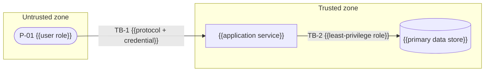
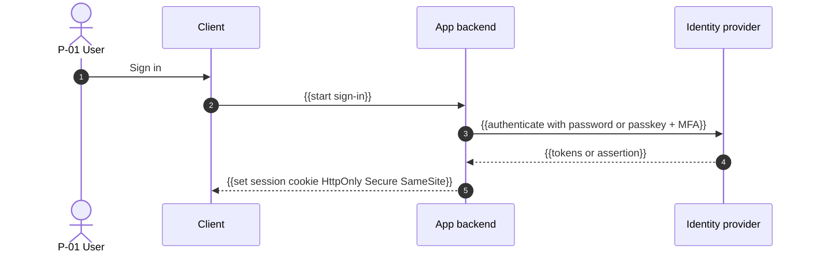

# Security Architecture — {{product_name}}

> **Status:** Draft · **Owner:** {{security_owner}} · **Last updated:** {{last_updated}} · **Tier:** {{tier}} · **Related:** [ARCHITECTURE](ARCHITECTURE.md) · [DATABASE](DATABASE.md) · [API](API.md) · [TESTING](TESTING.md) · [OPERATIONS](OPERATIONS.md)

> **Note:** This is the engineering threat model and control design. The vulnerability **disclosure policy** (how to report a vulnerability) lives in the root [SECURITY.md](../../SECURITY.md). This document does not by itself establish regulatory compliance.

<!-- guidance: Ground every threat and control in the actual architecture, data, and integrations. Do not claim a
control exists unless it is decided; mark planned controls as PROPOSAL and status "Planned". NEVER write secret values — names only
(e.g. `PAYMENT_API_KEY`). Use OWASP references for structure (Top 10 for web apps, API Security Top 10 for APIs,
Top 10 for LLM Applications for AI features, MASVS for mobile, ASVS levels for verification depth). For a local CLI or library, or a client-only / local-first
mobile or desktop app, read references/security-standards-checklists.md §13 first (which sections become N/A and what to focus on). Remove links to SECURITY.md/OPERATIONS/API if those docs are not generated.
Procedure (step by step): references/governance-guide.md §3 "Threat modeling procedure" and §4 "Authorization matrix". -->

<!-- guidance: Inputs you MUST read before writing: ARCHITECTURE (containers, integrations), DATABASE (entities, PII flags,
classification, access rules), API (OP-xx list with roles), PRD (roles/personas P-xx, Must features), DISCOVERY (IDN-*, PRV-*,
CMP-*, AIM-* answers), legal/COMPLIANCE (if generated). Every table below has a "Minimum content" rule. A section that does not apply
keeps its heading and one line `N/A — reason`. Example rows marked "Example" are illustrations; replace them with real rows. -->

<!-- guidance: Tier notes —
Lite: §1 assets, §2 boundaries (diagram + table), §3 threat table (top 5–8 threats, still ≥1 per STRIDE letter across the system), §4 authN, §5 role matrix, §7 secrets, §8 input handling, §12 redaction list, §14 residual risks, §15 a 3-row testing plan. Keep it to ~2 pages; skip §9.1 ASVS checklist (state target level only). Lite also: §13 severity table + first-action lines only; §16 three-line policy (intake, one SLA, exception rule); §17 one paragraph (who has prod/admin access, MFA, break-glass); §18 one row per third party; §19 backups + DNS/email lines only; §20 `N/A — Lite`. In Lite, OPERATIONS and API are not generated: repoint links per references/tiering-and-doc-matrix.md "Lite merges" (incident/secret rotation/runbooks/backups → ARCHITECTURE §14.4; API → ARCHITECTURE §7).
Standard: all sections; full STRIDE per trust boundary; ASVS Level 1 checklist as a typical baseline; OWASP Top 10 mapping (+ API Top 10 if API, + LLM Top 10 if AI). §13 full (detection sources, containment, notification table, communications); §16–§19 complete tables; §20 `N/A — reason` unless legal/COMPLIANCE.md exists.
Enterprise: ASVS Level 2 (Level 3 for high-assurance), formal DFD per trust boundary, abuse cases (§3.2), pen-test plan, key management (KMS/HSM, rotation), SBOM + signed artifacts + provenance mandatory, DPIA link, control owners and evidence locations for audit (§20 maps controls to legal/COMPLIANCE.md CR-xx), annual incident tabletop, access reviews with recorded evidence. -->

## 1. Assets
<!-- guidance: Minimum content: one row for (a) every data class in DATABASE §2 that holds Personal (PII), Sensitive or Secrets data,
(b) credentials and session tokens, (c) secrets and signing keys, (d) admin/privileged interfaces, (e) source code and CI/CD pipeline,
(f) availability of the primary journey. CIA = which property matters most (Confidentiality, Integrity, Availability). More example rows: references/security-standards-checklists.md §13. -->
| Asset | Classification | CIA priority | Why it matters (impact if compromised) | Stored / processed in | Owner |
| --- | --- | --- | --- | --- | --- |
| {{e.g. user accounts & credentials}} | {{Secrets}} | {{C, I}} | {{account takeover, data exposure}} | {{auth provider, users table}} | {{owner}} |

### 1.1 Data classification and handling
<!-- guidance: Use the class names from DATABASE §2 verbatim (Public, Internal, Personal (PII), Sensitive / special category, Secrets); never invent or rename classes here. One row per class actually used. -->
| Class | Examples in this product | Encryption | May appear in logs? | May be sent to AI tools? | Retention |
| --- | --- | --- | --- | --- | --- |
| Public | {{marketing pages, public docs}} | In transit | Yes | Yes | — |
| Internal | {{task titles, feature flags, non-sensitive config}} | In transit | Yes | {{per AI_GUIDELINES §2}} | {{period}} |
| Personal (PII) | {{email, name, IP, customer content}} | In transit + at rest | Masked only | {{No unless DPA}} | {{period}} |
| Sensitive / special category | {{payment, health, government IDs, precise location, children's data}} | In transit + at rest (+ field-level if required) | Never | Never | {{period}} |
| Secrets | {{password hashes, tokens, API keys, signing keys, webhook secrets}} | In transit + at rest (hash or KMS-wrapped) | Never | Never | {{period}} |

## 2. Trust boundaries
<!-- guidance: Minimum content: a data-flow diagram (DFD) with every external actor, every container from ARCHITECTURE,
every data store, and every third-party integration; each crossing numbered TB-1…TB-n; plus the boundary table below with one row per TB-x.
A trust boundary exists wherever data crosses between different privilege levels, owners, networks, or processes
(internet → edge, edge → app, app → data store, app → third party, third party → app (webhooks), CI → production, admin → app, AI model ↔ app).
Keep ≤ 15 nodes per diagram; split by zone if larger. Enterprise: one DFD per boundary. -->
<!-- guidance: For a server-backed product, load references/security-standards-checklists.md §10 for a full sample DFD (zones, webhooks, worker, CI, admin) with its ASCII fallback. -->

ASCII fallback (keep in sync with the diagram): `{{[P-01 user] --TB-1--> [app] --TB-2--> (db)}}`

| TB | From → To | Data classes crossing | Protocol | Authentication | Authorization | Key controls |
| --- | --- | --- | --- | --- | --- | --- |
| TB-1 | {{Client → edge}} | {{Personal (PII), Secrets}} | {{HTTPS (TLS 1.2+)}} | {{session cookie / bearer token}} | {{per §5}} | {{WAF, rate limits, input validation}} |

## 3. Threat model (STRIDE)
<!-- guidance: Coverage rule (MANDATORY): for EVERY trust boundary TB-x, consider all six STRIDE categories
(Spoofing, Tampering, Repudiation, Information disclosure, Denial of service, Elevation of privilege).
Each pair (TB-x, category) gets ≥1 TH-xx row OR one row stating `N/A — reason` (e.g. "TB-4 Repudiation: N/A — no human actor at this boundary; covered by TB-7").
Each threat names attacker, action, and asset ("An anonymous attacker replays a captured webhook to credit an account twice").
Each row has ≥1 control, a status (Planned / Implemented / Accepted risk / Needs decision), a test ID (SEC-xx in TESTING) or "N/A — reason",
and an R-xx if the residual risk is not Low. Rate likelihood and impact with §3.1. Sort rows by TB, then STRIDE order.
`Needs decision` = the threat exists only under an open design choice: leave L/I/Risk as `—` and link the Q-xx that resolves it.
Depth: follow references/security-threat-catalog.md — frame each TB as lower-trust principal → boundary → asset, select only the
catalog domains whose triggers match this design, turn applicable prompts into TH-xx rows, skip the rest silently, and fill the
coverage line below the table. A checklist gap with no attacker, boundary, and asset is a hardening note, not a threat.
Lite: 5–8 highest-risk threats total, but every STRIDE letter appears at least once across the system.
Seed rows for the sample design (TH-01…TH-10: credential stuffing, IDOR, repudiation, over-fetching, DoS, mass assignment, forged/replayed webhooks, cross-tenant read, CI compromise): references/security-standards-checklists.md §11. -->
| ID | TB | Component | STRIDE | Threat (attacker → action → asset) | L | I | Risk | Control(s) | Status | Test | Risk ID |
| --- | --- | --- | --- | --- | --- | --- | --- | --- | --- | --- | --- |
| TH-01 | TB-1 | {{sign-in}} | S | {{Attacker uses leaked credentials (credential stuffing) to take over accounts}} | {{M}} | {{H}} | {{High}} | {{rate limiting per IP+account, MFA, breached-password check, generic errors}} | {{Planned}} | {{SEC-01}} | {{R-xx}} |
| TH-02 | TB-1 | {{API}} | T | {{Authenticated user modifies another user's record by changing the ID (IDOR / BOLA)}} | | | | {{server-side ownership check on every access; opaque IDs}} | | | |
| TH-nn | TB-4 | {{db}} | R | N/A — {{reason}} | — | — | — | — | — | — | — |

Catalog domains considered: {{e.g. D1 web/identity, D4 supply chain, D7 availability, D8 data isolation}} · skipped: {{e.g. D9 (no native client), D10 (no native code)}}

### 3.1 Risk rating
| Likelihood ↓ / Impact → | Low | Medium | High |
| --- | --- | --- | --- |
| **High** | Medium | High | Critical |
| **Medium** | Low | Medium | High |
| **Low** | Low | Low | Medium |

- Likelihood: H = exploitable by an anonymous attacker with public tools; M = needs an account or insider knowledge; L = needs privileged access or an unlikely chain.
- Impact: H = Sensitive, Secrets or bulk Personal data exposed, money moved, or service down for all; M = one tenant/user affected or partial outage; L = minor, recoverable.
- Critical and High risks MUST have a control before release or an accepted-risk entry in §14 signed by {{risk_owner}}.

### 3.2 Abuse cases (Standard optional, Enterprise required)
<!-- guidance: One abuse case per Must feature that moves money, data, or permissions. Format: "As a <malicious actor>, I want to <misuse>, so that <gain>." Link to TH-xx and a SEC-xx test. -->
| ID | Feature | Abuse case | Linked threat | Test |
| --- | --- | --- | --- | --- |
| AB-01 | {{F-03}} | {{As a free user, I want to call the export API repeatedly to scrape all shared notes}} | {{TH-05}} | {{SEC-07}} |

### 3.3 AI / LLM-specific threats (if the product uses AI)
<!-- guidance: Required when DISCOVERY AIM-* says the product calls a model, uses RAG, or lets a model call tools. Otherwise `N/A — no AI features`. Load references/security-standards-checklists.md §1 only if AI features exist; one row per seed threat there (5 rows), mapped to OWASP Top 10 for LLM Applications (§9.4). -->
| ID | Threat | Example | Control(s) | Test |
| --- | --- | --- | --- | --- |
| TH-{{nn}} | Direct / indirect prompt injection | {{uploaded document tells the model to email all notes to an attacker}} | {{treat retrieved content as data; tool allow-list; human approval for side effects}} | {{SEC-xx}} |

## 4. Authentication
<!-- guidance: Minimum content: every bullet answered (or N/A — reason); ≥1 sequence diagram for the primary sign-in flow
and one for session refresh/revocation (if sessions exist); service-to-service auth for every internal call crossing a TB. -->
- **Identity source:** {{e.g. built-in accounts / OIDC provider / enterprise SSO (SAML/OIDC) / OS keychain for CLI / none}}
- **Credentials:** {{passwords hashed with a modern adaptive algorithm (e.g. Argon2id, bcrypt, scrypt) / passkeys (WebAuthn) / magic links}}
- **MFA:** {{required for admins; optional for users}}
- **Sessions/tokens:** {{lifetime, refresh, rotation, revocation on password change/logout, secure cookie flags}}
- **Account recovery:** {{flow and abuse protections}}
- **Service-to-service:** {{workload identity / mTLS / scoped API keys}}

### 4.1 Authentication flows
<!-- guidance: Draw the real flow for the chosen identity source: ≥1 sequence diagram for the primary sign-in flow and one for session refresh/revocation (if sessions exist), each with an ASCII fallback. Load references/security-standards-checklists.md §2 for worked examples (OIDC code + PKCE, rotating refresh tokens) only if the product has sign-in or sessions. API keys: issue → hash at rest → present → verify → rotate. CLI: device authorization flow + OS keychain storage. -->

ASCII fallback: `{{User -> Client -> App -> IdP (auth + MFA) -> App validates -> secure session}}`

### 4.2 Authentication control checklist
<!-- guidance: If the product has sign-in, load references/security-standards-checklists.md §2 and keep one row per control in its checklist (8 rows: enumeration, rate limits, password policy, MFA/step-up, timeouts, revocation, cookie/CSRF, token validation), each with a decided answer. -->
| Control | Decision | Status |
| --- | --- | --- |
| Generic error messages (no account enumeration on sign-in, sign-up, reset) | {{yes}} | {{Planned}} |

## 5. Authorization
<!-- guidance: Deny by default. Enforced server/core side on every request; the client only hides UI.
Minimum content (coverage rules):
- Every role/persona from PRD appears as a column (plus Anonymous if anything is public, plus service accounts if any).
- Every resource (entity) from DATABASE appears as a row group; every action the API exposes on it (create/read/update/delete/list/export/share/admin) is a row.
- Every OP-xx in API maps to exactly one permission row (record it in the "Operations" column).
- Cells use: ✓ allowed · ✗ denied · `own` only own records · `org` only within own tenant · `cond` see §5.3 rule ID.
- Every ✗ that a real user could attempt becomes a permission-denial test in TESTING §3 (SEC-xx).
Model: RBAC (roles), ABAC (attributes like owner, tenant, plan, status), or ReBAC (relationships like "shared with"). Most products are RBAC + ownership/tenant conditions. -->
**Model:** {{RBAC + ownership/tenant conditions / ABAC / ReBAC}} · **Policy location:** {{e.g. policy module in service layer / policy engine (OPA, Cedar, Casbin) / DB row-level security}} · **Default:** deny.

### 5.1 Roles
| Role | Who (persona) | How granted | Scope | Can be self-assigned? |
| --- | --- | --- | --- | --- |
| {{Anonymous}} | {{visitor}} | — | Public resources | — |
| {{Member}} | {{P-01}} | {{sign-up / invite}} | {{own tenant}} | {{No}} |
| {{Admin}} | {{P-02}} | {{granted by Owner}} | {{own tenant}} | No |
| {{Owner / Super-admin}} | {{P-03}} | {{tenant creator / ops}} | {{tenant / platform}} | No |

### 5.2 Permission matrix
<!-- guidance: More example rows (export, change role, billing): references/security-standards-checklists.md §13. -->
| Resource | Action | {{Anonymous}} | {{Member}} | {{Admin}} | {{Owner / Super-admin}} | Operations (OP-xx) | Enforced at |
| --- | --- | --- | --- | --- | --- | --- | --- |
| {{item}} | create | ✗ | org | org | org | {{OP-01}} | {{service + DB policy}} |
| {{item}} | read | ✗ | own / cond C-1 | org | org | {{OP-02}} | |
| {{item}} | update | ✗ | own | org | org | {{OP-03}} | |

### 5.3 Attribute and relationship conditions
| ID | Condition | Example |
| --- | --- | --- |
| C-1 | {{Member may read an item if owner OR the item is shared with them}} | {{share table lookup}} |

### 5.4 Enforcement rules
- Authorization runs after authentication and before any data access, in {{single policy layer}} — never scattered `if` checks in handlers.
- Tenant/owner IDs come from the verified token/session, never from request bodies or query strings.
- Return {{404 / 403}} for denied object access consistently (choose one to avoid existence leaks).
- Privileged actions (role change, export, delete tenant) require {{re-authentication / MFA step-up}} and write an audit event (§12).

## 6. Tenant and data isolation
<!-- guidance: Minimum content: isolation model, where the tenant ID comes from, every enforcement layer, and the tests that prove it. N/A — reason if single-tenant. -->
- **Model:** {{shared schema + tenant_id column / schema per tenant / database per tenant}} (see DATABASE §7)
- **Tenant source:** {{verified token claim only}} · **Enforcement layers:** {{repository filter + row-level security + cache key prefix + object-storage path prefix}}
- **Cross-tenant paths to guard:** {{search indexes, caches, background jobs, exports, analytics, AI retrieval}}
- **Tests:** isolation rows in [TESTING](TESTING.md) (`SEC-02` and others)

## 7. Secrets management
<!-- guidance: Minimum content: one row per secret the system uses (DB credentials, API keys for every third party, signing keys,
encryption keys, webhook secrets, OAuth client secrets, CI deploy credentials). Names only. Prefer short-lived credentials
(workload identity, OIDC federation from CI) over long-lived keys. -->
| Secret name | Used by | Stored in | Injected via | Rotation | Owner |
| --- | --- | --- | --- | --- | --- |
| `{{SECRET_NAME}}` | {{component}} | {{e.g. cloud secret manager / CI encrypted secrets / OS keychain}} | {{env var at runtime / mounted file / SDK fetch}} | {{cadence / on compromise}} | {{owner}} |
- Never in source, docs, logs, client bundles, mobile binaries, or container images. Secret scanning runs in CI and pre-commit.
- Public client config (e.g. publishable keys) is listed explicitly as public.

### 7.1 Secrets lifecycle
<!-- guidance: Standard/Enterprise: draw the lifecycle as a Mermaid stateDiagram (sample in references/security-standards-checklists.md §12) adapted to the chosen secret manager. -->
ASCII fallback: `request → create (secret manager) → distribute (least privilege) → use (never log) → rotate (overlap, revoke old) → retire`; on leak: `revoke now → replace → audit access → postmortem`.

### 7.2 Encryption and key management
| Key / purpose | Algorithm (decided) | Managed by | Rotation | Access |
| --- | --- | --- | --- | --- |
| {{data at rest — database}} | {{provider default AES-256}} | {{cloud KMS}} | {{yearly, automatic}} | {{service role only}} |

### 7.3 Leak response
1. Revoke/rotate the secret first (RB-03 in [OPERATIONS](OPERATIONS.md#15-runbooks-index); Lite: the "Incident & secret rotation" item in [ARCHITECTURE §14.4](ARCHITECTURE.md#144-deploy--run)); removing it from git history is not enough.
2. Review access logs for use of the secret between leak time and revocation.
3. Record as a security incident per §13.

## 8. Input and output handling
<!-- guidance: Minimum content: one bullet (or N/A) per input channel the product has: HTTP bodies/params, headers, file uploads,
webhooks, message queues, CLI args/env/files, deep links, AI model output, imported files (CSV/JSON/XML). -->
- Validate all input at the trust boundary with schemas (type, length, format, allow-lists); reject unknown fields.
- Parameterized queries only; context-aware output encoding; Content Security Policy for web.
- File uploads: {{allowed types by content sniffing, size ≤ {{n}} MB, stored outside web root, malware scan if needed}}.
- SSRF: outbound requests to user-supplied URLs use an allow-list and block internal ranges.
- CLI/library: no shell interpolation of user input; safe path handling; safe deserialization.
- LLM features (if any): treat model output and retrieved content as untrusted; guard tool calls; see OWASP Top 10 for LLM Applications.

### 8.1 Web security headers (if web UI)
| Header | Value (decided) |
| --- | --- |
| `Content-Security-Policy` | {{default-src 'self'; script-src with nonces; frame-ancestors 'none'}} |
| `Strict-Transport-Security` | {{max-age=31536000; includeSubDomains}} |
| `X-Content-Type-Options` | `nosniff` |
| `Referrer-Policy` | {{strict-origin-when-cross-origin}} |
| CORS | {{explicit origin allow-list; no wildcard with credentials}} |

## 9. Standards mapping
<!-- guidance: Coverage rule: every row of every applicable list below is present with "How addressed" (section / TH-xx / control)
or `N/A — reason`. Never write "compliant"; say "addressed by". Rows below follow OWASP Top 10:2025 (https://owasp.org/Top10/2025/); if you must map against 2021,
re-label rows from the official 2021 list. -->
| Reference | Item | How addressed | Status |
| --- | --- | --- | --- |
| OWASP Top 10:2025 (web) | A01 Broken Access Control (incl. SSRF) | §5, TH-02, §8 SSRF rule | {{Planned}} |
| OWASP Top 10:2025 | A02 Security Misconfiguration | {{hardened defaults, IaC review, §8.1 headers}} | |
| OWASP Top 10:2025 | A03 Software Supply Chain Failures | §10 | |
| OWASP Top 10:2025 | A04 Cryptographic Failures | {{TLS 1.2+, encryption at rest, §7.2}} | |
| OWASP Top 10:2025 | A05 Injection | §8 | |
| OWASP Top 10:2025 | A06 Insecure Design | {{this threat model, abuse cases §3.2}} | |
| OWASP Top 10:2025 | A07 Authentication Failures | §4 | |
| OWASP Top 10:2025 | A08 Software or Data Integrity Failures | {{§10 signing/provenance, webhook signatures TH-07}} | |
| OWASP Top 10:2025 | A09 Security Logging and Alerting Failures | §12, OPERATIONS | |
| OWASP Top 10:2025 | A10 Mishandling of Exceptional Conditions | {{fail closed, safe error handling §8, §12}} | |
| OWASP ASVS | Target level | {{L1 / L2 / L3}} — see §9.1 | |
<!-- guidance: Use the OWASP API Security Top 10 for API products and MASVS for mobile apps. Don't claim "compliant"; say "addressed by". -->

### 9.1 OWASP ASVS control checklist
<!-- guidance: Choose the target level: L1 = baseline for all apps (testable from outside), L2 = most apps handling personal or business data (recommended for Standard with accounts), L3 = high-value/high-assurance. Load references/security-standards-checklists.md §3 only if the tier is Standard or Enterprise (Lite states the target level only); one row per ASVS chapter there (names follow ASVS 5.0 — verify against the official release), non-applicable chapters `N/A — reason`. -->
| ASVS chapter | Applies? | Level target | Key requirements for this product | Where addressed | Status |
| --- | --- | --- | --- | --- | --- |
| Encoding and Sanitization | {{Yes}} | {{L1}} | {{output encoding per context; no dynamic SQL}} | §8 | {{Planned}} |

### 9.2 OWASP API Security Top 10 (2023) — if the product exposes an API
<!-- guidance: Load references/security-standards-checklists.md §4 only if the product exposes an API; one row per item there (API1–API10). Otherwise `N/A — no API`. -->
| Item | How addressed | Status |
| --- | --- | --- |
| API1 Broken Object Level Authorization | {{§5.4, TH-02, SEC-01}} | |

### 9.3 OWASP Mobile (MASVS) — if mobile app
<!-- guidance: Load references/security-standards-checklists.md §5 only if the product has a mobile app; one row per category there (STORAGE, CRYPTO, AUTH, NETWORK, PLATFORM, CODE, RESILIENCE, PRIVACY). Otherwise `N/A — no mobile app`. -->
| Category | How addressed | Status |
| --- | --- | --- |
| MASVS-STORAGE | {{no secrets in app storage; exclude sensitive files from OS backups}} | |

### 9.4 OWASP Top 10 for LLM Applications (2025) — if AI features
<!-- guidance: Load references/security-standards-checklists.md §6 only if the product has AI features; one row per item there (LLM01–LLM10). Otherwise `N/A — no AI features`. -->
| Item | How addressed | Status |
| --- | --- | --- |
| LLM01 Prompt Injection | {{§3.3, §8}} | |

## 10. Supply chain security
<!-- guidance: Minimum content: one row per control in the table, decided or PROPOSAL, with the CI stage that enforces it. Libraries/CLIs
publishing to registries MUST cover signing/provenance and trusted publishing. Reference levels: SLSA Build L1 (provenance exists),
L2 (signed provenance from a hosted build), L3 (hardened, isolated builds). -->
- Dependency policy: {{approval for new deps, pinned versions + lockfile, automated update PRs (e.g. Dependabot/Renovate)}}
- Scanning: {{SCA for known vulnerabilities, SAST, secret scanning, container/IaC scanning}} in CI — see [TESTING](TESTING.md#8-ci-quality-gates).
- SBOM: {{format e.g. CycloneDX / SPDX}} generated per release.
- Build integrity: {{signed artifacts/commits, provenance (e.g. SLSA level target), npm/PyPI trusted publishing}}.
- CI hardening: least-privilege tokens, pinned actions, protected branches.

<!-- guidance: Load references/security-standards-checklists.md §7 for the full control list (Standard/Enterprise, or anything published to a registry); one row per control there. -->
| Control | Decision | Enforced in | Status |
| --- | --- | --- | --- |
| Lockfiles committed; frozen installs in CI | {{e.g. `npm ci`, `uv sync --frozen`, `go mod verify`}} | CI install step | {{Planned}} |

<!-- guidance: Standard/Enterprise: add the pipeline as a Mermaid flowchart (sample in references/security-standards-checklists.md §12). -->
ASCII fallback: `signed source → pinned deps → isolated CI build → scans gate → artifact + SBOM → sign + provenance → registry → verify signature → deploy`.

## 11. Privacy engineering
<!-- guidance: Minimum content: every PII field flagged in DATABASE appears in the retention table with a purpose and lawful basis or [TBD: counsel].
The data list must match legal/PRIVACY_POLICY. If no personal data: `N/A — no personal data (see DATABASE)` and keep the analytics bullet. -->
- **Data minimization:** collect only {{fields}} for {{purpose}}; no collection "just in case".
- **Purpose & consent:** {{lawful basis / consent capture where required}} — legal review required.
- **Data subject requests:** access/export/correction/deletion handled via {{process}} within {{target}}.
- **Third-party sharing:** {{processors and data shared}} → [PRIVACY_POLICY](../legal/PRIVACY_POLICY.md).
- **Analytics/telemetry:** {{what, anonymization, opt-in/opt-out}}.

| Personal data | Purpose | Lawful basis | Retention | Deletion method | Shared with |
| --- | --- | --- | --- | --- | --- |
| {{email}} | {{account sign-in, notifications}} | {{contract / [TBD: counsel]}} | {{life of account + 30 days}} | {{hard delete + backup expiry}} | {{email provider}} |

- **Privacy by default:** {{non-essential tracking off until consent; minimal profile visibility}}.
- **Deletion reach:** primary store, replicas, search indexes, caches, analytics, logs, backups (expire within {{period}}), AI provider retention.
- **DPIA / privacy review trigger:** {{new PD category, new processor, profiling, children's data}} → [TBD: owner].

## 12. Logging, audit, and redaction
<!-- guidance: Minimum content: every security-relevant event below has a row (or N/A); a never-log list covering every Sensitive and Secrets field and every Personal field that must be masked, from §1.1. Typical event rows (role change, export, secret access, impersonation): references/security-standards-checklists.md §13. -->
- Security events logged: {{sign-in success/failure, permission denials, role changes, data exports, admin actions}}.
- **Never log:** passwords, tokens, session IDs, full payment data, secrets, {{other PII fields}}. Mask: {{email → u***@example.com}}.
- Audit log: {{append-only, retained {{period}}, access restricted}}.

| Event | Fields (no sensitive values) | Destination | Retention | Alerts? |
| --- | --- | --- | --- | --- |
| Sign-in success / failure | actor ID, IP (truncated if required), user agent, result, request ID | {{audit log}} | {{period}} | {{failure spike → OPERATIONS §8}} |
| Authorization denied | actor ID, resource type, action, request ID | {{audit log}} | | {{spike}} |

## 13. Incident response
<!-- guidance: Tier: Lite = severity table + 13.1 first actions; Standard = all subsections; Enterprise = + annual tabletop with recorded outcome. Process, on-call and postmortem templates live in OPERATIONS (Lite: ARCHITECTURE §14.4). NEVER state a legal deadline as fact: every deadline cell is `[TBD: counsel]` unless legal/COMPLIANCE.md defines it (then cite its CR-xx). -->
- Detection & alerting: [OPERATIONS](OPERATIONS.md#8-alerting-and-on-call) · Process & postmortems: [OPERATIONS](OPERATIONS.md#14-incident-management)
- External reports: [SECURITY.md](../../SECURITY.md) · Breach notification obligations: {{see legal/COMPLIANCE.md or [TBD]}}

**Severity classes** (defined by impact, not by cause):
| Class | Definition | Response target | Who is engaged |
| --- | --- | --- | --- |
| SEV-1 | {{Sensitive/Secrets/bulk Personal data exposed, active exploitation, or malicious release}} | {{PROPOSAL: start ≤ 1 h}} | {{security owner, engineering lead, counsel}} |
| SEV-2 | {{one tenant/user affected, exploitable weakness without known abuse}} | {{PROPOSAL: ≤ 1 business day}} | {{security owner, service owner}} |
| SEV-3 | {{low-impact finding, hardening gap}} | {{next planning cycle}} | {{service owner}} |

**Detection sources:** {{alerts per OPERATIONS §8 (auth-failure spikes, anomalous exports), SECURITY.md reports, SCA/secret-scanning alerts, vendor advisories, user support tickets, bug bounty}}.

**Containment and evidence:** {{disable feature flag / revoke credentials / isolate workload / block IP range}}; preserve logs, snapshots and affected artifacts **before** destructive remediation; keep a timestamped action log; restrict evidence access to the incident team.

**Notification clocks:**
| Obligation | Applies when | Deadline | Who notifies | Source |
| --- | --- | --- | --- | --- |
| {{regulator breach notice}} | {{personal data breach with risk}} | [TBD: counsel] | {{owner}} | {{COMPLIANCE CR-xx or [TBD]}} |

**Communications:** internal {{incident channel, single incident commander}} · customers {{template, approver: counsel/owner}} · public {{status page, SECURITY.md advisory}}. Only the approved spokesperson speaks externally.

**Exercises and learning:** {{tabletop cadence (Enterprise: yearly)}}; every SEV-1/2 gets a blameless postmortem ([OPERATIONS](OPERATIONS.md#14-incident-management)) with action items tracked to R-xx or issues.

### 13.1 Security playbooks
<!-- guidance: One row per likely security incident type. Each links a runbook RB-xx in OPERATIONS (create it there if missing). Typical scenarios (account takeover, cross-tenant exposure, compromised dependency): references/security-standards-checklists.md §13. -->
| Scenario | First action (within minutes) | Runbook | Notify |
| --- | --- | --- | --- |
| Leaked secret | Revoke and rotate | RB-03 | {{security owner}} |

## 14. Residual risk register
| ID | Risk | Why accepted / deferred | Owner | Review date |
| --- | --- | --- | --- | --- |
| R-{{nn}} | {{risk}} | {{rationale}} | {{owner}} | {{date}} |

## 15. Security testing plan
<!-- guidance: Minimum content: every activity row has an applicability decision; each automated activity names where it runs
and whether it blocks; every TH-xx with status Planned/Implemented has a test (SEC-xx) in TESTING or `N/A — reason`.
Tools are examples — pick by stack and mark PROPOSAL until configured. Load references/security-standards-checklists.md §8 (Standard/Enterprise; Lite: 3 rows) and keep one row per activity there. -->
| Activity | Scope | Example tools (pick per stack) | Cadence | Blocks release? | Test IDs |
| --- | --- | --- | --- | --- | --- |
| Authorization matrix tests | every ✗ in §5 | integration test framework | every PR | Yes | {{SEC-01…}} |

## 16. Vulnerability management
<!-- guidance: Tier: Lite = 3 lines (intake, one SLA, exception rule); Standard/Enterprise = full table. Remediation SLAs are PROPOSAL until the team agrees; the same SLA numbers MUST appear in TRD §3 (security NFR). Minimum content: every intake source, a triage owner, an SLA per severity, an exception rule with expiry, and the regression-test rule. -->
- **Intake:** {{root SECURITY.md reports, SCA/Dependabot, SAST/DAST, secret scanning, pen-test findings, vendor advisories}}. **Triage owner:** {{role}}; triage within {{PROPOSAL: 3 business days}} using CVSS plus exploitability and exposure in this product.
- **Security-regression rule:** every fixed High/Critical vulnerability gets a test (SEC-xx in TESTING) that fails without the fix.

| Severity | Remediation SLA | Verified by | Escalation if missed |
| --- | --- | --- | --- |
| Critical | {{PROPOSAL: n days}} | {{re-scan + SEC-xx}} | {{security owner}} |
| High | {{PROPOSAL: n days}} | | |
| Medium | {{PROPOSAL: n days}} | | |
| Low | {{next planned release}} | | |
| Exception | Needs a written reason, compensating control, approver and **expiry date**; tracked in §14 (R-xx). | | |

## 17. Access governance
<!-- guidance: Tier: Lite = one paragraph; Standard = table; Enterprise = table + recorded periodic review evidence. Cover people AND workloads. Never list credentials, only roles and systems. Standard/Enterprise: load references/security-standards-checklists.md §9 and keep one row per area there (7 rows). -->
| Area | Rule / control | Owner | Review cadence |
| --- | --- | --- | --- |
| Production and admin access | {{least privilege, named accounts, no shared logins, just-in-time where available}} | {{owner}} | {{quarterly}} |

## 18. Third-party and vendor risk
<!-- guidance: One row per third party / sub-processor / SDK from ARCHITECTURE (integrations) and TRD §5; no third party may be missing. Evidence = what the vendor provides (SOC 2 / ISO 27001 report, pen-test summary, DPA) or `[TBD]`; never claim a vendor is certified without the document. Lite: one row per third party, evidence column optional. -->
| Third party | Purpose | Data shared (classes from §1.1) | Auth method / secret name | Security evidence | Exit plan |
| --- | --- | --- | --- | --- | --- |
| {{payment / auth / email / analytics / hosting / AI provider}} | {{purpose}} | {{Personal (PII)}} | {{OAuth / API key NAME}} | {{SOC 2 report on file / [TBD]}} | {{replacement, data export/deletion}} |

## 19. Platform hardening baseline
<!-- guidance: Tier: Lite = backups + DNS/email only; Standard/Enterprise = all rows. Use baselines that fit the stack (e.g. CIS Benchmarks for hosts/containers/cloud accounts, provider security defaults) and mark each PROPOSAL until configured. Link OPERATIONS for backups (Lite: ARCHITECTURE §14.4). Load references/security-standards-checklists.md §9 for the five rows (configuration, network, backup, email/DNS, client distribution); Lite keeps backups + DNS/email. -->
| Area | Baseline | Status |
| --- | --- | --- |
| Backup security | {{encrypted, access separated from production credentials, immutable or offline copy, restore tested per [OPERATIONS](OPERATIONS.md#9-backup-and-disaster-recovery)}} | |

## 20. Control mapping (Enterprise)
<!-- guidance: Enterprise: one row per control family, mapped to a requirement in legal/COMPLIANCE.md (CR-xx). Lite/Standard without COMPLIANCE.md: `N/A — reason`. Evidence = location (path/URL/system), never copied secrets. Status values: Planned / Implemented / Verified. NEVER write "compliant" or "certified"; this table shows traceability only. -->
| Control (§) | Requirement source (COMPLIANCE CR-xx) | Owner | Evidence location | Status |
| --- | --- | --- | --- | --- |
| {{Access governance (§17)}} | {{CR-xx}} | {{owner}} | {{access-review records}} | {{Planned}} |

## Definition of done
- [ ] Assets, trust boundaries, and STRIDE threats reflect the real architecture; each threat has a control or accepted risk.
- [ ] AuthN decisions and a deny-by-default authorization matrix are agreed and match DATABASE access rules.
- [ ] Secrets are listed by name only with storage and rotation; no values anywhere.
- [ ] Supply chain, privacy, and logging-redaction controls are defined.
- [ ] Security tests are linked in TESTING; residual risks have owners. Root SECURITY.md covers disclosure.
- [ ] §4.2 auth checklist, §8 input/output rules, §12 redaction and §13 incident response (severity, notification clocks as `[TBD: counsel]` or cited) are complete; §16–§20 are filled or `N/A — reason` per tier.

### Completeness self-check
<!-- guidance: Run every check before marking the doc "In review". Fix gaps; do not just tick. Keep this list in the generated doc (checked). -->
- [ ] Every container, data store, and third party from ARCHITECTURE appears in the §2 diagram, and every crossing has a TB-x row.
- [ ] Every TB-x × STRIDE letter has ≥1 TH-xx row or an explicit `N/A — reason` row (Lite: every STRIDE letter at least once).
- [ ] Every High/Critical threat has a control with status, a SEC-xx test, and (if residual risk remains) an R-xx in §14.
- [ ] Every PRD role is a column in §5; every DATABASE entity is a resource; every API OP-xx appears in the Operations column.
- [ ] Every secret the system needs is in §7 (one per third-party integration at minimum); no values anywhere.
- [ ] §9 lists every OWASP Top 10 item; API Top 10 if API; LLM Top 10 if AI; MASVS if mobile; ASVS target level stated.
- [ ] Every PII field in DATABASE appears in §11 with purpose and retention, matching PRIVACY_POLICY.
- [ ] §4.2 has a decided answer for every control; §8 covers every input channel in §2; §12 never-log list covers every Sensitive and Secrets field.
- [ ] §13 has severity classes, containment steps and a notification table with no invented deadlines.
- [ ] §16 SLAs equal the TRD security NFR; every third party in ARCHITECTURE has a §18 row; §17 names owners and review cadence; §19 and §20 filled or `N/A — reason`.
- [ ] Mermaid diagrams render and each has an ASCII fallback; ≤ 15 nodes each.
- [ ] No `{{placeholders}}`, guidance comments, invented tools-as-configured, or "compliant/certified" claims remain.
