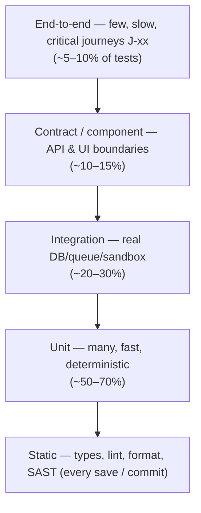
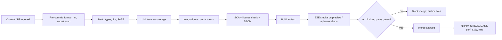

# Testing Strategy — {{product_name}}

> **Status:** Draft · **Owner:** {{quality_owner}} · **Last updated:** {{last_updated}} · **Tier:** {{tier}} · **Related:** [PRD](../product/PRD.md) · [TRD](TRD.md) · [SECURITY_ARCHITECTURE](SECURITY_ARCHITECTURE.md) · [CODE_STYLE](../engineering/CODE_STYLE.md) · [IMPLEMENTATION_PLAN](IMPLEMENTATION_PLAN.md)

<!-- guidance: Tests are derived from PRD acceptance criteria (AC-xx.y), TRD NFRs, and SECURITY threats — not invented
separately. Commands MUST be real: copy them only from the repository's actual configuration (package scripts,
Makefile, build files) after checking; otherwise write "Not configured". Every status starts as "Not run".
"Not run" is NEVER the same as "Passed"; never record a result you did not observe.
Tools in this template are EXAMPLES across stacks; list them as `> **PROPOSAL:**` until the stack is approved and the tool is configured.
Derivation procedure: references/governance-guide.md §6 "Deriving the test matrix". -->

<!-- guidance: Inputs you MUST read before writing: PRD (F-xx, AC-xx.y, J-xx, priorities), TRD (NFR-xx), SECURITY_ARCHITECTURE
(TH-xx with Test column, §5 matrix, §6 isolation, §15 testing plan), API (OP-xx), DATABASE (migrations, PII), APP_FLOW (S-xx states),
DESIGN_SYSTEM (a11y target), OPERATIONS (SLO-xx, RPO/RTO). Coverage rules (MANDATORY):
- Every Must AC-xx.y → ≥1 AT-xx row. Every Must feature → ≥1 failure/edge row. Should features → ≥1 row each. Could → optional.
- Every ✗ cell a real user could attempt in SECURITY_ARCHITECTURE §5 → ≥1 SEC-xx denial row (group by resource if many).
- Every TH-xx whose Test column names SEC-xx → that SEC-xx row exists here.
- Every NFR-xx → ≥1 PERF-/A11Y-/SEC-/DR-/COMPAT- row with a numeric target, or "N/A — reason".
- Every J-xx (critical journey) → ≥1 end-to-end row. Every migration-bearing milestone → a migration test row. -->

<!-- guidance: Tier notes —
Lite: §1 goals, §2 layers (unit + one end-to-end/smoke path), §3 matrix for Must features + permission/isolation rows (delete those, and DR/DAST/tenant rows, when there are no accounts/server), §9 commands, §10 release criteria, §11 results log. Keep §12 as a 4-row traceability summary; skip §13–§16 unless relevant (one line `N/A — Lite` is fine).
Standard: all sections; CI gates enforced on pull requests; contract and migration tests if API/DB exist.
Enterprise: add traceability report per release, performance baselines with budgets, DAST and pen-test cadence, accessibility audit by assistive-tech users, test data management policy, chaos/DR game days, and quality sign-off record. -->

## 1. Goals and scope
<!-- guidance: Minimum content: Must features and critical journeys by ID; top 3–5 risks with the layer that covers each; explicit out-of-scope with reasons. -->
- **Must work before release:** {{F-xx list and critical journeys J-xx}}
- **Highest risks to test:** {{e.g. authorization, data loss, payments, offline sync, upgrade path for library users}}
- **Out of scope:** {{what we will not test and why}}

| Risk | Why it matters | Covered by (layer / test IDs) |
| --- | --- | --- |
| {{cross-tenant data leak}} | {{Sensitive data exposure}} | {{Integration — SEC-02}} |

## 2. Strategy and layers
<!-- guidance: Default to a pyramid (many fast unit tests, fewer integration, few end-to-end). Adjust per app type:
a library leans on unit + property-based tests; an API on integration + contract tests; a UI app needs component + E2E;
a CLI needs golden-output/snapshot tests and exit-code checks. Minimum content: one row per layer that applies
(N/A rows state why), with tooling (PROPOSAL until configured), trigger, and owner. -->
| Layer | What it covers | Tooling | Runs when | Owner |
| --- | --- | --- | --- | --- |
| Static | Types, lint, format | {{tool_or_[TBD]}} | Pre-commit + PR | {{owner}} |
| Unit | Business rules, validation, pure functions | {{tool}} | Every PR | |
| Integration | Service ↔ database / queue / external sandbox | {{tool}} | Every PR | |
| Contract | API schema compatibility between producer and consumers | {{e.g. OpenAPI diff, Pact, buf breaking}} | PR touching contracts | |
| Component / UI | Components and states in isolation | {{tool}} | Every PR | |
| End-to-end | Critical journeys through the real stack | {{e.g. browser automation, device automation, CLI harness}} | PR (smoke) + nightly | |
| Manual / exploratory | UX, screen readers, edge cases | Checklist | Before release | |

### 2.1 Test pyramid


ASCII fallback:

```text
            /\        E2E (few, slow)          J-xx journeys
           /  \       Contract / component     OP-xx, S-xx boundaries
          /----\      Integration              DB, queue, sandbox
         /      \     Unit (many, fast)        rules, validation
        /________\    Static                   types, lint, SAST
```
<!-- guidance: The percentages are a starting heuristic, not a target. Use a "testing trophy" (more integration) for UI-heavy apps or
a "honeycomb" (more integration/contract) for microservices — say which and why. -->

### 2.2 Tooling examples by stack
<!-- guidance: Keep only the row(s) for the approved stack; delete the rest. Every entry stays PROPOSAL until configured and verified in §9. -->
| Stack | Unit | Integration | E2E / UI | Contract | Perf | A11y |
| --- | --- | --- | --- | --- | --- | --- |
| TypeScript / Node | Vitest, Jest, node:test | Testcontainers, Supertest | Playwright, Cypress | Pact, OpenAPI diff | k6, Artillery | axe-core, Lighthouse CI |
| Python | pytest, Hypothesis | pytest + Testcontainers | Playwright | Schemathesis, Pact | Locust, k6 | axe via Playwright |
| Go | `testing`, testify, go fuzz | Testcontainers-go, dockertest | Playwright / CLI harness | buf breaking, Pact | k6, vegeta | — |
| JVM (Java/Kotlin) | JUnit 5, Kotest, jqwik | Testcontainers, Spring Boot Test | Playwright, Selenium | Spring Cloud Contract, Pact | Gatling, k6 | axe-core |
| .NET | xUnit, NUnit | Testcontainers, WebApplicationFactory | Playwright | Pact | NBomber, k6 | axe-core |
| Rust | `cargo test`, proptest | Testcontainers-rs | CLI: assert_cmd, insta snapshots | — | criterion | — |
| Mobile | XCTest, JUnit/Robolectric, Flutter test | — | XCUITest, Espresso, Maestro, Detox | — | platform profilers | Accessibility Scanner, Xcode audits |

## 3. Acceptance test matrix
<!-- guidance: One row per acceptance criterion + mandatory security rows. Status: Not run | Passed | Failed | Blocked | Skipped (with reason).
Rules: (1) every Must AC-xx.y has ≥1 row; (2) each Must feature has ≥1 failure/edge row (invalid input, unauthorized, empty, limit, concurrency);
(3) scenario uses Given/When/Then wording or the AC text; (4) expected result is observable (status, message, persisted state, event);
(5) "Automated?" is yes/no/planned — "no" needs a reason in notes; (6) never prefill a status other than "Not run". -->
| Test ID | Covers | Scenario | Expected result | Layer | Automated? | Status |
| --- | --- | --- | --- | --- | --- | --- |
| AT-01 | F-01 / AC-01.1 | {{happy path}} | {{observable result}} | {{layer}} | {{yes}} | Not run |
| AT-02 | F-01 / AC-01.2 | {{invalid input}} | {{safe error, nothing persisted}} | {{layer}} | | Not run |
| SEC-01 | TH-02 / §5 matrix | Unauthorized caller accesses another user's record | Denied (403/404); no data leaked | Integration | | Not run |
| SEC-02 | DATABASE §7 | Tenant A reads tenant B's data | Denied | Integration | | Not run |
| SEC-03 | §7 secrets | Secrets absent from repo, logs, client bundle | Scanner reports none | CI | | Not run |
| SEC-04 | §8 input | Injection / oversized payload | Rejected with safe error | Integration | | Not run |

### 3.1 Permission-denial matrix (from SECURITY_ARCHITECTURE §5)
<!-- guidance: One row per (role, resource, action) that is ✗ or conditional and reachable by a real caller. Group identical behavior. N/A — no accounts. -->
| Test ID | Role | Resource / action | OP-xx | Expected | Status |
| --- | --- | --- | --- | --- | --- |
| SEC-{{nn}} | {{Member}} | {{item:delete (not own)}} | {{OP-04}} | {{404, record unchanged, audit event written}} | Not run |
| SEC-{{nn}} | {{Anonymous}} | {{item:read}} | {{OP-02}} | {{401}} | Not run |

### 3.2 End-to-end journeys
| Test ID | Journey | Steps (screens S-xx / OPs) | Expected end state | Platforms | Status |
| --- | --- | --- | --- | --- | --- |
| AT-{{nn}} | {{J-01}} | {{S-01 → S-03 → S-05}} | {{note shared and visible to recipient}} | {{Chromium, WebKit / iOS, Android}} | Not run |

## 4. Non-functional tests
<!-- guidance: One row per NFR-xx (numeric target copied exactly from TRD) plus SLO-backed tests. Each row names environment and load profile. -->
| Test ID | NFR | Method | Target | Environment | Status |
| --- | --- | --- | --- | --- | --- |
| PERF-01 | NFR-01 | {{load test / benchmark / Lighthouse / startup timing}} | {{target}} | {{staging}} | Not run |
| A11Y-01 | NFR-06 | {{automated scan (e.g. axe) + manual keyboard & screen-reader pass}} | WCAG 2.2 AA, 0 critical issues | {{env}} | Not run |
| SEC-SAST | NFR-16 | Static analysis | 0 high/critical unresolved | CI | Not run |
| SEC-SCA | NFR-16 | Dependency vulnerability scan | 0 known critical without accepted exception | CI | Not run |
| SEC-DAST | NFR-16 | Dynamic scan against staging | 0 high unresolved | Staging | Not run |
| DR-01 | NFR-09 | Backup restore drill | Meets RPO/RTO | {{env}} | Not run |
| COMPAT-01 | NFR-11 | {{browser/OS/runtime matrix}} | {{targets}} | CI | Not run |

### 4.1 Performance test profiles
| Profile | Purpose | Load shape | Duration | Pass criteria |
| --- | --- | --- | --- | --- |
| Smoke | Script works | {{1–2 virtual users}} | {{1 min}} | no errors |
| Load | Expected peak (TRD §1) | {{ramp to N req/s}} | {{15–30 min}} | {{p95 < NFR-01 target, error rate < x%}} |
| Stress | Find breaking point | {{ramp until failure}} | {{until SLO breached}} | {{degrades gracefully, recovers}} |
| Soak | Leaks over time | {{70% of peak}} | {{2–8 h}} | {{flat memory, stable latency}} |
| Spike | Sudden burst | {{10× in 1 min}} | {{10 min}} | {{rate limits engage, no data loss}} |

### 4.2 Accessibility tests (if UI)
| Test ID | Scope | Method | Target | Status |
| --- | --- | --- | --- | --- |
| A11Y-01 | {{all S-xx screens}} | {{automated scan in E2E}} | 0 critical/serious | Not run |
| A11Y-02 | {{J-01}} | Keyboard-only walkthrough; visible focus; no traps | Journey completable | Not run |
| A11Y-03 | {{J-01}} | Screen reader pass ({{VoiceOver / NVDA / TalkBack}}) | Labels, roles, announcements correct | Not run |
| A11Y-04 | {{design tokens}} | Contrast + 200% zoom / reflow + reduced motion | WCAG 2.2 AA | Not run |

## 5. Test data and fixtures
- Synthetic users and data only (e.g. `alice@example.test`); factories/builders over shared mutable fixtures.
- External services: {{mocks / provider sandboxes / recorded responses}} — assumptions documented.
- Isolation & reset: {{transaction rollback / ephemeral database per run / containerized dependencies}}.

### 5.1 Test data management policy
| Rule | Decision |
| --- | --- |
| Production data in tests | Never. Anonymized copies only with {{owner}} approval and documented masking (Enterprise). |
| Seed data | {{versioned seed scripts / factories}} in `{{path}}`; deterministic (fixed seeds, frozen clock). |
| Personas for tests | One fixture per role in SECURITY_ARCHITECTURE §5.1 + one per tenant (A, B) for isolation. |
| Secrets in tests | Test-only credentials from CI secret store; never real provider keys in fixtures. |
| Time, randomness, network | Injected clock, seeded RNG, no real network in unit tests. |
| Cleanup | {{per-test transaction / truncate / ephemeral containers}}; tests do not depend on order. |

## 6. Environments
| Environment | Purpose | Data | Who can deploy |
| --- | --- | --- | --- |
| Local | Development, unit/integration | Synthetic | Developer |
| CI | Automated gates | Ephemeral synthetic | Pipeline |
| Staging | E2E, performance, DAST | Synthetic / anonymized | {{role}} |

## 7. Coverage policy
- {{e.g. ≥ 80% line coverage on domain/core modules; no coverage target on generated code}} — coverage is a signal, not a goal; every bug fix adds a regression test.

| Area | Line / branch target | Gate type | Notes |
| --- | --- | --- | --- |
| Domain / core logic | {{80% / 70%}} | {{blocks merge}} | {{mutation testing optional (e.g. Stryker, mutmut, PIT)}} |
| Adapters / handlers | {{60%}} | {{report only}} | covered mostly by integration tests |
| Security-sensitive paths ({{auth, payments}}) | {{90% branch}} | {{blocks merge}} | |
| Generated code, migrations, config | excluded | — | |
| Diff coverage on changed lines | {{≥ 80%}} | {{blocks merge}} | prevents erosion without a global number |

## 8. CI quality gates
<!-- guidance: Minimum content: every gate the pipeline will run, whether it blocks, and its command (or Not configured). Must match OPERATIONS §3 and GIT_WORKFLOW §5. -->
| Gate | Blocks merge? | Tool / command |
| --- | --- | --- |
| Format + lint + type check | Yes | {{command_or_Not configured}} |
| Unit + integration tests | Yes | {{command_or_Not configured}} |
| Coverage threshold | {{Yes/No}} | {{command}} |
| SAST + SCA + secret scan | Yes (high/critical) | {{tool}} |
| Contract / breaking-change check | {{Yes}} | {{tool}} |
| E2E smoke | {{Yes/No}} | {{command}} |



ASCII fallback:

```text
PR -> pre-commit -> static/SAST -> unit+coverage -> integration+contract -> SCA/license/SBOM
   -> build -> E2E smoke -> [all green?] --no--> block merge
                                         --yes-> merge -> nightly: full E2E, DAST, perf, a11y, fuzz
```

## 9. Verified commands
<!-- guidance: Only commands you confirmed exist in the repo. Otherwise "Not configured". Keep in sync with AGENTS.md and CODE_STYLE.md. -->
| Purpose | Command | Verified on |
| --- | --- | --- |
| All tests | {{command_or_Not configured}} | {{date_or_—}} |
| Single test | {{command_or_Not configured}} | |
| End-to-end | {{command_or_Not configured}} | |
| Coverage report | {{command_or_Not configured}} | |
| Build / type check | {{command_or_Not configured}} | |

## 10. Release criteria
- All Must acceptance tests **Passed** (not "Not run"); no open Critical/High defects without a documented exception approved by {{owner}}.
- Security rows SEC-xx Passed; NFR tests for release-blocking NFRs Passed or explicitly waived with rationale.
- Known limitations recorded in release notes.

## 11. Results log
<!-- guidance: Append one row per execution. Never mark Passed without an observed run. -->
| Date | Commit / version | Command or method | Result | Failures / notes | Run by |
| --- | --- | --- | --- | --- | --- |
| {{date}} | {{sha}} | {{command}} | {{Passed / Failed / Not run}} | {{notes}} | {{name_or_agent}} |

## 12. Traceability summary
<!-- guidance: Computed from §3–§4 and §13–§15. A Must row below 100% blocks "Approved". -->
| Source | Items | Items with ≥1 test | Coverage | Gaps (IDs) |
| --- | --- | --- | --- | --- |
| Must AC-xx.y (PRD) | {{n}} | {{n}} | {{100%}} | {{none}} |
| Should AC-xx.y | {{n}} | {{n}} | | |
| NFR-xx (TRD) | {{n}} | {{n}} | | |
| TH-xx with SEC test (SECURITY_ARCHITECTURE) | {{n}} | {{n}} | | |
| ✗ cells in authZ matrix | {{n}} | {{n}} | | |
| J-xx critical journeys | {{n}} | {{n}} | | |
| SLO-xx / RPO-RTO (OPERATIONS) | {{n}} | {{n}} | | |

## 13. Contract and migration tests
<!-- guidance: Contract: required if API.md exists or services/clients are deployed independently. Migration: required if DATABASE has migrations. Otherwise N/A — reason. -->
| Test ID | Type | What is checked | Tool | Blocks merge? | Status |
| --- | --- | --- | --- | --- | --- |
| AT-{{nn}} | Contract (schema diff) | No breaking change to public OP-xx without version bump | {{OpenAPI diff / buf breaking / GraphQL inspector}} | Yes | Not run |
| AT-{{nn}} | Consumer-driven contract | Each consumer's expectations still met | {{Pact}} | {{Yes}} | Not run |
| AT-{{nn}} | Migration up | Apply all migrations to empty DB and to a copy of the previous release schema | {{migration tool}} | Yes | Not run |
| AT-{{nn}} | Migration rollback / expand-contract | Previous app version still works against new schema | {{integration test}} | Yes | Not run |
| AT-{{nn}} | Data backfill | Backfill is idempotent and resumable on synthetic large dataset | {{script test}} | {{No}} | Not run |

## 14. Resilience, chaos, and DR tests
<!-- guidance: Standard: DR-01 restore drill at minimum if data exists. Enterprise: chaos experiments with hypothesis + blast radius, game days. -->
| Test ID | Hypothesis | Fault injected | Expected behavior | Environment | Cadence | Status |
| --- | --- | --- | --- | --- | --- | --- |
| DR-01 | Restore meets RPO/RTO | Restore latest backup to empty env | Data ≤ RPO old; service back ≤ RTO | {{staging}} | {{quarterly}} | Not run |
| DR-{{nn}} | Dependency outage is survivable | {{payment provider returns 5xx / times out}} | {{retries with backoff, queue, user sees clear message}} | {{staging}} | {{release}} | Not run |
| DR-{{nn}} | Instance loss is invisible | {{kill one app instance}} | {{no failed requests beyond SLO}} | {{staging}} | {{monthly}} | Not run |
| DR-{{nn}} | Rollback works | Deploy N, roll back to N-1 | {{RB-01 completes ≤ target time}} | {{staging}} | {{release}} | Not run |

## 15. Flaky test policy
- A test that fails and passes on the same commit without code change is **flaky**.
- Flaky tests are quarantined within {{1 business day}}: tagged `{{quarantine_tag}}`, moved out of blocking gates, and an issue is opened with owner and due date ({{≤ 2 weeks}}).
- Never "fix" flakiness by adding sleeps, retries without cause, or deleting assertions; fix the root cause (shared state, time, ordering, network, race).
- Automatic retries in CI: {{0 / max 1}}, and every retry is reported.
- Quarantine limit: if more than {{n}} tests are quarantined, feature work pauses until reduced.
- Flake rate is tracked per week ({{dashboard / CI insights}}).

## 16. AI feature evaluations (if AI)
<!-- guidance: Required if the product calls a model. Otherwise N/A — no AI features. Evals are versioned datasets with pass thresholds, run on prompt/model changes. -->
| Test ID | Capability | Dataset | Metric | Threshold | Status |
| --- | --- | --- | --- | --- | --- |
| AT-{{nn}} | {{summarize note}} | {{50 synthetic notes + references}} | {{rubric score / exact-match / groundedness}} | {{≥ x}} | Not run |
| SEC-{{nn}} | Prompt injection resistance | {{injection corpus}} | {{% attacks blocked}} | {{100% for tool-calling paths}} | Not run |

## Definition of done
- [ ] Every Must feature AC maps to at least one test; security and isolation rows are present.
- [ ] Each blocking NFR has a non-functional test with a target.
- [ ] Commands are verified or marked "Not configured"; none are invented.
- [ ] CI gates and release criteria are agreed.
- [ ] All statuses start as "Not run"; results log separates Not run from Passed.

### Completeness self-check
- [ ] §12 shows 100% for Must AC-xx.y; every Must feature has ≥1 failure/edge row.
- [ ] Every TH-xx that names a SEC-xx in SECURITY_ARCHITECTURE has that row here; every reachable ✗ in the authZ matrix has a denial row.
- [ ] Every NFR-xx has a test row with the exact numeric target from TRD (or `N/A — reason`).
- [ ] Every critical J-xx has an end-to-end row; every API with consumers has a contract row; every DB with migrations has migration rows.
- [ ] DR-01 exists when the system stores data; RPO/RTO match OPERATIONS §9.
- [ ] CI gates match OPERATIONS §3 and GIT_WORKFLOW §5; tools are PROPOSAL until configured.
- [ ] All statuses are `Not run` unless a real run is recorded in §11; no command is invented.
- [ ] Mermaid diagrams have ASCII fallbacks; no `{{placeholders}}` or guidance comments remain.
