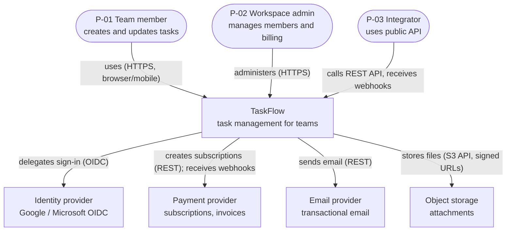
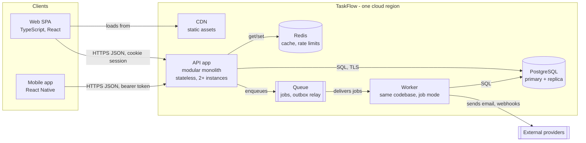
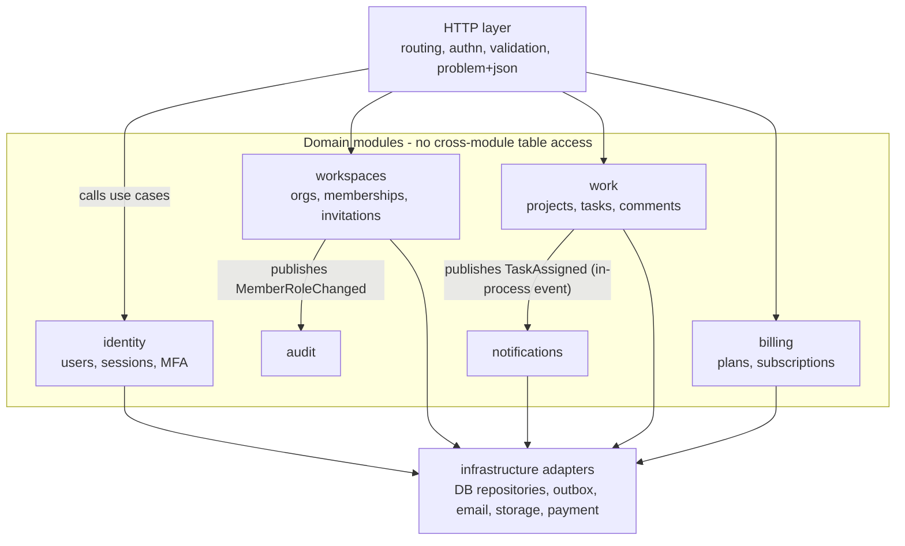
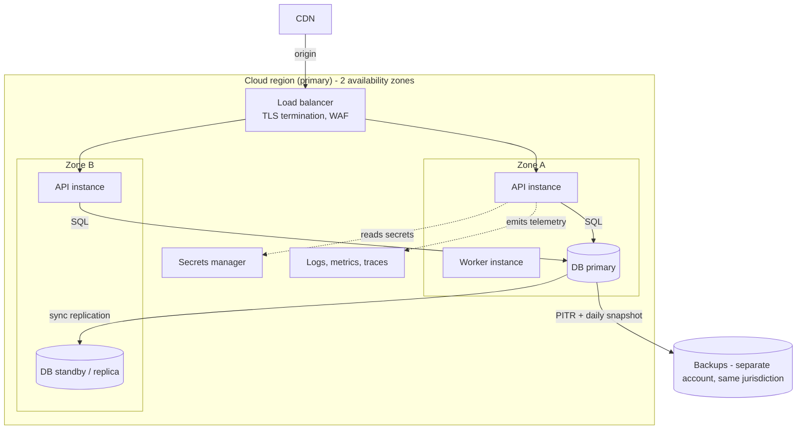

# Architecture guide — the architecture completeness engine

Read this before writing `docs/technical/TRD.md`, `docs/technical/ARCHITECTURE.md`, and `docs/technical/API.md` (templates under `assets/templates/docs/technical/`). It makes the first draft complete: the right style, every required view, every top journey traced end to end, NFRs turned into concrete tactics, capacity estimated with numbers, and interfaces designed to a checklist. Pair it with `references/data-modeling-guide.md` for the data layer.

Rules that apply throughout:

- Describe the simplest architecture that meets the NFRs and the capacity estimate. Complexity needs a driver (an NFR-xx, a constraint, or a D-xx decision).
- Every technology choice is either decided (with ADR) or a `> **PROPOSAL:**`. Never present an unapproved choice as decided.
- Diagrams and tables must agree: every node in a diagram is a row in a table, and vice versa.
- Diagrams use Mermaid, ≤ 15 nodes each (split if larger), edges labeled with verbs and protocols. Provide an ASCII fallback when the user's tools cannot render Mermaid (section 4).

## Contents

1. Choosing the architectural style
2. Required views and minimum content
3. Mermaid examples at the expected depth
4. ASCII fallback
5. Cross-cutting concerns checklist
6. NFR → tactic mapping
7. Capacity estimation worksheet
8. Interface and API design checklist
9. Failure-mode analysis
10. Architecture self-review checklist

---

## 1. Choosing the architectural style

Start from the default and move away only when a driver forces it. Record the choice and the rejected alternatives in ARCHITECTURE §2 and an ADR.

| Style | Choose when | Avoid when | Typical shape |
|---|---|---|---|
| **Modular monolith** (default for web/backend products) | Team ≤ ~20 engineers; one product; unknown domain boundaries; need for simple deploys and transactions | Independent teams must deploy independently at high frequency; parts have radically different scaling/runtime needs | One deployable, modules with enforced boundaries (packages + dependency rules), one primary DB, optional worker process for async jobs |
| **Microservices** | Several teams owning stable, well-understood bounded contexts; independent scaling or release cadence proven necessary; org can run distributed ops (tracing, on-call, platform) | Early product, small team, unclear boundaries — it multiplies failure modes and cost | Services own their data; communicate by API and events; API gateway; service discovery; distributed tracing mandatory |
| **Serverless (functions + managed services)** | Spiky or low traffic; event-driven glue; small team wanting zero server ops; cost scales to zero | Long-running or latency-critical paths sensitive to cold starts; heavy connection pooling to relational DBs; strict vendor-portability constraint | Functions behind API gateway; managed queue, DB, storage; infrastructure as code |
| **Event-driven** (as a style or a part) | Many consumers react to the same facts; workflows across components; audit/replay needed; integration with external systems | Simple CRUD where synchronous calls suffice; team unfamiliar with eventual consistency | Outbox → broker/stream → idempotent consumers; schemas versioned; DLQ |
| **Client-only / local-first** | Data is personal, offline use is core, privacy is a selling point, no collaboration (or sync can be added later) | Multi-user real-time collaboration needing strong consistency without a sync design | App + on-device store; optional sync service; conflict policy |
| **Edge-first** | Global audience needs low latency for reads/personalization; static or cacheable content; simple logic at the edge | Heavy transactional writes; data residency forbids replication | CDN + edge functions + regional origin + edge KV/cache |
| **CLI / single binary** | Developer tool, automation, local processing | — | Binary + config file + cache dir + remote APIs it calls |
| **Library / SDK** | Others embed your code | — | Public API surface, layered core, adapters per runtime; "deployment" = package registry |

Decision prompts to answer in ARCHITECTURE §2: team size and skills (DISCOVERY), deploy frequency, traffic shape (steady/spiky), consistency needs, offline needs, residency, budget (NFR-13), and the "two-year question": what change would force a redesign, and is it likely?

Monolith-to-services path: define module boundaries now (one module per bounded context, no cross-module table access, communication via module interfaces or in-process events). Extraction later becomes a deployment change, not a rewrite. Write this in ARCHITECTURE §5 "Module rules".

---

## 2. Required views and minimum content

| View | Doc / section | Minimum content | Tier |
|---|---|---|---|
| System context (C4 L1) | ARCHITECTURE §3.1 | Product as one box; every persona type (P-xx) and every external system from TRD §5; labeled edges | L S E |
| Containers (C4 L2) | ARCHITECTURE §3.2 | Every deployable/runnable unit and data store; protocols on edges; container table with responsibility, tech, owner, scaling | S E |
| Components (C4 L3) | ARCHITECTURE §3.3 | For the core container (the API/app core): modules/components and their dependencies; Enterprise: every critical container | S (core container) E (all critical) |
| Request/data flow | ARCHITECTURE §6 | One `sequenceDiagram` per Must journey (J-xx), the authentication flow, and at least one failure/recovery path (timeout, external outage, conflict). Async flows show the queue/outbox | L: J-01 only; S E: all Must journeys |
| Deployment | ARCHITECTURE §11 | Runtime topology: environments, regions/zones, load balancer, compute, data stores, CDN, secrets store, observability sinks; plus the delivery pipeline | S E (Lite: §14.4 bullets) |
| Trust boundaries | SECURITY_ARCHITECTURE (TB-x), referenced in ARCHITECTURE | Boundaries drawn on the container diagram or a copy | S E |
| Data view | DATABASE §4 | ERD (see data-modeling guide) | L S E |
| State lifecycles | DATABASE / APP_FLOW | `stateDiagram-v2` per entity with a status field | S E |

**Journey coverage rule:** list every Must J-xx from PRD/APP_FLOW in ARCHITECTURE §6's coverage table, each with the sequence diagram name. Journeys that share a flow may share a diagram; say so in the table.

---

## 3. Mermaid examples at the expected depth

All `Example:` content for "TaskFlow" (B2B task manager, modular monolith). Replace every node with the project's real ones.

### 3.1 Context (C4 L1)



Mermaid also has `C4Context` / `C4Container` diagram types; they render in fewer tools than `flowchart`. Prefer `flowchart` unless the user's renderer is known to support C4.

### 3.2 Containers (C4 L2)



### 3.3 Components (C4 L3) of the API app



### 3.4 Sequence — Must journey with failure paths (J-02 Create and assign a task)

```mermaid
sequenceDiagram
    autonumber
    actor U as P-01 Member
    participant C as Web SPA
    participant A as API app
    participant D as PostgreSQL
    participant Q as Outbox relay / queue
    participant W as Worker
    U->>C: fills task form, clicks Create
    C->>A: POST /v1/projects/{id}/tasks (session cookie, Idempotency-Key)
    A->>A: authenticate, resolve tenant from session, validate body
    A->>D: check membership + role (RLS tenant set)
    alt not a member or role=guest
        A-->>C: 403 problem+json
        C-->>U: "You don't have permission" (no data changed)
    else valid
        A->>D: BEGIN; insert task, task_assignees, outbox_event; COMMIT
        alt idempotency key seen before
            A-->>C: 201 original response (no duplicate)
        else first request
            A-->>C: 201 task (ETag: version)
        end
        C-->>U: task appears in list
        Q->>D: poll unpublished outbox events
        Q->>W: TaskAssigned
        W->>W: send email via provider (timeout 5 s, retry x3 with jitter)
        opt provider down after retries
            W->>D: mark notification failed; move to DLQ; alert if DLQ > N
        end
    end
```

### 3.5 Sequence — authentication (OIDC authorization code + PKCE, server session)

```mermaid
sequenceDiagram
    autonumber
    actor U as User
    participant C as Web SPA
    participant A as API app
    participant I as Identity provider
    participant D as PostgreSQL
    U->>C: clicks "Sign in with Google"
    C->>A: GET /auth/oidc/start
    A-->>C: 302 to IdP (state, nonce, PKCE challenge)
    C->>I: authorize
    I-->>C: 302 /auth/oidc/callback?code&state
    C->>A: callback
    A->>A: verify state; exchange code + verifier
    A->>I: POST token
    I-->>A: id_token
    A->>A: verify signature, iss, aud, nonce, exp
    alt verification fails
        A-->>C: 302 /login?error=signin_failed (logged, no detail to user)
    else ok
        A->>D: find user_identity or create user (+ audit log)
        A->>D: insert session (token hash, expiry)
        A-->>C: Set-Cookie session (HttpOnly, Secure, SameSite=Lax); 302 /app
    end
```

### 3.6 Deployment



### 3.7 Variants

- **Local-first mobile:** context = user + app + OS services (notifications, keychain, backup) + optional sync API; containers = app (UI, domain core, sync engine) + on-device DB + sync service + server DB; sequence = offline edit → pending change → reconnect → push/pull → conflict resolution.
- **CLI:** containers = binary + config file + cache dir + credential store (OS keychain) + remote API; sequence = command parse → load config (flag > env > file > default) → call API with retry → render output / exit code.
- **Library:** containers become packages/modules; deployment becomes registry publishing and supported runtime matrix; sequence = consumer call → public API → core → adapter (I/O) → typed result or error.
- **Event-driven / microservices:** add an event flow diagram showing producers, topics, consumers, DLQs, and the saga/compensation path for a multi-step workflow.

---

## 4. ASCII fallback

When Mermaid is not rendered (plain terminals, some wikis, older IDE previews), add the same diagram as a `text` block directly under the Mermaid block, or replace it if the user prefers. Keep node names identical.

```text
[P-01 Member] --HTTPS--> [Web SPA] --HTTPS JSON--> [API app] --SQL--> (PostgreSQL)
                                                      |
                                                      +--enqueue--> [[Queue]] --> [Worker] --REST--> {Email provider}

Sequence (J-02):
Member      SPA          API             DB
  |--create-->|            |               |
  |           |--POST----->|               |
  |           |            |--authz------->|
  |           |            |<--ok----------|
  |           |            |--insert+outbox>|
  |           |<--201------|               |
  |<--shown---|            |               |
  [alt: 403 when not a member -> "You don't have permission"]
```

Legend: `[ ]` component, `( )` data store, `[[ ]]` queue, `{ }` external system, `-->` call with label.

---

## 5. Cross-cutting concerns checklist

Each row gets a decision in ARCHITECTURE §8 or `N/A — reason`. Lite may merge rows.

| Concern | Decide |
|---|---|
| Authentication | Mechanism (session cookie / OIDC / tokens / API keys / mTLS), where verified, session lifetime and revocation |
| Authorization | Model (RBAC / ABAC / ReBAC), where enforced (one policy layer), tenant resolution source |
| Tenancy | Isolation model and enforcement points (link DATABASE §7) |
| Input validation | At the boundary with a schema; DB constraints as second line |
| Error handling | Error model (API §2.5), mapping of domain errors to responses, user-facing vs internal, never leak internals |
| Logging | Structured (JSON), levels, correlation/request ID, PII redaction list, retention |
| Tracing and metrics | Trace propagation (W3C Trace Context), RED metrics per endpoint (rate, errors, duration), USE for resources, business KPIs |
| Configuration | Source and precedence (env > file > default), validation at startup, per-environment differences |
| Secrets | Store (cloud secrets manager / vault / OS keychain), names only in docs, rotation |
| Caching | Layers (CDN, HTTP, app, DB), keys include tenant, TTL, invalidation |
| Async work | Queue/scheduler, retry with exponential backoff + jitter, idempotent handlers, DLQ, visibility timeout |
| Idempotency and concurrency | Idempotency keys for unsafe retries, optimistic locking (version/ETag) |
| Time and IDs | UTC storage, time zones for user-facing schedules, ID format |
| Internationalization | Locale negotiation, string storage, formatting, RTL |
| Feature flags | Tool, naming, cleanup policy |
| Rate limiting and abuse | Per user/IP/API key, algorithm (token bucket), response (429 + Retry-After) |
| File handling | Upload path (direct-to-storage with signed URL), size/type limits, malware scan |
| Email/notifications | Provider, templates, bounce/complaint handling, unsubscribe |
| Data protection | Encryption in transit (TLS 1.2+) and at rest, field-level encryption where needed, backups |
| Auditability | What is audit-logged (DATABASE `audit_logs`) |
| Accessibility (UI) | Standard (e.g. WCAG 2.2 AA), component library support |
| Offline / sync (clients) | Strategy and conflict policy, or N/A |
| AI/LLM components | Provider, prompt/response logging policy, PII handling, cost limits, fallbacks — or N/A |

---

## 6. NFR → tactic mapping

For every NFR-xx in TRD §3, pick tactics, name the component that implements them, and the test that verifies them. Write the table in ARCHITECTURE §15.

| Quality attribute | Tactics (pick what the target requires) | Verified by |
|---|---|---|
| Performance (latency) | Indexes matching key queries; avoid N+1 (eager loading, batch queries); caching (CDN, HTTP `Cache-Control`/ETag, app cache); pagination limits; compression; async for slow side effects; connection pooling; payload size budget; edge for static assets | PERF-xx load test, query plans, RUM |
| Throughput / scalability | Stateless app instances behind LB; horizontal autoscaling; read replicas; queue-based load leveling; partitioning; backpressure | Load test at 2–10× expected peak |
| Availability | Redundancy across zones; health checks (liveness/readiness); automatic failover for DB; graceful degradation of non-core features; rolling/blue-green deploys; no single point of failure list | Uptime SLO, failover drill (DR-xx) |
| Resilience (dependency failure) | Timeouts on every outbound call; retries with exponential backoff + jitter (only for idempotent operations); circuit breaker; bulkheads (separate pools); fallback/cache; DLQ | Fault-injection test, chaos drill |
| Reliability / durability (RPO/RTO) | Managed backups + PITR; cross-zone replication; backups in separate account; restore runbook; outbox for "write + side effect" | DR-xx restore drill with measured time |
| Consistency | Transactions for invariants; optimistic locking; idempotency keys; unique constraints; outbox + idempotent consumers; read-your-writes routing | Concurrency tests |
| Security | Defense in depth: authN at edge, authZ in one policy layer, tenant isolation in DB (RLS), input validation, output encoding, secrets manager, least-privilege IAM, WAF, dependency scanning | SEC-xx tests, threat model review |
| Privacy | Data minimization; classification; field encryption; retention jobs; DSR export/delete paths; redaction in logs | DSR test, log review |
| Observability | Structured logs + correlation ID; traces across all hops; RED metrics; alerting on SLO burn rate; dashboards per journey | Review checklist; game day |
| Maintainability | Module boundaries enforced (lint/arch tests); layered dependencies; ADRs; automated tests in CI; dependency update policy | Architecture fitness functions in CI |
| Deployability | CI/CD with automated tests; infrastructure as code; feature flags; backward-compatible migrations (expand/contract); one-command rollback | Deploy frequency, rollback drill |
| Portability / compatibility | Standard protocols; containerization; avoid proprietary features without ADR; versioned APIs; supported-platform matrix | COMPAT-xx tests |
| Cost | Right-size instances; autoscaling to low baseline; serverless for spiky; storage lifecycle rules; budget alerts; cost per tenant metric | Monthly billing review vs NFR-13 |
| Accessibility | Accessible component library; semantic markup; automated + manual audits | A11Y-xx |
| Offline / mobile | Local store; background sync; small payloads; retry queue; conflict policy | Offline E2E test |

---

## 7. Capacity estimation worksheet

Fill in TRD §9 with this worksheet. Use the user's numbers from DISCOVERY; when unknown, write the assumption as `> **ASSUMPTION:** (A-xx)` and keep the arithmetic visible so it can be redone. Round generously; the goal is the order of magnitude.

| Step | Formula | Example (TaskFlow, year 1) |
|---|---|---|
| 1. Users | Registered users at 12 months; DAU ratio | 20,000 registered; DAU 25% = 5,000 |
| 2. Actions per active user per day | From journeys: reads and writes separately | 60 reads, 10 writes |
| 3. Average RPS | DAU × actions ÷ 86,400 | reads 5,000×60/86,400 ≈ 3.5 RPS; writes ≈ 0.6 RPS |
| 4. Peak RPS | Average × peak factor (business hours concentration: 3–10×) | × 8 → ~28 read RPS, ~5 write RPS |
| 5. Design target | Peak × headroom (2–3×) — this is the NFR-03 load-test target | ~80 read RPS, ~15 write RPS |
| 6. Record growth | New rows/day per main entity | 5,000 × 10 writes ≈ 50,000 rows/day ≈ 18 M rows/year (tasks+comments+events) |
| 7. Row size | Sum of column sizes + ~30% index/overhead | ~1 KB avg incl. indexes |
| 8. Storage/year | Rows × size; add audit/log tables separately | ~18 GB/year primary; audit logs ~10 GB/year (partitioned, 1-year retention) |
| 9. Object storage | Uploads/day × avg size | 500 × 2 MB = 1 GB/day ≈ 365 GB/year |
| 10. Bandwidth | Peak RPS × avg response size | 28 × 20 KB ≈ 0.6 MB/s egress at peak |
| 11. Background jobs | Events/day × fan-out | 50,000 writes × 0.3 notifications ≈ 15,000 emails/day → provider limits OK? |
| 12. Concurrency | Peak RPS × p95 latency (Little's law) | 33 RPS × 0.3 s ≈ 10 concurrent requests → DB pool of 20 is enough |
| 13. Conclusion | What fits on one node; when the next scaling step triggers | Single primary + 1 replica fits ≥ 10× this; revisit partitioning at 200 M rows |

Also estimate cost at this load (order of magnitude, `[TBD]` if prices are not verified) and compare with NFR-13. For mobile/CLI/library: estimate device storage per user, sync payload per day, binary size, or calls per second the library must sustain.

---

## 8. Interface and API design checklist

Apply to API.md. Each item is decided or `N/A — reason`.

### 8.1 All styles

- [ ] Style chosen with reason: REST (default for public/CRUD), GraphQL (many client shapes, aggregating reads), gRPC (internal service-to-service, streaming, strict contracts), events/webhooks (async notifications), CLI, library SDK.
- [ ] Machine-readable spec named as source of truth: OpenAPI 3.1, GraphQL SDL, `.proto`, AsyncAPI, CLI help/manpage, typed SDK reference.
- [ ] Every operation traces to F-xx and to an APP_FLOW screen/command S-xx; every APP_FLOW action has an operation.
- [ ] Auth requirement and role/scope per operation; tenant derived from credentials.
- [ ] One error model reused everywhere; stable machine-readable error codes.
- [ ] Input limits: max body size, string lengths, array lengths, page size.
- [ ] Pagination (cursor-based for unbounded lists), filtering, sorting conventions.
- [ ] Idempotency for unsafe operations clients may retry (payments, creates).
- [ ] Concurrency control for updates (ETag/If-Match or version).
- [ ] Versioning and deprecation policy; additive changes only within a version.
- [ ] Rate limits and quotas per consumer tier.
- [ ] Timeouts and retry guidance for clients.
- [ ] Observability: request ID returned in responses/errors.
- [ ] Data formats: UTC timestamps (RFC 3339), opaque string IDs, money as minor units + currency.
- [ ] Bulk/batch operations where journeys need them (import, multi-select) with partial-failure semantics.
- [ ] Long-running operations: 202 + status resource / job ID, or webhook on completion.

### 8.2 REST specifics

- [ ] Resource-oriented paths, plural nouns, nesting ≤ 2 levels (`/projects/{id}/tasks`), actions as sub-resources only when not CRUD (`POST /invoices/{id}/void`).
- [ ] Correct methods and status codes (201 + Location on create, 204 on delete, 409/412 on conflicts, 422 validation).
- [ ] `PATCH` semantics stated (JSON Merge Patch or JSON Patch).
- [ ] Caching headers on cacheable GETs.
- [ ] CORS policy for browser clients.

### 8.3 GraphQL specifics

- [ ] Query depth/complexity limits; persisted queries for public clients.
- [ ] DataLoader/batching to avoid N+1.
- [ ] Field-level authorization; errors in `errors[]` with `extensions.code`.
- [ ] Relay-style connections for pagination.

### 8.4 gRPC specifics

- [ ] Package versioning (`acme.tasks.v1`), field numbers never reused, `buf lint`/`buf breaking` in CI.
- [ ] Deadlines on every call; status codes + error details.
- [ ] Streaming only where needed; backpressure stated.

### 8.5 Events and webhooks

- [ ] Event catalog: name (`task.assigned`), version, schema, producer, consumers.
- [ ] Envelope: `id`, `type`, `occurred_at`, `tenant_id`, `data` (CloudEvents is a reasonable default).
- [ ] Delivery semantics (at-least-once), ordering guarantees (per key or none), consumer dedupe by `id`.
- [ ] Retries with backoff, max attempts, DLQ, replay.
- [ ] Webhooks: HMAC signature + timestamp (replay window), secret rotation, endpoint verification, auto-disable after repeated failures.

### 8.6 CLI and library

- [ ] CLI: command grammar (`noun verb`), flags (long kebab-case, short for common), config precedence, `--json` output for scripting, exit codes table, stdout for data / stderr for diagnostics, non-interactive mode, credential storage in OS keychain.
- [ ] Library: public vs internal surface, SemVer policy, typed errors, thread-safety/async model, supported runtime versions, no global state, tree-shaking/side-effect-free imports.

---

## 9. Failure-mode analysis

For each container and external dependency, write one row in ARCHITECTURE §10 failure table.

| Component / dependency | Failure | Detection | User impact | Mitigation / degradation | Recovery |
|---|---|---|---|---|---|
| Example: Email provider | Down / 5xx | Error rate alert on worker | Notifications delayed | Queue + retry with backoff up to 24 h; in-app notification still shown | Auto drain; DLQ replay runbook RB-04 |
| Example: DB primary | Zone outage | Health check, managed failover event | Writes fail ≤ 60 s | Managed failover to standby; API returns 503 + Retry-After | Automatic; post-incident review |
| Example: Payment webhook | Duplicate / out of order | Event id seen | None if handled | Dedupe by event id; fetch latest state from provider | — |

Minimum: every external integration from TRD §5, the primary data store, the queue (if any), and the identity provider.

---

## 10. Architecture self-review checklist

Tick each item before presenting TRD / ARCHITECTURE / API. Fix gaps; do not just list them.

**Coverage**
- [ ] Every F-xx (Must/Should) maps to a component (TRD §2 / ARCHITECTURE §14.1) and, where applicable, an OP-xx and an entity.
- [ ] Every Must J-xx has a sequence diagram (or shares one, stated) in ARCHITECTURE §6.
- [ ] Authentication flow and at least one failure/recovery path are diagrammed.
- [ ] Every persona type and external system appears in the context diagram; every container in the container table; every container in the deployment view.
- [ ] Every NFR-xx maps to tactics, a component, and a test (ARCHITECTURE §15).
- [ ] Capacity worksheet completed with visible arithmetic and stated assumptions (TRD §9).

**Soundness**
- [ ] Style choice has drivers and rejected alternatives; an ADR exists or is proposed.
- [ ] No technology appears that is not decided or marked PROPOSAL; versions say "verify at setup" unless verified.
- [ ] Authorization and validation are enforced server/core side; the client is never trusted.
- [ ] Every outbound call has a timeout and a failure behavior; retries only on idempotent operations.
- [ ] Every "write + side effect" uses a transaction + outbox (or equivalent) — no dual writes.
- [ ] No single point of failure is unlisted; each listed one has a mitigation or accepted risk (R-xx).
- [ ] Module boundaries and dependency direction are stated and enforceable.

**Consistency**
- [ ] Diagrams match tables (same names, same count).
- [ ] ARCHITECTURE stack = ADRs = TRD constraints = CODE_STYLE directories.
- [ ] API operations = APP_FLOW actions = SECURITY_ARCHITECTURE authorization matrix rows.
- [ ] Data stores in ARCHITECTURE = DATABASE §1.

**Readability**
- [ ] Diagrams ≤ 15 nodes, labeled edges; ASCII fallback added if the user's tools need it.
- [ ] Unknowns are `[TBD: … — owner]` and appear as Q-xx.
