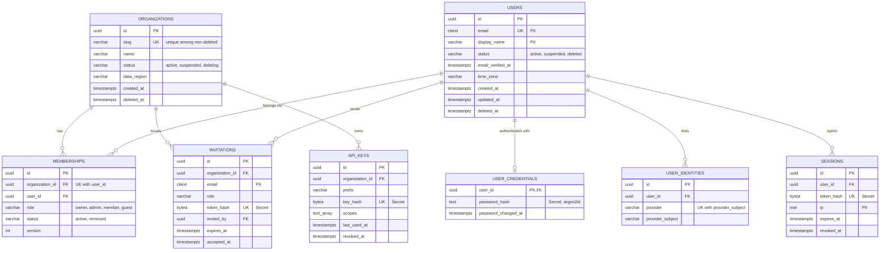
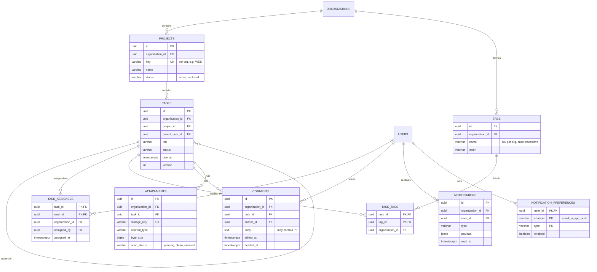
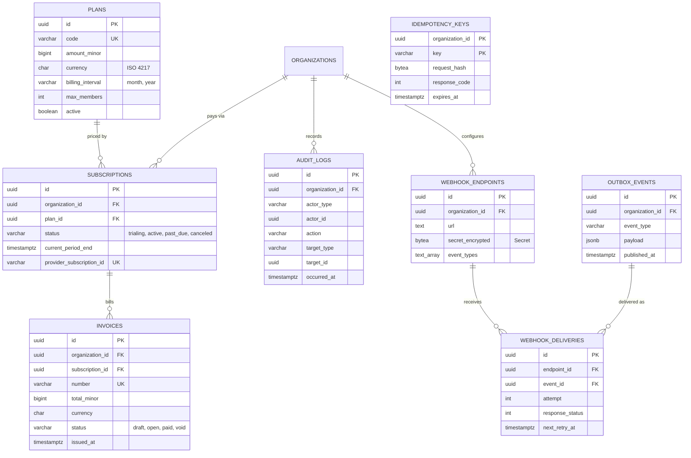
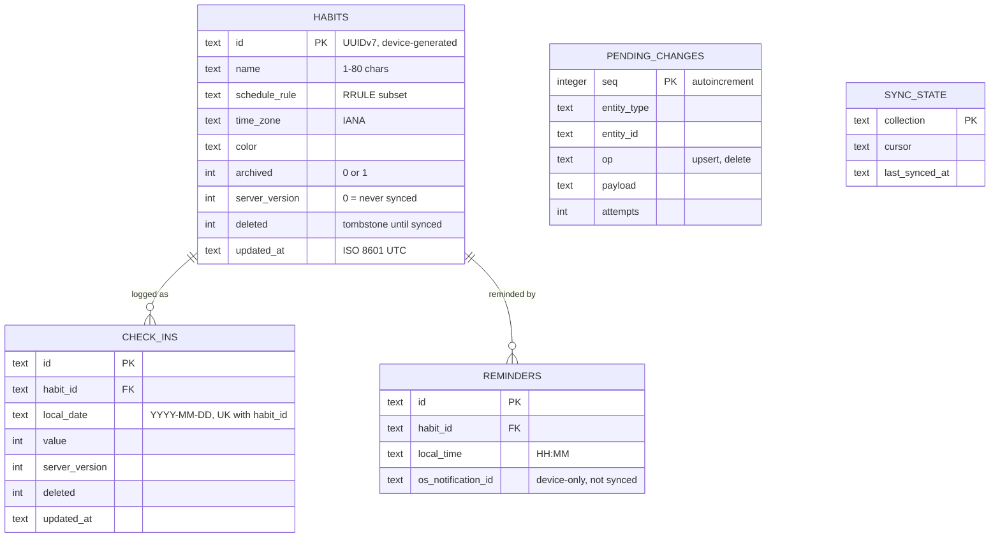

# Data modeling guide — the ERD completeness engine

Read this before writing `docs/technical/DATABASE.md` (template: `assets/templates/docs/technical/DATABASE.md`). It turns PRD features into a complete, scalable, best-practice data model on the first pass. Follow the steps in order. Do not skip a step because the product "looks simple": missing tables are the most common defect in generated data models.

The guide is store-agnostic. Words map as follows:

| Relational | Document (MongoDB, Firestore, Couchbase) | Key-value / wide-column (DynamoDB, Cassandra, Redis) | On-device (SQLite, Room, Core Data, Realm, IndexedDB) |
|---|---|---|---|
| table | collection | item type in a table / key prefix | table / entity / object store |
| row | document | item | row / object |
| column | field | attribute | column / property |
| foreign key | reference field or embedded copy | key attribute pointing to another item | FK / relationship |
| index | index | GSI / LSI / secondary key | index |
| join table | array of refs or link collection | adjacency-list items | join table / to-many relationship |

All examples are `Example:` material. Every schema you write for a real project is a `> **PROPOSAL:**` until the user approves it.

## Contents

1. Entity discovery procedure
2. Supporting entity checklist
3. Per-entity field checklist
4. Normalization and when to denormalize
5. Relationships, cardinality, and delete behavior
6. Indexing strategy from key queries
7. Scalability patterns
8. Data integrity
9. Non-relational and on-device models
10. Migrations (expand → migrate → contract)
11. Worked example A — multi-tenant SaaS
12. Worked example B — local-first mobile app
13. ERD self-review checklist

---

## 1. Entity discovery procedure

Run all five passes. Write the results into DATABASE §3 (Entities) and §15 (Feature-to-entity coverage).

**Pass 1 — Nouns from requirements.** For every `F-xx`, `US-xx`, `AC-xx.y`, `J-xx` step, and APP_FLOW screen `S-xx`, list each noun the user creates, reads, changes, owns, shares, pays for, or is notified about. Each distinct noun with its own lifecycle or identity is a candidate entity.

**Pass 2 — Verbs that hide entities.** Some verbs imply records that the PRD never names:

| Verb / phrase in PRD | Hidden entity |
|---|---|
| "invite", "join", "share with" | `invitations`, `memberships` / `shares` (M:N with role) |
| "assign", "follow", "like", "bookmark", "subscribe to" | a join table with its own metadata (`task_assignees`, `follows`) |
| "approve", "review", "publish", "status changes" | status column + `*_events` / `*_history` table if history is shown or audited |
| "comment", "reply", "mention" | `comments` (polymorphic or per-parent), `mentions` |
| "upload", "attach", "avatar", "export" | `files` / `attachments` (metadata in DB, bytes in object storage) |
| "notify", "remind", "email me" | `notifications`, `notification_preferences`, scheduled `jobs` |
| "pay", "upgrade", "trial", "plan limit" | `plans`, `subscriptions`, `invoices`, `payments`, `usage_records` |
| "log in with Google", "reset password", "2FA" | `user_identities`, `password_reset_tokens`, `mfa_factors`, `sessions` |
| "search", "filter by tag" | `tags` + join table; search index (derived data) |
| "history", "undo", "who changed this" | `audit_logs` or `*_versions` |
| "import", "sync", "integrate with X" | `integrations` / `connections`, `sync_cursors`, `external_ids` |
| "schedule", "recurring", "every Monday" | `schedules` / recurrence rule fields, `jobs` |
| "quota", "limit", "rate" | `usage_counters` / `usage_records` |

**Pass 3 — Supporting entity checklist.** Walk section 2 row by row. For each row, decide Include / Exclude, and record the reason in one line. Exclusions are legitimate ("no billing — free internal tool, D-04"), silence is not.

**Pass 4 — Lifecycle and states.** For each entity with a status, draw a `stateDiagram-v2` (in DATABASE §5 or APP_FLOW). Each state transition that must be remembered ("who approved, when") needs columns (`approved_by`, `approved_at`) or a history table.

**Pass 5 — Cross-check against other docs.** Every entity referenced by API operations (`OP-xx` request/response), SECURITY_ARCHITECTURE (roles, tokens, audit), OPERATIONS (jobs, feature flags), PRIVACY_POLICY (data collected), and analytics events exists in the model or is explicitly marked "external system of record" (e.g. "payments live in the payment provider; we store only `provider_customer_id`").

Output of discovery: the entity list, each with purpose, owner (user / tenant / system), classification, linked F-xx, and retention rule.

---

## 2. Supporting entity checklist

"Include when" is the rule. "Typical fields" is the minimum, not the maximum.

### 2.1 Identity and access

| Entity | Include when | Typical fields / notes |
|---|---|---|
| `users` | Any login or per-person data | `id`, `email` (unique, case-insensitive: `citext` or lower-cased unique index), `display_name`, `status` (active/suspended/deleted), `email_verified_at`, `locale`, `time_zone`, audit columns, `deleted_at` |
| `user_credentials` / `password_hashes` | Own password login | `user_id` (1:1), `password_hash` (argon2id/bcrypt/scrypt — never reversible), `password_changed_at`. Keep separate from `users` so `SELECT *` never leaks it |
| `user_identities` | Social login, SSO, OIDC, or more than one login method | `user_id`, `provider`, `provider_subject` (unique per provider), `email_at_provider`, `linked_at` |
| `sessions` / `refresh_tokens` | Server-side sessions or refresh-token rotation | `user_id`, `token_hash` (store hash, not token), `created_at`, `expires_at`, `revoked_at`, `ip` (PII), `user_agent`, `rotated_from_id` |
| `mfa_factors`, `recovery_codes` | MFA required for any role | `user_id`, `type` (totp/webauthn/sms), secret encrypted at rest, `last_used_at` |
| `verification_tokens` (email verify, password reset, magic link) | Any of those flows | `user_id`, `purpose`, `token_hash`, `expires_at`, `consumed_at` — single use |
| `roles`, `permissions`, `role_permissions` | More than two fixed roles, or custom roles per tenant | If roles are fixed and few, an enum on `memberships.role` is enough — state that choice |
| `memberships` | A user can belong to an organization/workspace/project | `organization_id`, `user_id`, `role`, `status`, `joined_at`; unique (`organization_id`, `user_id`) |
| `api_keys` / `personal_access_tokens` | Programmatic access, integrations, CLI | `owner` (user or org), `name`, `prefix` (shown), `key_hash`, `scopes`, `last_used_at`, `expires_at`, `revoked_at` |

### 2.2 Tenancy and collaboration

| Entity | Include when | Typical fields / notes |
|---|---|---|
| `organizations` / `workspaces` / `tenants` | B2B, teams, households, or any shared space | `id`, `name`, `slug` (unique), `plan_id` or subscription link, `status`, `data_region`, `deleted_at` |
| `invitations` | Users invite others | `organization_id`, `email`, `role`, `token_hash`, `invited_by`, `expires_at`, `accepted_at`, `revoked_at` |
| `teams` / `groups` | Permissions or assignment by group | plus `team_members` join table |
| `shares` / `access_grants` | Per-object sharing beyond org membership | `resource_type`, `resource_id`, `grantee_type`, `grantee_id`, `permission` |

### 2.3 Platform and operations

| Entity | Include when | Typical fields / notes |
|---|---|---|
| `audit_logs` | Admin actions, B2B, regulated data, "who changed this", or any Enterprise tier | `id`, `tenant_id`, `actor_type`, `actor_id`, `action`, `target_type`, `target_id`, `changes` (JSON diff, PII-redacted), `ip`, `request_id`, `occurred_at`. Append-only; no update/delete grants |
| `notifications` | In-app inbox or notification history | `user_id`, `type`, `payload`, `read_at`, `created_at`; plus `notification_preferences` (`user_id`, `channel`, `type`, `enabled`) when users can opt out |
| `files` / `attachments` | Any upload | `owner_id`, `tenant_id`, `storage_key`, `content_type`, `byte_size`, `checksum_sha256`, `scan_status` (pending/clean/infected), `uploaded_at`. Bytes in object storage, never in the DB |
| `user_settings` / `preferences` | Per-user or per-org configuration | Typed columns for known settings; a JSON column only for genuinely open-ended settings |
| `consents` | Marketing opt-in, cookie consent, terms acceptance, children's or health data | `user_id`, `purpose`, `version` (policy version), `granted_at`, `withdrawn_at`, `source`. Append-only history |
| `webhook_endpoints`, `webhook_deliveries` | Product sends webhooks | endpoint: `url`, `secret` (encrypted), `event_types`, `status`; delivery: `event_id`, `attempt`, `response_status`, `next_retry_at` |
| `outbox_events` | Any write that must also publish an event, send email, or call another system reliably | `id`, `aggregate_type`, `aggregate_id`, `event_type`, `payload`, `created_at`, `published_at`. Written in the same transaction as the business change |
| `idempotency_keys` | Payments, order creation, any POST clients may retry | `key`, `scope` (user/tenant + operation), `request_hash`, `response_code`, `response_body`, `created_at`, `expires_at`; unique (`scope`, `key`) |
| `jobs` / `scheduled_tasks` | Reminders, recurring work, delayed processing — unless the queue product stores them | `type`, `run_at`, `status`, `attempts`, `last_error`, `locked_until` |
| `feature_flags` | Flags managed in-app (not a third-party flag service) | `key`, `description`, `default`, plus `feature_flag_overrides` (`flag_key`, `tenant_id`/`user_id`, `value`) |
| `usage_records` / `usage_counters` | Quotas, metered billing, rate limits stored durably | Aggregate per (`tenant_id`, `metric`, `period`) — see section 7.6 |

### 2.4 Billing

Include when anything is paid. If a payment provider is the system of record, store only references and a synced status; never card numbers (PCI scope).

| Entity | Typical fields / notes |
|---|---|
| `plans` / `prices` | `code`, `name`, `interval`, `amount_minor`, `currency`, `limits` (typed), `active`. Versioned: never edit a price that subscribers use; create a new one |
| `subscriptions` | `tenant_id`, `plan_id`, `status` (trialing/active/past_due/canceled), `current_period_start/end`, `cancel_at`, `provider_subscription_id` |
| `invoices` | `tenant_id`, `number` (unique, sequential if law requires), `status`, `total_minor`, `tax_minor`, `currency`, `issued_at`, `provider_invoice_id`. Immutable once issued |
| `payments` / `charges` | `invoice_id`, `amount_minor`, `currency`, `status`, `provider_payment_id`, `failure_code` |
| `customers` / billing profile | `tenant_id`, `provider_customer_id`, billing email, tax ID (PII/sensitive), address |

### 2.5 Content and lifecycle

| Entity / pattern | Include when | Notes |
|---|---|---|
| Soft delete (`deleted_at`) | Users can undo/restore, or deletes must be audited | Pair with a purge job and unique indexes that ignore deleted rows (section 6.4). Hard-delete PII when the retention period ends |
| Archive tables / cold storage | Data older than N months is rarely read but must be kept | `*_archive` tables, partitions, or exports to object storage (section 7.3) |
| `translations` / i18n content | User-visible content (not UI strings) exists in more than one language | `entity_type`, `entity_id`, `locale`, `field`, `value`; or per-entity `*_translations` (`entity_id`, `locale`, columns) with unique (`entity_id`, `locale`) |
| `tags`, `categories` + join table | Filtering, labeling, taxonomy | `tags` scoped by `tenant_id`, unique (`tenant_id`, lower(`name`)); join table with own PK or composite PK |
| `comments` | Discussion on any object | Per-parent FK (`task_id`) is safer than polymorphic (`commentable_type`, `commentable_id`) because the DB can enforce it; choose polymorphic only for many parent types and document the integrity check |
| `activity_events` / feed | User-visible activity timeline | Distinct from `audit_logs` (security record, append-only, longer retention) |
| `*_versions` / revisions | Document history, undo, "restore previous version" | `entity_id`, `version`, `content`, `created_by`, `created_at` |

---

## 3. Per-entity field checklist

Apply to every entity. Omit an item only with a reason.

1. **Primary key.** Choose one strategy for the whole model and record it in DATABASE §1 and an ADR.

   | Strategy | Pros | Cons | Choose when |
   |---|---|---|---|
   | UUIDv7 (RFC 9562) | Globally unique, generated anywhere (client, offline, other services), time-ordered so B-tree inserts stay local, non-enumerable | 16 bytes; leaks creation time; older DB versions need an extension or app-side generation | Default for multi-tenant, distributed, offline-capable, or publicly exposed IDs |
   | ULID | Same benefits as UUIDv7, 26-char sortable string | Stored as text unless converted to 16-byte binary/uuid | Stack has better ULID support than UUIDv7 |
   | UUIDv4 | Universal support | Random inserts fragment indexes at scale | Small tables only, or legacy |
   | `bigint` identity / sequence | 8 bytes, fastest joins, human-friendly | Enumerable (never expose raw in URLs without authorization), needs central generation, hard to merge across shards/devices | Single-database internal systems; high-volume append tables (logs) where size matters |
   | Natural key | No surrogate needed | Natural values change (emails, names) | Only for truly immutable codes: ISO currency `USD`, country `DE`, locale `en-GB` |

   A hybrid is fine: `bigint` internal PK + unique `public_id` (UUIDv7/ULID) exposed in the API. Record it.
2. **Tenant key.** Every tenant-owned table has `tenant_id` / `organization_id` NOT NULL, even child tables (do not rely on joining up to the parent for isolation). It leads every composite index on that table.
3. **Foreign keys.** Declared in the DB (relational), named `<entity>_id`, each with an index and an ON DELETE rule (section 5).
4. **Natural / business unique keys.** Slug, email, external provider ID, invoice number: declare `UNIQUE`, scoped by tenant where applicable (`UNIQUE (tenant_id, slug)`).
5. **Status / type fields.** Enumerated values listed in the schema table and a state diagram for lifecycles. Store as enum type, check constraint, or lookup table (section 8.2).
6. **Audit columns.** `created_at`, `updated_at` (always); `created_by`, `updated_by` (when multiple people edit the same object, or Enterprise tier).
7. **Soft delete.** `deleted_at` (+ `deleted_by`) when restore or audit is required; otherwise hard delete. Never both silently.
8. **Optimistic locking.** `version` integer (or `updated_at` / row version / ETag) on entities edited concurrently by more than one person or device. The API's `If-Match` / `version` field maps to it.
9. **Money.** Integer minor units (`amount_minor bigint`) + `currency char(3)` (ISO 4217). Never floating point. Note currencies with 0 or 3 decimal places. Use fixed-point `numeric/decimal` only for rates, FX, or sub-cent pricing, and state the scale.
10. **Time.** Instants in UTC as `timestamptz` / ISO 8601 with `Z` / epoch ms. Store the user's IANA time zone (`Europe/Berlin`) separately when local time matters (reminders, "every Monday 9:00"). Calendar dates without time use a `date` type.
11. **Text limits.** Maximum length for every user-entered string (e.g. title 1–200). Case-insensitive uniqueness where users expect it (emails, slugs).
12. **PII and classification.** Mark each column Public / Internal / PII / Sensitive / Secret (DATABASE §2). Secrets are hashed (tokens, passwords) or encrypted (third-party credentials, webhook secrets). Sensitive fields get field-level encryption or tokenization when required.
13. **JSON columns.** Allowed for genuinely schemaless payloads (event payloads, provider responses, open-ended settings). Not for fields you filter, join, or constrain — those become columns.
14. **Derived / cached fields** (`comment_count`, `last_activity_at`): marked as derived with the update mechanism (trigger, same transaction, async job).

---

## 4. Normalization and when to denormalize

**Default: third normal form (3NF).** Each non-key column depends on the key, the whole key, and nothing but the key.

- 1NF: no repeating groups or comma-separated lists — `tags = "a,b,c"` becomes a join table.
- 2NF: in a composite-key table, no column depends on only part of the key (`task_assignees.user_email` belongs on `users`).
- 3NF: no column depends on another non-key column (`tasks.project_name` belongs on `projects`).

**Denormalize deliberately**, never by accident. Each denormalization is listed in DATABASE §17 with its source of truth, update mechanism, and staleness tolerance.

| Legit reason | Example | Mechanism |
|---|---|---|
| Hot read path that would need multiple joins at high volume | `tasks.project_id` + `tasks.tenant_id` copied from project | Set on insert, immutable |
| Aggregates shown on every list view | `projects.open_task_count` | Same transaction or async counter (section 7.6) |
| Historical snapshot that must not change | `invoice_lines.unit_price_minor`, `orders.shipping_address` | Copied at write time; immutable by design (this is correctness, not optimization) |
| Search / analytics | Search index, reporting warehouse | Outbox/CDC → derived store; rebuildable |
| Document/NoSQL store | Embed author name in comment | Accept staleness or fan-out update job |

---

## 5. Relationships, cardinality, and delete behavior

**Cardinality notation** (Mermaid `erDiagram`): `||--||` one-to-one, `||--o{` one-to-zero-or-many, `||--|{` one-to-one-or-many, `}o--o{` many-to-many (draw it, but implement as a join table).

**Rules**

1. Every relationship appears in the ERD, in the schema tables (as an FK column), and in DATABASE §6 with an ON DELETE rule.
2. **1:1** — put the FK + `UNIQUE` on the dependent side (`user_credentials.user_id UNIQUE`). Split 1:1 only for security (credentials), size (large blobs), or optional sparse data.
3. **1:N** — FK on the many side, NOT NULL unless the child can genuinely exist alone.
4. **M:N** — always a join table. Give it its own surrogate PK or a composite PK, a unique constraint on the pair, and its own metadata when the relationship has attributes (`role`, `added_by`, `added_at`, `position`). If the relationship has a lifecycle (invited → active), it is an entity (`memberships`), not just a link.
5. **Self-reference** (parent task, reply-to comment, org hierarchy) — nullable `parent_id`; state max depth; for deep trees choose adjacency list + recursive CTE, materialized path, or closure table and say which.
6. **Polymorphic associations** — avoid when the DB cannot enforce them. Prefer separate FKs (`task_id`, `project_id` nullable + check that exactly one is set) or a per-parent table.

**ON DELETE choices**

| Rule | Use for | Avoid for |
|---|---|---|
| `CASCADE` | Pure children with no independent meaning (task_tags when task deleted, sessions when user hard-deleted) | Anything with legal/financial value (invoices, audit logs) or large fan-out (cascading millions of rows in one transaction) |
| `RESTRICT` / `NO ACTION` | Parents that must not disappear while referenced (plans with subscriptions, users who authored invoices) | — |
| `SET NULL` | Optional references where history should survive (`tasks.assignee_id` when a member leaves; `audit_logs.actor_id` after account deletion, keeping `actor_label`) | Required relationships |
| Soft delete + async purge | Tenant or account deletion, large subtrees | — |

Tenant deletion is a job, not a cascade: mark the tenant `deleting`, block access, purge in batches, then delete the tenant row; record in audit log.

---

## 6. Indexing strategy from key queries

### 6.1 Derive indexes from queries, not from columns

For each Must feature, write the key queries in DATABASE §9 — filter, sort, pagination, expected rows, target latency (NFR). Then design the index. Minimum list for a typical app: list views (per screen), detail by ID, lookups by unique business key, every FK join, auth lookups (session/token by hash, user by email), background job polling, retention/purge jobs, uniqueness checks.

### 6.2 Composite index order

Order columns **Equality → Sort → Range (ESR)**:

- `WHERE tenant_id = ? AND project_id = ? AND status = 'open' ORDER BY created_at DESC` → index `(tenant_id, project_id, status, created_at DESC)`.
- Range predicates (`created_at > ?`, `due_at BETWEEN`) go after equality and sort columns; anything after the first range column cannot be used for ordering.
- The leading column of a composite index also serves queries on that prefix — do not add a separate index on `(tenant_id)` if `(tenant_id, …)` exists.

### 6.3 Index types to consider

| Need | Technique |
|---|---|
| Every FK | Index it. PostgreSQL does not index FKs automatically (MySQL InnoDB does). Unindexed FKs make parent deletes and joins slow |
| Only a subset is queried (`status = 'open'`, not deleted, pending jobs) | Partial / filtered index: `… WHERE deleted_at IS NULL`. MySQL lacks partial indexes — use a generated column or include the flag in the composite |
| Avoid table lookups on hot list queries | Covering index (`INCLUDE (title, status)` in PostgreSQL/SQL Server; extra trailing columns elsewhere) |
| Case-insensitive lookup | Expression index on `lower(email)` or `citext` / case-insensitive collation |
| Full-text search | Built-in full-text index (tsvector/GIN, MySQL FULLTEXT, SQLite FTS5) at small scale; dedicated search engine via outbox at large scale |
| JSON containment / arrays | GIN (PostgreSQL), multikey (MongoDB) — only if you query inside the JSON |
| Geospatial | GiST / PostGIS, 2dsphere (MongoDB) |

### 6.4 Unique constraints with soft delete

A plain `UNIQUE (tenant_id, slug)` blocks re-creating a slug after soft delete. Use a partial unique index `UNIQUE (tenant_id, slug) WHERE deleted_at IS NULL` (PostgreSQL, SQLite), or in MySQL a generated column that is NULL when deleted and unique otherwise.

### 6.5 Cost of indexes

Every index slows writes and uses storage. Do not index low-selectivity columns alone (`status`, `boolean`). Remove indexes no query uses. Write-heavy append tables (events, logs) get the fewest indexes.

---

## 7. Scalability patterns

Write the chosen patterns in DATABASE §7 (tenancy) and §16 (scalability). Choose the simplest that meets the 12–24 month capacity estimate (TRD §9). For each pattern below, state "used / not yet — trigger to adopt".

### 7.1 Multi-tenancy

| Pattern | Isolation | Cost / ops | Choose when |
|---|---|---|---|
| **Pooled: shared tables + `tenant_id` + row-level security** | Logical; RLS policy in the DB plus tenant-scoped repository | Lowest; one migration path | Default for SaaS with many small/medium tenants |
| **Schema per tenant** | Stronger logical separation | Migrations run N times; connection/catalog bloat beyond ~hundreds to low thousands of schemas | Fewer, larger tenants needing per-tenant customization or restore |
| **Database (or cluster) per tenant** | Physical; per-tenant region, keys, backups | Highest; fleet management | Enterprise contracts, data residency, noisy-neighbor risk, regulated data |
| **Hybrid (pooled + dedicated for top tier)** | Mixed | Medium | Mix of SMB and enterprise customers |

Pooled-model rules: `tenant_id` from the verified token/session only, never from client input; every query filtered by tenant in the data-access layer; DB-level policy as a second line (PostgreSQL: `ENABLE ROW LEVEL SECURITY` + `FORCE ROW LEVEL SECURITY` so the table owner is also bound, policy `USING (tenant_id = current_setting('app.tenant_id')::uuid)` set per transaction); unique constraints include `tenant_id`; cross-tenant tests in TESTING.

### 7.2 Partitioning and sharding

- **Partition** large, time-ordered tables (audit logs, events, metrics, notifications) by time range (monthly) so retention is `DROP PARTITION`, not `DELETE`. Partition key must appear in queries to prune partitions.
- **Hash-partition** by `tenant_id` only when a single table is too large for one node's indexes.
- **Shard** (split across databases) only when vertical scaling and read replicas are exhausted; the shard key is almost always `tenant_id`. Record "not before X rows / Y writes per second".

### 7.3 Archival and retention

Every table has a retention rule (DATABASE §12). Implement with partition drops, batched delete jobs (`DELETE … WHERE id IN (SELECT … LIMIT 1000)`), or export-then-delete to object storage. Purging PII must also cover backups (they age out), search indexes, caches, and analytics copies.

### 7.4 Read scaling and caching

- **Read replicas** for reporting and heavy read endpoints; accept replica lag (state the tolerance) and read-your-writes on the primary after a user's own write.
- **Cache** (in-process, Redis/Memcached, CDN, HTTP caching): list what is cached, key format (include `tenant_id`), TTL, invalidation trigger. Never cache authorization decisions longer than the permission-change tolerance.
- **Connection pooling** (PgBouncer, RDS Proxy, built-in pools) when serverless or many instances connect.

### 7.5 Hot rows and contention

Single rows updated by many requests (global counters, a tenant's `balance`, inventory of a popular item) serialize writes. Mitigate with: append-only ledger rows + periodic aggregation, sharded counters (N rows summed on read), `SELECT … FOR UPDATE SKIP LOCKED` for job queues, optimistic locking with retry, or moving the counter to a store built for it.

### 7.6 Counters and aggregates

Choose per counter: exact in the same transaction (low volume), async increment from outbox events (medium), approximate/periodic recompute (high volume, display only). Quotas used for billing or enforcement must be exact and reconciled.

### 7.7 Pagination

Use **keyset (cursor) pagination** for user-facing lists: `WHERE (created_at, id) < (:c_created_at, :c_id) ORDER BY created_at DESC, id DESC LIMIT :n`, with an index matching the order. The API returns an opaque cursor. Offset pagination only for small, bounded admin tables. Always include a unique tiebreaker (`id`) in the sort.

### 7.8 Events, outbox, and derived data

When a write must also send an email, call a webhook, update a search index, or notify another service, write the business row **and** an `outbox_events` row in the same transaction; a relay publishes and marks `published_at`. Consumers are idempotent (dedupe by event `id`). This avoids "saved but never notified" and "notified but rollback" bugs. Change-data-capture (CDC) is an alternative at larger scale.

### 7.9 Large objects

Files, images, exports, and AI artifacts go to object storage; the DB stores metadata and the storage key. Access via short-lived signed URLs. Scan uploads before making them available if users share files.

---

## 8. Data integrity

### 8.1 Constraints at the database

Defense in depth: the API validates for good error messages; the database enforces for correctness. Declare NOT NULL, `UNIQUE`, FKs, and `CHECK` constraints:

- `CHECK (amount_minor >= 0)`, `CHECK (ends_at > starts_at)`, `CHECK (char_length(title) BETWEEN 1 AND 200)`
- `CHECK (status IN ('open','in_progress','done','archived'))`
- Exactly-one-of: `CHECK (num_nonnulls(task_id, project_id) = 1)`
- Exclusion constraints for non-overlapping bookings (PostgreSQL `EXCLUDE USING gist`)

### 8.2 Enums vs lookup tables

| Option | Choose when |
|---|---|
| `CHECK` constraint on text | Values change occasionally; easiest to migrate |
| Native enum type | Values stable; note that removing values is hard in PostgreSQL |
| Lookup table with FK | Values are data (admins add them), carry attributes (label, color, order), or need translations |

### 8.3 Transactions and consistency

Name the operations that must be atomic (e.g. "create order + reserve stock + outbox event") and the isolation level if not the default. State where eventual consistency is acceptable (search, counters, analytics).

---

## 9. Non-relational and on-device models

### 9.1 Access-pattern-first design (document, key-value, wide-column)

In NoSQL you design from the queries, not the entities. Procedure:

1. Still do section 1 discovery — the logical entities and relationships are the same.
2. List every access pattern: "get task by id", "list open tasks in project ordered by due date", "list tasks assigned to user across projects".
3. Choose keys and indexes so each pattern is one key lookup or one range query.
4. Decide embed vs reference per relationship:

   | Embed when | Reference when |
   |---|---|
   | Child is always read with the parent; bounded size; not shared | Child grows unbounded (comments, events); shared by many parents; updated independently |

5. Document size and write limits: MongoDB documents ≤ 16 MB; Firestore documents ≤ 1 MiB and sustained writes to a single document are limited (roughly one per second — verify current provider limits); DynamoDB items ≤ 400 KB. Unbounded arrays are a defect.
6. Hot partitions: a partition key with low cardinality or skewed traffic (e.g. `status`, today's date) throttles. Add a suffix/shard or choose a higher-cardinality key.

Example (DynamoDB single-table, Example only):

| Access pattern | PK | SK | Index |
|---|---|---|---|
| Get task | `TENANT#<t>#TASK#<id>` | `META` | table |
| List tasks in project by due date | `TENANT#<t>#PROJECT#
` | `DUE#<iso>#TASK#<id>` | table |
| List tasks assigned to user | `TENANT#<t>#USER#<u>` | `ASSIGNED#<due>#<task>` | GSI1 |

Example (MongoDB): `tasks` collection with embedded `checklist[]` (bounded ≤ 50 items, enforced), `comments` as a separate collection referencing `task_id`, compound index `{ tenant_id: 1, project_id: 1, status: 1, due_at: 1 }` (ESR).

The ERD is still drawn (logical model); the DATABASE §5 schema then shows the physical key design per collection/item type.

### 9.2 On-device and local-first (SQLite, Room, Core Data, Realm, IndexedDB)

- **IDs generated on the device** (UUIDv7/ULID) so records can be created offline and merged later.
- **Schema version and migrations** shipped in the app (SQLite `PRAGMA user_version`, Room/Core Data/Realm migration steps). Users skip versions, so migrations run sequentially from any older version and must never lose data. Test upgrade from the oldest supported version.
- **Sync metadata** when a backend exists: `updated_at` (device clock is untrusted — prefer server-assigned `server_version` / hybrid logical clock), `deleted` tombstone instead of hard delete until the deletion has synced, a `pending_changes` / outbox table, and a per-collection `sync_cursor`.
- **Conflict policy** per entity: last-writer-wins on field or record level, server wins, merge (CRDT for collaborative text/lists), or user-resolved. Write it down.
- **Encryption at rest** for sensitive local data (SQLCipher, platform keystore-protected keys); credentials only in Keychain/Keystore, never in the DB.
- **Size and cleanup**: cap local caches, evict old data, and say what is included in OS backups.

### 9.3 Files, CLIs, and libraries

A CLI's "data model" is its config file schema (with version field), cache layout, and lock files. A library's model is its public types. Still list entities, fields, versions, and migration (config upgrade) rules — DATABASE.md may be short, but it is not empty unless there is truly no persisted or public data (`N/A — reason`).

---

## 10. Migrations (expand → migrate → contract)

1. **Expand:** add new nullable columns/tables/indexes. Create indexes without long locks (PostgreSQL `CREATE INDEX CONCURRENTLY`; online DDL in MySQL). Add FKs as `NOT VALID`, then `VALIDATE CONSTRAINT` separately.
2. **Dual write:** deploy code that writes old and new shapes.
3. **Backfill** in batches (e.g. 1,000 rows, throttled), idempotent and resumable.
4. **Switch reads** to the new shape; verify.
5. **Contract:** in a later release, stop writing the old shape, then drop it.

Rules: one migration tool; migrations versioned in the repo and reviewed; forward-only in shared environments (write a compensating migration rather than editing an applied one); never rename/drop a column the running version still reads; large table rewrites have a plan and maintenance-window decision; on-device migrations follow section 9.2.

---

## 11. Worked example A — multi-tenant SaaS

`Example:` "TaskFlow", a B2B task manager. PRD features: F-01 workspaces and members, F-02 projects, F-03 tasks with assignees, tags, due dates, F-04 comments and attachments, F-05 notifications, F-06 subscription billing, F-07 public API + webhooks, F-08 audit log for admins. Stack PROPOSAL: PostgreSQL, pooled multi-tenancy with RLS, UUIDv7 keys.

Discovery result (25 entities): organizations, users, user_credentials, user_identities, sessions, memberships, invitations, projects, tasks, task_assignees, tags, task_tags, comments, attachments, notifications, notification_preferences, audit_logs, api_keys, webhook_endpoints, webhook_deliveries, outbox_events, idempotency_keys, plans, subscriptions, invoices. Excluded with reasons: custom roles (fixed roles owner/admin/member/guest — enum on memberships, D-03); translations (single-language content, A-02); feature_flags (third-party flag service, ADR-0007).

The ERD is split into three diagrams of ≤ 15 entities each (writing convention: split large diagrams). Entities shared between diagrams appear with only their key.

### 11.1 Identity and tenancy

### 11.2 Core domain

### 11.3 Billing and platform

### 11.4 Full schema for three entities

**`tasks`** — F-03 · owner: organization · classification: Internal (title/description may contain PII) · retention: life of organization; soft-deleted rows purged after 30 days.

| Field | Type | Null | Default | Constraints | Class | Notes |
|---|---|---|---|---|---|---|
| id | uuid | No | app-generated UUIDv7 | PK | Internal | Exposed in API |
| organization_id | uuid | No | — | FK → organizations.id ON DELETE RESTRICT | Internal | Tenant key; RLS policy |
| project_id | uuid | No | — | FK → projects.id ON DELETE CASCADE | Internal | Project deletion is a soft-delete job; cascade only on purge |
| parent_task_id | uuid | Yes | NULL | FK → tasks.id ON DELETE SET NULL; CHECK (parent_task_id <> id) | Internal | Max depth 2 (enforced in service) |
| number | int | No | per-project sequence | UNIQUE (project_id, number) | Internal | Human key `WEB-123` |
| title | varchar(200) | No | — | CHECK (char_length(trim(title)) BETWEEN 1 AND 200) | Internal/PII-possible | |
| description | text | Yes | NULL | CHECK (char_length(description) <= 20000) | Internal/PII-possible | Markdown |
| status | varchar(20) | No | 'open' | CHECK (status IN ('open','in_progress','done','archived')) | Internal | State diagram in §5 |
| priority | smallint | No | 2 | CHECK (priority BETWEEN 0 AND 4) | Internal | |
| due_at | timestamptz | Yes | NULL | | Internal | UTC |
| completed_at | timestamptz | Yes | NULL | CHECK ((status = 'done') = (completed_at IS NOT NULL)) | Internal | |
| version | int | No | 1 | | Internal | Optimistic lock; API `If-Match` |
| created_by | uuid | No | — | FK → users.id ON DELETE RESTRICT | Internal | Account deletion anonymizes the user row instead of deleting it |
| updated_by | uuid | Yes | NULL | FK → users.id ON DELETE SET NULL | Internal | |
| created_at | timestamptz | No | now() | | Internal | |
| updated_at | timestamptz | No | now() | | Internal | Set by app/trigger |
| deleted_at | timestamptz | Yes | NULL | | Internal | Soft delete |

**`memberships`** — F-01 · owner: organization · classification: Internal · retention: removed memberships kept 90 days for audit, then hard-deleted.

| Field | Type | Null | Default | Constraints | Class | Notes |
|---|---|---|---|---|---|---|
| id | uuid | No | UUIDv7 | PK | Internal | |
| organization_id | uuid | No | — | FK → organizations.id ON DELETE CASCADE (runs only in tenant purge job) | Internal | Tenant key |
| user_id | uuid | No | — | FK → users.id ON DELETE CASCADE | Internal | |
| role | varchar(10) | No | 'member' | CHECK (role IN ('owner','admin','member','guest')) | Internal | At least one owner per org (service rule + test) |
| status | varchar(10) | No | 'active' | CHECK (status IN ('active','removed')) | Internal | |
| invited_by | uuid | Yes | NULL | FK → users.id ON DELETE SET NULL | Internal | |
| joined_at | timestamptz | No | now() | | Internal | |
| version | int | No | 1 | | Internal | Role changes by two admins |
| created_at / updated_at | timestamptz | No | now() | | Internal | |
| — | — | — | — | UNIQUE (organization_id, user_id) | — | One membership per user per org |

**`audit_logs`** — F-08 · owner: organization (system-written) · classification: Internal + PII (actor, IP) · retention: 1 year, monthly partitions dropped after expiry · append-only (app role has INSERT and SELECT only).

| Field | Type | Null | Default | Constraints | Class | Notes |
|---|---|---|---|---|---|---|
| id | uuid | No | UUIDv7 | PK (id, occurred_at) | Internal | Partition key in PK |
| organization_id | uuid | No | — | no FK (survives tenant purge until expiry; decision D-09) | Internal | |
| actor_type | varchar(10) | No | — | CHECK IN ('user','api_key','system') | Internal | |
| actor_id | uuid | Yes | NULL | | PII (pseudonymous) | No FK: actor may be deleted |
| actor_label | varchar(200) | Yes | NULL | | PII | Snapshot (email at the time); anonymized on account deletion |
| action | varchar(64) | No | — | e.g. `member.role_changed` | Internal | Catalog in SECURITY_ARCHITECTURE |
| target_type / target_id | varchar(32) / uuid | Yes | NULL | | Internal | |
| changes | jsonb | Yes | NULL | | Internal | Before/after diff; secrets and PII fields redacted |
| ip | inet | Yes | NULL | | PII | |
| request_id | varchar(64) | Yes | NULL | | Internal | Correlates with logs/traces |
| occurred_at | timestamptz | No | now() | | Internal | Range-partitioned monthly |

### 11.5 Index list (derived from key queries)

| Query (feature) | Index |
|---|---|
| List open tasks in a project by due date (F-03, S-04) | `tasks (organization_id, project_id, status, due_at) WHERE deleted_at IS NULL` |
| My assigned tasks across projects (F-03, S-02) | `task_assignees (organization_id, user_id, task_id)` (PK `(task_id, user_id)` serves the reverse) |
| Task by human key `WEB-123` | `UNIQUE tasks (project_id, number)` |
| Subtasks of a task | `tasks (parent_task_id) WHERE parent_task_id IS NOT NULL` |
| Comments on a task, newest first, keyset | `comments (task_id, created_at DESC, id DESC) WHERE deleted_at IS NULL` |
| Tasks with tag | `task_tags (tag_id, task_id)` |
| Tag name unique per org | `UNIQUE tags (organization_id, lower(name))` |
| Unread notifications badge | `notifications (user_id, created_at DESC) WHERE read_at IS NULL` |
| Login by email | `UNIQUE users (email) WHERE deleted_at IS NULL` (citext) |
| Session / API key / invitation lookup | `UNIQUE sessions (token_hash)`, `UNIQUE api_keys (key_hash)`, `UNIQUE invitations (token_hash)` |
| Org members list | `UNIQUE memberships (organization_id, user_id)`; `memberships (user_id)` for "my workspaces" |
| Org slug | `UNIQUE organizations (slug) WHERE deleted_at IS NULL` |
| Audit log viewer (F-08) | `audit_logs (organization_id, occurred_at DESC)` per partition |
| Outbox relay polling | `outbox_events (created_at) WHERE published_at IS NULL` |
| Webhook retry job | `webhook_deliveries (next_retry_at) WHERE next_retry_at IS NOT NULL` |
| Idempotency lookup | PK `(organization_id, key)`; purge by `expires_at` index |
| Every FK not covered above | single-column index (e.g. `attachments (task_id)`, `invoices (subscription_id)`, `invitations (organization_id)`) |

Scalability decisions recorded for the example: pooled tenancy + RLS (hybrid DB-per-tenant trigger: enterprise contract requiring residency); `audit_logs`, `notifications`, `outbox_events` partitioned monthly; `projects.open_task_count` maintained async from outbox events; read replica for the audit-log viewer (lag ≤ 5 s acceptable); keyset pagination on every list.

---

## 12. Worked example B — local-first mobile app

`Example:` "Streak", an offline-first habit tracker (iOS/Android) with optional cloud sync. SQLite via the platform ORM. Features: F-01 habits, F-02 daily check-ins, F-03 reminders, F-04 optional account + sync.

Decisions: `PRAGMA user_version` migrations shipped with each app version and tested from the oldest supported version; check-ins keyed by `(habit_id, local_date)` so the streak is computed in the habit's time zone; conflicts are last-writer-wins by `server_version` per record, except check-ins (union, never lost); deleted records are tombstones until the server acknowledges; no PII stored locally until an account exists; the database file is excluded from cloud backup only if the user opts out (state choice). Indexes: `check_ins (habit_id, local_date)` unique; `pending_changes (seq)`.

---

## 13. ERD self-review checklist

Tick every item before presenting DATABASE.md. Fix gaps; do not just report them.

**Completeness**
- [ ] Every F-xx (Must and Should) maps to at least one entity (DATABASE §15); no F-xx left unmapped without `N/A — reason`.
- [ ] Every noun in PRD user stories and APP_FLOW screens is an entity, an attribute, or explicitly out of scope.
- [ ] Every row of the supporting entity checklist (section 2) is decided: included, or excluded with a one-line reason.
- [ ] Every entity referenced by API operations, SECURITY_ARCHITECTURE (roles, tokens, audit), OPERATIONS (jobs), PRIVACY_POLICY, and analytics events exists.
- [ ] No orphan entity: each entity has at least one relationship or a stated reason to stand alone (e.g. `plans`).
- [ ] ERD entities = §3 entity list = §5 schema tables (same names, same count).

**Correctness**
- [ ] Every entity has a PK, audit timestamps, owner, access rule (§8), classification, and retention (§12).
- [ ] Every FK is declared, indexed, and has an ON DELETE rule in §6.
- [ ] Every M:N is a join table with a unique pair constraint.
- [ ] Every status field lists its values and has a lifecycle (diagram or table).
- [ ] Money is integer minor units + currency; time is UTC with time zone stored where local time matters.
- [ ] Concurrently edited entities have a `version` (or equivalent).
- [ ] Unique business keys are declared and soft-delete-aware.
- [ ] Data is in 3NF; each denormalization is listed with its source of truth and update mechanism.

**Scale and performance**
- [ ] Every key query in §9 has a matching index; every index has a query (no speculative indexes).
- [ ] List queries use keyset pagination with a unique tiebreaker.
- [ ] Growth estimate exists (§16, from TRD §9); large append-only tables have partitioning/archival or a stated trigger.
- [ ] Hot rows and counters have a strategy.
- [ ] Side effects use an outbox (or the reason none is needed is stated).

**Security and privacy**
- [ ] Every PII and secret column is classified; secrets are hashed/encrypted; credentials are in a separate table.
- [ ] Tenant isolation is enforced at every tenant-owned table (`tenant_id` NOT NULL + scoped queries + DB policy or stated alternative), or §7 is `N/A — reason`.
- [ ] Account and tenant deletion paths reach every table holding that person's or tenant's data.
- [ ] PII fields match PRIVACY_POLICY "data we collect".

**Operability**
- [ ] Migration tool and expand/contract rule are stated; risky migrations have a plan.
- [ ] Backups have RPO/RTO from NFRs; restore test planned.
- [ ] Seeds are synthetic.
