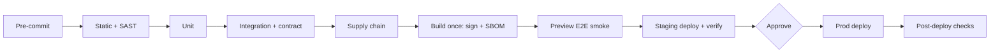

# Governance guide — security, testing, operations, engineering rules, AGENTS.md

The completeness engine for SECURITY_ARCHITECTURE, TESTING, OPERATIONS, CODE_STYLE, GIT_WORKFLOW, AI_GUIDELINES, and AGENTS.md. Read it before generating any of these docs. Each template already carries "Minimum content" guidance and a "Completeness self-check"; this guide explains how to produce that content step by step, so any model gets it right on the first run.

## Contents

1. How to use this guide
2. Inputs and generation order
3. Threat-modeling procedure (SECURITY_ARCHITECTURE §1–§3)
4. Authorization matrix procedure (SECURITY_ARCHITECTURE §5)
5. Deriving SLOs, alerts, and DR targets from NFRs (OPERATIONS §7–§9)
6. Deriving the test matrix from AC, NFR, and threats (TESTING §3–§4, §12)
7. CI/CD reference pipeline (TESTING §8, OPERATIONS §3, GIT_WORKFLOW §5)
8. Writing AGENTS.md for maximum agent compliance
9. Self-review checklists per document
10. Common failure modes and fixes

---

## 1. How to use this guide

1. Generate these docs **one at a time**, in the order in §2. Never batch several into one response.
2. Before each doc: list its inputs (§2), open them, and extract the IDs you need (roles, entities, OP-xx, NFR-xx, AC-xx.y, TH-xx).
3. Fill every H2 of the template. Optional depth goes under H3. A section that does not apply keeps its heading and one line `N/A — reason`.
4. Apply the procedure for that doc (§3–§8). Procedures produce tables; tables must satisfy the coverage rules.
5. Run the doc's self-check (§9 and the end of the template). Fix gaps before setting status `In review`. Do not tick a box you have not verified.
6. Never invent tools as "configured", commands, numbers, hostnames, vendors, or results. Proposals use `> **PROPOSAL:**`; unknowns use `[TBD: question — owner]`.

**Depth by tier** (coverage does not drop, depth does):

| Doc | Lite | Standard | Enterprise |
|---|---|---|---|
| SECURITY_ARCHITECTURE | Top 5–8 threats, every STRIDE letter at least once; role matrix | STRIDE per TB; full matrix; ASVS L1 checklist; OWASP mappings | + DFD per TB, abuse cases, ASVS L2/L3, pen test, control owners and evidence |
| TESTING | Must AC rows + denial/isolation rows; commands; release criteria | + NFR tests, contract, migration, DR-01, flaky policy | + traceability report per release, perf budgets, chaos, a11y audit, sign-off |
| OPERATIONS | Merged into ARCHITECTURE §14.4 | Full; ≥1 SLO; RB-01..03 | + error-budget freeze, 24×7 on-call, DR tiers, game days, change management |
| CODE_STYLE | §1, 2, 3, 5, 6, 12, 13, 14 | All | + CS-xx rule IDs, SAST gate, license compliance |
| GIT_WORKFLOW | 2–5 lines in CODE_STYLE §14 | Full | + signed commits, ≥2 reviewers on protected paths, separation of duties |
| AI_GUIDELINES | Condensed DOs/DON'Ts (≥3 rows/category), loop, red flags, one prompt | Full | + tool register, disclosure trailer, agent audit (§19) |
| AGENTS.md | Overview, commands, rules, boundaries, DoD | All sections, ≤150 lines | + compliance areas, CODEOWNERS paths |

## 2. Inputs and generation order

| Order | Doc | Must read first | Extract |
|---|---|---|---|
| 10 | SECURITY_ARCHITECTURE | ARCHITECTURE, DATABASE, API, PRD, DISCOVERY (IDN, PRV, CMP, AIM), COMPLIANCE if any | containers, stores, integrations, roles (P-xx), entities, PII fields, OP-xx, AI use |
| 11 | TESTING | PRD, TRD, SECURITY_ARCHITECTURE, API, DATABASE, APP_FLOW, DESIGN_SYSTEM | AC-xx.y with priority, NFR-xx targets, TH-xx → SEC-xx, ✗ cells, J-xx, S-xx, migrations |
| 12 | OPERATIONS | TRD, ARCHITECTURE, SECURITY_ARCHITECTURE, TESTING, DATABASE | NFR availability/latency/RPO/RTO, containers, stores, secrets, gates, DR-xx |
| 13 | CODE_STYLE | ARCHITECTURE, ADRs, SECURITY_ARCHITECTURE §1.1/§12, TESTING §9 | languages, directories, never-log list, commands |
| 14 | GIT_WORKFLOW | OPERATIONS §3, TESTING §8, CODE_STYLE, DISCOVERY TEA/OSS | gates, release model, review rules |
| 15 | AI_GUIDELINES | CODE_STYLE, GIT_WORKFLOW, SECURITY_ARCHITECTURE, TESTING, DISCOVERY TEA-05/06 | tools, data classes, boundaries, commands |
| 19 | AGENTS.md | every generated doc | links, commands, boundaries, style summary |

If an input doc is not generated (Lite), use the merge target from `references/tiering-and-doc-matrix.md` (e.g. NFRs live in ARCHITECTURE §14.2).

## 3. Threat-modeling procedure

Use the four-question frame: *What are we building? What can go wrong? What are we doing about it? Did we do a good job?*

### Step 1 — Model the system (What are we building?)

1. List every **external actor**: each role from PRD, anonymous users, attackers, third-party senders (webhooks), admins/operators, CI/CD.
2. List every **process/container** from ARCHITECTURE (web, API, worker, functions, mobile app, CLI).
3. List every **data store**: databases, caches, object storage, queues, search indexes, logs, backups, secret manager, local device storage.
4. List every **data flow** between them, with protocol and the data classes carried (from DATABASE classification).
5. Draw the DFD in Mermaid (`flowchart LR`, zones as `subgraph`). ≤15 nodes per diagram; split by zone if larger. Add an ASCII fallback.

### Step 2 — Find trust boundaries

A boundary exists wherever data crosses a change in privilege, owner, network, or process. Check each pattern:

| Pattern | Typical TB |
|---|---|
| Internet → your edge | Client/browser/app → CDN/gateway |
| Edge → app | Gateway → service |
| App → data store | Service → DB/cache/object storage |
| App → third party | Outbound API calls (payments, email, AI model) |
| Third party → app | Webhooks, OAuth callbacks, file imports |
| CI/CD → production | Deploy credentials, artifacts |
| Admin → app | Admin console, support tooling, DB console |
| Tenant → tenant | Logical boundary inside shared stores |
| App ↔ AI model | Prompts out, generated content and tool calls back |
| Device → OS backup / other apps | Mobile/desktop local storage, IPC, deep links |

Number them `TB-1…TB-n`. Fill the TB table: from → to, data classes, protocol, authN, authZ, key controls.

### Step 3 — Enumerate threats (What can go wrong?)

For **each TB × each STRIDE letter**, ask the prompt question. Write ≥1 TH-xx or an `N/A — reason` row.

| Letter | Property violated | Prompt question | Common examples |
|---|---|---|---|
| S Spoofing | Authentication | Can someone pretend to be another user, service, or sender here? | credential stuffing, forged webhook, stolen token, SSRF to metadata as the service |
| T Tampering | Integrity | Can data or code be modified in transit, at rest, or via parameters? | IDOR/BOLA writes, mass assignment, replayed requests, poisoned dependency, unsigned artifact |
| R Repudiation | Non-repudiation | Can an actor deny an action because we lack evidence? | missing audit log for admin/role/export actions, mutable logs |
| I Information disclosure | Confidentiality | Can data leak to someone not allowed to see it? | over-fetching, cross-tenant reads, PII in logs, verbose errors, public buckets, model leaking context |
| D Denial of service | Availability | Can someone exhaust resources or block others? | expensive queries, unbounded uploads, missing pagination, queue floods, AI token abuse |
| E Elevation of privilege | Authorization | Can someone gain rights they should not have? | role change via API, missing function-level checks, path traversal, injection to code execution, agent with over-broad tools |

Write each threat as **attacker → action → asset**: "An authenticated member changes the note ID in `PATCH /notes/{id}` to edit another tenant's note." Vague threats ("hackers attack the API") are not acceptable.

Also derive: one **abuse case** per Must feature that moves money, data, or permissions (Standard optional, Enterprise required); **AI threats** (§3.3 of the template, mapped to the OWASP LLM Top 10) when the product uses models.

### Step 4 — Rate and respond (What are we doing about it?)

1. Rate likelihood and impact with the template's 3×3 matrix (§3.1). Use its definitions; do not invent CVSS scores.
2. Choose a response: **mitigate** (control), **eliminate** (remove the feature/flow), **transfer** (provider responsibility, contract), **accept** (R-xx in §14 with owner and review date).
3. Every control has a status (`Planned` until built) and a test ID (`SEC-xx`) that TESTING must contain.
4. Critical/High → control required before release, or accepted risk signed by the named risk owner.

### Step 5 — Validate (Did we do a good job?)

- Coverage: count TB × 6 cells; every cell has a row. Every High/Critical has a control + test.
- Cross-check: every role in the matrix, every entity, every OP-xx, every secret, every PII field appears somewhere in the doc.
- Map to standards (§9 of the template): every OWASP Top 10 item; API Top 10 if API; LLM Top 10 if AI; MASVS if mobile; choose ASVS level (L1 baseline; L2 for most apps with personal/business data; L3 high assurance).
- Plan re-review: at each milestone and on any new TB, new data class, or new integration.

### Worked example (abbreviated)

TB-3 "Payment provider → webhook endpoint":

| STRIDE | Threat | Control | Test |
|---|---|---|---|
| S | Attacker posts a forged "payment succeeded" event | HMAC signature with provider secret; reject unsigned | SEC-05 |
| T | Captured event replayed to double-credit | timestamp tolerance 5 min + idempotency key store | SEC-06 |
| R | Disputed credit with no evidence | store raw event ID + signature check result in audit log | SEC-07 |
| I | Error response reveals stack trace | generic 400/401; details only in logs | SEC-04 |
| D | Flood of fake events | rate limit per source IP; cheap signature check first | PERF-03 |
| E | Event payload sets `plan=enterprise` for any account | only trust provider-side object fetched by ID via API | SEC-08 |

## 4. Authorization matrix procedure

1. **Columns = roles.** Every PRD role/persona with distinct rights + `Anonymous` (if anything is public) + service accounts/integrations.
2. **Row groups = resources.** Every DATABASE entity users can act on, plus non-entity resources (billing, settings, audit log, admin console, exports).
3. **Rows = actions.** For each resource, list every action the API/UI exposes: create, read, list, update, delete, export, share, invite, change role, approve, impersonate. Map each OP-xx to exactly one row.
4. **Cells:** `✓` allowed · `✗` denied · `own` only own records · `org` within own tenant · `cond C-n` attribute/relationship rule written in §5.3.
5. **Choose the model:** RBAC (roles only) for simple products; RBAC + ownership/tenant attributes for most SaaS; ReBAC (relationships, e.g. "shared with", folder inheritance) for collaboration apps; ABAC for policy-heavy domains (region, plan, data class). Record the choice; propose a policy engine only as PROPOSAL.
6. **Enforcement:** one policy layer, deny by default; tenant/owner from verified session; consistent 403 vs 404; step-up auth for privileged actions; audit events for role changes and exports.
7. **Tests:** every `✗` or `cond` a real caller can attempt becomes a SEC-xx denial row in TESTING §3.1 (group identical cases).
8. **Consistency:** the matrix must match DATABASE access rules (RLS/policies) and API per-operation auth. Any mismatch is a blocking finding.

## 5. Deriving SLOs, alerts, and DR targets from NFRs

### 5.1 NFR → SLO

1. Select each NFR about **availability, latency, freshness, durability, or correctness** of a user-facing journey.
2. Name the **journey** (J-xx) and where users feel it (edge/load balancer, client RUM, synthetic probe).
3. Write the **SLI** as a ratio: `good events / valid events`. Examples:
   - Availability: non-5xx responses / all responses (exclude health checks and 4xx caused by clients).
   - Latency: requests served < 300 ms / all requests (a threshold-based SLI, not "average latency").
   - Freshness: data updates visible within 60 s / all updates.
   - Job success: jobs completed successfully within 10 min / jobs started.
4. Set the **target** ≤ the NFR target and ≤ what dependencies allow (composite availability ≈ product of serial dependencies' availability).
5. Choose a **window** (28 or 30 days rolling).
6. Compute the **error budget** = (1 − target) × window. Reference: 99% ≈ 7 h 12 min / 30 d; 99.5% ≈ 3 h 36 min; 99.9% ≈ 43 min; 99.95% ≈ 22 min; 99.99% ≈ 4.3 min.
7. Write the **error-budget policy** with escalating actions (template §7 table).

| NFR (TRD) | → | SLO (OPERATIONS) |
|---|---|---|
| NFR-01 p95 read latency < 300 ms at 50 req/s | → | SLO-01: 95% of read requests < 300 ms over 28 d (and PERF-01 proves it at 50 req/s) |
| NFR-02 99.5% monthly availability | → | SLO-02: 99.5% non-5xx over 28 d, measured at the load balancer |
| NFR-09 RPO 15 min / RTO 4 h | → | §9 backup row: PITR; DR-01 drill measures both |

NFRs that are not SLOs (e.g. accessibility, security) become tests in TESTING instead.

### 5.2 SLO → alerts

Use multi-window burn-rate alerts (pattern from the Google SRE Workbook):

| Alert | Burn rate | Long window | Short window | Budget consumed if sustained | Action |
|---|---|---|---|---|---|
| Fast burn | 14.4× | 1 h | 5 min | 2% in 1 h | Page |
| Medium burn | 6× | 6 h | 30 min | 5% in 6 h | Page or urgent ticket |
| Slow burn | 1× | 3 d | 6 h | 10% in 3 d | Ticket |

Plus non-SLO alerts: backup failures, certificate expiry, queue age, saturation (> 80%), auth-failure spikes, cost anomalies. Every paging alert links a runbook RB-xx; every runbook has trigger, diagnosis, mitigation, verification, escalation.

### 5.3 Golden signals

For every user-facing container record latency (by percentile and route), traffic, errors (by type), and saturation (CPU, memory, pools, queue depth). Workers: job duration, throughput, failure/DLQ, oldest-message age. Clients: Core Web Vitals or app start time and crash-free sessions.

### 5.4 Backup and DR

- One backup row per stateful asset (DB, object storage, search index, secrets, IaC state). RPO/RTO from NFR; if no NFR exists, ask (`[TBD]`) — do not invent.
- Pick a DR tier (backup & restore, pilot light, warm standby, active-active) that meets RTO within budget.
- Each row has a DR-xx drill in TESTING with status `Not run`.
- Respect residency: the DR location must satisfy the same data-residency rules.

## 6. Deriving the test matrix from AC, NFR, and threats

Build TESTING §3–§4 mechanically, then add judgment:

| Source | Rule | Test ID | Layer (default) |
|---|---|---|---|
| Must AC-xx.y | ≥1 row each | AT-xx | lowest layer that can observe the result |
| Must feature | ≥1 failure/edge row (invalid, unauthorized, empty, limit, concurrency, offline) | AT-xx | unit/integration |
| Should AC-xx.y | ≥1 row each | AT-xx | |
| J-xx critical journey | ≥1 end-to-end row | AT-xx | E2E |
| ✗/cond cell in authZ matrix | ≥1 denial row (group identical) | SEC-xx | integration |
| Tenant isolation path | ≥1 row per path (DB, cache, search, files, jobs, AI retrieval) | SEC-xx | integration |
| TH-xx with Test column | row with that exact ID | SEC-xx | per threat |
| NFR performance | row with exact numeric target and load profile | PERF-xx | staging |
| NFR accessibility | automated + keyboard + screen reader rows | A11Y-xx | E2E/manual |
| NFR compatibility | matrix row | COMPAT-xx | CI |
| RPO/RTO, rollback | drill rows | DR-xx | staging |
| API with consumers | schema diff + consumer contract rows | AT-xx | CI |
| DB migrations | up, backward-compat, backfill rows | AT-xx | CI |
| AI features | eval rows with dataset + threshold; injection row | AT-xx / SEC-xx | CI |

**Layer selection:** pick the cheapest layer that observes the behavior. Validation → unit. Persistence or authZ → integration. Multi-screen flow → E2E. Never put all ACs in E2E.

**Row quality:** scenario in Given/When/Then; expected result observable (status code, message, persisted state, event, UI text); status `Not run`.

**Traceability summary (TESTING §12):** count items per source and items with ≥1 test. Must rows below 100% block approval.

## 7. CI/CD reference pipeline

Use these stages as the reference; drop what does not apply and say why. Tools are examples — PROPOSAL until configured.

| # | Stage | Purpose | Example tools (by stack) | Blocks? |
|---|---|---|---|---|
| 0 | Pre-commit | fast local feedback | pre-commit, lefthook, husky; gitleaks | local |
| 1 | Install | reproducible deps | `npm ci`, `uv sync --frozen`, `go mod download`, `cargo fetch --locked` | yes |
| 2 | Static | format, lint, types | Prettier/Biome+ESLint+tsc; Ruff+mypy/pyright; gofmt+golangci-lint; rustfmt+clippy | yes |
| 3 | SAST + secrets | code-level security | CodeQL, Semgrep, gosec, Bandit; gitleaks, trufflehog | high/critical |
| 4 | Unit | fast behavior checks + coverage | Vitest/Jest, pytest, go test, cargo test, JUnit, xUnit | yes |
| 5 | Integration + contract | real deps, schema compatibility | Testcontainers; Pact; OpenAPI diff; buf breaking | yes |
| 6 | Supply chain | vulnerabilities, licenses, SBOM | OSV-Scanner, Trivy, dependency review; license checker; Syft/CycloneDX | critical |
| 7 | Build | build once, sign, provenance | Docker/Buildpacks, goreleaser; cosign; CI attestations (SLSA) | yes |
| 8 | Preview / E2E smoke | journey on ephemeral env | Playwright, Cypress, Maestro, CLI harness | yes (smoke) |
| 9 | Deploy staging | migrations (expand), health checks | platform/IaC tool | yes |
| 10 | Verify staging | E2E, DAST, perf, a11y | ZAP, k6, axe/Lighthouse CI | per policy |
| 11 | Approve | human or automated gate | environment protection rules | yes |
| 12 | Deploy prod | rolling/canary/blue-green | platform | auto-rollback on SLI breach |
| 13 | Post-deploy | synthetics, release notes | uptime checks; release-please/semantic-release | — |

ASCII: `pre-commit → static/SAST → unit → integration/contract → supply chain → build+sign+SBOM → preview E2E → staging → approve → prod → post-deploy`.

**Hardening:** pin third-party CI actions to commit SHAs; least-privilege job tokens; OIDC federation instead of long-lived cloud keys; protected environments for prod; no secrets in PR builds from forks.

**Consistency rule:** the same gate names appear in TESTING §8, OPERATIONS §3.1, GIT_WORKFLOW §5, and CONTRIBUTING.

## 8. Writing AGENTS.md for maximum agent compliance

AGENTS.md is read by many tools (Codex, Cursor, Copilot, Gemini CLI, Claude Code via a `CLAUDE.md` pointer that imports it, and others). Agents comply best with short, specific, imperative instructions near the top.

**Rules for writing it:**

1. **≤150 lines.** Link to docs; never copy them. Long files get truncated or skimmed.
2. **Order by criticality:** overview → read order → commands → working rules → boundaries → security → git → DoD.
3. **Imperatives, one rule per bullet.** "Never run migrations against shared databases." not "Be careful with migrations."
4. **Exact commands in a table**, copy-pasteable, verified; otherwise `Not configured`. Agents run what they see.
5. **Explicit boundaries list** (ask first) and **stop conditions** (red flags). Make the list identical to AI_GUIDELINES §15.
6. **Name paths concretely** (`internal/domain`, `src/app/api`) rather than describing them.
7. **Definition of done as a checklist** with evidence ("command → result").
8. **No secrets, no personal data, no URLs you did not verify.**
9. **Monorepos:** root AGENTS.md for global rules; nested AGENTS.md per package for package commands. The closest file wins; user prompts override.
10. **Tool pointers** (`CLAUDE.md`, `GEMINI.md`, `.github/copilot-instructions.md`) stay thin and point to AGENTS.md — one source of truth.
11. **Stable anchors:** keep the heading "Read before you work" (other docs link `#read-before-you-work`).
12. **Re-check after every doc change** that affects commands, boundaries, or structure.

**Compliance test:** give a fresh agent only AGENTS.md and a task; it should be able to answer: which docs to read, which command runs tests, what it may not do without asking, and when it is done. If not, fix the file.

## 9. Self-review checklists per document

Run the template's "Completeness self-check" plus these cross-doc checks. Fix, then tick.

**SECURITY_ARCHITECTURE**
- [ ] TB × STRIDE coverage complete; threats written as attacker → action → asset.
- [ ] Roles = PRD roles; resources = DATABASE entities; OP-xx all mapped; matches DATABASE access rules and API auth.
- [ ] Secrets: one per integration; names only; storage, rotation, owner.
- [ ] OWASP mappings present per product type (MASVS: all 8 categories); ASVS level stated; no "compliant" claims.
- [ ] §1.1 classes are DATABASE §2's names verbatim; §4.2, §8, §12 complete; §13 has severity classes and notification clocks as `[TBD: counsel]` or cited from COMPLIANCE.
- [ ] §16 SLAs = TRD security NFR; every ARCHITECTURE third party has a §18 row; §17 and §19 filled; §20 mapped to CR-xx (Enterprise) or `N/A — reason`.
- [ ] Lite: OPERATIONS/API/SECURITY.md links repointed per tiering-and-doc-matrix "Lite merges".
- [ ] Every SEC-xx named here exists in TESTING.

**TESTING**
- [ ] 100% Must AC coverage; failure row per Must feature; journeys covered end to end.
- [ ] Denial and isolation rows match the authZ matrix and §6 paths.
- [ ] NFR rows use exact TRD numbers; DR rows match OPERATIONS RPO/RTO.
- [ ] Gates match OPERATIONS and GIT_WORKFLOW; commands verified or `Not configured`; all statuses `Not run`.

**OPERATIONS**
- [ ] NFR → SLO mapping complete; burn-rate alerts per SLO; runbooks for every page.
- [ ] Backup row per stateful asset; DR tier chosen; drills `Not run`.
- [ ] Rollback decision tree accounts for migrations and flags.
- [ ] No invented hostnames, accounts, costs, or commands.

**CODE_STYLE**
- [ ] Every language has version, naming, formatter, linter, type rules.
- [ ] Directory table equals ARCHITECTURE structure.
- [ ] Never-log list ⊇ Sensitive, Secrets and masked Personal fields; dependency policy with approver and licenses.
- [ ] Review checklist present (`#12-review-checklist` anchor intact).

**GIT_WORKFLOW**
- [ ] gitGraph of the chosen model + ASCII; branch naming with examples.
- [ ] Required checks = TESTING §8 gates; protection status truthful.
- [ ] Release approach named (manual / release-please / semantic-release / changesets / other); tag format; hotfix flow.

**AI_GUIDELINES**
- [ ] DOs/DON'Ts for all 11 categories; task loop (Mermaid + ASCII) with exit criteria.
- [ ] Red flags with STOP behavior; four prompt templates; extended reviewer checklist.
- [ ] Boundaries identical to AGENTS.md; disclosure policy chosen (`#13-disclosure-and-attribution` anchor intact).

**AGENTS.md**
- [ ] ≤150 lines; links only to generated docs; commands identical to CODE_STYLE §13 / TESTING §9.
- [ ] Boundaries and stop conditions present; DoD checklist present.

## 10. Common failure modes and fixes

| Symptom | Cause | Fix |
|---|---|---|
| STRIDE table has 6 generic rows | Threats listed per category, not per boundary | Iterate TB × STRIDE; write attacker → action → asset |
| Matrix shows only 3 generic permissions | Resources not taken from DATABASE | Build rows from entities × exposed actions; map OP-xx |
| Test matrix covers only happy paths | No failure-row rule applied | Add ≥1 failure/edge row per Must feature; denial rows from ✗ cells |
| "Tests: Passed" in a new project | Prefilled status | Reset to `Not run`; only real runs go in the results log |
| SLO says 99.99% with no basis | Number invented | Copy from NFR or write `[TBD]`; check dependency SLAs |
| Commands like `make test` in a repo without a Makefile | Guessed from stack | Write `Not configured` until verified |
| Docs truncated after several files | Too many docs in one response | One doc per response; record progress in STATE.md; continue |
| AGENTS.md is 400 lines | Copied docs into it | Replace with links; keep rules and commands only |
| Diagrams missing or unreadable | Mermaid skipped or >15 nodes | Add Mermaid + ASCII fallback; split by zone |
| Tool listed as "configured" | Proposal treated as fact | Mark `> **PROPOSAL:**` and `Not configured` |
