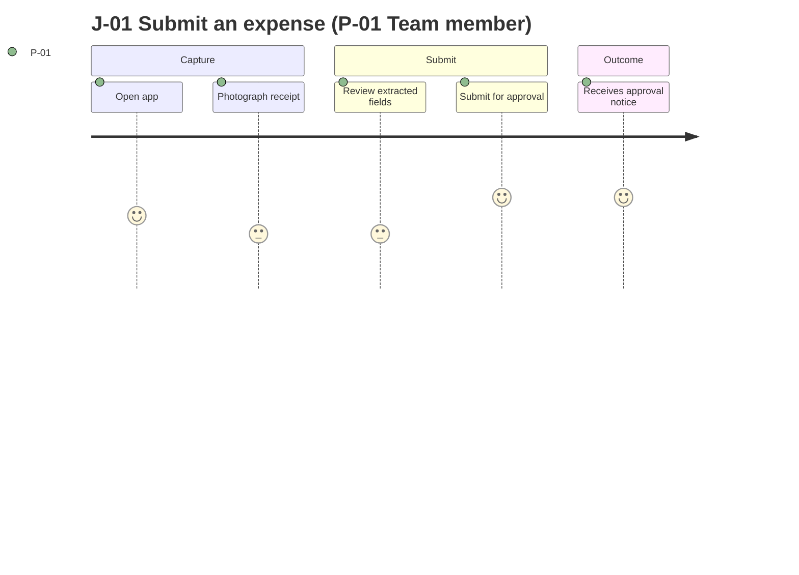
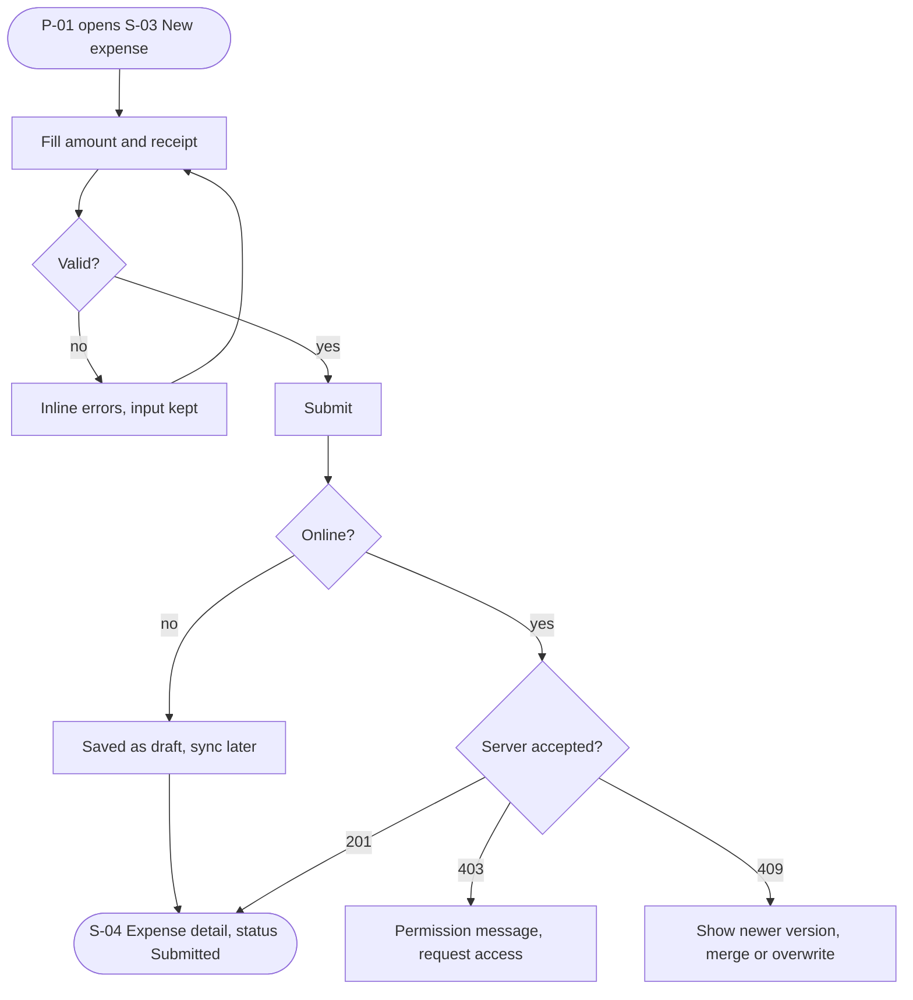
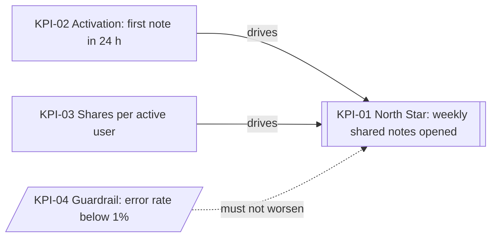
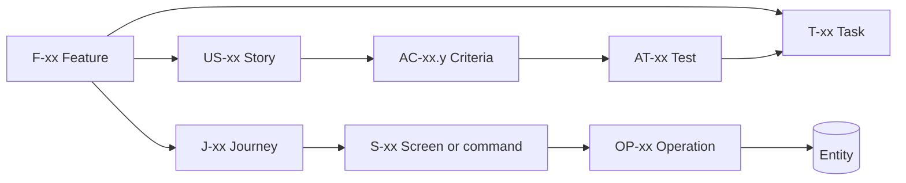
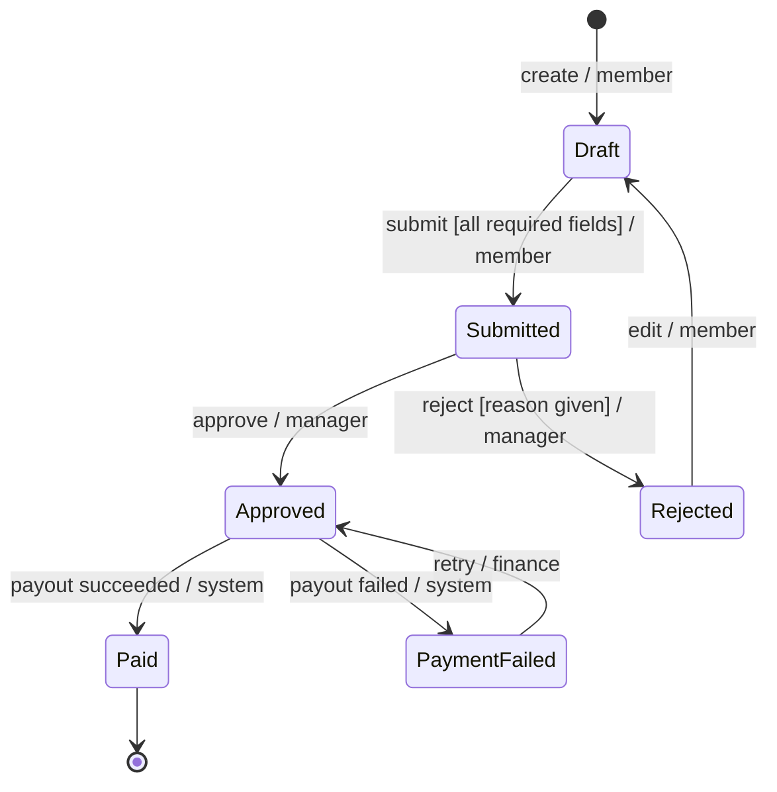

# Product guide — PRD, APP_FLOW, DESIGN_SYSTEM and plan completeness engine

Read this before generating `docs/product/PRD.md`, `docs/product/APP_FLOW.md`, `docs/product/DESIGN_SYSTEM.md`, and `docs/technical/IMPLEMENTATION_PLAN.md`. It turns DISCOVERY.md answers into complete, consistent, testable product docs on the first pass. It is model-agnostic: follow the steps in order, meet every minimum in §1, and run the self-review in §17 before you show a document.

All rules from `writing-conventions.md` apply (IDs, markers, never invent). This guide adds **how much** and **how deep**.

---

## 0. The procedure (do these in order)

1. Read DISCOVERY.md completely. List every persona, journey, feature, NFR, risk, and open question it contains (DISCOVERY §11 "Seed register" if present).
2. Derive personas (§2) and JTBD (§3).
3. Write journeys: happy + alternate + failure for every Must feature (§4).
4. Decompose features: epic → F-xx → US-xx → AC-xx.y (§5). Run the edge-case catalog (§5.4) on every Must feature.
5. Prioritize with MoSCoW, and RICE if Standard/Enterprise has more than 8 features (§6).
6. Summarize NFRs (§7) and define metrics (§8).
7. Apply the scope-creep guard (§9).
8. Draw state machines for key entities (§11).
9. Write APP_FLOW: inventory, flows, action specs, per-screen state matrix (§12).
10. Write DESIGN_SYSTEM coverage from the APP_FLOW inventory (§13).
11. Write the IMPLEMENTATION_PLAN from all docs (§14).
12. Fill the traceability matrix (§10) and run the self-review checklist (§17). Fix every unticked box, or record why it is `N/A` / `[TBD]`.

If DISCOVERY.md does not answer something you need, do NOT invent it: write `[TBD: question — owner]` and add a Q-xx.

---

## 1. Minimum content (counts and coverage)

These are floors, not targets. "Must F" = feature with priority Must.

| Item | Lite | Standard | Enterprise |
|---|---|---|---|
| Personas P-xx | ≥ 1 (≥ 2 if there is an admin or second role) | ≥ 2 | ≥ 2 + one per distinct role (admin, support, API consumer, auditor) |
| JTBD | optional | ≥ 1 per persona | ≥ 1 per persona |
| Journeys J-xx | ≥ 1 primary | ≥ 3 (primary, onboarding, one more) | ≥ 3 + one per role |
| Paths per Must F | happy + failure | happy + alternate + failure | happy + alternate + failure |
| User stories US-xx | ≥ 1 per Must F | ≥ 1 per Must/Should F | ≥ 1 per F, per persona that uses it |
| AC per Must F | ≥ 2 (1 happy, 1 negative) | ≥ 3 (≥ 1 negative, ≥ 1 edge) | ≥ 4 (≥ 1 negative, ≥ 1 edge, ≥ 1 permission) |
| AC per Should F | ≥ 1 | ≥ 2 (≥ 1 negative) | ≥ 3 |
| Edge-case catalog (§5.4) | Must F, top 3 categories | every Must F, all categories (mark N/A) | every Must and Should F |
| Out-of-scope items | ≥ 2 | ≥ 3 with reason | ≥ 3 with reason and owner |
| KPI-xx | ≥ 1 | North Star + ≥ 2 inputs + ≥ 1 guardrail | as Standard + HEART/AARRR mapping |
| State machines | if an entity has ≥ 3 statuses | every entity with ≥ 3 statuses | every entity with a status field |
| APP_FLOW screens S-xx | every interactive Must F | every interactive F | every F + admin/back-office |
| Per-screen state matrix | Must screens | all screens | all screens + role variants |
| Mermaid diagrams (PRD + APP_FLOW) | ≥ 2 | ≥ 5 | ≥ 7 |
| Plan tasks per Must F | ≥ 1 | ≥ 2 (build + test/hardening) | ≥ 2 + evidence task if regulated |
| Plan milestones | M0, M1/M2 merged, M3, M6 | M0–M7 | M0–M7 + sign-off gates |

Counting rule: if you are under a floor, either add the missing item from DISCOVERY.md or write one explicit line explaining why it does not apply (`N/A — single-role CLI tool`). Silence is a defect.

---

## 2. Personas (P-xx)

A persona is a **role + context + goal**, derived from DISCOVERY answers (USR-01..07, VIS-01). Never invent demographics, quotes, or research.

Derivation steps:

1. List every actor that touches the product: primary user, secondary users (admin, moderator, support), external systems (API client, webhook consumer, CI job), and the operator.
2. Merge actors with the same goals and permissions; split actors whose permissions differ.
3. For each persona fill: context (where, device, frequency), goals (1–3), frustrations (from VIS-02 workaround), skill level, accessibility/environment needs (USR-04, USR-06), and the role used for permissions.
4. Mark which persona is **primary** (the release fails if they are not served).

| Interface | Typical personas |
|---|---|
| Web/mobile SaaS | End user (member), workspace admin, support agent |
| CLI | Developer on a laptop, CI pipeline (non-interactive), maintainer |
| Public API | Integrating developer, platform operator, end user of the integrator |
| Library/SDK | Application developer, library maintainer |

Bad: "P-01 Sarah, 32, loves coffee." Good: "P-01 Team member — uses the web app daily on a work laptop to file expenses; goal: submit in < 2 min; frustration: re-typing receipts (VIS-02)."

## 3. Jobs to be done (JTBD-xx)

Format: **When** situation, **I want to** motivation, **so I can** outcome. One per persona minimum (Standard+). JTBD describe the job, not the feature: "When a client asks for an invoice copy, I want to find it in seconds, so I can answer before the call ends." Each JTBD should map to ≥ 1 feature; a JTBD with no feature is either out of scope (say so) or a gap.

## 4. Journeys (J-xx): happy, alternate, failure

For each journey record: actor (P-xx), trigger, preconditions, steps, success outcome, alternates, failures and recovery, features touched.

- **Happy path:** the shortest successful route.
- **Alternate paths:** valid variations (cancel, edit, undo, skip, back, save draft, `--dry-run`, pagination, bulk).
- **Failure paths:** validation error, permission denied, network/offline, dependency down, conflict, limit reached, session expired. Each failure needs a **recovery** (retry, fix input, request access, resume).

Every Must feature appears in at least one journey and has all three path types written somewhere (PRD summary or APP_FLOW detail).

Mermaid `journey` (PRD summary — satisfaction score 1–5 is a design estimate; label it PROPOSAL if not from research):



Mermaid `flowchart` with failure branches (APP_FLOW detail):



ASCII fallback (always add one for the primary journey; some viewers do not render Mermaid):

```text
[S-03 New expense] --fill--> (validate) --ok--> (submit) --201--> [S-04 Detail: Submitted]
                                 |                  |--403--> [Denied: request access]
                                 |                  |--409--> [Conflict: merge/overwrite]
                                 |                  '--offline--> [Draft queued] --> sync later
                                 '--invalid--> [inline errors, input kept] --> back to form
```

## 5. Feature decomposition

### 5.1 Hierarchy

```text
Epic (optional grouping, e.g. "Expenses")
 └─ F-xx Feature  (priority, release, owner)
     ├─ US-xx User story  (As a P-xx, I want …, so that …)
     │   └─ AC-xx.y Acceptance criteria  (Given / When / Then)
     ├─ Business rules  (numbered inside the feature: Rule 1, Rule 2 …)
     ├─ Data touched    (entity names, used later by DATABASE)
     └─ States          (empty, loading, error … used by APP_FLOW)
```

A feature is the smallest unit a user would recognize and a release could include or exclude. If a feature needs more than ~8 AC, split it.

### 5.2 Feature specification fields (every Must and Should F)

| Field | Content | Minimum |
|---|---|---|
| Description | what the user can do; inputs → outputs | 2–4 sentences |
| Actors & permissions | which P-xx / role can do what; who cannot | every role mentioned |
| Trigger & preconditions | what starts it; what must be true | 1 line each |
| Inputs & validation | field, type, required, limits, format | every input field |
| Business rules | numbered, testable statements | ≥ 1, or "none" |
| Data touched | entities read/written | names only, no schema |
| States | empty / loading / success / error / denied / offline as applicable | every applicable state |
| Acceptance criteria | Given/When/Then | per §1 floors |
| Out of scope | exclusions for this feature | ≥ 1 |
| Related | US, J, NFR, R, Q | IDs |

### 5.3 Acceptance criteria rules

- Format: `AC-xx.y (type) Given <state>, when <action>, then <observable result>.` Types: `happy`, `negative`, `edge`, `permission`, `nfr`.
- Observable: a message text, a status/exit code, a record visible in a list, a timing with a number. Never "works", "correctly", "properly", "fast".
- One behavior per AC. Split "and then also…" into two.
- Negative AC states what is **not** done too ("nothing is saved", "no email is sent", "no data leaked").
- Use real limits from DISCOVERY; if unknown, `[TBD: max file size — PO]`, never a guessed number.

### 5.4 Edge-case catalog (run on every Must feature)

For each category write an AC, or `N/A — reason` in the feature's coverage row (PRD §7.3).

| Category | Question to ask | Example AC (web / CLI / API) |
|---|---|---|
| Empty | What if there is no data yet? | Given no notes, when I open Notes, then I see "No notes yet" and a "New note" button. |
| Invalid input | Missing, too long, wrong format, injection characters? | Given title > 200 chars, when I save, then I see "Max 200 characters" and nothing is saved. |
| Unauthenticated | Session missing/expired? | Given an expired token, when the client calls `GET /v1/notes`, then 401 problem+json; no data returned. |
| Unauthorized | Wrong role or another tenant's object? | Given a viewer role, when they delete a note, then "You don't have permission" and the note remains. |
| Not found | Deleted/unknown ID? | Given a deleted note link, when opened, then "This note no longer exists" with a link to Notes. |
| Concurrency / conflict | Two edits at once, double submit? | Given two tabs edit the same note, when the second saves, then a conflict notice offers reload or overwrite. |
| Duplicate / idempotency | Retry or double click? | Given a payment request retried with the same idempotency key, then only one charge exists. |
| Limits / quotas | Max items, size, rate? | Given 100 notes on the free plan, when I create one more, then I see the plan limit and nothing is created. |
| Offline / timeout | Network lost, dependency slow? | Given no network, when I save, then the change is queued and marked "Not synced". |
| Dependency failure | Email/payment/AI provider down? | Given the email provider fails, when I invite, then the invite is stored and retried; the UI says "Invite pending". |
| Partial failure / bulk | Some items fail? | Given 3 of 50 rows invalid, when I import, then 47 import and a report lists the 3 with reasons. |
| Destructive action | Delete, irreversible? | Given I delete a project, then I must confirm by typing its name; undo is available for 10 s `[TBD]`. |
| Locale / time | Time zones, DST, RTL, currency? | Given a user in UTC+7, when a due date is shown, then it is in their local time. |
| Accessibility | Keyboard only, screen reader? | Given keyboard only, when I complete J-01, then every step is reachable and focus is visible. |
| CLI specifics | Non-TTY, `--json`, exit codes, Ctrl-C? | Given stdout is not a TTY, when I run `tool list`, then no colors/spinners are printed and exit code is 0. |

### 5.5 Feature summary hygiene

- Every F-xx has exactly one priority and one target release.
- Every F-xx links ≥ 1 US-xx; every US-xx links exactly one F-xx.
- Withdrawn features keep their ID with `(withdrawn)`.

## 6. Prioritization

**MoSCoW** (per release):

- **Must** — the release fails its goal without it. Test: "Would we delay launch for this?" Yes → Must.
- **Should** — important, painful to drop, has a workaround.
- **Could** — nice to have; first to cut.
- **Won't (this release)** — agreed exclusion; list in PRD §10 with a reason.

Rule of thumb: Must ≤ 60% of estimated effort; if more, the scope is at risk — raise R-xx.

**RICE** (Standard/Enterprise, when > 8 features or the team disagrees): `score = Reach × Impact × Confidence ÷ Effort`.

| Factor | Scale |
|---|---|
| Reach | users or events per period (from DISCOVERY; else `[TBD]`) |
| Impact | 3 massive · 2 high · 1 medium · 0.5 low · 0.25 minimal |
| Confidence | 100% data · 80% some evidence · 50% guess |
| Effort | person-weeks (estimate; label PROPOSAL) |

RICE informs MoSCoW; it does not override a user's decision. Never present RICE inputs as data unless the user provided them.

## 7. NFR elicitation (PRD summary → TRD NFR-xx)

The PRD states plain-language expectations; TRD (Lite: ARCHITECTURE §14.2) holds the numbers. Walk this table; every row gets an answer, a PROPOSAL default, or `N/A — reason`.

| Category | Ask (question ID) | Proposal default if user has no view | Unit / measure |
|---|---|---|---|
| Performance | NFR-Q01 | p95 interactive action < 1 s; API p95 < 300 ms at expected load; CLI start < 300 ms | ms at load, measured by PERF-xx |
| Capacity | NFR-Q03, USR-03 | launch users × 3 headroom | users, req/s, GB/year |
| Availability | NFR-Q02 | 99.5% monthly (S), 99.9% (E) | % per month, uptime monitor |
| Recovery | NFR-Q05 | RPO 24 h, RTO 4 h (S); RPO 1 h, RTO 1 h (E) | hours, DR drill |
| Security | IDN-* | MFA available for admins; least privilege | control present, SEC-xx |
| Privacy | PRV-* | collect minimum; deletion within 30 days of request | days, process audit |
| Accessibility | ACC-01 | WCAG 2.2 AA | A11Y-xx audit |
| Compatibility | NFR-Q07 | last 2 major versions of evergreen browsers / OS | matrix, COMPAT-xx |
| Offline/network | NFR-Q04 | usable on 3G-class networks; offline N/A unless asked | behavior test |
| Localization | I18N-01 | one locale, strings externalized | locales list |
| Observability | OBS-* | errors traced with correlation ID | presence check |
| Reliability of jobs | NFR-Q08 | at-least-once with idempotent handlers | retries, duplicate test |

## 8. Metrics (KPI-xx)

Structure (Standard+):

- **North Star** (1) — the value users get, counted per period. e.g. "weekly notes shared that are opened by a recipient".
- **Input metrics** (2–4) — levers that move the North Star (activation rate, time to first value, weekly retained users).
- **Guardrails** (≥ 1) — must not get worse (error rate, p95 latency, support tickets per 100 users, unsubscribe rate, cost per active user).

Every KPI row: definition (numerator/denominator, period), data source, measurement method (event name, query, log, survey), baseline (`[TBD]` unless the user gave one), target, timeframe, owner, privacy note if tracking.

Frameworks — pick one and map KPIs to it (Enterprise required, Standard optional):

| HEART | Example signal | AARRR | Example signal |
|---|---|---|---|
| Happiness | CSAT after J-01 | Acquisition | sign-ups per week |
| Engagement | sessions per active user per week | Activation | % completing J-01 within 24 h |
| Adoption | % new users using F-03 | Retention | week-4 retention |
| Retention | % active in week 4 | Referral | invites sent per active user |
| Task success | J-01 completion rate, time on task | Revenue | paid conversion |

Metric tree (Mermaid):



Internal tools, CLIs, and libraries also have metrics: tasks automated per week, installs/downloads, time saved per run, issues per release. If no tracking is wanted, say so and use manual measures (survey, interviews) — never imply analytics exist.

## 9. Scope-creep guard

Apply while writing every product doc:

1. Every feature, screen, command, endpoint, and task MUST trace to an F-xx that exists in PRD §7.1 with an approved priority.
2. If you think of something useful that is not in DISCOVERY: do not add it as a feature. Add `> **PROPOSAL:** consider F-new "…" for a later release` in PRD §10 (out of scope) or as a Q-xx.
3. "While we're at it" items (admin dashboards, analytics, theming, i18n, social login, AI features) are Won't unless the user asked.
4. A change of scope after approval goes through the change-propagation rule (SKILL.md) and the PRD change log; the plan is updated in the same change.
5. In the plan: a task with no F-xx/NFR-xx/TH-xx link is either infrastructure (M0/M5, say so) or out of scope — delete it.

## 10. Traceability

Chain (left to right, every Must F must have a full row by the end of Phase 6):

```text
F-xx → US-xx → AC-xx.y → J-xx → S-xx (APP_FLOW) → OP-xx (API) → entity (DATABASE) → AT-xx / SEC-xx (TESTING) → T-xx (PLAN)
```



Rules:

1. Every Must F has ≥ 1 US, ≥ the AC floor, ≥ 1 J, ≥ 1 S (if interactive), ≥ 1 AT per AC, and ≥ 1 T.
2. Every S-xx lists ≥ 1 F-xx. A screen without a feature is scope creep or a missing feature.
3. Every OP-xx used in APP_FLOW exists in API.md; every entity named in PRD "Data touched" exists in DATABASE.md.
4. Columns for docs not yet generated are written `pending` during generation and MUST be filled during the Phase 6 audit; for docs not in the tier write `N/A`.
5. One matrix lives in PRD §18; APP_FLOW §10 repeats only the F → J → S → OP slice.

## 11. State machines for key entities

Draw a `stateDiagram-v2` for every entity with ≥ 3 statuses or with transitions restricted by role (order, invoice, document, ticket, subscription, invitation, job). Label transitions with `action [guard] / role`. Include terminal states and the failure states.



Under each diagram add a transition table: from, to, trigger, who, guard, side effects (notifications, audit log). Forbidden transitions get a negative AC ("Given Paid, when a member edits, then 'Paid expenses are locked'").

## 12. APP_FLOW depth

### 12.1 Inventory vocabulary by interface

| Interface | S-xx unit | Action | Success signal | Error signal |
|---|---|---|---|---|
| Web/mobile/desktop | screen, dialog, sheet | tap/click/submit | navigation, toast | inline error, banner |
| CLI | command/subcommand | invocation with flags | stdout + exit 0 | stderr + non-zero exit code |
| API | endpoint group | request | 2xx + body | 4xx/5xx problem+json |
| Library | public module/function | call | return value | typed error/exception |

### 12.2 Per-screen state matrix (required)

One row per S-xx; each cell says what is shown or `N/A — reason`.

| S-xx | Empty | Loading | Populated | Validation error | Server error | Permission denied | Offline | Session expired |
|---|---|---|---|---|---|---|---|---|
| S-02 Notes list | "No notes yet" + New | skeleton rows | list, newest first | N/A — no input | banner + Retry + ref ID | redirect to S-01 with message | cached list + "Offline" badge | re-auth sheet, keeps scroll |

CLI equivalent columns: no results, progress, output, usage error (exit 2), runtime error (exit 1), auth error (exit 77 or documented code), non-TTY, interrupted (Ctrl-C).

### 12.3 Action specs

Every action in Must/Should features gets: trigger, validation, loading, success, error (message + recovery), next. Error messages are written out verbatim (the DESIGN_SYSTEM voice applies).

### 12.4 Diagram set

- Navigation map (`flowchart`, all S-xx, ≤ 15 nodes per diagram; split by area).
- Primary journey with failure branches (`flowchart`), plus ASCII fallback.
- One `sequenceDiagram` for the most important operation (client → API → data → external).
- Entity lifecycle (`stateDiagram-v2`) for entities from §11 that drive screen states.

## 13. DESIGN_SYSTEM coverage

1. Inventory every component used by APP_FLOW screens; each component lists all applicable states (default, hover, focus-visible, active, disabled, loading, error, success, empty).
2. Every token has a semantic name, light and dark value (or `N/A — single theme`), and usage. Values are PROPOSAL until approved. Contrast ratios are computed (e.g. with a contrast checker) or written `Not checked` — never estimated.
3. Message patterns (error, empty, confirmation, destructive) are written as examples so APP_FLOW messages are consistent.
4. CLI products: replace visual tokens with terminal styles (ANSI roles, `NO_COLOR`, non-TTY, width 80), keep voice and accessibility.

## 14. Implementation plan rules

1. Phases: M0 Foundations/repo setup → M1 data & auth → M2 first vertical slice → M3 core (Must) features → M4 secondary (Should) features → M5 hardening (security, accessibility, performance, observability) → M6 release/launch → M7 post-launch. Merge or drop phases that do not apply and say why (e.g. "M1: no accounts — local storage only").
2. Every Must F → ≥ 1 build task in M2/M3 and its AT rows referenced in the task acceptance. Every Should F → task in M4 or listed as out of plan.
3. Every NFR-xx with a test → task in M5 (or earlier if foundational). Every TH-xx with mitigation `Planned` → task.
4. Tasks: S (≤ ½ day) or M (1–2 days). L is not allowed — split. Each task fits one PR.
5. Dependencies form a DAG (no cycles); the critical path is named.
6. Owners: `Human`, `Agent` (with human reviewer role), or `Human + Agent`. Decisions, credentials, legal, store submissions, and production deploy approvals are `Human`.
7. Verification commands are the verified commands from CODE_STYLE/TESTING or `Not configured`. Never invent commands.
8. Dates: no invented calendar dates. Gantt uses durations relative to the plan approval date and is labeled PROPOSAL.

## 15. Mermaid safety rules (avoid broken diagrams)

- Node IDs: letters/digits only (`T01`, `S02`), never `T-01` as an ID; put the readable ID in the label: `T01[T-01 Repo setup]`.
- Quote labels containing `( ) [ ] { } : ; # " / <`: `A["Submit (draft)"]`.
- Do not name a node `end` (reserved); use `done`.
- `stateDiagram-v2` state names: no spaces (`PaymentFailed`); describe with `state "Payment failed" as PaymentFailed` if needed.
- `gantt`: needs `dateFormat YYYY-MM-DD`; task IDs alphanumeric; use `after id` for dependencies; one `section` per milestone.
- `journey`: scores 1–5; actors after the colon.
- ≤ 15 nodes per diagram; split by area or milestone.
- Every diagram has an ASCII or table equivalent for the primary flow and the phase plan.

## 16. Worked example — mini PRD excerpt ("Acme Notes", Standard tier)

`Example:` synthetic, for depth calibration only. Do not copy content into a real project.

**Personas:** P-01 Writer (member; web on laptop, daily; goal: capture and share notes quickly). P-02 Workspace admin (manages members; weekly).

**F-01 — Create and edit a note** (Must, MVP)

- **Description:** A member creates a note with a title and body, edits it, and sees it in the notes list.
- **Actors & permissions:** P-01 members create/edit their own notes; admins can view all notes in the workspace; viewers cannot create.
- **Inputs & validation:** title (text, required, 1–200 chars); body (rich text, optional, ≤ 100 000 chars `[TBD: confirm limit — PO]`).
- **Business rules:** Rule 1 — notes autosave 2 s after the last keystroke. Rule 2 — the latest save wins only if the version matches; otherwise conflict.
- **Data touched:** Note, Workspace, User.
- **States:** empty list, saving, saved, offline (queued), conflict, error.
- **Acceptance criteria:**
  - AC-01.1 (happy) Given I am a member, when I enter a title and stop typing for 2 s, then "Saved" appears and the note is first in my list.
  - AC-01.2 (negative) Given the title is empty, when I leave the field, then I see "Title is required" and no note is created.
  - AC-01.3 (edge) Given another session saved the note after I opened it, when I save, then I see "This note changed" with Reload and Overwrite, and nothing is lost.
  - AC-01.4 (permission) Given I am a viewer, when I open New note, then the action is not shown and `POST /notes` returns 403.
- **Out of scope:** version history, attachments.

**F-02 — Share a note** (Must, MVP)

- **Description:** The owner shares a note with a registered workspace member as viewer or editor.
- **Business rules:** Rule 1 — only the owner and admins can share. Rule 2 — maximum 50 shares per note `[TBD: confirm — PO]`.
- **Acceptance criteria:**
  - AC-02.1 (happy) Given I own a note, when I share it with a member's email as viewer, then that member sees it in "Shared with me" within 5 s.
  - AC-02.2 (negative) Given I am not the owner or an admin, when I try to share, then I see "You don't have permission" and nothing is shared.
  - AC-02.3 (edge) Given the email is not a workspace member, when I share, then I see "Invite them to the workspace first" and no share is created.
  - AC-02.4 (edge) Given a note has 50 shares, when I add another, then I see the limit message and nothing changes.
- **States:** share dialog empty, searching, added, error, limit reached.

**F-03 — Offline drafts** (Should, MVP)

- **Description:** Edits made while offline are kept on the device and synced when back online.
- **Acceptance criteria:**
  - AC-03.1 (happy) Given I lose network, when I edit a note, then the note shows "Not synced" and my changes remain after reload.
  - AC-03.2 (edge) Given queued edits and a newer server version, when the network returns, then I get the conflict choice from AC-01.3.
  - AC-03.3 (negative) Given I sign out while edits are queued, when I confirm sign-out, then I am warned that unsynced changes will be lost.

**Coverage row (PRD §7.3):** F-01 — empty ✔ invalid ✔ unauth ✔ (AC-01.4) not found: AC-01.5 pending — add · conflict ✔ limits `[TBD]` offline → F-03 · dependency N/A — no external provider.

**Lifecycle:** Note: `Draft → Saved → Shared → Archived → Deleted (soft, 30 days) → Purged`.

**Traceability row:** F-01 · US-01 · AC-01.1–01.4 · J-01 · S-02, S-03 · OP-01, OP-02 · Note · AT-01..AT-04, SEC-01 · T-08, T-11.

This is the expected depth. A feature with one happy AC and no states is shallow and must be expanded before review.

## 17. Self-review checklists (tick before presenting each doc)

### 17.1 PRD

- [ ] Persona count meets §1 floor; each persona has context, goals, frustrations, role.
- [ ] Every Must F has: description, actors & permissions, inputs & validation, rules, data touched, states, AC floor (≥ 1 negative, ≥ 1 edge for S/E), out of scope.
- [ ] Edge-case coverage row exists for every Must F; every category answered or `N/A — reason`.
- [ ] Every Must F appears in a journey with happy, alternate, failure paths.
- [ ] Every AC is observable (no "works", "fast", "properly").
- [ ] MoSCoW set; Won't items listed with reasons; no feature without priority.
- [ ] NFR summary covers all §7 categories (answer, PROPOSAL, or N/A) and links TRD/ARCHITECTURE.
- [ ] KPIs: North Star + inputs + guardrail (S/E), each with method, baseline `[TBD]` if unknown, target, owner.
- [ ] State machine for every entity with ≥ 3 statuses.
- [ ] No invented numbers, research, competitors, or dates; unknowns are `[TBD]` + Q-xx.
- [ ] Traceability table has a row for every F-xx.
- [ ] Mermaid blocks follow §15; at least one ASCII fallback.

### 17.2 APP_FLOW

- [ ] Every interactive F-xx maps to ≥ 1 S-xx; every S-xx lists ≥ 1 F-xx.
- [ ] Navigation map, primary journey (with failure branches), sequence diagram, ASCII fallback present.
- [ ] Per-screen state matrix complete; every cell filled or `N/A — reason`.
- [ ] Every Must/Should action has trigger, validation, loading, success, error text + recovery, next.
- [ ] Exit codes (CLI) or status codes (API) listed.
- [ ] Onboarding with time-to-first-value target.

### 17.3 DESIGN_SYSTEM

- [ ] Every component used in APP_FLOW is listed with all applicable states.
- [ ] Tokens semantic; light + dark (or N/A); PROPOSAL until approved; contrast computed or `Not checked`.
- [ ] Message patterns and dos/don'ts present.
- [ ] Accessibility checklist with verification method.

### 17.4 IMPLEMENTATION_PLAN

- [ ] Phases M0–M7 present or merged/dropped with a reason; each has entry, exit, deliverables, DoD, verification, risks, gate.
- [ ] Gantt + dependency flowchart + ASCII workflow present.
- [ ] Every Must F → ≥ 1 task; every task → F-xx/NFR-xx/TH-xx or "infrastructure".
- [ ] Every task has size S/M, depends-on, owner (Human/Agent), acceptance (AC/AT IDs), DoD.
- [ ] No cycles; critical path named; M0 contains setup only.
- [ ] Commands verified or `Not configured`; no invented dates.
- [ ] Agent execution protocol and dos & don'ts present.

## 18. Shallow-output anti-patterns and fixes

| Anti-pattern | Fix |
|---|---|
| One AC per feature, happy path only | Run §5.4; add negative + edge + permission AC. |
| "TBD" sections with no question | Write `[TBD: precise question — owner]` and add Q-xx. |
| Persona = demographic sketch | Rewrite as role + context + goal + frustration from DISCOVERY. |
| Feature table but no specifications | Every Must/Should F gets a §5.2 block. |
| Diagram with only happy path | Add failure branches and recovery edges. |
| Screens without states | Fill the §12.2 matrix. |
| Plan = list of features | Add phases, entry/exit criteria, tasks with dependencies, owners, acceptance. |
| "Implement backend", "Build UI" tasks | Split into vertical slices per F-xx (UI → API → data → test). |
| Invented dates, baselines, commands | Replace with `[TBD]`, relative durations (PROPOSAL), or `Not configured`. |
| Stopping mid-document to save tokens | Never truncate. In chat-only mode deliver fewer docs per message instead (SKILL.md output modes). |
