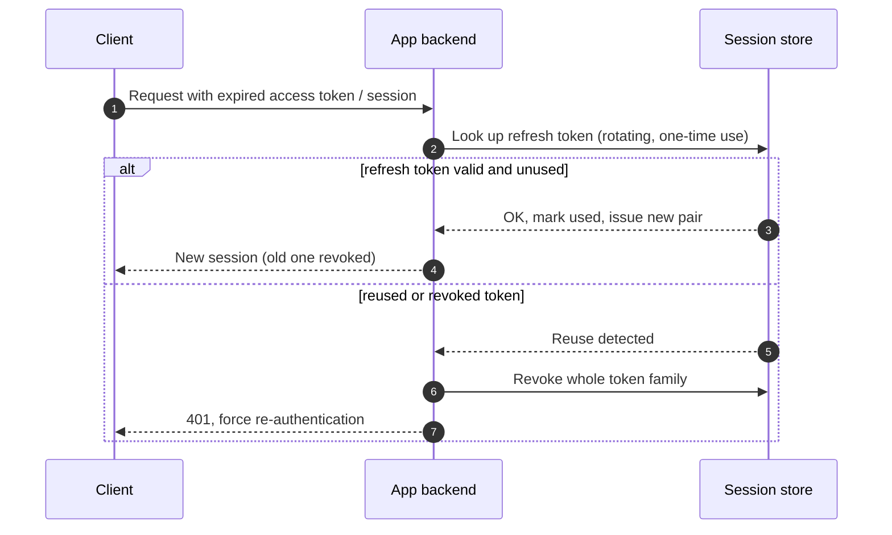
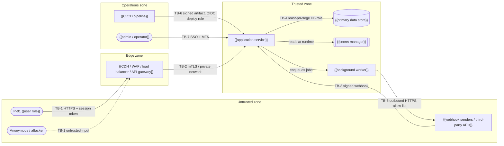
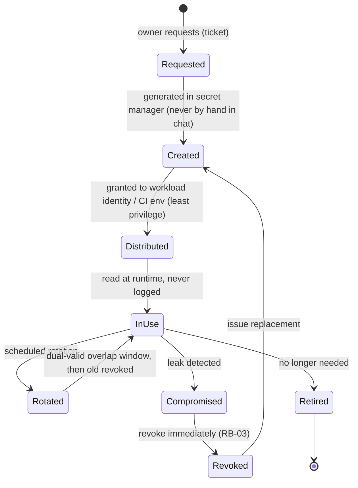
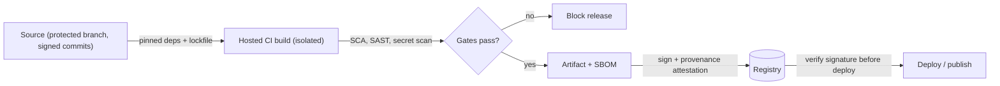

# Security standards checklists (SECURITY_ARCHITECTURE row lists)

Row lists and worked examples for `assets/templates/docs/technical/SECURITY_ARCHITECTURE.md`. The template keeps every heading, the table header and one example row. The full lists live here so a project loads only what applies.

**When to read:** while writing SECURITY_ARCHITECTURE, and only the sections whose condition matches the approved design (STATE.md flags, DISCOVERY, ARCHITECTURE). Never load the whole file by default. Every row of a loaded list goes into the generated doc: filled, or `N/A — reason`. Example cells (`{{…}}`) are illustrations; replace them with this product's decisions. Never write "compliant"; write "addressed by".

| § | Section | Load when | Fills template |
|---|---|---|---|
| 1 | AI / LLM threat seeds | the product calls a model, uses RAG, or lets a model call tools (DISCOVERY AIM-*) | §3.3 |
| 2 | Authentication flow examples and control checklist | the product has sign-in or sessions | §4.1, §4.2 |
| 3 | OWASP ASVS chapter checklist | Standard or Enterprise (Lite states the target level only) | §9.1 |
| 4 | OWASP API Security Top 10 (2023) | the product exposes an API | §9.2 |
| 5 | OWASP MASVS categories | the product has a mobile app | §9.3 |
| 6 | OWASP Top 10 for LLM Applications (2025) | AI features (same trigger as §1) | §9.4 |
| 7 | Supply-chain control list | Standard or Enterprise, or any project that publishes packages, binaries or images | §10 |
| 8 | Security testing activities | Standard or Enterprise (Lite: a 3-row plan) | §15 |
| 9 | Access governance and hardening rows | Standard or Enterprise (Lite: §17 one paragraph; §19 backups + DNS/email only) | §17, §19 |
| 10 | Sample data-flow diagram + boundary rows | drawing §2 for a server-backed product (skip for client-only apps) | §2 |
| 11 | STRIDE seed threats | writing §3, to see the expected row shape (seeds are never filler) | §3 |
| 12 | Secrets lifecycle and supply-chain diagrams | Standard or Enterprise (Lite: the ASCII lines in the template suffice) | §7.1, §10 |
| 13 | Product-type notes; more example rows | a CLI/library or client-only app; when a table needs more example rows | header, §1, §5.2, §5.3, §7.2, §12, §13, §13.1, §20 |

---

## 1. AI / LLM threat seeds (template §3.3)

Required when DISCOVERY AIM-* says the product calls a model, uses RAG, or lets a model call tools. Map each row to §9.4 (section 6 below). Deepen with `references/security-threat-catalog.md` D2.

| ID | Threat | Example | Control(s) | Test |
| --- | --- | --- | --- | --- |
| TH-{{nn}} | Direct / indirect prompt injection | {{uploaded document tells the model to email all notes to an attacker}} | {{treat retrieved content as data; tool allow-list; human approval for side effects}} | {{SEC-xx}} |
| TH-{{nn}} | Sensitive information disclosure | {{model reveals another tenant's data from shared context}} | {{per-tenant retrieval filters; no secrets in prompts; output filters}} | |
| TH-{{nn}} | Improper output handling | {{model output rendered as HTML executes script}} | {{encode output; never pass model output to shell/SQL/eval}} | |
| TH-{{nn}} | Excessive agency | {{agent deletes data via an over-scoped tool}} | {{least-privilege tool scopes; confirmation for destructive actions}} | |
| TH-{{nn}} | Unbounded consumption | {{long prompts drive cost spikes}} | {{token and rate limits per user; budget alerts}} | |

## 2. Authentication flow examples and control checklist (template §4.1, §4.2)

Draw the real flow for the chosen identity source. Minimum: one sequence diagram for the primary sign-in flow and one for session refresh/revocation (if sessions exist), each with an ASCII fallback. Example: OIDC authorization code + PKCE with a server-side session. For API keys: issue → hash at rest → present → verify → rotate. For a CLI: device authorization flow + OS keychain storage.

```mermaid
sequenceDiagram
    autonumber
    actor U as P-01 User
    participant C as Client (browser / app)
    participant A as App backend
    participant I as Identity provider
    U->>C: Click "Sign in"
    C->>A: GET /auth/login
    A->>A: Create state + nonce + PKCE verifier (stored server-side)
    A-->>C: 302 redirect to IdP (code_challenge, state)
    C->>I: Authorization request
    I->>U: Authenticate (password / passkey + MFA)
    I-->>C: 302 back with code + state
    C->>A: GET /auth/callback?code&state
    A->>A: Verify state; exchange code + verifier
    A->>I: Token request (back channel)
    I-->>A: ID token + access token
    A->>A: Validate signature, issuer, audience, nonce, expiry
    A-->>C: Set session cookie (HttpOnly, Secure, SameSite)
```



ASCII fallback:

```text
User -> Client -> App:/auth/login -> (state, nonce, PKCE) -> redirect -> IdP
IdP: authenticate + MFA -> redirect(code,state) -> App:/auth/callback
App: verify state -> exchange code+verifier -> validate ID token -> set secure session cookie
Refresh: rotating refresh token; reuse => revoke family => 401 re-auth
```

**§4.2 authentication control checklist** (one row per control, each with a decided answer or `N/A — reason`):

| Control | Decision | Status |
| --- | --- | --- |
| Rate limiting / progressive delay on sign-in, reset, MFA | {{limits}} | |
| Password policy (length ≥ {{n}}, breached-password check, no composition rules — NIST SP 800-63B style) | {{policy or N/A}} | |
| MFA enrolment and recovery codes; step-up auth for sensitive actions | {{which actions}} | |
| Session idle timeout / absolute timeout | {{values}} | |
| Revoke sessions on password change, role change, account disable | {{yes}} | |
| Cookie flags `HttpOnly`, `Secure`, `SameSite={{Lax/Strict}}`; CSRF protection for cookie auth | {{yes}} | |
| Token validation: signature, issuer, audience, expiry, algorithm allow-list | {{yes}} | |

## 3. OWASP ASVS chapter checklist (template §9.1)

Choose the target level: L1 = baseline for all apps (testable from outside), L2 = most apps handling personal or business data (recommended for Standard with accounts), L3 = high-value/high-assurance (payments at scale, health, critical infrastructure). One row per ASVS chapter (names below follow ASVS 5.0 — verify against the official release you target). A chapter that does not apply (e.g. WebRTC) is `N/A — reason`. "Key requirements" lists the 2–4 requirements most relevant to this product, by ASVS ID once verified.

| ASVS chapter | Applies? | Level target | Key requirements for this product | Where addressed | Status |
| --- | --- | --- | --- | --- | --- |
| Encoding and Sanitization | {{Yes}} | {{L1}} | {{output encoding per context; no dynamic SQL}} | §8 | {{Planned}} |
| Validation and Business Logic | | | {{schema validation; business limits (e.g. max shares/day)}} | §8, §3.2 | |
| Web Frontend Security | | | {{CSP, cookie flags, clickjacking}} | §8.1, §4.2 | |
| API and Web Service | | | {{auth on every OP, content-type checks}} | §5, API | |
| File Handling | | | {{type/size checks, storage outside web root}} | §8 | |
| Authentication | | | {{§4.2 checklist}} | §4 | |
| Session Management | | | {{rotation, revocation, timeouts}} | §4 | |
| Authorization | | | {{deny by default, object-level checks}} | §5 | |
| Self-contained Tokens | | | {{JWT validation, algorithm allow-list}} | §4.2 | |
| OAuth and OIDC | | | {{PKCE, state, nonce, redirect URI allow-list}} | §4.1 | |
| Cryptography | | | {{approved algorithms, key management}} | §7.2 | |
| Secure Communication | | | {{TLS everywhere incl. internal}} | §2 | |
| Configuration | | | {{no debug in prod, secrets out of config}} | §7, OPERATIONS §2 | |
| Data Protection | | | {{classification, minimization, retention}} | §1.1, §11 | |
| Secure Coding and Architecture | | | {{dependency policy, safe deserialization}} | §10, CODE_STYLE | |
| Security Logging and Error Handling | | | {{security events, no sensitive data in logs/errors}} | §12 | |
| WebRTC | {{N/A — no real-time media}} | — | — | — | — |

## 4. OWASP API Security Top 10 (2023) (template §9.2)

All ten rows when the product exposes an API; otherwise §9.2 is `N/A — no API`.

| Item | How addressed | Status |
| --- | --- | --- |
| API1 Broken Object Level Authorization | {{§5.4, TH-02, SEC-01}} | |
| API2 Broken Authentication | {{§4}} | |
| API3 Broken Object Property Level Authorization | {{response DTOs, writable-field allow-lists, TH-04/TH-06}} | |
| API4 Unrestricted Resource Consumption | {{rate limits, pagination caps, payload size, TH-05}} | |
| API5 Broken Function Level Authorization | {{admin OPs gated in §5}} | |
| API6 Unrestricted Access to Sensitive Business Flows | {{abuse cases §3.2, bot controls}} | |
| API7 Server Side Request Forgery | {{§8 SSRF rule}} | |
| API8 Security Misconfiguration | {{CORS, headers, error verbosity}} | |
| API9 Improper Inventory Management | {{API.md is the inventory; versioning and deprecation}} | |
| API10 Unsafe Consumption of APIs | {{validate third-party responses, timeouts, TB-5}} | |

## 5. OWASP MASVS categories (template §9.3)

One row per category: STORAGE, CRYPTO, AUTH, NETWORK, PLATFORM, CODE, RESILIENCE, PRIVACY. Otherwise §9.3 is `N/A — no mobile app`.

| Category | How addressed | Status |
| --- | --- | --- |
| MASVS-STORAGE | {{no secrets in app storage; exclude sensitive files from OS backups}} | |
| MASVS-CRYPTO | {{platform crypto APIs only; no hard-coded keys; key storage in Keychain / Keystore}} | |
| MASVS-AUTH | {{server-side authorization; biometric as local convenience only; token lifetime}} | |
| MASVS-NETWORK | {{TLS only; certificate pinning decision and rotation plan}} | |
| MASVS-PLATFORM | {{deep-link/intent validation, WebView hardening, minimal permissions, clipboard/screenshot policy}} | |
| MASVS-CODE | {{dependency/SDK review, signed builds, update enforcement}} | |
| MASVS-RESILIENCE | {{root/jailbreak and tamper stance (decide: none / detect / enforce), obfuscation decision}} | |
| MASVS-PRIVACY | {{data minimization, consent, SDK data flows, store privacy labels}} | |

## 6. OWASP Top 10 for LLM Applications (2025) (template §9.4)

All ten rows when the product has AI features; otherwise §9.4 is `N/A — no AI features`.

| Item | How addressed | Status |
| --- | --- | --- |
| LLM01 Prompt Injection | {{§3.3, §8}} | |
| LLM02 Sensitive Information Disclosure | {{no Secrets or Sensitive data in prompts; per-tenant retrieval}} | |
| LLM03 Supply Chain | {{approved model/providers list; model and dataset provenance}} | |
| LLM04 Data and Model Poisoning | {{curated sources for RAG/fine-tuning}} | |
| LLM05 Improper Output Handling | {{encode/validate model output}} | |
| LLM06 Excessive Agency | {{least-privilege tools, human approval}} | |
| LLM07 System Prompt Leakage | {{no secrets or authZ logic in system prompts}} | |
| LLM08 Vector and Embedding Weaknesses | {{tenant-partitioned indexes, access checks at retrieval}} | |
| LLM09 Misinformation | {{citations, confidence UI, human review for high-stakes output}} | |
| LLM10 Unbounded Consumption | {{token/rate/budget limits}} | |

## 7. Supply-chain control list (template §10)

One row per control, decided or PROPOSAL, with the CI stage that enforces it. Libraries/CLIs publishing to registries MUST cover signing/provenance and trusted publishing. Reference levels: SLSA Build L1 (provenance exists), L2 (signed provenance from a hosted build), L3 (hardened, isolated builds).

| Control | Decision | Enforced in | Status |
| --- | --- | --- | --- |
| Lockfiles committed; frozen installs in CI | {{e.g. `npm ci`, `uv sync --frozen`, `go mod verify`}} | CI install step | {{Planned}} |
| Pin CI actions/plugins to commit SHA; container base images to digest | {{yes}} | CI config review | |
| New dependency review (license, maintenance, advisories, typo-squatting) | {{CODE_STYLE §10}} | PR review + dependency-review check | |
| SCA vulnerability scan; fail on {{critical/high}} without exception | {{tool e.g. OSV-Scanner, Dependabot alerts, Trivy, Snyk}} | PR + nightly | |
| SBOM per release | {{CycloneDX / SPDX}} | release job | |
| Artifact signing | {{e.g. Sigstore cosign keyless / GPG / platform code signing for mobile/desktop}} | release job | |
| Build provenance | {{SLSA Build L{{n}} target via hosted CI attestations}} | release job | |
| Trusted publishing to registries (no long-lived tokens) | {{npm / PyPI / crates.io / container registry via OIDC}} | release job | |
| Repository hygiene score | {{e.g. OpenSSF Scorecard}} | weekly | |
| Branch protection + required reviews | link to GIT_WORKFLOW (`../engineering/GIT_WORKFLOW.md`) | code host | |

## 8. Security testing activities (template §15)

Every activity row has an applicability decision; each automated activity names where it runs and whether it blocks. Tools are examples — pick by stack and mark PROPOSAL until configured.

| Activity | Scope | Example tools (pick per stack) | Cadence | Blocks release? | Test IDs |
| --- | --- | --- | --- | --- | --- |
| Authorization matrix tests | every ✗ in §5 | integration test framework | every PR | Yes | {{SEC-01…}} |
| Tenant isolation tests | §6 paths | integration tests | every PR | Yes | {{SEC-02}} |
| SAST | all source | {{CodeQL, Semgrep, gosec, Bandit, SpotBugs}} | every PR | High/critical | {{SEC-SAST}} |
| SCA (dependencies) | lockfiles, images | {{OSV-Scanner, Dependabot, Trivy, Snyk}} | every PR + nightly | Critical | {{SEC-SCA}} |
| Secret scanning | repo + history | {{gitleaks, trufflehog, platform push protection}} | pre-commit + PR | Yes | {{SEC-03}} |
| IaC / container scanning | IaC, Dockerfiles | {{Checkov, tfsec/Trivy config, hadolint}} | PR touching infra | High | {{SEC-xx}} |
| DAST | staging | {{OWASP ZAP baseline / API scan}} | nightly / pre-release | High | {{SEC-DAST}} |
| Fuzzing (parsers, file import, protocol) | {{components}} | {{language-native fuzzers, e.g. Go fuzzing, cargo-fuzz, Atheris, Jazzer}} | {{nightly}} | No | {{SEC-xx}} |
| AI red-team / prompt-injection evals | §3.3 | {{eval suite with injection corpus}} | PR touching prompts/tools | {{Yes}} | {{SEC-xx}} |
| Threat model review | this doc | review meeting | {{each milestone / major change}} | — | — |
| Penetration test | {{production-like env}} | {{external firm [TBD]}} | {{before GA, yearly}} (Enterprise) | Critical/high findings | — |

## 9. Access governance and platform hardening rows (template §17, §19)

Cover people AND workloads. Never list credentials, only roles and systems. Enterprise adds recorded periodic-review evidence.

**§17 Access governance:**

| Area | Rule / control | Owner | Review cadence |
| --- | --- | --- | --- |
| Production and admin access | {{least privilege, named accounts, no shared logins, just-in-time where available}} | {{owner}} | {{quarterly}} |
| Workload and cloud IAM | {{one identity per service, scoped roles, no wildcard policies, short-lived credentials}} | | |
| Admin consoles (cloud, DB, CI, support tools) | {{MFA required, phishing-resistant for admins where possible}} | | |
| Code host, package registry, domain registrar, app-store accounts | {{MFA, ≥ 2 owners, branch protection, recovery contacts documented}} | | |
| Joiner / mover / leaver | {{grant by role, remove access on role change, revoke all on exit within PROPOSAL: 1 business day}} | | |
| Break-glass | {{sealed emergency account, alert on use, post-use review, credential rotated after}} | | |
| Periodic access review | {{list of who can reach production data and secrets; remove unused}} | | {{quarterly}} |

**§19 Platform hardening baseline** (use baselines that fit the stack, e.g. CIS Benchmarks for hosts/containers/cloud accounts or provider security defaults; mark each PROPOSAL until configured):

| Area | Baseline | Status |
| --- | --- | --- |
| Configuration baseline | {{CIS benchmark or provider baseline for hosts / containers / cloud account / platform}}; drift checked by {{IaC scan}} | |
| Network segmentation | {{public edge only for web/API; data stores private; egress allow-list for workloads where feasible}} | |
| Backup security | {{encrypted, access separated from production credentials, immutable or offline copy, restore tested per OPERATIONS §9 (link `OPERATIONS.md#9-backup-and-disaster-recovery`)}} | |
| Email and DNS | {{SPF, DKIM, DMARC policy; CAA records; registrar lock; remove dangling DNS records to prevent subdomain takeover}} | |
| Endpoint / client distribution (mobile, desktop, CLI) | {{code signing and key custody, notarization, update integrity check, no unsigned auto-update}} | |

## 10. Sample data-flow diagram (template §2)

Load when drawing §2 for a typical server-backed product (web/API with webhooks, a worker, CI and admin access). Replace every node with the real containers from ARCHITECTURE. For a client-only or local-first app, draw device storage, OS backups, SDKs and the update channel instead. Keep ≤ 15 nodes per diagram.



ASCII fallback (keep in sync with the diagram; use when Mermaid cannot render):

```text
 UNTRUSTED                 | EDGE        | TRUSTED                          | OPS
 [P-01 user]--TB-1 HTTPS-->| [gateway]   |                                  |
 [attacker]--TB-1-------->|   |--TB-2-->| [app] --TB-4--> (db)             |
 [3rd party]--TB-3 signed------------->|   |  \--> [[secrets]]            |
                           |             |   \--> [worker]--TB-5--> 3rd pty |
                           |             |  <--TB-6 signed artifact-------- | [CI]
                           |             |  <--TB-7 SSO+MFA--------------- | [admin]
```

Boundary table example rows (one row per TB-x in the real doc):

| TB | From → To | Data classes crossing | Protocol | Authentication | Authorization | Key controls |
| --- | --- | --- | --- | --- | --- | --- |
| TB-1 | {{Client → edge}} | {{Personal (PII), Secrets}} | {{HTTPS (TLS 1.2+)}} | {{session cookie / bearer token}} | {{per §5}} | {{WAF, rate limits, input validation}} |
| TB-2 | {{Edge → app}} | | | | | |
| TB-3 | {{Third party → app (webhook)}} | | | {{HMAC signature + timestamp}} | {{fixed sender}} | {{replay window, idempotency key}} |
| TB-4 | {{App → data store}} | | | {{DB credentials from secret manager}} | {{least-privilege role, RLS}} | {{parameterized queries}} |

## 11. STRIDE seed threats (template §3)

Seed rows for the sample design in section 10. They show the expected shape (attacker → action → asset, control, status, test). Use a seed only when its boundary and asset exist in this design; derive the rest from `references/security-threat-catalog.md`. Never copy seeds as filler.

| ID | TB | Component | STRIDE | Threat (attacker → action → asset) | L | I | Risk | Control(s) | Status | Test | Risk ID |
| --- | --- | --- | --- | --- | --- | --- | --- | --- | --- | --- | --- |
| TH-01 | TB-1 | {{sign-in}} | S | {{Attacker uses leaked credentials (credential stuffing) to take over accounts}} | {{M}} | {{H}} | {{High}} | {{rate limiting per IP+account, MFA, breached-password check, generic errors}} | {{Planned}} | {{SEC-01}} | {{R-xx}} |
| TH-02 | TB-1 | {{API}} | T | {{Authenticated user modifies another user's record by changing the ID (IDOR / BOLA)}} | | | | {{server-side ownership check on every access; opaque IDs}} | | | |
| TH-03 | TB-1 | {{app}} | R | {{User denies performing a destructive action}} | | | | {{append-only audit log with actor, time, request ID}} | | | |
| TH-04 | TB-1 | {{API responses}} | I | {{Over-fetching exposes fields the caller may not see}} | | | | {{response allow-lists / DTOs per role}} | | | |
| TH-05 | TB-1 | {{search endpoint}} | D | {{Bot floods an expensive endpoint}} | | | | {{rate limits, pagination caps, timeouts, cost limits}} | | | |
| TH-06 | TB-1 | {{profile update}} | E | {{User escalates role via mass assignment of `role` field}} | | | | {{allow-listed writable fields, role changes only via admin OP}} | | | |
| TH-07 | TB-3 | {{webhook handler}} | S | {{Attacker forges a webhook from the payment provider}} | | | | {{HMAC signature verification, timestamp tolerance}} | | | |
| TH-08 | TB-3 | {{webhook handler}} | T | {{Replayed webhook double-applies an event}} | | | | {{idempotency key store, replay window}} | | | |
| TH-09 | TB-4 | {{db}} | I | {{Cross-tenant read through a query missing the tenant filter}} | | | | {{tenant-scoped repository layer + RLS; isolation tests}} | | | |
| TH-10 | TB-6 | {{CI/CD}} | T | {{Compromised dependency or CI action injects code into the release}} | | | | {{pinned deps and action SHAs, SBOM, signed artifacts, provenance}} | | | |
| TH-nn | TB-4 | {{db}} | R | N/A — {{reason}} | — | — | — | — | — | — | — |

## 12. Secrets lifecycle and supply-chain diagrams (template §7.1, §10)

Adapt both to the chosen secret manager and CI; each keeps an ASCII fallback.



ASCII fallback: `request → create (secret manager) → distribute (least privilege) → use (never log) → rotate (overlap, revoke old) → retire`; on leak: `revoke now → replace → audit access → postmortem`.



ASCII fallback: `signed source → pinned deps → isolated CI build → scans gate → artifact + SBOM → sign + provenance → registry → verify signature → deploy`.

## 13. Product-type notes and more example rows

**Product-type notes.** For a local CLI or library: focus on input handling, supply chain, file/system access, and credential storage; many web-specific sections become N/A. For a client-only / local-first mobile or desktop app: replace the sample diagram and seed threats (no gateway, tenants, IDOR); focus on on-device storage and OS backups (MASVS-STORAGE), third-party SDKs that send data (analytics/crash), app-store and signing-key account security (MFA), supply chain, and logging of user-entered content. Auth/role sections become "N/A — no accounts" with one line.

**§1 assets — more example rows:**

| Asset | Classification | CIA priority | Why it matters (impact if compromised) | Stored / processed in | Owner |
| --- | --- | --- | --- | --- | --- |
| {{e.g. customer content}} | {{Personal (PII)}} | {{C}} | {{privacy breach, contractual liability}} | {{db, object storage}} | |
| {{e.g. signing keys, CI tokens}} | {{Secrets}} | {{I}} | {{malicious release to all users}} | {{secret manager, CI}} | |
| {{e.g. primary journey J-01}} | {{—}} | {{A}} | {{revenue / trust loss}} | {{all containers}} | |

**§5.2 permission matrix — more example rows:**

| Resource | Action | {{Anonymous}} | {{Member}} | {{Admin}} | {{Owner / Super-admin}} | Operations (OP-xx) | Enforced at |
| --- | --- | --- | --- | --- | --- | --- | --- |
| {{item}} | delete | ✗ | own | org | org | {{OP-04}} | |
| {{item}} | export | ✗ | ✗ | org | org | {{OP-05}} | |
| {{member}} | change role | ✗ | ✗ | cond C-2 | org | {{OP-10}} | |
| {{billing}} | manage | ✗ | ✗ | ✗ | org | {{OP-20}} | |

**§12 security events — more example rows:**

| Event | Fields (no sensitive values) | Destination | Retention | Alerts? |
| --- | --- | --- | --- | --- |
| Role / permission change | actor, target, old → new role | {{audit log}} | | {{yes}} |
| Data export / bulk read | actor, scope, row count | {{audit log}} | | |
| Secret access / rotation | identity, secret name | {{secret manager audit}} | | |
| Admin / support impersonation | admin ID, target, reason | {{audit log}} | | {{yes}} |

**§13.1 security playbooks — more example rows:**

| Scenario | First action (within minutes) | Runbook | Notify |
| --- | --- | --- | --- |
| Account takeover reports | Force sign-out, lock account, review audit log | {{RB-xx}} | {{support, user}} |
| Cross-tenant data exposure | Disable affected feature/flag, preserve logs | {{RB-xx}} | {{security owner, counsel}} |
| Compromised dependency / release | Stop deploys, yank/deprecate, publish advisory | {{RB-xx}} | {{maintainers, users}} |

**§7.2 encryption and key management — more example rows:**

| Key / purpose | Algorithm (decided) | Managed by | Rotation | Access |
| --- | --- | --- | --- | --- |
| {{field-level encryption for Sensitive and Secrets fields}} | {{envelope encryption}} | {{KMS}} | | |
| {{artifact / release signing}} | {{e.g. Sigstore keyless / GPG}} | {{CI identity / maintainer}} | | |

**§13 notification clocks — more example rows:**

| Obligation | Applies when | Deadline | Who notifies | Source |
| --- | --- | --- | --- | --- |
| {{affected users / customers}} | {{SEV-1 with user impact; contract terms}} | [TBD: counsel] | {{owner}} | {{MSA / DPA / [TBD]}} |
| {{app store / platform / card network}} | {{if applicable}} | [TBD: counsel] | {{owner}} | |

**§20 control mapping — more example rows:**

| Control (§) | Requirement source (COMPLIANCE CR-xx) | Owner | Evidence location | Status |
| --- | --- | --- | --- | --- |
| {{Logging and audit (§12)}} | {{CR-xx}} | | {{log retention config}} | |
| {{Vulnerability management (§16)}} | {{CR-xx}} | | {{scanner reports}} | |

**§5.3 conditions — more example rows:**

| ID | Condition | Example |
| --- | --- | --- |
| C-2 | {{Admin may change roles except their own and except to Owner}} | {{prevents self-escalation}} |
