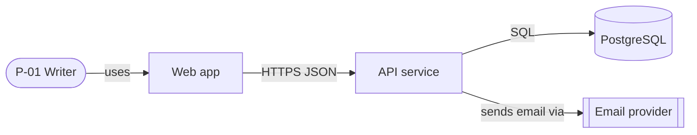

# Writing conventions

Apply to every generated document and to DISCOVERY.md. Templates already follow them; generated output MUST too.

## 1. Status header

The first line under the title is a visible blockquote (not an HTML comment):

```markdown
# Product Requirements Document — Acme Notes

> **Status:** Draft · **Owner:** Jane Doe (Product) · **Last updated:** 2026-10-24 · **Tier:** Standard · **Related:** [DISCOVERY](../DISCOVERY.md) · [TRD](../technical/TRD.md)
```

- **Status:** `Draft` → `In review` → `Approved`. A changed Approved doc returns to `In review`.
- **Owner:** a person or role. Unknown → `[TBD: owner]`.
- **Last updated:** ISO date `YYYY-MM-DD`, the real current date.
- **Tier:** `Lite`, `Standard`, or `Enterprise`.
- **Related:** relative links to existing docs only. If a related doc is not generated, drop it from the list.

Exceptions (no header, because it would break their format or purpose): `LICENSE`, `CHANGELOG.md` (Keep a Changelog format), `CODE_OF_CONDUCT.md`, `.github/PULL_REQUEST_TEMPLATE.md`, `.github/*.yml`, `.github/CODEOWNERS`, and thin pointer files (`CLAUDE.md`, `GEMINI.md`, `.github/copilot-instructions.md`). `scripts/check-docs.mjs` uses the same exception list (it skips everything under `.github/`). In `README.md` the header goes under the H1 like every other doc.

Legal docs can be `Approved` as drafts by the user; the separate counsel review stays an open Q-xx until done (do not invent a status like "Approved by counsel").

## 2. Markers

| Marker | Meaning | Example |
|---|---|---|
| `{{snake_case_name}}` | Template placeholder. MUST NOT appear in output. | `{{product_name}}` → `Acme Notes` |
| `<!-- guidance: … -->` | Instruction to the AI inside a template. MUST be removed in output. | — |
| `[TBD: question — owner]` | Unknown that someone must decide. | `[TBD: Which region hosts EU data? — CTO]` |
| `> **PROPOSAL:** …` | AI suggestion awaiting approval. | `> **PROPOSAL:** Use managed PostgreSQL (see ADR-0002).` |
| `> **ASSUMPTION:** …` | Treated as true until told otherwise. | `> **ASSUMPTION:** (A-03) Fewer than 500 users in year one.` |
| `Not configured` | No verified command exists yet. | `Test: Not configured` |
| `Not run` | Test has not been executed. Default for every test row. | — |
| `N/A — reason` | Section or doc deliberately not applicable. | `N/A — no user interface (CLI tool).` |

Rules:

1. When the user approves a PROPOSAL, rewrite it as plain text and record the decision (D-xx) in DISCOVERY.md.
2. Every ASSUMPTION also appears in DISCOVERY.md with an A-xx ID.
3. Every blocking TBD also appears as a Q-xx in DISCOVERY.md "Open questions".
4. Never use a marker to hide an invented fact. If you are not sure, it is TBD.

## 3. IDs

IDs are permanent. Never renumber; if an item is withdrawn, mark it `(withdrawn)` and keep the ID. Number with two digits (`F-01`), four for ADRs (`ADR-0001`).

| Prefix | Item | Defined in | Referenced in |
|---|---|---|---|
| `P-xx` | Persona | PRD | APP_FLOW, DESIGN_SYSTEM, TESTING |
| `J-xx` | User journey | PRD (summary), APP_FLOW (detail) | TESTING (E2E), DESIGN_SYSTEM |
| `US-xx` | User story | PRD | TESTING |
| `F-xx` | Feature | PRD | everywhere |
| `AC-xx.y` | Acceptance criterion `y` of feature `xx` (e.g. `AC-03.2`) | PRD | TESTING, IMPLEMENTATION_PLAN |
| `KPI-xx` | Success metric | PRD | OPERATIONS (analytics), README |
| `NFR-xx` | Non-functional requirement | TRD (Lite: ARCHITECTURE) | PRD summary, ARCHITECTURE, OPERATIONS, TESTING |
| `S-xx` | Screen, CLI command, or endpoint group in the flow inventory | APP_FLOW | DESIGN_SYSTEM, API, TESTING |
| `OP-xx` | API operation (endpoint, RPC, command, public function) | API | APP_FLOW, SECURITY_ARCHITECTURE, TESTING |
| `TB-x` | Trust boundary | SECURITY_ARCHITECTURE | ARCHITECTURE |
| `TH-xx` | Threat (STRIDE) | SECURITY_ARCHITECTURE | TESTING (SEC-xx), R-xx |
| `AT-xx` | Acceptance test | TESTING | IMPLEMENTATION_PLAN |
| `SEC-xx` | Security test | TESTING | SECURITY_ARCHITECTURE |
| `PERF-xx` | Performance test | TESTING | TRD, OPERATIONS |
| `A11Y-xx` | Accessibility test | TESTING | DESIGN_SYSTEM, ACCESSIBILITY.md |
| `DR-xx`, `COMPAT-xx` | Disaster-recovery drill, compatibility test | TESTING | OPERATIONS, TRD |
| `JTBD-xx` | Job to be done (optional) | PRD | — |
| `CR-xx` | Compliance register entry | COMPLIANCE | SECURITY_ARCHITECTURE |
| `CS-xx` | Code-style rule (Enterprise, optional) | CODE_STYLE | AI_GUIDELINES |
| `SLO-xx` | Service level objective | OPERATIONS | TRD NFR-xx |
| `RB-xx` | Runbook | OPERATIONS | — |
| `M0`–`M7` | Delivery phase (milestone) | IMPLEMENTATION_PLAN | docs/README.md |
| `G0`–`G5` | Phase gate (must pass before next phase) | IMPLEMENTATION_PLAN | — |
| `G-xx` | Product goal | PRD | KPI-xx, DISCOVERY |
| `T-xx` | Implementation task | IMPLEMENTATION_PLAN | — |
| `R-xx` | Risk | PRD / DISCOVERY / IMPLEMENTATION_PLAN | SECURITY_ARCHITECTURE |
| `A-xx` | Assumption | DISCOVERY | any doc (ASSUMPTION blocks) |
| `D-xx` | Decision | DISCOVERY | ADRs |
| `Q-xx` | Open question | DISCOVERY | any doc (TBD) |
| `ADR-0001` | Architecture decision record | docs/decisions/ | ARCHITECTURE, stack tables |

Interview question IDs (`VIS-01`, `IDN-02`, `ACC-01`, …) belong to `discovery-question-bank.md` and appear only in DISCOVERY.md. `SEC-xx` and `A11Y-xx` in generated docs always mean tests.

Cross-reference by ID and link: `F-03 ([PRD](../product/PRD.md#7-features))`. A bare ID is acceptable inside the same doc.

## 4. Acceptance criteria

Use Given/When/Then with an observable result. Include at least one failure or edge case for every Must feature.

```markdown
**F-03 Share a note** (Must)
- AC-03.1 Given I own a note, when I share it with a registered email, then that user sees it in "Shared with me" within 5 seconds.
- AC-03.2 Given I am not the owner, when I try to share the note, then I see "You don't have permission" and nothing is shared.
```

Bad: "Sharing works well." (not observable).

## 5. Non-functional requirements

Each NFR has a number, a unit, a condition, and a measurement method.

```markdown
| ID | Category | Requirement | Measured by |
|---|---|---|---|
| NFR-01 | Performance | p95 latency of read API < 300 ms at 50 req/s | PERF-01 load test; SLO-01 dashboard |
| NFR-02 | Availability | 99.5% monthly uptime of the web app | Uptime monitor; SLO-02 |
```

Bad: "The app should be fast."

## 6. Tests and commands

- Every test row starts with status `Not run`. Change it only after a real, observed run, and record the date and command.
- Commands are written as `command` or `Not configured`:

```markdown
| Purpose | Command |
|---|---|
| Install | Not configured |
| Unit tests | `npm test` (verified in package.json, 2026-10-24) |
```

- In a new project, all commands are `Not configured` until the project exists. Do not guess commands from the stack.

## 7. Diagrams

Use Mermaid code blocks. Keep diagrams small (≤ 15 nodes); split if larger. Label edges with verbs.

````markdown

````

Common types: `flowchart` (context, containers, flows), `sequenceDiagram` (request flows), `erDiagram` (DATABASE), `stateDiagram-v2` (status lifecycles), `gantt` (only if the user wants dated plans).

## 8. Links

- Use relative links between docs: `[ARCHITECTURE](../technical/ARCHITECTURE.md)`.
- Never link to a file that does not exist. If a doc is not generated, remove the link or write `N/A — <reason>`.
- docs/README.md shows not-generated docs as rows with status `N/A` and a reason.
- External links: official sources only (standards, license texts, regulators). Do not invent URLs.

## 9. Tone and language

- Write in the document language chosen in Phase 1. Keep file names, IDs, code identifiers, and Mermaid keywords in English.
- Short sentences. Active voice. One idea per bullet.
- Plain language; explain jargon on first use if the user is a beginner (`experience-modes.md`).
- No marketing language ("revolutionary", "seamless", "blazing fast").
- Use MUST/SHOULD/MAY for requirements where precision matters.
- Use tables for matrices (roles × permissions, features × tests, options × trade-offs).

## 10. Never invent

Do not invent: user research, market sizes, competitor facts, metrics baselines, prices, legal entity names, addresses, jurisdictions, compliance status, certifications, version numbers, commands, test results, performance measurements, URLs, people's names, or credentials. Ask, or write `[TBD]`.

Allowed: clearly labeled PROPOSALs (e.g. proposed tokens, proposed schema), ASSUMPTIONs the user accepted, and illustrative examples marked `Example:`.

## 11. Secrets and personal data

- Name configuration values; never fill them: `STRIPE_SECRET_KEY` (stored in hosting secret store).
- Use synthetic examples: `user@example.com`, `Jane Doe`, `+1 555 0100`.
- If the user pastes a secret, do not repeat it, do not write it, tell them to rotate it.

## 12. Legal notice

Every doc under `docs/legal/` and any license recommendation includes this exact sentence (the legal templates already carry it in a `[!CAUTION]` callout; keep it, translated if the document language is not English):

```markdown
> **This is a draft, not legal advice. Have it reviewed by qualified counsel.**
```

`scripts/check-docs.mjs` warns when a file under `docs/legal/` lacks the phrase "not legal advice".

## 13. Tier depth

- Lite: one line where a paragraph would do; keep every H2 heading, and write one line `N/A — reason` under a heading that does not apply (never delete headings).
- Enterprise: keep every section; add owners, approvals, and evidence locations.
