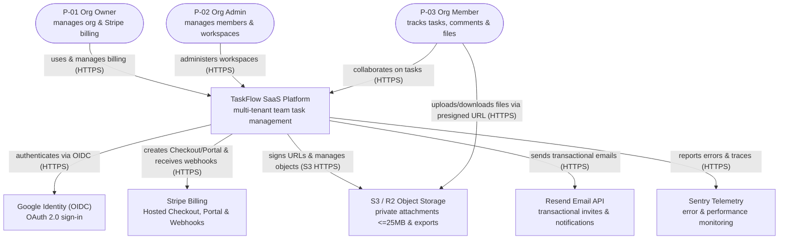
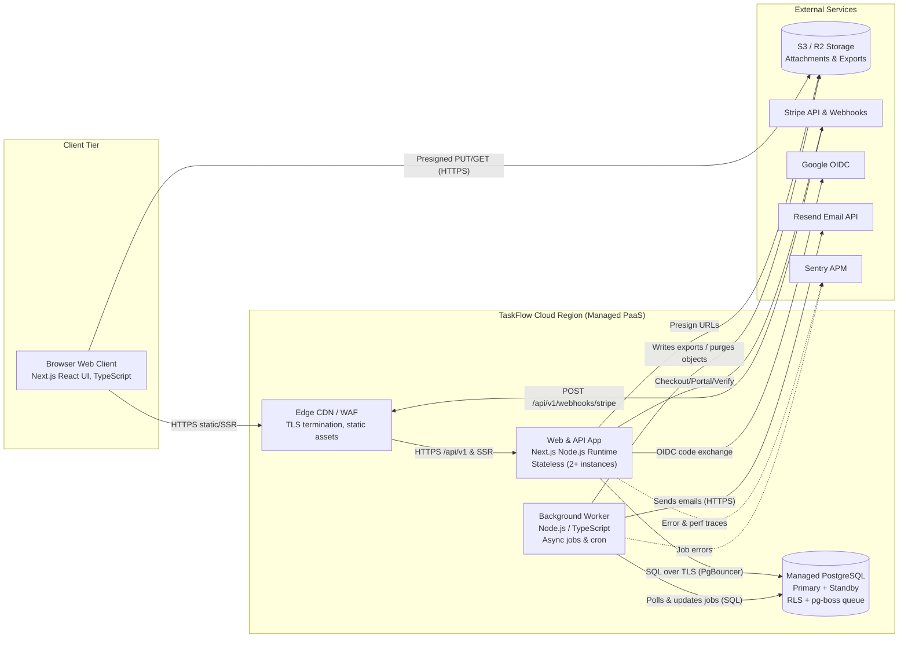

# Architecture — TaskFlow

> **Status:** Approved · **Owner:** Full-Stack Engineers (`@taskflow-hq/core`) · **Last updated:** 2026-10-24 · **Tier:** Standard · **Related:** [TRD](TRD.md) · [Decisions](../decisions/README.md) · [DATABASE](DATABASE.md) · [API](API.md) · [SECURITY_ARCHITECTURE](SECURITY_ARCHITECTURE.md) · [OPERATIONS](OPERATIONS.md)

## 1. Purpose and drivers
- **System purpose:** TaskFlow is a multi-tenant B2B team task-management web application that enables organizations to manage workspaces, projects, tasks, `@mention` comments, file attachments (≤ 25 MB), notifications, and per-seat Stripe subscriptions.
- **Key drivers (quality attributes):**
  - **Multi-tenant security & isolation (`NFR-07`, `R-03`):** Zero cross-organization or unauthorized cross-workspace data leakage.
  - **API responsiveness (`NFR-01`):** p95 API latency < 300 ms at 100 req/s peak load.
  - **Service availability (`NFR-02`):** ≥ 99.9% monthly uptime.
  - **Webhook & job reliability (`NFR-09`, `R-01`):** Idempotent, at-least-once processing for Stripe billing webhooks, email notifications, data exports, and 30-day purges.
  - **Delivery velocity & cost control (`NFR-10`, `NFR-13`, `R-02`, `R-04`):** Ship MVP in 4 months with 2 full-stack TypeScript engineers within a ~USD 500/month infrastructure budget.
- **Capacity headline:** Up to 2,000 organizations and 20,000 users in year one (~29.2 calculated peak RPS; designed and load-tested for **100 req/s**, ~77 GB/yr relational DB growth, ~365 GB/yr object storage — see [TRD §9](TRD.md#9-capacity-estimate)).
- **Constraints:** 4-month deadline, 4-person team (strong TypeScript), managed hosting preference, no raw payment card handling on TaskFlow servers, GDPR/CCPA data export & 30-day deletion purge ([TRD §4](TRD.md#4-constraints)).
- **Assumptions:** `A-01` (24h due-soon lead time), `A-02` (Org Owners/Admins have admin access to org workspaces), `A-03` (Radix + Tailwind UI), `A-04` (essential cookies only), `A-05` (trial caps), `A-06` (single primary region at launch).

## 2. Architectural style
- **Chosen style:** **Modular Monolith** (single TypeScript repository deploying stateless web/API instances and a background worker process sharing a single primary PostgreSQL database).
- **Rationale:** With 2 full-stack TypeScript developers and a 4-month deadline (`R-04`), a modular monolith eliminates cross-service network serialization, distributed transaction sagas, and multi-repo CI/CD overhead. Enforcing strict module boundaries (`identity`, `organizations`, `workspaces`, `tasks`, `attachments`, `notifications`, `billing`, `audit`) inside one deployable unit allows ACID database transactions (e.g., task write + activity log + outbox job) and easily achieves p95 < 300 ms at 100 req/s (`NFR-01`). Running the asynchronous worker from the same codebase keeps email sending, org JSON/CSV exports, and 30-day purges off the synchronous request path.
- **Alternatives rejected:**
  - *Separated React SPA + Python FastAPI backend (`Option B`)* — rejected because splitting 2 developers across two languages and duplicating DTO schemas slows feature velocity ([ADR-0002](../decisions/0002-fullstack-typescript-nextjs-modular-monolith.md)).
  - *Microservices* — rejected because operational complexity, distributed tracing overhead, and cloud base cost exceed a 4-person team's capacity and the USD 500/mo budget ([ADR-0002](../decisions/0002-fullstack-typescript-nextjs-modular-monolith.md)).
  - *Client-heavy BaaS (Supabase Postgrest direct from browser, `Option C`)* — rejected because enforcing multi-level RBAC + workspace membership, Stripe webhook state machines, and user anonymization rules solely in client-exposed SQL policies increases tenant leakage risk ([ADR-0002](../decisions/0002-fullstack-typescript-nextjs-modular-monolith.md)).
- **Redesign trigger:** If engineering headcount grows beyond 3+ independent squads needing decoupled release cadences, or if peak sustained API load exceeds ~1,500 req/s, individual domain modules (`notifications`, `attachments`, `billing`) can be extracted into standalone services along their existing module interfaces.

## 3. System views (C4)

### 3.1 Context



ASCII fallback:

```text
[P-01 Owner]   [P-02 Admin]   [P-03 Member]
     \              |              /
      +---(HTTPS)---+---(HTTPS)---+
                    |
                    v
        +-----------------------+ <---(Signed Webhooks)--- {Stripe Billing}
        |   TaskFlow Platform   | ----(Checkout/Portal)--> {Stripe Billing}
        | (Web UI, API, Worker) | ----(OIDC Auth)--------> {Google Identity}
        +-----------------------+ ----(REST Email)-------> {Resend Email}
            |               |     ----(Telemetry)--------> {Sentry}
  (Presign) |               | (Direct PUT/GET via Presigned URL <=25MB)
            v               v
      {S3 / R2 Private Object Storage}
```

### 3.2 Containers



| Container | Responsibility | Technology | Owner | Scales by | Stateful? |
| --- | --- | --- | --- | --- | --- |
| **Browser Web Client** | Renders accessible UI (`S-01`..`S-11`), manages local form state, performs direct presigned S3 file uploads | React, TypeScript, Tailwind CSS, Radix UI (`Next.js` client bundles) | Product Designer & Full-Stack Engineers | Per user browser | No (server is source of truth) |
| **Edge CDN / WAF** | TLS 1.3 termination, static asset caching, DDoS protection, routes dynamic `/api/v1/*` and SSR to Web & API App | Managed PaaS Edge / Cloudflare | Full-Stack Engineers | Global edge | No |
| **Web & API App** | Serves SSR pages and `/api/v1/*` REST endpoints; enforces authN, RBAC, workspace guards, Zod validation, and Stripe webhook verification | Node.js LTS, TypeScript, Next.js App Router (`output: 'standalone'`) | Full-Stack Engineers | Horizontal (`2–6` stateless instances behind LB) | No |
| **Background Worker** | Processes asynchronous jobs (`pg-boss` on PostgreSQL): transactional emails, org JSON/CSV exports, hourly due-soon notifications, daily 30-day org purges, 365-day audit log cleanup, and 24h orphan S3 cleanup | Node.js LTS, TypeScript, `pg-boss` worker entry point from same repo | Full-Stack Engineers | Horizontal (`1–2` worker instances with `SKIP LOCKED`) | No |
| **Managed PostgreSQL** | Primary relational store for all entities, full-text search (`tsvector` GIN), Row-Level Security (RLS) enforcement, and transactional job queue (`pg-boss`) | PostgreSQL (current stable — verify at setup), Drizzle ORM, PgBouncer pooler | Full-Stack Engineers | Vertical (CPU/RAM/IOPS) + High-Availability standby replica | Yes |
| **S3 / R2 Storage** | Private object bucket storing task attachments (≤ 25 MB) and temporary org data export archives | Cloudflare R2 or AWS S3 (`@aws-sdk/client-s3`) | Full-Stack Engineers | Managed elastic object storage | Yes |

### 3.3 Components

```mermaid
flowchart TB
    http["HTTP & Route Layer (src/app/api/v1)<br/>Auth session middleware, Rate limiter, Zod validation, Problem+JSON errors"]
