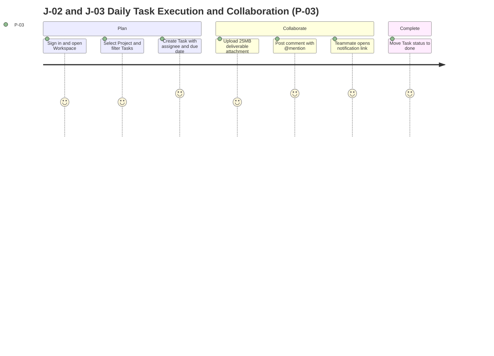

# Product Requirements Document — TaskFlow

> **Status:** Approved · **Owner:** PM/Founder (`@taskflow-hq/core`) · **Last updated:** 2026-10-24 · **Tier:** Standard · **Related:** [DISCOVERY](../DISCOVERY.md) · [APP_FLOW](APP_FLOW.md) · [TRD](../technical/TRD.md) · [TESTING](../technical/TESTING.md) · [IMPLEMENTATION_PLAN](../technical/IMPLEMENTATION_PLAN.md)

## 1. Overview

| Item | Value |
| --- | --- |
| Product | TaskFlow |
| One-liner | A fast, multi-tenant team task-management SaaS web app that helps small and mid-size teams replace spreadsheets and chat threads with structured workspaces, projects, and tasks. |
| Product type | Multi-tenant B2B SaaS web application (desktop + responsive web) |
| Release in scope | MVP (v1.0) — 4-month target launch |
| Decision maker | PM/Founder (`@taskflow-hq/core`) |
| Primary persona | `P-03` Organization Member (daily active user) & `P-01` Organization Owner (buyer) |
| North Star metric | `KPI-02` Weekly Active Users per Seat (WAU/seat ≥ 60%) paired with `KPI-01` Paying Organizations (≥ 100 within 6 months) |

### 1.1 Vision
TaskFlow gives small and mid-size teams a single, calm source of truth for day-to-day work so no task is lost in a chat scrollback or stale spreadsheet tab. Beyond the MVP, TaskFlow will expand into reusable workflow templates, richer cross-project reporting, public integrations API, enterprise SSO/SAML, and regional data residency (`VIS-07`).

### 1.2 Problem
- **Who:** Small and mid-size teams (5–50 people) across operations, product, design, and engineering (`VIS-01`).
- **Pain today:** Action items are scattered across spreadsheets and chat threads. Ownership is ambiguous, due dates slip silently without contextual notifications, and files get buried in chat history (`VIS-01`, `VIS-02`).
- **Current workaround:** Manually maintaining Google Sheets / Excel trackers alongside Slack / Microsoft Teams threads (`VIS-02`).
- **Evidence:** Direct founder experience from previous team operations where spreadsheet + chat coordination caused missed client deliverables (`VIS-03`).
- **Why now:** Existing enterprise project trackers are overly complex and expensive per seat for SMBs, while lightweight spreadsheets lack real-time ownership, `@mentions`, file attachments, and workspace access boundaries (`VIS-03`).

### 1.3 Value proposition
For small and mid-size teams who are tired of juggling spreadsheets and chat threads to track work, **TaskFlow** is a team task-management web application that organizes work into tenant-isolated organizations, workspaces, projects, and actionable tasks with `@mentions`, attachments, and due-date notifications. Unlike spreadsheets and chat channels, it enforces clear ownership, workspace-level access control, and automated reminders without heavyweight enterprise setup.

## 2. Goals and non-goals

| ID | Goal (outcome) | Measured by (see §9) | Priority |
| --- | --- | --- | --- |
| G-01 | Achieve sustainable commercial traction with small and mid-size teams within 6 months of launch. | `KPI-01` (Paying organizations ≥ 100) | Primary |
| G-02 | Become the daily habit for team work tracking rather than shelfware. | `KPI-02` (WAU/seat ≥ 60%) | Primary |
| G-03 | Deliver fast, frictionless onboarding from sign-up to first assigned task. | `KPI-03` (Organization activation rate ≥ 50% within 24 h) | Secondary |
| G-04 | Convert free-trial organizations into paying per-seat subscribers without manual sales intervention. | `KPI-04` (14-day trial-to-paid conversion rate) | Secondary |
| G-05 | Maintain high reliability, fast API responsiveness, and zero cross-tenant data leakage. | `KPI-05` (Guardrail: API p95 < 300 ms, uptime ≥ 99.9%, 0 security breaches) | Primary (Guardrail) |

**Non-goals (MVP):**
1. **No native mobile applications** (iOS/Android apps are deferred; mobile browsers use the responsive web layout).
2. **No Gantt charts, critical-path scheduling, or resource leveling** (TaskFlow focuses on actionable task lists and boards, not heavyweight project portfolio management).
3. **No time tracking, timesheets, or client invoicing.**
4. **No public third-party REST/GraphQL API or webhook outbound marketplace.**
5. **No enterprise SAML/OIDC SSO or SCIM directory provisioning.**
6. **No external guest accounts** (all collaborators in MVP must be invited organization members).

## 3. Stakeholders

| Stakeholder | Interest | Role (R/A/C/I) |
| --- | --- | --- |
| PM / Founder (`@taskflow-hq/core`) | Product vision, scope, commercial success (`KPI-01`, `KPI-02`), legal/billing setup, business-hours support | **Accountable (A)** / **Responsible (R)** for product & ops |
| Full-Stack Engineers (2×, `@taskflow-hq/core`) | Architecture, security, tenant isolation, API latency (`NFR-01`), 4-month delivery | **Responsible (R)** for engineering & security |
| Product Designer (1×, `@taskflow-hq/core`) | UX flows, design system tokens, WCAG 2.2 AA accessibility conformance (`NFR-04`) | **Responsible (R)** for design & accessibility |
| Prospective EU & US Customers | Data privacy (GDPR, CCPA), service availability (`NFR-02`), data export/portability | **Informed (I)** |

## 4. Personas

| ID | Persona | Role (permissions) | Context (where, device, frequency) | Goals | Frustrations | Skill level | Accessibility / environment needs |
| --- | --- | --- | --- | --- | --- | --- | --- |
| P-01 | **Organization Owner** | `owner` (full org admin + billing + org deletion + data export + all workspaces) | Desktop browser at work; daily for task overview, weekly/monthly for billing and member governance | Replace chaotic team spreadsheets; control seat costs; keep company data secure and exportable | Surprise per-seat bills; no visibility into who has access to sensitive workspaces; complicated setup | Intermediate | Keyboard navigation, clear billing status banners, TOTP MFA support |
| P-02 | **Organization Admin** | `admin` (manage org members, invitations, workspaces, data export, audit log, and all workspace projects/tasks) | Desktop and laptop browsers daily; occasionally tablet/mobile browser | Onboard new hires quickly into the right workspaces; structure projects and labels; track overdue tasks across teams | Chasing status updates in Slack; people editing the wrong spreadsheet row; inability to restrict confidential projects | Intermediate to Expert | High-contrast status/priority badges (not color-alone), fast filtering |
| P-03 | **Organization Member** (Primary) | `member` (access only workspaces where added as a member; CRUD projects, tasks, comments, attachments within those workspaces) | Desktop browser all day at work; responsive mobile browser when checking notifications on the go | Know exactly what is assigned to them and due soon; discuss tasks in context with `@mentions` and files; update task status in seconds | Missing `@mentions` in noisy chat channels; hunting for the latest file version; slow, clunky task forms | Beginner to Expert | Full keyboard shortcuts/focus order, WCAG 2.2 AA contrast, responsive ≥ 320 px layout |

## 5. Jobs to be done

| ID | Persona | Job statement | Served by |
| --- | --- | --- | --- |
| JTBD-01 | P-01 | **When** my growing team's work is slipping through spreadsheets and Slack threads, **I want to** set up an organization with structured workspaces and predictable per-seat billing in under 10 minutes, **so I can** establish clear accountability and retain full ownership of our company data. | `F-01`, `F-02`, `F-03`, `F-09` |
| JTBD-02 | P-02 | **When** a new project or department initiative kicks off, **I want to** create a dedicated workspace, invite the relevant team members, and organize projects with standardized priorities and labels, **so I can** track progress without exposing private work to the entire company. | `F-02`, `F-03`, `F-04`, `F-05`, `F-10` |
| JTBD-03 | P-03 | **When** I start my workday or receive a notification, **I want to** see my assigned tasks ordered by due date and priority, discuss blockers via `@mentions`, and attach deliverables directly to the task, **so I can** finish work on time without context-switching across chat apps. | `F-05`, `F-06`, `F-07`, `F-08`, `F-11` |

## 6. User journeys and stories

### 6.1 Journeys

| Journey | Actor | Trigger | Preconditions | Steps (happy path) | Alternate paths | Failure → recovery | Success outcome | Features |
| --- | --- | --- | --- | --- | --- | --- | --- | --- |
| **J-01** Onboarding, Org Creation & Team Invite | P-01, P-02 | User visits TaskFlow to set up their team | Unauthenticated visitor with valid email or Google account | 1. Sign up via email+password or Google OAuth (`S-01`/`S-02`). 2. Create Organization (`S-04`), automatically starting 14-day trial. 3. Create first Workspace (`S-05`). 4. Invite teammates by email with role (`member`/`admin`) (`S-09`). 5. Invitee clicks email link and joins org (`S-01`). | User enables optional TOTP MFA (`S-11`) during setup; existing user accepts invite directly into new org. | Duplicate email on sign-up → prompt to sign in; expired/revoked invite token → show clear error + "Request new invite from admin"; email delivery transient failure → job retries automatically with "Invite pending" status. | Organization is active on 14-day trial with ≥ 1 workspace and invited members able to access assigned workspaces. | `F-01`, `F-02`, `F-03`, `F-09` |
| **J-02** Daily Task Execution & Tracking | P-02, P-03 | Team member needs to capture, assign, and progress work | Signed-in member belonging to ≥ 1 active workspace | 1. Open Workspace Overview (`S-05`). 2. Create or select Project (`S-06`). 3. Create Task with title, description, status (`todo`), assignee, due date, priority, and label (`S-07`). 4. Filter project tasks by assignee/status (`S-06`). 5. Move task from `todo` → `in_progress` → `done` (`S-06`/`S-07`). | Search tasks across workspaces (`S-08`, `F-11`); create task from template (`F-12`); bulk filter by label or priority. | Missing task title → inline validation error keeping typed description; non-workspace member tries opening project URL → 403 Permission Denied screen with no project data leaked; concurrent status update → last-write updates UI with activity log entry. | Task progresses cleanly from creation to `done`, visible to all workspace members with full activity history. | `F-03`, `F-04`, `F-05`, `F-10`, `F-11` |
| **J-03** Task Collaboration, Attachments & Notifications | P-03 | Collaborator needs input or needs to attach a file to a task | Task exists in a workspace the actor can access | 1. Open Task Detail (`S-07`). 2. Write a comment with `@mention` of a workspace teammate. 3. Attach a file (≤ 25 MB) via presigned upload. 4. Mentioned user receives in-app notification (`S-05` bell) and email, clicks link, and lands directly on the task comment (`S-07`). | User edits or deletes their own comment; user downloads or deletes an attachment; user marks all notifications read. | File > 25 MB selected → immediate client & server rejection ("File exceeds 25 MB limit") before upload; presigned S3 upload network drop → retry upload button without losing task/comment; mentioned user not in workspace → UI warns that user does not have access to this workspace. | Comment and attachment are persisted on the task; mentioned/assigned teammate is notified in-app and via email within seconds. | `F-05`, `F-06`, `F-07`, `F-08` |
| **J-04** Subscription Billing & Trial Conversion | P-01 | Organization Owner converts trial to paid plan or adjusts seats | Signed-in `owner` (`P-01`) of an organization | 1. Open Billing Settings (`S-10`) showing trial days remaining and current active seats. 2. Select Monthly or Annual per-seat plan and click "Subscribe". 3. Complete payment on Stripe Hosted Checkout. 4. Stripe webhook updates org subscription to `active`. 5. Owner opens Stripe Customer Portal to download invoices or update payment method. | Owner upgrades from Monthly to Annual; adding a new member automatically increments Stripe subscription seat quantity. | Stripe Checkout canceled by user → return to `S-10` with trial intact; card declined on renewal → Stripe webhook marks subscription `past_due`, banner warns `P-01` to update payment in Customer Portal; delayed webhook → `S-10` polls/syncs checkout session on return. | Organization subscription transitions to `active`, seat count matches active members, and card numbers never touch TaskFlow servers. | `F-09` |
| **J-05** Data Export, Member Offboarding & Org Deletion | P-01, P-02 | Org Owner/Admin exports data, removes a departed employee, or closes the org | Signed-in `owner` or `admin` (`P-01`/`P-02`) | 1. Open Org Governance & Audit (`S-09`/`S-10`). 2. Request full org export (JSON or CSV); download archive when ready. 3. Remove a user or process account deletion → user's historical comments show `Deleted User`. 4. Owner requests org deletion → org enters 30-day grace period (`pending_deletion`) and is permanently purged after 30 days. | Owner cancels pending organization deletion within the 30-day window, restoring full access. | Non-owner (`admin` or `member`) attempts org deletion → 403 denied; export job fails transiently → worker retries and shows "Retry export" button. | Org data is exported portably; deleted users are anonymized in comments; deleted organizations are completely purged after 30 days. | `F-02`, `F-10` |

#### 6.1.1 Primary journey map

> **PROPOSAL:** Satisfaction scores (1–5) in the journey diagram below are design estimates for baseline calibration, not measured user research.



ASCII fallback:

```text
[Sign in (S-01)] --> [Workspace (S-05)] --> [Project Board/List (S-06)] --> [Create Task (S-07)]
                                                                                  |
     +----------------------------------------------------------------------------+
     v
[Assign + Due Date + Label] --> [Upload Attachment <=25MB] --> [Comment with @mention]
     |                                |                              |
     | (invalid title)                | (>25MB or upload err)        v
     +--> [Inline error, keep input]  +--> [Reject / Retry upload]  [Notify Assignee/Mentioned (F-08)]
                                                                     |
                                                                     v
                                                            [Move Task: todo -> in_progress -> done]
```

### 6.2 User stories
