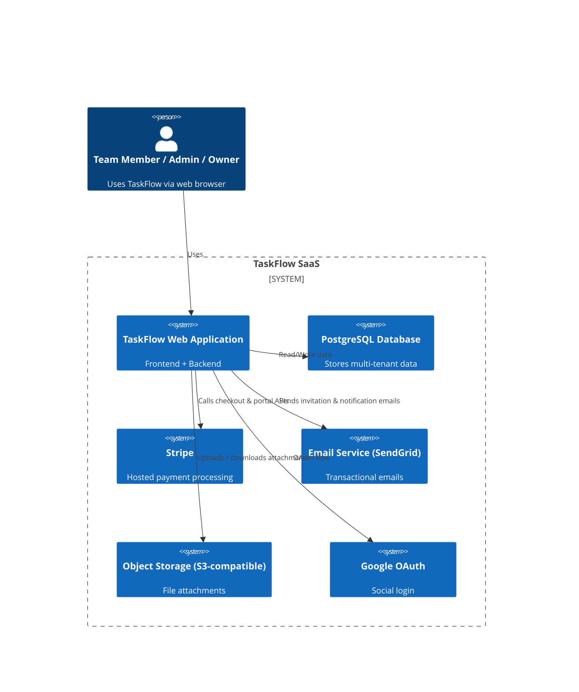
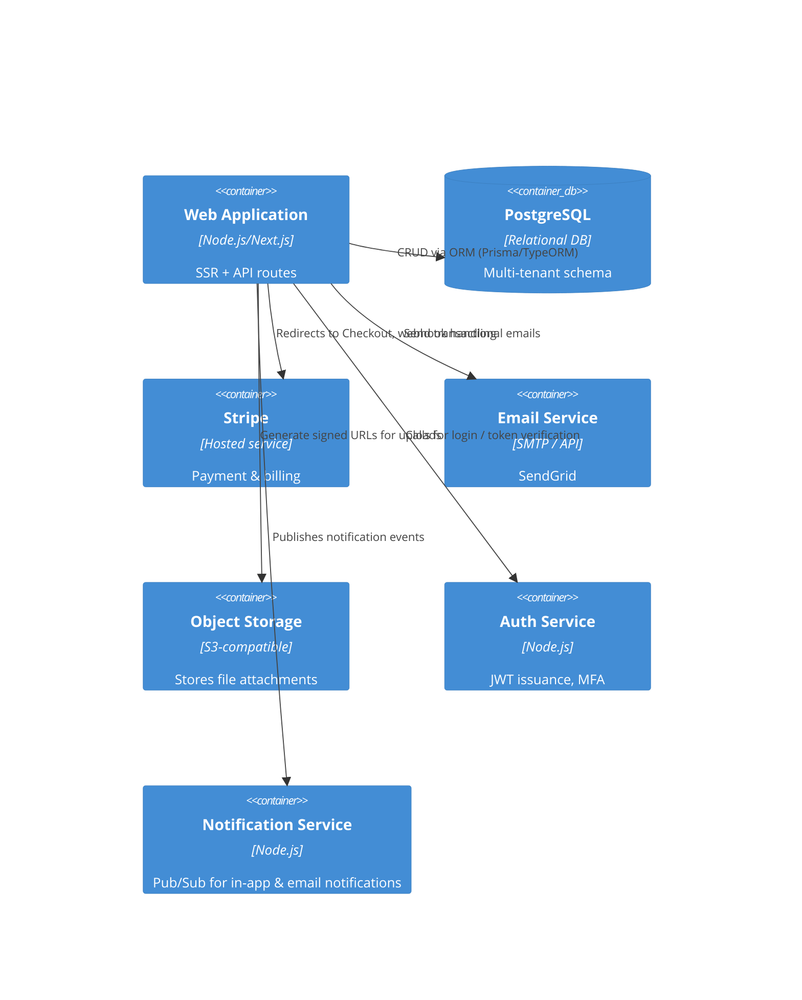

> **Status:** Draft · **Owner:** Antigravity · **Last updated:** 2026-10-24 · **Tier:** Standard · **Related:** docs/DISCOVERY.md, docs/.start-from-here/STATE.md

# TaskFlow – Architecture (C4)

## 1. Context Diagram (Level 1)


## 2. Container Diagram (Level 2)


## 3. Component Overview (selected)
| Component | Responsibility | Tech Stack (proposed) |
|---|---|---|
| **Frontend** | UI rendering, client‑side routing, state management | React + Next.js (SSR), TypeScript, Tailwind CSS |
| **API Layer** | REST‑like endpoints for all CRUD operations | Next.js API routes, Express‑like middleware |
| **Auth Service** | Credential verification, JWT issuance, MFA | Node.js, Argon2id, speakeasy (TOTP), jsonwebtoken |
| **Billing Service** | Stripe checkout & portal integration, webhook processing | Stripe SDK, Node webhook endpoint |
| **Notification Service** | Real‑time in‑app notifications, email dispatch | Redis Pub/Sub or SNS, SendGrid API |
| **File Service** | Signed URL generation, metadata storage | AWS SDK (S3) or Cloudflare R2 SDK |
| **Data Access Layer** | ORM mapping, tenant isolation | Prisma (PostgreSQL) with `tenant_id` filters |
| **Background Workers** | Email sending, retry logic for Stripe webhooks | BullMQ (Redis‑backed) or AWS SQS/Lambda (managed) |

## 4. Deployment View (Level 3 – Physical)
```mermaid
graph TD
    subgraph Cloud Provider
        LB[Load Balancer (HTTPS)]
        FE[Web/App Service (Next.js) - Autoscale]
        DB[PostgreSQL (Managed) - Multi‑AZ]
        REDIS[Redis (Managed) - for session & queues]
        S3[Object Storage Bucket]
    end
    LB --> FE
    FE --> DB
    FE --> REDIS
    FE --> S3
    FE --> Stripe
    FE --> SendGrid
    FE --> GoogleOAuth
```

- **Load Balancer** terminates TLS (managed cert).  
- **Web/App Service** runs stateless containers (Docker) behind LB; autoscaling based on CPU/RAM.  
- **Database** is a single‑region managed PostgreSQL (e.g., AWS RDS) with automated backups (30 days).  
- **Redis** used for session store, rate limiting, and background job queue.  
- **Object Storage** bucket with per‑tenant prefixes (`org-{id}/`) and signed URL policy.  

## 5. Security Architecture Highlights
- **Zero‑Trust Network**: No inbound traffic to DB or Redis except from internal VPC.  
- **JWT** signed with RSA‑256; short‑lived access token (15 min) + refresh token (7 days).  
- **MFA** optional for owners/admins (TOTP).  
- **Stripe Webhooks** verified via signature header; processed in isolated worker.  
- **CORS** restrictive: origins limited to `https://app.taskflow.com` (production) and `http://localhost:3000` (dev).  

## 6. Scalability & Resilience
- Stateless services enable horizontal scaling.  
- Database read‑replicas for read‑heavy workloads (e.g., dashboards).  
- Retry mechanisms for Stripe webhooks and email dispatch.  
- Daily DB snapshots; point‑in‑time recovery enabled.

## 7. Open Architectural Questions
- **Q‑A‑01:** Choice between AWS RDS vs managed PostgreSQL on another cloud (to be decided in stack recommendation).  
- **Q‑A‑02:** Whether to employ a service mesh (e.g., Linkerd) for internal traffic – **Assumption:** Not needed for MVP.  

---  
*End of ARCHITECTURE.md*
