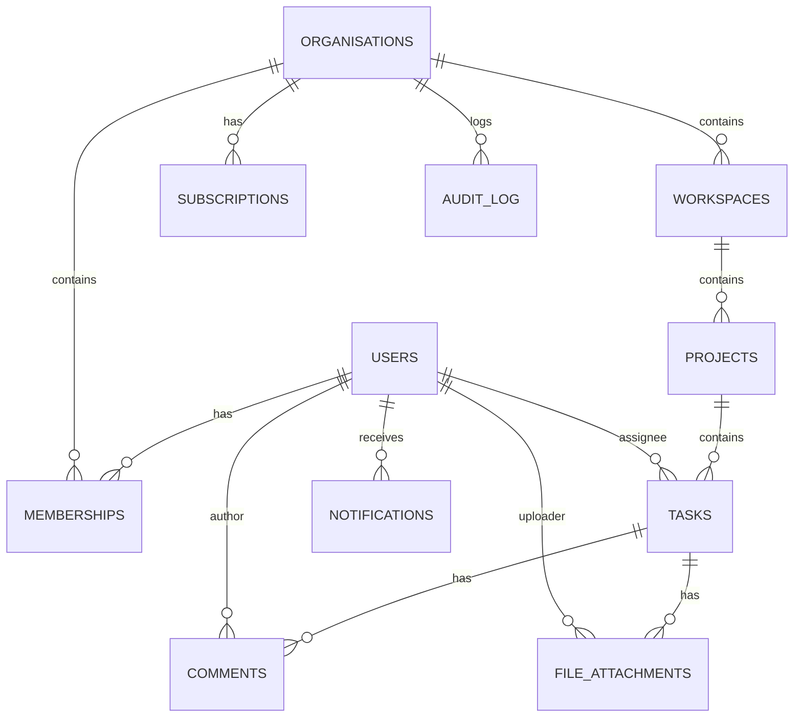

> **Status:** Draft · **Owner:** Antigravity · **Last updated:** 2026-10-24 · **Tier:** Standard · **Related:** docs/DISCOVERY.md, docs/.start-from-here/STATE.md, docs/technical/TRD.md, docs/technical/ARCHITECTURE.md

# TaskFlow – Database Design (DATABASE)

## 1. Overview
The database is a single‑tenant PostgreSQL instance with **row‑level tenant isolation** via a `tenant_id` column on every primary table. All tables use **UUID** primary keys. Sensitive personal data is encrypted at rest (AES‑256) and column‑level encryption is applied where appropriate.

## 2. Entity Definitions

| Table | Columns (type) | Description |
|---|---|---|
| **users** | `id UUID PK`, `tenant_id UUID FK → organisations.id`, `email VARCHAR(255) UNIQUE`, `password_hash VARCHAR(255)`, `google_sub VARCHAR(255)`, `mfa_secret VARCHAR(255)`, `created_at TIMESTAMP`, `updated_at TIMESTAMP` | Authentication subjects; may have Google OAuth sub. |
| **organisations** | `id UUID PK`, `name VARCHAR(255)`, `stripe_customer_id VARCHAR(255)`, `created_at TIMESTAMP`, `updated_at TIMESTAMP` | Top‑level tenant. |
| **memberships** | `id UUID PK`, `user_id UUID FK → users.id`, `org_id UUID FK → organisations.id`, `role ENUM('owner','admin','member')`, `status ENUM('active','invited','revoked')`, `created_at TIMESTAMP` | Links users to organisations with role. |
| **workspaces** | `id UUID PK`, `org_id UUID FK → organisations.id`, `name VARCHAR(255)`, `created_at TIMESTAMP` | Logical grouping within an org. |
| **projects** | `id UUID PK`, `workspace_id UUID FK → workspaces.id`, `name VARCHAR(255)`, `created_at TIMESTAMP` | Container for tasks. |
| **tasks** | `id UUID PK`, `project_id UUID FK → projects.id`, `title VARCHAR(255)`, `description TEXT`, `status ENUM('todo','in_progress','done')`, `assignee_id UUID FK → users.id NULLABLE`, `due_date DATE NULLABLE`, `priority ENUM('low','medium','high')`, `labels TEXT[]`, `tenant_id UUID`, `created_at TIMESTAMP`, `updated_at TIMESTAMP` | Core work item. |
| **comments** | `id UUID PK`, `task_id UUID FK → tasks.id`, `author_id UUID FK → users.id`, `body TEXT`, `mentions UUID[]`, `created_at TIMESTAMP` | Discussion on tasks. |
| **file_attachments** | `id UUID PK`, `task_id UUID FK → tasks.id`, `uploader_id UUID FK → users.id`, `storage_key VARCHAR(512)`, `filename VARCHAR(255)`, `mime_type VARCHAR(100)`, `size_bytes BIGINT`, `created_at TIMESTAMP` | Metadata for files stored in S3. |
| **notifications** | `id UUID PK`, `user_id UUID FK → users.id`, `type ENUM('assignment','mention','due_soon','system')`, `payload JSONB`, `read_at TIMESTAMP NULLABLE`, `created_at TIMESTAMP` | In‑app notification events. |
| **subscriptions** | `id UUID PK`, `org_id UUID FK → organisations.id`, `stripe_subscription_id VARCHAR(255)`, `plan ENUM('monthly','annual')`, `seat_count INT`, `trial_end DATE NULLABLE`, `status ENUM('active','canceled','past_due')`, `created_at TIMESTAMP` | Billing information. |
| **audit_log** | `id BIGSERIAL PK`, `tenant_id UUID`, `entity VARCHAR(50)`, `entity_id UUID`, `action ENUM('create','update','delete')`, `changed_by UUID FK → users.id`, `timestamp TIMESTAMP`, `details JSONB` | Immutable log for compliance (retained 1 year). |

## 3. Relationships (Mermaid ER Diagram)

## 4. Indexes & Constraints
- **Primary Keys:** UUID `id` columns (auto‑generated v4).  
- **Foreign Keys:** Enforced with `ON DELETE CASCADE` where appropriate (e.g., deleting a workspace cascades projects and tasks).  
- **Unique Constraints:** `users.email` scoped by `tenant_id` (composite unique).  
- **Indexes:**  
  - `tasks (project_id, status)` for board filtering.  
  - `tasks (assignee_id)` for assignment queries.  
  - `comments (task_id, created_at)` for recent comment retrieval.  
  - `file_attachments (task_id)` for attachment lookup.  
  - `audit_log (tenant_id, timestamp)` for compliance queries.  
- **Full‑Text Search:** Optional GIN index on `tasks.title` and `tasks.description` to support MVP search feature.

## 5. Data Retention & Deletion Policies
- **Organisation Deletion:** Soft‑delete `organisations` record, retain data for 30 days, then hard‑delete. Cascade deletes all related rows (`workspaces`, `projects`, `tasks`, etc.).  
- **User Deletion:** Anonymise `users.email` (replace with `deleted-{id}@example.com`), retain `user_id` for comment attribution.  
- **Audit Log:** Retained for 1 year, then purged automatically.  
- **File Attachments:** Retained as long as the owning task exists; deleted when task is hard‑deleted.

## 6. Security Considerations
- **Encryption at Rest:** Enable PostgreSQL Transparent Data Encryption (TDE) or use encrypted storage volumes.  
- **Column‑Level Encryption:** Sensitive columns (`users.password_hash`, `users.mfa_secret`, `file_attachments.storage_key`) stored encrypted via application‑level libs (e.g., `libsodium`).  
- **Row‑Level Security (RLS):** PostgreSQL policies enforce `tenant_id` filtering for all queries automatically.  
- **Backup Encryption:** Daily logical backups encrypted with GPG before uploading to secure storage.

## 7. Open Technical Questions
- **Q‑DB‑01:** Preferred managed PostgreSQL provider (AWS RDS, Azure Database for PostgreSQL, Supabase) – *to be resolved in stack recommendation.*  
- **Q‑DB‑02:** Whether to enable **Read‑Replica** for reporting dashboards in MVP – *assumed not required now.*

---  
*End of DATABASE.md*
