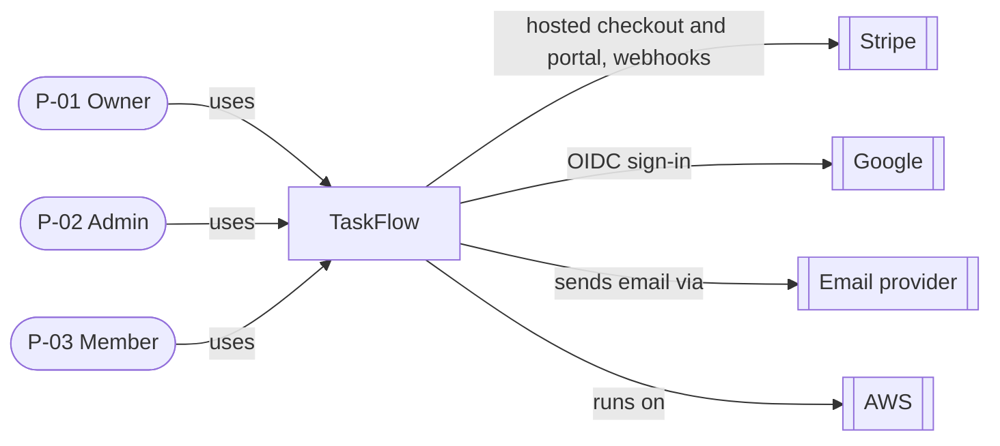
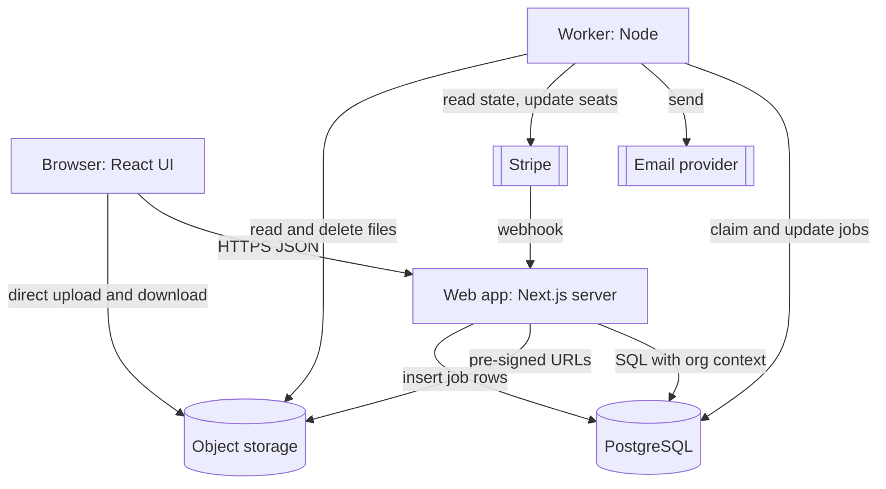
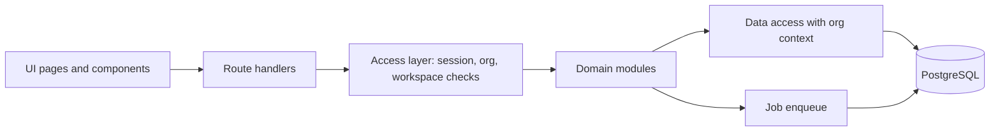

# Architecture — TaskFlow

> **Status:** Draft · **Owner:** Lead developer [TBD: name — Founder/PM] · **Last updated:** 2026-10-24 · **Tier:** Standard · **Related:** [DISCOVERY](../DISCOVERY.md) · [PRD](../product/PRD.md) · [TRD](TRD.md) · [DATABASE](DATABASE.md) · [API](API.md) · [SECURITY_ARCHITECTURE](SECURITY_ARCHITECTURE.md) · [OPERATIONS](OPERATIONS.md) · [ADRs](../decisions/README.md)

## 1. Purpose and drivers

TaskFlow is a multi-tenant web SaaS. This document describes the system's structure, the stack, and the main flows.

| Driver | Source | Effect on the design |
| --- | --- | --- |
| Launch in 4 months with 2 developers | DISCOVERY §3.9 | One language, one deployable web app plus one worker, managed services |
| Tenant data leakage is a named risk (R-03) | DISCOVERY §3.9 | `org_id` on every tenant row, row-level security, central access layer, isolation tests |
| Stripe webhook reliability (R-01) | DISCOVERY §3.9 | Event inbox, idempotency, reconciliation |
| File storage cost (R-02) | DISCOVERY §3.9 | Direct-to-storage uploads, quota, lifecycle rules |
| p95 < 300 ms at 100 req/s; 99.9% monthly | NFR-01, NFR-02 | Stateless web tier, 2+ instances, indexed queries, managed database |
| ~USD 500/month | NFR-13 | No separate search, cache, or queue service in MVP |
| GDPR/CCPA; deletion and export | NFR-09 | Retention jobs, anonymization, export job |

## 2. Architectural style

**Modular monolith** (ADR-0002): one codebase, one web application process type and one worker process type, sharing one PostgreSQL database. Modules have clear boundaries (auth, orgs, workspaces, projects, tasks, comments, attachments, notifications, billing, audit, export). Modules call each other only through their public functions, not through each other's tables.

Why not microservices: two developers, one database, and no independent scaling needs at 2,000 orgs. Why not a BaaS: per-tenant rules and billing logic are easier to test as plain code and SQL.

```text
Browser ──HTTPS──> Web app (Next.js: pages + /api route handlers) ──SQL──> PostgreSQL
                          |                                           ^
                          |--pre-signed URLs--> Object storage        |
                          '--enqueue jobs-------------------------------'
Worker (Node) ──polls jobs table──> email provider, Stripe, object storage, PostgreSQL
Stripe ──signed webhooks──> Web app (/api/stripe/webhook) ──> stripe_events inbox ──> Worker
```

## 3. System views (C4)

### 3.1 Context



### 3.2 Containers



ASCII version of the container view:

```text
[Browser] --HTTPS--> [Web app] --SQL--> [(PostgreSQL)] <--poll/update-- [Worker] --> Email, Stripe API, Storage
    |                    |                                                 ^
    |                    '--pre-signed URL--> [(Object storage)]            |
    '--direct upload/download-----------------^        Stripe --webhook--> [Web app] --inbox--> [(PostgreSQL)]
```

### 3.3 Components (web app modules)



The **access layer** is the only code that sets the org context for a database transaction (see §8.2).

## 4. Stack decisions

> Versions are not stated here. Choose the latest stable versions at setup and verify them. Records: [ADR index](../decisions/README.md).

| Layer | Choice | Reason | ADR |
| --- | --- | --- | --- |
| Language | TypeScript (strict mode) for UI, API, and worker | Team knows it; shared types | [ADR-0002](../decisions/0002-modular-monolith-typescript-nextjs.md) |
| Web framework | Next.js (React) with server route handlers | One deployable for UI and API | ADR-0002 |
| Worker | Node process using the same code base | Shares modules and types | ADR-0002, ADR-0008 |
| Database | PostgreSQL, managed (AWS) | Relational, RLS, full-text search, JSON | [ADR-0003](../decisions/0003-postgresql-shared-schema-rls-tenancy.md) |
| Query layer / migrations | [TBD: ORM or query builder — Q-10] | Spike in M0 | ADR-0003 follow-up |
| Object storage | S3-compatible (Amazon S3) | Cheap, durable, pre-signed URLs | [ADR-0007](../decisions/0007-object-storage-presigned-uploads.md) |
| Jobs | PostgreSQL-backed queue | No extra service | [ADR-0008](../decisions/0008-postgres-backed-job-queue.md) |
| Auth | In-app, maintained library [TBD: Q-10] | Roles in our DB; no extra vendor | [ADR-0005](../decisions/0005-in-app-authentication.md) |
| Billing | Stripe Checkout + Customer Portal + webhooks | No card data in our systems | [ADR-0006](../decisions/0006-stripe-hosted-billing-webhook-inbox.md) |
| Hosting | AWS managed containers [TBD: exact service — OPERATIONS §5], one region | Managed; matches budget | [ADR-0004](../decisions/0004-managed-aws-hosting-single-region.md) |
| Email | [TBD: provider — Q-11] | Deliverability | — |
| CI/CD | GitHub Actions | Given | OPERATIONS §3 |
| Observability | [TBD: tools — Q-27] | | — |
| UI components | [TBD: Designer + developers] (DESIGN_SYSTEM §10) | Accessibility base | — |

## 5. Boundaries and responsibilities

| Module / component | Owns | Must not |
| --- | --- | --- |
| Access layer | Session lookup, org and workspace membership checks, DB org context | Contain business rules |
| auth | Users, credentials, sessions, MFA, tokens | Read tenant tables |
| orgs | Organizations, memberships, invitations, roles | Handle billing details |
| workspaces / projects | Workspaces, membership, projects | Read task contents |
| tasks | Tasks, labels, activity events | Send email directly |
| comments | Comments, mentions | Resolve mentions across workspaces |
| attachments | Metadata, pre-signed URLs, quota | Proxy file bytes through the web app |
