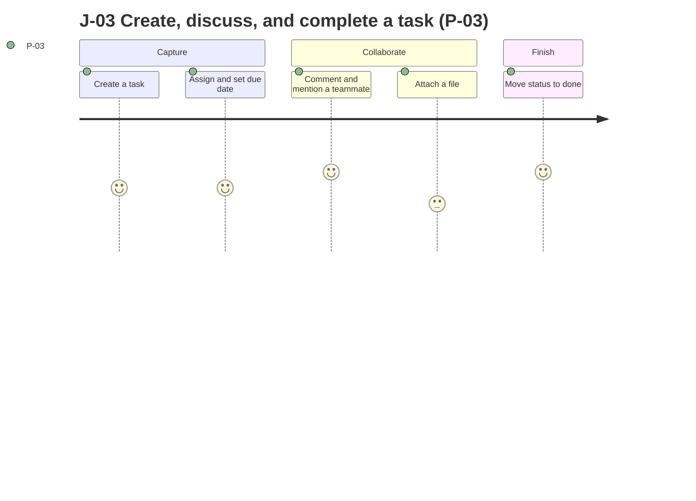

# Product Requirements Document — TaskFlow

> **Status:** Draft · **Owner:** Founder / PM · **Last updated:** 2026-10-24 · **Tier:** Standard · **Related:** [DISCOVERY](../DISCOVERY.md) · [APP_FLOW](APP_FLOW.md) · [DESIGN_SYSTEM](DESIGN_SYSTEM.md) · [TRD](../technical/TRD.md) · [TESTING](../technical/TESTING.md) · [IMPLEMENTATION_PLAN](../technical/IMPLEMENTATION_PLAN.md)

This PRD defines what TaskFlow does and why. It does not define how. Numeric limits marked **(P)** are proposals that the Founder/PM has not yet confirmed; they are listed in [DISCOVERY §7](../DISCOVERY.md#7-open-questions) or will be confirmed when the PRD is approved.

## 1. Overview

| Item | Value |
| --- | --- |
| Product | TaskFlow |
| One-liner | A team task-management web app for small and mid-size teams that replaces spreadsheets and chat threads for tracking work. |
| Product type | Multi-tenant web SaaS (responsive web app) |
| Release in scope | MVP (launch in 4 months) |
| Decision maker | Founder / PM |
| Primary persona | P-03 Member |
| North Star metric | KPI-01 Paying organizations |

### 1.1 Vision
Every small team can see who is doing what, by when, in one place, without asking in chat.

### 1.2 Problem
- **Who:** Small and mid-size teams that track work in spreadsheets and chat threads.
- **Pain today:** Work gets lost between spreadsheets and chat. Ownership and due dates are unclear. Nothing reminds people of what is due.
- **Current workaround:** Spreadsheets for lists of work and chat threads for discussion. Falls short because the two are not linked, nobody is notified, and files and history are scattered.
- **Evidence:** The founders lived this on their previous team. No customer research is recorded. [TBD: Is any customer interview or survey evidence available? — Founder/PM]
- **Why now:** Founders' previous team pain (see [DISCOVERY §3.1](../DISCOVERY.md#31-vision--problem)).

### 1.3 Value proposition
For small and mid-size teams who track work across spreadsheets and chat, **TaskFlow** is a task-management web app that keeps tasks, discussion, files, and reminders in one place. Unlike spreadsheets plus chat, it assigns clear owners, notifies people when work needs them, and keeps a history. [TBD: Named competitor comparison is not provided — Founder/PM]

## 2. Goals and non-goals

| ID | Goal (outcome) | Measured by (see §9) | Priority |
| --- | --- | --- | --- |
| G-01 | Teams pay for TaskFlow: 100 paying organizations within 6 months of launch. | KPI-01 | Primary |
| G-02 | Teams use TaskFlow every week, not once: weekly active users per seat ≥ 60%. | KPI-02 | Primary |
| G-03 | New organizations reach value fast: they create tasks and invite teammates in their first week. | KPI-03 | Secondary |
| G-04 | Customers trust TaskFlow with their data: no cross-tenant data exposure and the availability target is met. | KPI-05, KPI-06 | Secondary |

**Non-goals (MVP):** native mobile apps, Gantt charts, time tracking, a public API, SSO/SAML, guest access, multiple languages, and enterprise compliance certifications.

## 3. Stakeholders

| Stakeholder | Interest | Role (R/A/C/I) |
| --- | --- | --- |
| Founder / PM | Product scope, pricing, launch | A (accountable) |
| Full-stack developers (2) | Build and operate | R |
| Designer | UX, design system, accessibility | R |
| Paying org owners (customers) | Reliable service, billing control | C |
| Counsel (external) [TBD: Q-15] | Review of legal drafts | C |

## 4. Personas

| ID | Persona | Role (permissions) | Context (where, device, frequency) | Goals | Frustrations | Skill level | Accessibility / environment needs |
| --- | --- | --- | --- | --- | --- | --- | --- |
| P-01 | Org owner (buyer) | Owner: all admin rights, billing, org deletion | Desktop browser, occasional (setup, billing, monthly checks) | Set up the org, control cost, trust the data | Surprise charges, losing control of who has access | Intermediate | Standard; responsive for quick checks on a phone |
| P-02 | Org admin | Admin: manage members, invites, workspaces; no billing or org deletion | Desktop, weekly | Keep the right people in the right workspaces | Manual access management, unclear who can see what | Intermediate | Standard |
| P-03 | Member (primary) | Member: works on tasks in workspaces they belong to | Desktop browser and phone browser, daily | Know what to do today, update status quickly, discuss in context | Missed updates, hunting for files and threads | Beginner to intermediate | Keyboard-only and screen-reader users must be supported (WCAG 2.2 AA) |

> **ASSUMPTION:** (A-02) Owners and admins can see all workspaces in their org. (A-01) One person can belong to several orgs.

## 5. Jobs to be done

| ID | Persona | Job statement | Served by |
| --- | --- | --- | --- |
| JTBD-01 | P-03 | When I start my day, I want to see what is assigned to me and due soon, so I can work on the right things. | F-05, F-08 |
| JTBD-02 | P-03 | When a task needs input, I want to mention a teammate in a comment, so they are told and can answer in context. | F-06, F-08 |
| JTBD-03 | P-02 | When a new person joins the team, I want to invite them and give them access to the right workspaces, so they can start the same day. | F-02, F-03 |
| JTBD-04 | P-01 | When my team grows or shrinks, I want billing to follow the number of people, so I only pay for who uses it. | F-09 |
| JTBD-05 | P-01 | When we stop using the product, I want to take our data and delete it, so nothing is left behind. | F-13, F-14 |

## 6. User journeys and stories

### 6.1 Journeys

| Journey | Actor | Trigger | Preconditions | Steps (happy path) | Alternate paths | Failure → recovery | Success outcome | Features |
| --- | --- | --- | --- | --- | --- | --- | --- | --- |
| J-01 Sign up, create the org, start the trial | P-01 | Visits the sign-up page | No account | 1. Sign up with email+password or Google. 2. Verify email (password sign-up). 3. Name the organization. 4. Land in an empty home with a prompt to create the first workspace. Trial starts. | Sign up through an invite link (J-02). Enable TOTP MFA after sign-up. | Email already registered → message with a link to sign in. Verification link expired → resend. Google sign-in cancelled → back to sign-up, nothing created. | An org exists, the user is its owner, the 14-day trial is running. | F-01, F-02, F-09 |
| J-02 Invite teammates, create a workspace and project | P-02 | Wants the team on TaskFlow | Org exists; user is owner or admin | 1. Open Members, enter emails and roles. 2. Invitees get email. 3. Create a workspace and add members. 4. Create a project. | Resend or revoke an invite. Invitee signs up through the link. | Invite email bounces → admin sees "Not delivered". Invite expired → send again. Wrong email used on accept → clear message. | Teammates are in a workspace with a project ready. | F-02, F-03, F-04 |
| J-03 Create, assign, discuss, and complete a task | P-03 | Work arrives | Member of a workspace with a project | 1. Create a task with title, assignee, due date, priority, labels. 2. Comment and @mention a teammate. 3. Attach a file. 4. Move status todo → in progress → done. | Edit or reassign; delete a task; use search (F-11). | Validation errors keep input. Upload too large or interrupted → clear message, task unchanged. Concurrent edit → conflict message. | The task is completed with its discussion and files attached. | F-05, F-06, F-07 |
| J-04 Get notified and act | P-03 | Someone assigns or mentions them, or a due date approaches | Notifications enabled | 1. Bell shows an unread count; an email arrives. 2. Open the notification. 3. Land on the task. 4. Respond or update. | Turn off email for a type. Mark all read. | Email delayed or failed → in-app still works. Lost access to the task → "not available" message. | The person acts on the task from the notification. | F-08, F-05 |
| J-05 Subscribe, change seats, manage billing | P-01 | Trial is ending or the owner wants to pay | Org on trial or subscribed | 1. Open Billing. 2. Choose plan (monthly or annual) in Stripe Checkout. 3. Return; status shows Active. 4. Later, manage the plan in the Stripe Customer Portal. | Cancel at period end in the Portal. Add members → seat count follows. | Payment fails → past due banner, update payment method in Portal. Webhook delayed → status shows "Updating" until confirmed or reconciled. | Subscription is active and matches the number of seats. | F-09 |
| J-06 Export org data and delete the org | P-01 | Leaving the product | Owner | 1. Request export. 2. Receive an email with a download link. 3. Delete the org after typing its name and confirming identity. 4. Org is locked and purged after 30 days. | Cancel deletion within 30 days. | Export fails → retry message and support contact. Wrong confirmation text → nothing happens. | Data exported; org removed on schedule. | F-13, F-14 |

#### 6.1.1 Primary journey map (J-03, P-03)

> **PROPOSAL:** Scores are design estimates, not research.



ASCII fallback:

```text
work arrives -> create task -> assign + due date -> comment/@mention -> attach file -> done
                    '--empty title--> inline error, input kept --> back to create task
                    '--file too large--> message, task unchanged --> back to attach file
```

### 6.2 User stories

| ID | Story | Persona | Feature | Priority |
| --- | --- | --- | --- | --- |
| US-01 | As a visitor, I want to sign up with email and password or Google, so I can start using TaskFlow. | P-01 | F-01 | Must |
| US-02 | As an owner or admin, I want to turn on TOTP MFA for my account, so a stolen password is not enough. | P-01 | F-01 | Must |
| US-03 | As an owner, I want to create an organization and be its owner, so my team has a home. | P-01 | F-02 | Must |
| US-04 | As an owner or admin, I want to invite people by email with a role, so they can join. | P-02 | F-02 | Must |
| US-05 | As an invitee, I want to accept an invitation, so I join the organization. | P-03 | F-02 | Must |
| US-06 | As an admin, I want to change or remove a member's role, so access stays right. | P-02 | F-02 | Must |
