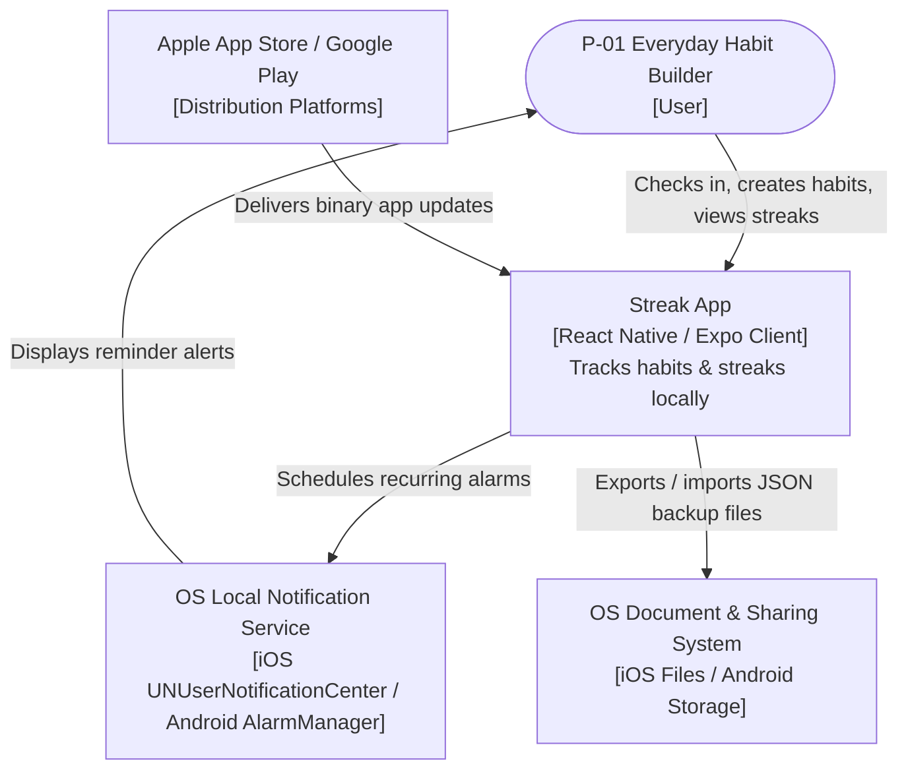
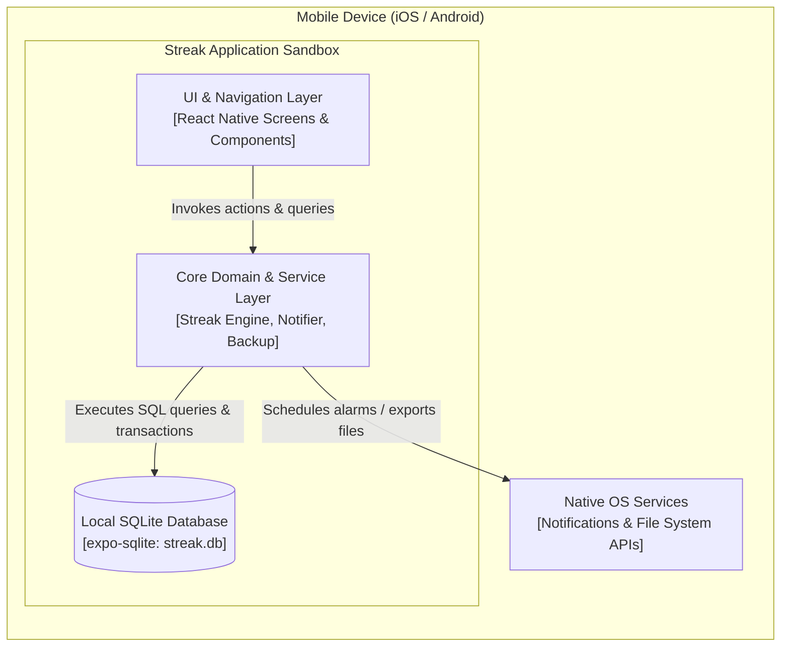

# Architecture — Streak

> **Status:** Draft · **Owner:** Solo Developer · **Last updated:** 2026-10-24 · **Tier:** Lite · **Related:** [PRD](../product/PRD.md) · [APP_FLOW](../product/APP_FLOW.md) · [DATABASE](DATABASE.md) · [SECURITY_ARCHITECTURE](SECURITY_ARCHITECTURE.md) · [TESTING](TESTING.md) · [CODE_STYLE](../engineering/CODE_STYLE.md) · [AGENTS](../../AGENTS.md)

## 1. Purpose and drivers

- **System purpose:** Streak is an offline-first mobile application for iOS and Android that allows users to create, track, and maintain daily habits without requiring accounts, remote servers, or external services.
- **Key drivers (quality attributes):**
  - **NFR-01 (Startup & Responsiveness):** Cold launch interactive UI < 1.0 s on mid-range reference devices; interaction response < 50 ms.
  - **NFR-02 (Offline Self-Sufficiency):** 100% functional without an active network connection; zero network requests.
  - **NFR-03 (Mobile Accessibility):** UI conforms to WCAG 2.2 AA mobile equivalents with touch targets ≥ 44x44 pt.
  - **NFR-04 (Zero Infrastructure Cost):** $0/month recurring backend overhead.
- **Capacity headline:** Standalone local client app; typical user SQLite database size is < 2 MB across 5 years of daily tracking.
- **Constraints:** Solo developer; dual-platform distribution (Apple App Store and Google Play); strictly local storage and alarms.
- **Assumptions:** React Native with Expo (TypeScript) supports on-device SQLite, native local notifications, and document sharing without ejecting from managed workflow (A-01 to A-04).

## 2. Architectural style

- **Chosen style:** Client-Only / Local-First Mobile Application (Layered Monolith on device).
- **Rationale:** Because Streak has zero multi-user collaboration, no remote syncing, and no backend services, a client-only architecture provides maximum user privacy, zero recurring cloud operational costs, and instantaneous offline responsiveness.
- **Alternatives rejected:**
  - *Backend-as-a-Service (Firebase / Supabase):* Rejected because it introduces recurring costs, network latency, online login walls, and privacy liabilities that directly contradict the project's zero-signup, offline premise.
  - *Native Dual Codebase (SwiftUI + Jetpack Compose):* Rejected because maintaining two separate platform codebases exceeds solo developer capacity for an MVP.
- **Redesign trigger:** If future product versions require multi-device cloud synchronization or web access, an optional end-to-end encrypted sync adapter would be introduced.

## 3. System views (C4)

### 3.1 Context



### 3.2 Containers



| Container | Responsibility | Technology | Owner | Scales by | Stateful? |
| --- | --- | --- | --- | --- | --- |
| Mobile App UI | Renders screens, captures user check-ins, handles gestures | React Native, Expo Router | Solo Developer | On-device rendering | Yes (UI state) |
| Core Domain Engine | Computes streaks, validates inputs, formats backups | TypeScript Domain Modules | Solo Developer | On-device CPU | No (stateless) |
| Local SQLite Store | Persists habits, check-in history, and app preferences | `expo-sqlite` (SQLite 3) | Solo Developer | Local disk storage | Yes (persistent) |

### 3.3 Components
N/A — Lite tier (modular layered structure within single client container documented in §9).

## 4. Stack decisions

| Layer | Choice | Version policy | Reason | Alternative considered | ADR |
| --- | --- | --- | --- | --- | --- |
| Framework & Runtime | React Native with Expo (TypeScript) | Current LTS / stable at setup — verify | Single shared codebase for iOS & Android, high developer productivity | Flutter, Native Swift/Kotlin | D-01 (in §12) |
| Navigation | Expo Router (File-based) | Current stable at setup — verify | Native-driven stack and modal transitions with deep TypeScript safety | React Navigation raw | D-01 (in §12) |
| Local Database | `expo-sqlite` | Current stable at setup — verify | Native SQLite engine embedded in sandbox, full SQL query power, zero network | AsyncStorage, WatermelonDB, Realm | D-02 (in §12) |
| Local Notifications | `expo-notifications` | Current stable at setup — verify | Native scheduled alarms without push notification server or FCM keys | Native background headless tasks | D-06 (in §12) |
| File I/O & Sharing | `expo-file-system` & `expo-sharing` | Current stable at setup — verify | Standard OS document export and native share sheet integration | Direct cloud drive SDKs | D-03 (in §12) |
| Build & Distribution | Expo Application Services (EAS Build) | Current stable at setup — verify | Cloud compilation of iOS IPA and Android AAB without maintaining local macOS/Linux build farms | Pure local Xcode / Android Studio builds | D-01 (in §12) |

## 5. Boundaries and responsibilities

- **Client Presentation Layer owns:** Screen rendering, animations, user input validation feedback, optimistic UI toggles.
- **Core Domain Layer owns:** Business rules, streak calculation logic, local notification scheduling payload generation, JSON backup schema validation.
- **Database Access Layer owns:** SQL execution, schema creation, database migrations, atomic transaction rollback.
- **OS Native Services own:** Accurate system alarm dispatching, file picker dialog presentation, native file share sheet.
- **Server / Backend:** None (zero remote server boundaries).

## 6. Request and data flow

| Journey | Diagram | Containers involved | Failure paths shown |
| --- | --- | --- | --- |
| J-01 Habit Creation & Scheduling | §6.1 | UI Layer, Core Domain, SQLite DB, OS Notifications | Validation error, notification permission denied |
| J-02 Habit Check-in & Streak Update | §6.2 | UI Layer, Core Domain, SQLite DB | Storage write failure, streak decrement on undo |

### 6.1 J-01 — Habit Creation & Reminder Scheduling

```mermaid
sequenceDiagram
    autonumber
    actor U as P-01 User
    participant UI as S-02 Habit Form
    participant Core as Habit Service
    participant DB as SQLite Store
    participant OS as OS Notification API

    U->>UI: Enter habit title, days, and reminder time
    U->>UI: Tap "Save"
    UI->>Core: validateAndCreateHabit(data)
    alt Invalid Input (e.g. empty title)
        Core-->>UI: ValidationError("Habit name is required")
        UI-->>U: Show inline error text; keep form inputs
    else Valid Input
        Core->>DB: INSERT INTO habits (...)
        DB-->>Core: habit_id = 42 (SUCCESS)
        opt Reminder time configured
            Core->>OS: scheduleNotificationAsync(habit_id, time, days)
            alt Permission Denied by User
