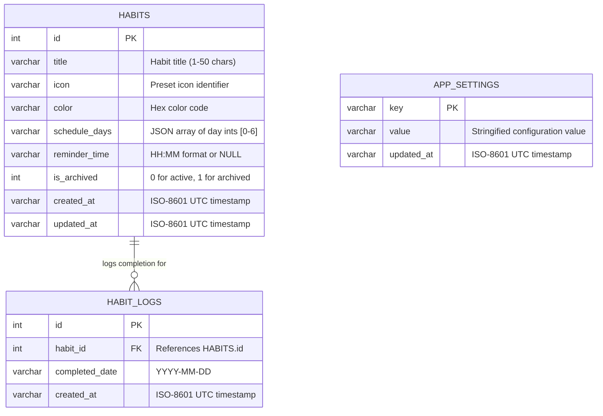

# Data Model & Database — Streak

> **Status:** Draft · **Owner:** Solo Developer · **Last updated:** 2026-10-24 · **Tier:** Lite · **Related:** [ARCHITECTURE](ARCHITECTURE.md) · [SECURITY_ARCHITECTURE](SECURITY_ARCHITECTURE.md) · [PRIVACY_POLICY](../legal/PRIVACY_POLICY.md)

## 1. Storage model

| Item | Value |
| --- | --- |
| Primary store | Embedded SQLite via `expo-sqlite` (database file: `streak.db`) |
| Other stores | File system cache (`FileSystem.cacheDirectory`) for transient JSON backup generation |
| Why | Native, zero-network, highly performant relational engine embedded within the application sandbox. |
| Ownership / tenancy model | Single-user device owner; isolated within native mobile OS app sandbox. |
| Hosting & region | Local on-device storage (iOS/Android internal app sandbox storage). |
| Access layer | Raw parameterized SQL helper / lightweight typed query repository. |
| ID strategy | Auto-incrementing 64-bit integers (`INTEGER PRIMARY KEY AUTOINCREMENT`). |
| Time conventions | Timestamps stored in UTC ISO-8601 string format (`YYYY-MM-DDTHH:MM:SS.SSSZ`); habit completion dates stored as `YYYY-MM-DD`. |
| Consistency | Strong transactional consistency (ACID compliant with SQLite WAL mode). |

## 2. Data classification

| Class | Definition | Examples in this product | Handling |
| --- | --- | --- | --- |
| Public | Safe to publish | App version, preset icon names, preset color palette | Bundled in code |
| Internal | Private to user on device | Habit titles, scheduled days, reminder times, completion logs | Sandboxed SQLite storage |
| Personal (PII) | Identifies an individual | None collected or stored (zero account registration) | N/A |
| Sensitive | High harm if leaked | None | N/A |
| Secrets | Authentication credentials | None (no tokens, passwords, or API keys exist) | N/A |

## 3. Entities

| Entity | Purpose | Owner | Classification | Features | Retention |
| --- | --- | --- | --- | --- | --- |
| `habits` | Represents a user-defined habit with schedule and presentation settings | User | Internal | F-01, F-03, F-04 | Retained until user deletes or uninstalls app |
| `habit_logs` | Represents a single completed check-in for a habit on a specific date | User | Internal | F-02, F-03, F-05 | Retained until habit deleted or app uninstalled |
| `app_settings` | Key-value store for app configuration (backup timestamp, onboarding flag) | User | Internal | F-06 | Retained until app uninstalled |

### 3.1 Supporting entity decisions

| Area | Entities | Decision | Reason / link |
| --- | --- | --- | --- |
| Identity | users, credentials, sessions | Excluded | Client-only, zero-account architecture (D-03) |
| Authorization | roles, permissions | Excluded | Single-user physical device ownership |
| Tenancy | organizations, workspaces | Excluded | Single-user personal application |
| Audit & activity | audit_logs, events | Excluded | User activity reflected directly in `habit_logs` |
| Notifications | push_tokens, notification_queue | Excluded | Native OS local alarms handle scheduling directly |
| Files | attachments, file_metadata | Excluded | Only ephemeral JSON backups generated on demand |
| Settings & consent | app_settings | Included | Tracks local schema version and first-run state |
| Integration | api_keys, webhooks | Excluded | Zero remote external integrations |
| Operations | jobs, telemetry counters | Excluded | No background job queues or telemetry |
| Billing | subscriptions, payment_history | Excluded | Free MVP without in-app purchases (D-04) |
| Content | tags, comments | Excluded | Simplified MVP scope |

## 4. Entity relationship diagram



ASCII fallback:
```text
HABITS (1) ──< has >── (0..N) HABIT_LOGS (habit_id references HABITS.id)
APP_SETTINGS (Standalone key-value configuration table)
```

## 5. Schema

### 5.1 `habits`
> **PROPOSAL:** Features F-01, F-03, F-04 · owner User · classification Internal · retention Persistent until deleted.

| Field | Type | Null | Default | Constraints | Classification | Notes |
| --- | --- | --- | --- | --- | --- | --- |
| `id` | INTEGER | No | AUTOINCREMENT | PRIMARY KEY | Internal | Unique habit identifier |
| `title` | TEXT | No | — | CHECK(length(trim(title)) > 0 AND length(title) <= 50) | Internal | Habit name |
| `icon` | TEXT | No | 'check' | CHECK(length(icon) > 0) | Internal | Icon name from preset set |
| `color` | TEXT | No | '#4F46E5' | CHECK(length(color) = 7) | Internal | Hex color format `#RRGGBB` |
| `schedule_days` | TEXT | No | '[0,1,2,3,4,5,6]' | JSON array string | Active weekdays (0=Sun, 1=Mon... 6=Sat) |
| `reminder_time` | TEXT | Yes | NULL | CHECK(reminder_time IS NULL OR reminder_time GLOB '[0-2][0-9]:[0-5][0-9]') | Internal | 24-hr `HH:MM` time |
| `is_archived` | INTEGER | No | 0 | CHECK(is_archived IN (0, 1)) | Internal | 0=Active, 1=Archived |
| `created_at` | TEXT | No | (strftime('%Y-%m-%dT%H:%M:%fZ', 'now')) | ISO-8601 format | Internal | UTC creation timestamp |
| `updated_at` | TEXT | No | (strftime('%Y-%m-%dT%H:%M:%fZ', 'now')) | ISO-8601 format | Internal | UTC update timestamp |

### 5.2 `habit_logs`
> **PROPOSAL:** Features F-02, F-03, F-05 · owner User · classification Internal · retention Persistent until deleted.

| Field | Type | Null | Default | Constraints | Classification | Notes |
| --- | --- | --- | --- | --- | --- | --- |
| `id` | INTEGER | No | AUTOINCREMENT | PRIMARY KEY | Internal | Unique log identifier |
| `habit_id` | INTEGER | No | — | FOREIGN KEY REFERENCES habits(id) ON DELETE CASCADE | Internal | Target habit |
| `completed_date` | TEXT | No | — | CHECK(completed_date GLOB '[0-9][0-9][0-9][0-9]-[0-1][0-9]-[0-3][0-9]') | Internal | Format `YYYY-MM-DD` |
| `created_at` | TEXT | No | (strftime('%Y-%m-%dT%H:%M:%fZ', 'now')) | ISO-8601 format | Internal | UTC timestamp |

**Table constraints:**
- `UNIQUE(habit_id, completed_date)`: Guarantees idempotent check-ins; prevents duplicate completion logs for the same habit on the same day.

### 5.3 `app_settings`
> **PROPOSAL:** Features F-06 · owner User · classification Internal · retention Persistent until uninstalled.

