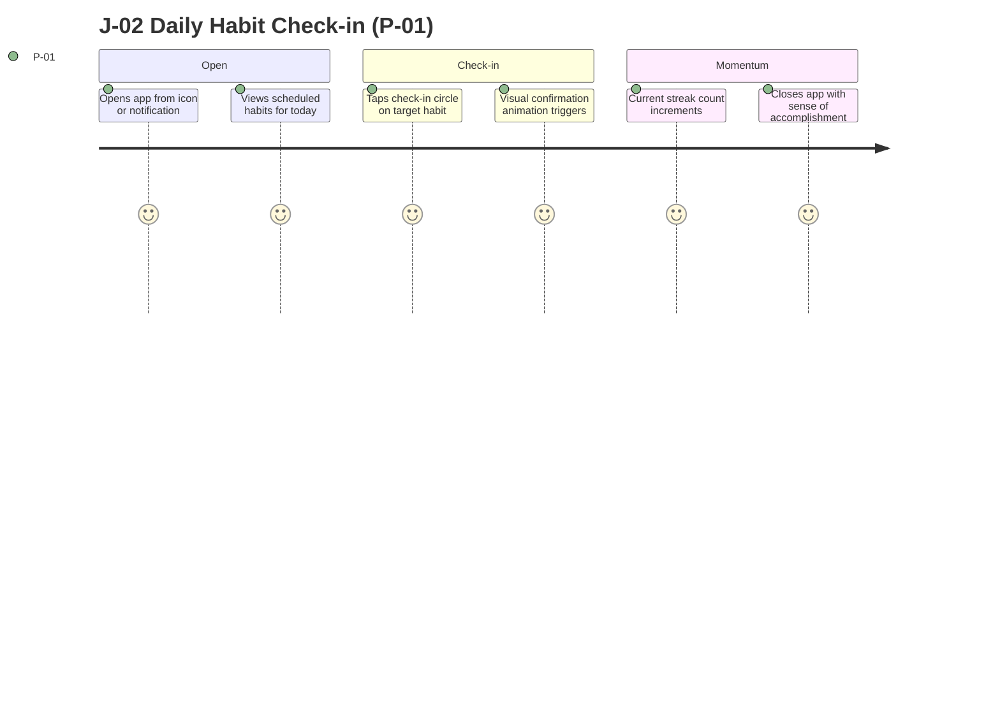

# Product Requirements Document — Streak

> **Status:** Draft · **Owner:** Solo Developer · **Last updated:** 2026-10-24 · **Tier:** Lite · **Related:** [DISCOVERY](../DISCOVERY.md) · [APP_FLOW](APP_FLOW.md) · [ARCHITECTURE](../technical/ARCHITECTURE.md) · [DATABASE](../technical/DATABASE.md) · [TESTING](../technical/TESTING.md) · [IMPLEMENTATION_PLAN](../technical/IMPLEMENTATION_PLAN.md)

## 1. Overview

| Item | Value |
| --- | --- |
| Product | Streak |
| One-liner | A private, offline-first mobile habit tracker that helps people build daily habits without accounts, servers, or subscriptions. |
| Product type | Mobile Application (iOS & Android) |
| Release in scope | MVP (v1.0) |
| Decision maker | Solo Developer (Product Owner & Engineer) |
| Primary persona | P-01 (Everyday Habit Builder) |
| North Star metric | KPI-01 (1,000 Total Installs across iOS and Android) |

### 1.1 Vision
Empower individuals to build positive daily habits with complete peace of mind, using an ultra-responsive, distraction-free tool where personal data never leaves their device.

### 1.2 Problem
- **Who:** Everyday individuals seeking personal self-improvement through consistent routines.
- **Pain today:** Mainstream habit trackers demand mandatory cloud registration, push recurring subscriptions, present intrusive banner ads, or silently track behavioral telemetry.
- **Current workaround:** Manual paper journals (easily lost, lack reminders) or complex notes apps (lack automated streak computation and reminders).
- **Evidence:** User discovery interview confirming demand for a privacy-first, zero-signup utility.
- **Why now:** Mobile operating systems now support robust on-device databases and local notification primitives, making serverless utility apps exceptionally viable.

### 1.3 Value proposition
For self-motivated individuals who want to establish daily habits, **Streak** is an offline mobile utility that delivers effortless one-tap check-ins and streaks. Unlike cloud-based trackers, it requires zero sign-up, has zero ads, and ensures 100% of user data remains on the phone.

## 2. Goals and non-goals

| ID | Goal (outcome) | Measured by (see §9) | Priority |
| --- | --- | --- | --- |
| G-01 | Achieve organic adoption on public app stores. | KPI-01: 1,000 installs | Primary |
| G-02 | Deliver durable habit retention over 30 days. | KPI-02: 30-day retention ≥ 20% | Primary |
| G-03 | Deliver instantaneous offline interaction without latency. | Cold launch < 1.0 s, check-in response < 50 ms | Guardrail |

**Non-goals:**
- User accounts, remote authentication, or multi-device cloud synchronization.
- Social feeds, leaderboards, or sharing streaks with other users.
- Monetization via paywalls, ads, or in-app purchases during the MVP release.
- Web or desktop companion applications.

## 3. Stakeholders
N/A — Lite tier solo developer project.

## 4. Personas

| ID | Persona | Role (permissions) | Context | Goals | Frustrations | Skill level | Accessibility / environment needs |
| --- | --- | --- | --- | --- | --- | --- | --- |
| P-01 | Everyday Habit Builder (Primary) | Device Owner (Full CRUD on local data) | Morning/evening smartphone check-in (1–2 min/day), frequently on cellular or airplane mode | Form lasting daily habits; view clear progress streaks; receive gentle local reminders | Intrusive popups, account sign-up walls, subscriptions, clutter | Non-technical / Beginner | Large touch targets (≥ 44 pt), strong contrast, clear iconography |

## 5. Jobs to be done
| ID | Persona | Job statement | Served by |
| --- | --- | --- | --- |
| JTBD-01 | P-01 | When I complete a daily routine, I want to tap a single button to log it, so I can celebrate my momentum without friction. | F-02, F-03 |
| JTBD-02 | P-01 | When I am planning my day, I want timely local alerts, so that I do not forget my scheduled habits. | F-04 |
| JTBD-03 | P-01 | When I switch devices or want safety, I want to export my habit history to a file, so that I never lose my progress. | F-06 |

## 6. User journeys and stories

### 6.1 Journeys
| Journey | Actor | Trigger | Preconditions | Steps (happy path) | Alternate paths | Failure → recovery | Success outcome | Features |
| --- | --- | --- | --- | --- | --- | --- | --- | --- |
| J-01 Habit Onboarding & Creation | P-01 | Installs and opens app for the first time | App installed | 1. Views empty state.<br>2. Taps "Add Habit".<br>3. Enters name, selects icon, color, schedule days, and reminder time.<br>4. Saves habit. | Cancels modal (no record created). | Empty habit title submitted → Displays "Habit name is required"; cursor refocuses. | Habit appears on dashboard ready for today. | F-01, F-04 |
| J-02 Daily Check-in & Streak Update | P-01 | Receives reminder notification or opens app | ≥1 active habit scheduled for today | 1. Views habit card on Today screen.<br>2. Taps check circle.<br>3. Circle fills with color, streak increments by 1. | Taps checkmark again to undo check-in (streak decrements). | Database write error → Shows error banner "Failed to save check-in. Please try again." | Habit marked done, streak updated. | F-02, F-03 |
| J-03 Monthly History Review | P-01 | Wants to inspect historical consistency | Active or archived habit exists | 1. Taps habit card.<br>2. Navigates to Habit Detail screen.<br>3. Views calendar grid with completed dates highlighted.<br>4. Inspects best streak and completion rate. | Taps past date to inspect status. | No historical logs exist → Calendar displays month with zero highlights and helpful prompt. | Comprehensive view of past performance. | F-03, F-05 |
| J-04 Backup Export & Restore | P-01 | Upgrading phone or creating snapshot | App has habit data | 1. Opens Settings.<br>2. Taps "Export Backup".<br>3. Selects destination via OS Share sheet.<br>4. On new phone, taps "Import Backup" and selects JSON file. | Cancels file picker during import. | Selected file is invalid JSON → Shows error modal "Invalid backup format: file could not be read"; database remains untouched. | Full database restored successfully. | F-06 |

#### 6.1.1 Primary journey map



ASCII fallback:
```text
[Open App] --> [View Today Screen] --> [Tap Habit Checkmark]
                    |
                    +--> (Save Success) --> [Streak +1 Animated] --> [Done]
                    |
                    '--> (DB Failure) --> [Show Error Banner] --> [Retry Tap]
```

### 6.2 User stories
| ID | Story | Persona | Feature | Priority |
| --- | --- | --- | --- | --- |
| US-01 | As a user, I want to create a new habit with custom days and colors, so that I can tailor it to my routine. | P-01 | F-01 | Must |
| US-02 | As a user, I want to edit or archive a habit I no longer practice, so that my dashboard stays clean without deleting history. | P-01 | F-01 | Must |
| US-03 | As a user, I want to check off a habit with a single tap today, so logging takes less than two seconds. | P-01 | F-02 | Must |
| US-04 | As a user, I want to toggle a check-in off if tapped by mistake, so my records remain accurate. | P-01 | F-02 | Must |
| US-05 | As a user, I want to see my current consecutive streak, so that I feel motivated to keep the chain going. | P-01 | F-03 | Must |
| US-06 | As a user, I want a local notification at my chosen time, so that I am reminded to complete my habit. | P-01 | F-04 | Must |
| US-07 | As a user, I want to view a monthly calendar of my past completions, so I can visualize long-term consistency. | P-01 | F-05 | Must |
| US-08 | As a user, I want to export and import a backup file, so I retain ownership and safety of my logs. | P-01 | F-06 | Must |

## 7. Features

### 7.1 Feature summary
| ID | Feature | Epic | User benefit | Priority | Stories | Release |
| --- | --- | --- | --- | --- | --- | --- |
| F-01 | Habit Management | Core Habits | Custom habits tailored to personal routine | Must | US-01, US-02 | MVP (v1.0) |
| F-02 | Daily Check-in | Execution | Fast, friction-free daily completion logging | Must | US-03, US-04 | MVP (v1.0) |
| F-03 | Streak Calculation | Motivation | Immediate visual momentum and record tracking | Must | US-05 | MVP (v1.0) |
| F-04 | Local Habit Reminders | Engagement | Reliable prompt without cloud or battery drain | Must | US-06 | MVP (v1.0) |
| F-05 | History Calendar View | Insights | Visual proof of consistency over time | Must | US-07 | MVP (v1.0) |
| F-06 | Local Backup (JSON) | Data Safety | Full data portability and device migration | Must | US-08 | MVP (v1.0) |
| F-07 | Dark Mode Support | Usability | Comfortable viewing in low-light environments | Should | N/A | Post-MVP (v1.1) |
| F-08 | Home Screen Widgets | Convenience | At-a-glance status without opening the app | Should | N/A | Post-MVP (v1.1) |

